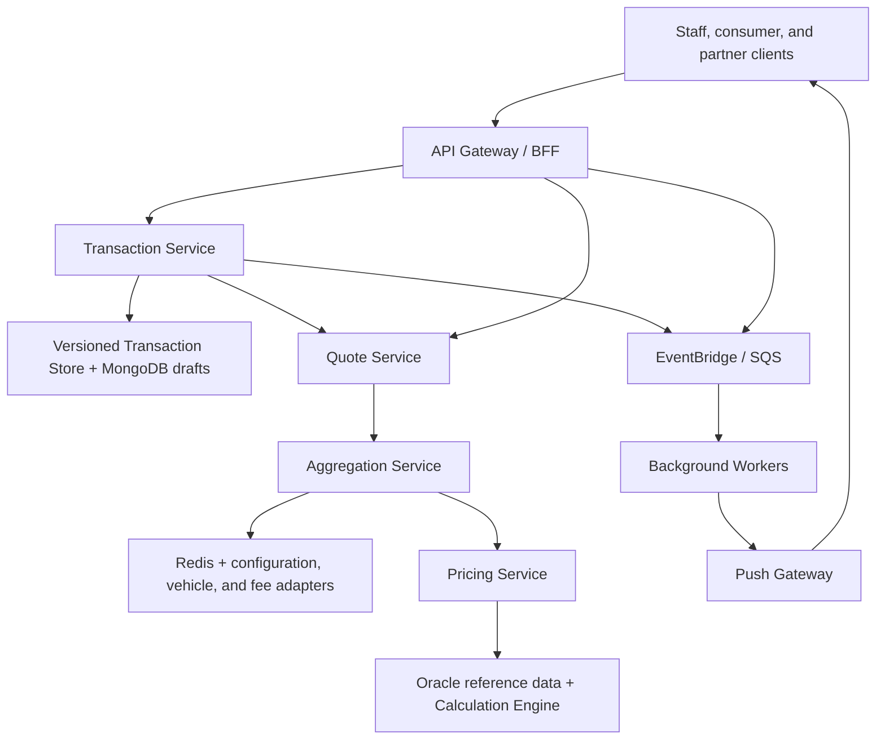

# Vehicle Sales Platform — System Design Anchor

## 1. Standardized System Overview (The Interview Pitch & Story Backdrop)

### Elevator pitch

A vehicle-sales platform helps sales representatives, managers, and finance staff turn online or in-store inquiries into contract-ready transactions. Users manage customers and trade-ins, compare finance/lease/cash options, apply incentives and fees, and prepare proposals and contracts. Shared services keep rules consistent across staff tools, consumer websites, and partner applications. The value is less repeated data entry, clearer pricing, and faster preparation of viable offers.

### Clean component and workflow map

Use these names consistently in lessons. Combine responsibilities in smaller deployments until independent scaling or ownership justifies separation.

| Component | Responsibility and state |
| --- | --- |
| **Web App + API Gateway/BFF** | React workspace; authentication, organization-scoped access, and UI-oriented response composition. |
| **Transaction Service** | Assembles and saves versioned transactions; applies templates. The **Transaction Store** is authoritative; MongoDB holds drafts and temporary sessions. |
| **Quote Service** | Resolves tax jurisdiction, coordinates lender programs and incentives, and offers a labeled standard-rate estimate when appropriate. |
| **Aggregation Service** | Combines organization settings, vehicle data, and fees through provider adapters; caches reusable inputs in Redis. |
| **Pricing Service** | Runs finance/lease calculations through a Calculation Engine; owns Oracle tax, fee, lender, incentive, and partner reference data. |
| **Background Workers + Push Gateway** | Build scenarios, transfer documents, process partner updates, and send authorized WebSocket notifications. S3 stores documents. |

**Core entities:** Organization, User, Customer/Co-buyer, Vehicle/Trade-in, Transaction, Offer, Quote, LenderProgram, Incentive, TaxRule, Fee, Template, Document, IntegrationJob. Transactions carry organization, version, participants, terms, and status. Quotes carry input versions, assumptions, and calculation time; saving an Offer changes business state.

**Primary flows:**

1. **Open/read:** Authorize → load a transaction version → apply organization/template settings → assemble customer, vehicle, and initial quotes. Fetch optional recommendations and scenarios asynchronously.
2. **Recalculate:** Edit price, down payment, term, trade-in, or products → resolve tax location → fetch programs, incentives, and fees with bounded parallelism → compare quotes or solve for target payment/profit. Clarify ambiguity; fallback estimates are not lender approvals.
3. **Save/write:** Store a draft or persist an Offer/Transaction. Check the expected version to prevent lost updates; record audit history. Separately, UI request sequences discard older quote responses.
4. **Complete/integrate:** Verify identity and credit decisions → share proposal → contract and transfer documents/data to business systems. Track durable jobs, deduplicate retries, and publish versioned updates; refresh recovers missed notifications.

Enforce organization membership and action permissions at service boundaries. Optional failures should preserve the workspace; unavailable pricing stays explicit.

## 2. Familiar Tech Stack (The Example Syntax)

| Layer | Familiar tools for examples |
| --- | --- |
| UI and request orchestration | React, Redux, TypeScript, Node.js, AWS Lambda; `zod` validation and `axios` HTTP calls. |
| Shared pricing | Python, FastAPI, Uvicorn, ECS Fargate, SQLAlchemy, Pydantic; SOAP/XML behind the Calculation Engine adapter. |
| Data and caching | MongoDB for drafts/sessions, Oracle for relational reference data, Redis for reusable reads, S3 for documents and static assets. |
| Entry and identity | CloudFront, API Gateway, ALB, WAF, OIDC/JWT; resource authorization and authenticated service calls. |
| Asynchronous work | EventBridge for routed events, SQS with a dead-letter queue for durable work, WebSockets for updates. |
| Delivery and operations | Docker/ECR, CDK or Terraform, CodePipeline/CodeBuild or GitHub Actions; CloudWatch, New Relic, AWS X-Ray; Jest, pytest, Postman, browser E2E. |

Use TypeScript for browser/APIs, Python/SQLAlchemy for pricing/data access, SQL for queries, and JSON for events. Contracts use `transactionId`, validated `organizationId`, `version`, and an idempotency key for retryable writes.

## 3. Realistic Scale & Evolution Scenarios (The Motivation)

### Example design envelope

These are illustrative sizing assumptions over **30 days**, not production measurements or capacity guarantees.

| Scope | Monthly activity | Average / busiest-hour rate |
| --- | --- | --- |
| Staff workspace | 400 organizations, 1,600 users; 80,000 unique transactions opened and 50,000 saved/updated. | Activity counts differ from endpoint calls. |
| BFF | 8.64 million calls. | 200 / 800 per minute. |
| Transaction Service, all channels | 6.48 million calls; 4,000 organizations. | 150 / 450 per minute. |
| Quote Service, all channels | 64.8 million calls. | 1,500 / 4,000 per minute. |
| Aggregation Service and Pricing Service, each | 1.296 billion requests. | 30,000 / 60,000 per minute: about 500 / 1,000 requests/second. |

The busiest-hour rate is that hour's per-minute average. Shared totals include other channels and fan-out; tier counts are not unique user actions. Example server-side p95: **Quote Service 1.5 s; Pricing Service 0.4 s**, excluding browser latency.

### Pressures that motivate universal patterns

| Scenario | Design reasoning to teach |
| --- | --- |
| Morning surge and hot organizations | Rate limits, autoscaling, protected interactive capacity, and cache-stampede control. Cache keys include organization and reference-data version. |
| Repeated program and reference reads | Cache-aside, bounded stale-while-revalidate, batched lookups, and request coalescing. Freshness rules matter for financial inputs. |
| Growing history and reporting queries | Index by organization and query shape, avoid N+1 reads, paginate history, and move large exports to background jobs. |
| Compute scales faster than the database | Budget fleet-wide pools: 12 connections × 4 workers × 60 tasks = **2,880 potential connections**. Bound concurrency and include deployment overlap. |
| Multi-step scenario builds and document transfers | Durable jobs, explicit status, bounded retries, idempotency, DLQs, and replay. Use an outbox when a committed write must reliably publish an event. |
| Concurrent edits and delayed responses | Optimistic concurrency for saved state; request sequences and event versions for UI ordering. Neither mechanism replaces the other. |
| Slow lender, tax, or vehicle provider | End-to-end deadlines, bulkheads, circuit breakers, and explicit partial results. Never disguise an expired estimate as a confirmed price. |
| Regional outage or incompatible release | Health-based routing, warm standby, compatible schema changes, and tested rollback. Define data ownership, replication, and recovery objectives before adding active-active writes. |

Evolve from measured pressure: explain each change's benefit, consistency cost, and failure behavior against latency/availability goals.
