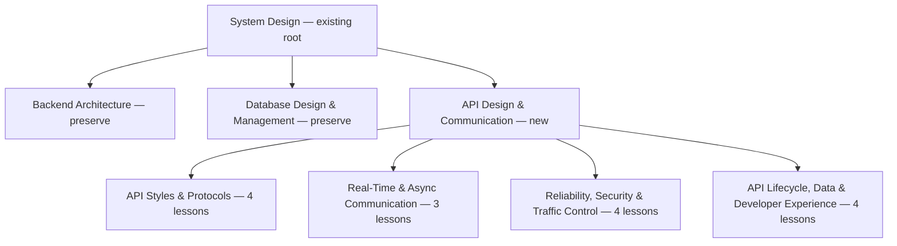

# API Design & Communication

**Stage:** Implementation and validation complete; all 23 tasks and seven acceptance gates passed.\
**Requested:** 2026-11-17. **Profile:** Compact content publishing; constitution v1.3.0.\
**Branch:** `main`. **Git HEAD:** `58d55ff076690804a2f71e5e70b1a4b8f3a68730`.

## Outcome and current taxonomy audit

Learners can choose an API interaction style, reason about real-time delivery, protect
API operations under failure and load, and evolve a documented client-facing contract.
Deliver 15 complete lessons through the four requested learning paths, using the existing
dashboard, recall controls and progress engine.

The current working `manifest.json` has `schemaVersion: 1`, a `roots` array and recursive
`hub`/`topic` nodes with immutable `id`, `title` and kebab-case `slug` fields. Only hubs
have `children`; routes and partial locations derive from ancestry. It contains one root,
30 lessons and 11 hubs: Backend Architecture and Database Design & Management beneath
System Design. No API Design & Communication parent or requested category already exists.

**Working-tree baseline:** The completed database batch remains uncommitted. Its entries,
files and research are part of the current catalog and must be preserved. Git HEAD alone
does not capture this baseline. Current manifest SHA256:
`24988def0327437be7f246adb7c217d5e7db13651c6832f4c729a66b2ec8c72b`.
Snapshot the then-current manifest before implementation; re-audit if it changes.

**Placement justification:** Root: System Design > Parent: API Design & Communication
> one of the four requested categories > Topic. This branch teaches interface contracts
and communication choices alongside the existing architecture and database branches,
without duplicating the System Design domain or confusing API policies with system topology.

Reuse System Design ID `d3825659-12c2-4fc8-b6fe-bdd050762da3`. Preserve both existing
subtrees, their IDs, optional metadata and recall keys. Append the API parent after the
database parent; keep the requested category/topic order. During implementation allocate
20 unique UUIDv4 IDs once: five hubs and 15 distinct lessons. The hierarchy has four levels.



## Lesson inventory and boundaries

Every row is a separate complete lesson authoring item; final results are recorded below. Files below
are relative to `topics/system-design/api-design-and-communication/`. Hash routes use the
same ancestry without `topics/` or `.html`, prefixed with `#/`.

| # | Category | Exact lesson title | Relative lesson file | Distinct learning focus |
| --- | --- | --- | --- | --- |
| 1 | API Styles & Protocols | REST API Design | `api-styles-and-protocols/rest-api-design.html` | Resource contracts, methods, representations, HTTP semantics and evolvable request/response design. |
| 2 | API Styles & Protocols | GraphQL | `api-styles-and-protocols/graphql.html` | Schema/resolver execution, field-level access, query cost, data fetching and contract evolution. |
| 3 | API Styles & Protocols | gRPC | `api-styles-and-protocols/grpc.html` | Typed RPC contracts, generated clients, deadlines, streaming, compatibility and client/transport constraints. |
| 4 | API Styles & Protocols | SOAP | `api-styles-and-protocols/soap.html` | Message envelopes, WSDL contracts, faults, interoperability and the actual scope of selected extensions. |
| 5 | Real-Time & Async Communication | WebSockets | `real-time-and-async-communication/websockets.html` | Bidirectional connection lifecycle, authentication, message contracts, backpressure, reconnect and delivery assumptions. |
| 6 | Real-Time & Async Communication | Server-Sent Events (SSE) | `real-time-and-async-communication/server-sent-events.html` | Server-to-client event streams, reconnect/replay state, proxy behavior and browser/client constraints. |
| 7 | Real-Time & Async Communication | Long Polling | `real-time-and-async-communication/long-polling.html` | Held-request lifecycle, timeouts, cursor continuity, empty responses, retries and server/client resource budgets. |
| 8 | Reliability, Security & Traffic Control | API Gateway | `reliability-security-and-traffic-control/api-gateway.html` | API-level routing, authentication/authorization boundaries, cache policy and payload transformation; link to the existing architectural lesson. |
| 9 | Reliability, Security & Traffic Control | Rate Limiting | `reliability-security-and-traffic-control/rate-limiting.html` | Algorithm choice, identity/quota scope, distributed enforcement, bursts, fairness and caller retry behavior. |
| 10 | Reliability, Security & Traffic Control | Idempotency | `reliability-security-and-traffic-control/idempotency.html` | Request identity, concurrent duplicates, semantic conflicts, stored outcomes, retention and uncertain-result retries. |
| 11 | Reliability, Security & Traffic Control | Request Validation | `reliability-security-and-traffic-control/request-validation.html` | Structural/semantic validation, canonicalization, resource limits, error feedback and the boundary with authorization. |
| 12 | API Lifecycle, Data & Developer Experience | API Versioning | `api-lifecycle-data-and-developer-experience/api-versioning.html` | Compatibility, version negotiation, deprecation, mixed clients and migration/retirement policy. |
| 13 | API Lifecycle, Data & Developer Experience | Pagination Strategies | `api-lifecycle-data-and-developer-experience/pagination-strategies.html` | Offset/cursor/keyset contracts, stable ordering, filter context, mutation/snapshot behavior and bounded traversal. |
| 14 | API Lifecycle, Data & Developer Experience | Error Handling & Status Codes | `api-lifecycle-data-and-developer-experience/error-handling-and-status-codes.html` | Truthful status/error semantics, structured errors, safe diagnostics, retryability and protocol-specific mapping boundaries. |
| 15 | API Lifecycle, Data & Developer Experience | API Documentation (OpenAPI/Swagger) | `api-lifecycle-data-and-developer-experience/api-documentation.html` | A maintained API description, examples, authentication/errors, compatibility checks, interactive tooling and generated-client assumptions. |

Protocol/specification versions and product-specific guarantees must be identified and
checked during research. Preserve the requested titles and acronym capitalization.
Examples must distinguish HTTP-specific contracts from GraphQL, gRPC and SOAP behavior
instead of forcing every protocol into one status/error or tooling model.

## Existing overlap and required cross-links

- **API Gateway:** The existing **API Gateway Pattern** lesson remains unchanged at
  `#/system-design/backend-architecture/communication-and-routing/api-gateway-pattern`,
  ID `a5b7beee-bdbd-4987-9a41-8e16471b0a32`. The new lesson must prominently link there
  and explain the scope difference. Teach API routing rules, trusted identity boundaries,
  cache keys/freshness/isolation and transformation correctness here; keep architectural
  placement, service composition and BFF comparisons with the existing material.
  A reciprocal edit to the existing lesson is not required for this batch.
- **Idempotency:** Link to the database **Transactions** and **ACID Properties** lessons
  where useful, but teach the API request/result contract and duplicate lifecycle rather
  than reproducing transaction mechanics or treating the guarantees as interchangeable.
- **Pagination Strategies:** Link to
  `#/system-design/database-design-management/query-performance-and-indexing/composite-indexes`
  for physical key-order mechanics. This lesson owns client traversal semantics and cursor
  behavior; it must remain self-contained without duplicating the indexing deep dive.
- **Real-time/async:** Compare the three requested delivery choices directly. Link to
  the existing Event-Driven Architecture lesson for backend event/publication ownership;
  do not imply choosing a client transport establishes an end-to-end delivery guarantee.
- **Documentation:** Keep the API description, interactive documentation tooling,
  generated clients and runtime enforcement conceptually distinct. Protocol-specific
  schema/contract formats belong in their corresponding protocol lessons as appropriate.

## Shared integration and delivery scope

Create `_overview.html` at the new API parent and each of its four category directories.
Each needs ELI5 orientation, a meaningful Mermaid roadmap, suggested reading guidance
and ordered links to all immediate children. Update `topics/system-design/_overview.html`
so its prose, roadmap and links introduce all three branches while retaining existing IDs.
Reuse the inspected `.kb-*` partial contract, native disclosures and host-owned controls.

Deliver the 15 full lesson files, five new hubs, updated root hub and matching manifest
change together. Keep one concise reviewed `research/topics/<topic-id>.json` record per
new lesson under the existing publishing format; new IDs use its default research directory.
The delivery bundle includes placement justification, the applied manifest snippet and
links to complete lesson/hub files. Existing lesson files, database work, research records,
historical migration evidence, application shell and persistence schema stay intact.

## Inherited acceptance checklist

These gates govern the delivered bundle; completion reflects the final checks recorded below.

- [X] **Taxonomy and coverage:** All 15 requested lessons appear once under the four
  requested categories in order. Five new hubs and the root update have complete links;
  routes/directories mirror the tree in kebab-case and all existing IDs/metadata survive.
  From this audit the catalog becomes 45 lessons and 16 hubs, 61 nodes total. Recompute
  counts if the starting catalog changes; do not turn them into a permanent fixed baseline.
- [X] **Full teaching:** Every lesson has the six ordered story modules, an ELI5 model
  before jargon, explained valid Mermaid visuals, collapsible mechanics, a decision matrix,
  concrete Symptom → Root Cause → Fix/Prevention stories and real-world takeaways. Keep
  complete explanations; a relevant shared diagram may cover several scenarios without
  generating redundant diagrams for every card.
- [X] **Recall and scenarios:** Each lesson includes the Feynman prompt, 3–5 foundational
  cards and a dedicated **Tricky & Most-Asked Interview Scenarios** subsection inside mastery
  with 5–7 distinct constrained production questions. That is 75–105 interview scenarios
  for the batch. Every independently collapsible scenario contains **The Scenario &
  Constraint**, **The Direct Answer & Architectural Decision**, and **Key Trade-Offs &
  Follow-Up Traps**, with explicit assumptions, a defended action, alternatives and a
  changed-constraint follow-up. Preserve stable question IDs and hidden initial answers.
- [X] **Source/editorial quality:** Search the web for each exact concept before choosing
  its questions when available; verify answers against primary technical sources. Record
  actual queries, source mappings and concise substantive review findings. Distinguish
  reported recurring questions from adapted variants and disclose unverified frequency,
  insufficient evidence or unavailable search. Research/question selection remains pending.
- [X] **Boundaries and links:** The new API Gateway lesson explains its API-policy focus
  and links to the existing pattern route/ID without creating another architecture lesson
  or altering the original. Related database/architecture links resolve, while each lesson
  supplies enough explanation to stand alone. Security, caching, retry and transport claims
  specify their actual scope rather than promising guarantees by product/style name.
- [X] **Dashboard and learning:** Every new lesson/hub loads and reloads through known hash
  routes at both `/` and `/backend-lab/`, with correct breadcrumbs, search results and
  sidebar state. Mastery includes all current lessons; existing progress, review history,
  confidence and unknown backup records survive. Recall disclosure/ratings never imply
  mastery; keyboard controls, independent cards, mobile light/dark layouts and backup
  export/import remain usable through the existing host.
- [X] **Focused verification and print:** Whole-catalog intrinsic and general unit checks
  pass; browser/PDF checks cover all new API partials and affected hubs. From this audit
  that is 21 partials, 63 browser cases and 42 light/dark PDFs, with complete text/diagram
  labels, hidden controls and restored disclosure state. Review new layouts and editorial
  quality separately from structural checks. Because the database batch is uncommitted,
  use the current pre-edit manifest and explicit API/root paths to avoid treating its
  pre-existing files as newly changed API work. Broaden checks for actual shared runtime
  changes only; do not regenerate or require frozen historical migration evidence.

## Specification review and handoff

**Review:** Passed: exact inventory/order, balanced placement, existing-overlap audit,
gateway scope/cross-link, all hub work, full learning/source requirements, preservation of
the working database batch and measurable verification scope are explicit. No unresolved
clarification is required. `.specify/extensions.yml` is absent; no before/after-specify
hooks are configured.

**Specification handoff:** Completed through the compact content profile. The planning
stage below extends this document; the specification stage did not change the manifest,
lessons or application files.

## Implementation plan

**Planned:** 2026-11-17 on `main`, using the working-tree baseline above. This is a
content-only extension of the supported application contract. No application dependency,
renderer, stylesheet, manifest-schema or learning-standard change is planned. No separate
data model, contract, research ledger or historical migration baseline is needed.

### Inspected integration contract

- **Exact catalog shape:** `{"schemaVersion": 1, "roots": [...]}`. Current hubs have
  `id`, `kind: "hub"`, `title`, `slug`, `children`; topics have the same identity fields
  with `kind: "topic"` and no `children`. Do not add route/file fields: the existing
  `index_manifest` derives `/<ancestor-slugs>` and
  `topics/<ancestor-slugs>/_overview.html` for hubs or `.html` for lessons. Preserve any
  existing optional metadata rather than rebuilding the catalog from this field summary.
- **Actual lesson inspected:**
  `topics/system-design/database-design-management/query-performance-and-indexing/composite-indexes.html`.
  It uses one `.kb-topic` article with its manifest UUID, exact-title `h1`, and the six
  direct section keys `hook-eli5`, `big-picture`, `mechanics`, `trade-offs`, `pitfalls`,
  `mastery`; each section ID is `node-<UUID>-<key>`. Its four foundational and six interview
  cards demonstrate the existing supported controls; counts remain constitutionally 3–5
  and 5–7, respectively, rather than a new fixed quota.
- **Reuse its presentation:** `.kb-callout--insight`, `.kb-callout--pitfall`,
  `.kb-callout--impact`, `.kb-diagram` with `pre.mermaid` and explanatory `figcaption`,
  `.kb-table-wrap`, `.kb-question`, `.kb-references`, and `code.language-*` where useful.
  Native mechanics `<details>` and recall `<details>` stay independently closed initially;
  no shared `name`, inline handlers, embedded script/style, document wrapper or duplicate
  host controls. Use diagrams with accessible titles/descriptions and readable labels.
- **Mastery markup:** Keep foundational cards and the Feynman prompt separate from the
  nested `data-interview-scenarios` section. Its heading/ARIA target is
  `node-<UUID>-interview-scenarios`, titled exactly **Tricky & Most-Asked Interview Scenarios**.
  Each scenario has a stable `interview-<kebab-key>` recall ID, accurate
  `data-scenario-basis`, and direct `data-scenario-part="scenario|decision|trade-offs"`
  divisions with the three exact answer labels in the specification. Associate one visible
  `aside[data-interview-research]` outside the closed cards with named HTTPS sources.
- **Actual hub inspected:** `topics/system-design/database-design-management/_overview.html`.
  Reuse `.kb-hub` identity/title, ELI5 orientation, explained Mermaid roadmap, reading guide,
  `[data-child-links]` in immediate-child manifest order and parent hash link. Update the
  System Design root's prose, roadmap and child list together.
- **Host ownership:** Existing hash routing, relative fetching, diagram/highlighter
  post-processing, confidence buttons, mastery, progress storage, theme and print behavior
  supply the integration. New research records use constitution `1.3.0`; the existing
  markup/recall profile remains `constitution-1.2`. Use the default
  `research/topics/<topic-id>.json` lookup without changing the publishing registry.

### Concept-specific research and authoring queue

Each numbered row is one independent, complete lesson authoring item using its exact path
in the inventory. Research and review that lesson's answers before marking the item done;
do not combine several rows into a summary lesson. The concerns below guide research,
not a preselected or verified-frequency interview set.

For every row, search the exact concept name plus production scenario/system-design,
debugging and trade-off interview terms. Batch independent searches; retain useful results
so planning/authoring do not repeat them. Inspect interview evidence for the precise claim
it supports, then verify decisions with the primary source families listed below. Record
actual queries/dates/results, checked source URLs, protocol/product versions, assumptions
and limitations in that lesson's single research JSON. Search/selection and technical
verification are **pending authoring work**, not completed research claimed by this plan.

| Item | Complete lesson | Distinct production concerns to research | Primary verification targets |
| --- | --- | --- | --- |
| L01 | REST API Design | Resource/action boundaries; retries after lost mutation responses; conditional updates and cache freshness; safe contract evolution. | HTTP Semantics and HTTP Caching RFCs; original REST architectural constraints; selected implementation documentation only for scoped examples. |
| L02 | GraphQL | Resolver N+1 access; query cost/depth and resource budgets; field/object authorization; partial failures; schema evolution. | GraphQL specification, GraphQL-over-HTTP documentation and the explicitly selected resolver/server implementation. |
| L03 | gRPC | End-to-end deadlines; retry/duplicate effects; slow streaming consumers; protobuf compatibility; client/browser transport constraints. | Official gRPC concepts, deadlines, retry and flow-control documentation; Protocol Buffers compatibility documentation. |
| L04 | SOAP | WSDL-driven integration drift; envelope/fault handling; interoperability; security requirements and the actual selected WS-* extensions. | W3C SOAP/WSDL specifications and the relevant OASIS extension specifications; chosen stack documentation where behavior is implementation-specific. |
| L05 | WebSockets | Reconnect gaps/duplicates; connection authentication and renewal; slow consumers; fan-out ownership; proxy/connection resource limits. | WebSocket protocol specification, browser WebSocket documentation and the selected server/proxy documentation. |
| L06 | Server-Sent Events (SSE) | Event IDs and replay windows; reconnect cursors; expired authentication; buffering/timeouts; browser and server connection constraints. | WHATWG HTML EventSource specification, browser documentation and explicitly selected proxy/server behavior. |
| L07 | Long Polling | Timeout/retry coordination; cursor continuity and overlapping polls; connection budgets; cancellation; duplicate or empty responses. | HTTP semantics and the IETF long-polling guidance; chosen browser/server/proxy timeout behavior. |
| L08 | API Gateway | Route precedence; untrusted forwarded identity; auth/authorization boundaries; cache-key tenant isolation; transformation meaning and failure behavior. | HTTP caching/semantics and official documentation for one explicitly named gateway; existing API Gateway Pattern lesson for architectural scope. |
| L09 | Rate Limiting | Burst versus sustained limits; identity/quota dimensions; distributed counters; dependency failure policy; fairness and retry budgets. | HTTP 429 semantics and current standards status for any rate-limit fields used; original algorithm or official enforcement/storage documentation. |
| L10 | Idempotency | Concurrent duplicate requests; same key/different intent; uncertain outcomes; retention expiry; external side effects and recovery. | HTTP method semantics and primary idempotent-API design guidance; chosen provider's key/retention contract where used. |
| L11 | Request Validation | Malformed versus unauthorized input; unknown fields/coercion; structural versus domain invariants; large/nested payload budgets; safe feedback. | OWASP input-validation guidance, the selected schema specification and chosen validator's actual behavior. |
| L12 | API Versioning | Wire-compatible but behavior-breaking changes; version negotiation; mixed clients; deprecation/retirement; measured migration. | Primary API compatibility guidelines, relevant HTTP negotiation semantics and explicitly identified provider/version policy examples. |
| L13 | Pagination Strategies | Tied sort values; inserts/deletes between pages; filter-bound opaque cursors; random access versus seek; consistent exports versus live feeds. | Primary API pagination guidance, chosen database ordering/snapshot documentation and existing Composite Indexes lesson. |
| L14 | Error Handling & Status Codes | Client mistakes versus server faults; retryable/uncertain outcomes; partial failures; safe diagnostics and correlation; protocol-specific error models. | HTTP Semantics, Problem Details specification and official GraphQL/gRPC/SOAP error contracts for comparisons. |
| L15 | API Documentation (OpenAPI/Swagger) | Specification/runtime drift; executable examples; auth descriptions; generated-client compatibility; OpenAPI versus Swagger tooling and schema versions. | Official OpenAPI specification at an explicit version and official Swagger tooling/code-generation documentation. |

Author each lesson as a cohesive ELI5-first story with a worked production example, complete
mechanics, a decision matrix, explained failure stories and useful takeaways. Select 5–7
materially distinct scenarios only after its search, including debugging and changing
constraints; give each a direct decision, implementation/recovery reasoning, costs, a viable
alternative and a follow-up trap. Add 3–5 foundational cards and the Feynman prompt as well.
Use purposeful Mermaid diagrams for processes/relationships without a per-card quota.
Cross-link the scope boundaries already specified, especially the two distinct gateway
lessons, database transaction guarantees, composite indexing and backend event ownership.

Technical specifications establish behavior, not interview frequency. Use
`adapted-production` with an honest public disclosure where adaptations are supported but
frequency is unverified; reserve `reported-recurring` for the exact evidenced claim.
Record search failure/insufficient evidence without inventing sources or dropping scenarios.
Review the eight supported editorial criteria per scenario with concise concrete findings;
do not copy complete answers into evidence. Source-note text/URLs and ordered scenario keys
must agree with the reviewed research record.

### Dependency order and shared integration

1. **Freeze the current working baseline:** Re-audit the catalog, preserve a pre-edit
   manifest in `.cache/topic-checks/api-design-communication-manifest-before.json`, and
   hash existing lesson/research/runtime files plus the database request document. Capture
   the root hub separately because its edit is intentional. Preserve both existing child
   subtrees byte-equivalently as JSON values and all existing IDs/recall keys. If the starting
   catalog changed, update the derived counts/scope before implementation.
2. **Allocate and integrate once:** Allocate 20 new UUIDv4 IDs; append the requested parent,
   four categories and 15 lessons in order. Create the five matching hubs and update the
   existing root hub. Keep routes/files derived from the exact inventory; no provisional
   empty lesson pages or placeholder explanations count as deliverables.
3. **Complete L01–L15 separately:** Research, author, technically/editorially review and
   write the corresponding stable-ID research record for each lesson. The final task
   breakdown must retain all 15 separate HTML authoring tasks; shared setup and acceptance
   work can be grouped. Complete all lesson files before catalog-wide acceptance.
4. **Verify the complete bundle:** Run the checks below, fix failures, then rerun only
   affected expensive checks using the supported cache. Verify every final input fingerprint
   and PDF hash through the runner; an interrupted, failed or pending result is incomplete.
5. **Deliver:** Record concise per-lesson results and limitations in this request document,
   mark acceptance only with evidence, and provide the placement line, applied manifest
   snippet, all complete partial links and verification results. Commit/push only if requested.

### Focused verification plan

The pre-edit snapshot must represent the working catalog containing the database batch,
not Git HEAD or the earlier database snapshot. Use explicit API/root paths rather than
unfiltered `--changed`; that would also select unrelated uncommitted database work. Give
API acceptance its own report/PDF paths to preserve the database batch's existing report.

At implementation start, before any catalog edit:

```sh
mkdir -p .cache/topic-checks
cp manifest.json .cache/topic-checks/api-design-communication-manifest-before.json
```

After full authoring, run whole-catalog intrinsic validation and the existing general tests:

```sh
python3 tools/validate_content.py --report .cache/topic-checks/api-design-communication-static.json
python3 -m unittest discover -s tests/content -q
node --experimental-default-type=module tests/dashboard/test_catalog.mjs
node --experimental-default-type=module tests/dashboard/test_learning_state.mjs
```

Then use the pinned Playwright development environment described in
`docs/topic-publishing.md` for the supported scoped runner:

```sh
python3 tools/check_topics.py \
  --baseline .cache/topic-checks/api-design-communication-manifest-before.json \
  --paths manifest.json topics/system-design/_overview.html topics/system-design/api-design-and-communication/_overview.html \
  --report .cache/topic-checks/api-design-communication-report.json \
  --pdf-dir .cache/topic-checks/api-design-communication-pdfs
```

The manifest delta selects every new lesson/hub even though only the new parent path is
named explicitly. From the inspected baseline it selects 20 new nodes plus the existing
root: **21 partials, 63 layout/theme browser cases and 42 actual PDFs**. Cheap static checks
still inspect the entire 61-node catalog. The runner owns its local server and checks hash
route loading/reloads at `/` and `/backend-lab/`, identity, all diagrams, independent keyboard
disclosures, every confidence card's persistence, explicit mastery, mobile light/dark
layouts, hub child links and both-theme print completeness/restored disclosure state.

Add one focused integration pass for all 15 exact-title searches (including distinguishing
API Gateway from API Gateway Pattern), three home branch cards and the current mastery
denominator derived from the manifest. In isolated browser state, carry an existing known
topic's status/review/confidence plus an unknown backup record through export/import; add a
new topic's confidence/mastery and verify both generations survive reload. Confirm opening
or rating cards does not itself mark mastery, and verify drawer/breadcrumb/active sidebar
behavior on the new branch. Keep temporary browser fixtures outside the publication tree.

Review representative light/dark/mobile layouts and actual PDF pages for every new visual
pattern, especially long protocol comparisons, dense diagrams and scenario answers. Review
all 15 lessons for correctness, ELI5 continuity, distinct decisions and complete prose;
structural/text extraction checks alone do not establish those qualities. Compare protected
file hashes and old subtree values to the pre-edit baseline. Use the generic publishing
profile; do not alter or require the frozen backend migration expectations. Shared runtime
changes, if unexpectedly necessary, require broader checks before acceptance.

### Plan review and handoff

Constitution gates pass at design level: all six modules, distinct foundational/interview
practice, exact-concept web research, primary verification, three-part scenario answers,
stable identities, native accessibility, complete print output and honest source limitations
are explicitly planned. Existing validators/controls support these requirements without a
schema or styling change. No unresolved design clarification blocks the task breakdown.

Planning inspected the actual manifest, representative lesson/hub and runner selection
contract. It does not claim that topic research, authoring or publication acceptance ran.
An in-memory dry run through the existing manifest indexer and runner selector confirmed
all 15 inventory paths, the 4/3/4/4 distribution, 61 prospective nodes and exactly 21
selected partials; the System Design root was the only existing selected node. Temporary
UUIDs were not persisted. All 61 protected working-tree files matched their pre-plan hashes,
including the manifest, existing partials/research, database request and application shell.
`.specify/extensions.yml` is absent; no before/after-plan hooks are configured.
**Plan handoff:** The compact task breakdown below retains one separate complete HTML
authoring task for each of L01–L15. Planning made no manifest, lesson or runtime changes.

## Implementation tasks

**Generated and completed:** 2026-11-17. All 23 tasks are complete. This checklist is the
compact content profile's task artifact; continue here rather than creating a separate
`specs/` feature or resuming a historical feature's `tasks.md`. Paths below are relative
to the repository root. The inventory and research matrix above define the exact titles,
ordering and concept-specific boundaries for every lesson task.

### Complete-lesson definition for T004–T018

Each lesson task includes **research → full HTML authoring → its research JSON → substantive
review**, using its corresponding L01–L15 research row. Before choosing scenarios, search
the exact concept's production/debugging/trade-off interview situations when available;
verify answers against primary sources with explicit protocol/product assumptions. Retain
actual queries/results and checked source links in
`research/topics/<that-lesson-manifest-id>.json`. Use the UUID allocated by T002, not a new
ID per attempt. Disclose search/evidence limitations and unverified frequency honestly;
technical documentation does not prove a question is frequently asked.

Deliver a self-contained, ELI5-first six-module story, meaningful explained Mermaid
visuals, complete collapsible mechanics, a trade-off matrix, concrete Symptom → Root Cause
→ Fix/Prevention stories and real-world takeaways. Include **“Summarize this in your own
words”**, **3–5 foundational cards** and **5–7 distinct production interview scenarios** in
the dedicated mastery subsection. Every scenario must contain the exact three labeled
parts **The Scenario & Constraint**, **The Direct Answer & Architectural Decision** and
**Key Trade-Offs & Follow-Up Traps**, with an explicit decision, reasoning, costs, alternative
and changed-constraint follow-up. Keep native independently closed cards, stable recall
keys, accurate basis labels and supported `.kb-*` markup; reuse the inspected host controls.

Each matching research record must follow `docs/topic-publishing.md` and
`tools/validate_content.py`: constitution `1.3.0`, ordered scenario mappings, honest claims,
the eight concrete editorial findings per scenario, exact public disclosure/source-note
agreement and `state: "reviewed"` only after substantive review. Review complete answers,
concept boundaries and sources before checking off that lesson task. No shortened lesson,
placeholder, repeated generic scenario set or copied answer ledger satisfies it. Browser
and PDF acceptance remain shared gates after authoring, not implied by a completed draft.

### Shared baseline and taxonomy

- [X] T001 Re-audit `manifest.json` against this request and inspect the current sample lesson/hub from the plan; before editing, save the working manifest to `.cache/topic-checks/api-design-communication-manifest-before.json` and protected lesson/research/runtime/database-document hashes to `.cache/topic-checks/api-design-communication-protected.json`. Include the existing root hub's original hash separately as an intentional-change reference. Preserve the completed uncommitted database batch; update derived counts if the catalog changed. Reuse this snapshot on resumed runs instead of overwriting it after edits.
- [X] T002 Append the API parent, four requested categories and 15 exact-title topics to `manifest.json` in inventory order, allocating exactly 20 new canonical UUIDv4 IDs once. Preserve existing root identity, both existing subtrees, metadata and IDs; derive kebab-case routes/files using the existing schema and record no replacement schema or historical baseline.
- [X] T003 Create `topics/system-design/api-design-and-communication/_overview.html` and its `api-styles-and-protocols/_overview.html`, `real-time-and-async-communication/_overview.html`, `reliability-security-and-traffic-control/_overview.html`, and `api-lifecycle-data-and-developer-experience/_overview.html`; update `topics/system-design/_overview.html`. Match each manifest ID/title, add ELI5 orientation, explained Mermaid roadmap, reading guidance and every immediate-child hash link in order; introduce all three branches at the existing root.

### API Styles & Protocols — four complete lessons

Independent acceptance for this path: four complete six-module lessons and reviewed research
records; correct category links; valid diagrams; full recall/scenario content and passing
scoped render/print checks for its lessons and affected hubs.

- [X] T004 [P] Research, author and review **REST API Design** in `topics/system-design/api-design-and-communication/api-styles-and-protocols/rest-api-design.html` and its stable-ID research JSON under `research/topics/`, meeting the complete-lesson definition and L01. Cover resource/method contracts, uncertain mutation retries, conditional updates and caching under stated HTTP semantics.
- [X] T005 [P] Research, author and review **GraphQL** in `topics/system-design/api-design-and-communication/api-styles-and-protocols/graphql.html` and its stable-ID research JSON under `research/topics/`, meeting the complete-lesson definition and L02. Address resolver N+1 behavior, field/object authorization, query resource budgets, partial failure and schema compatibility.
- [X] T006 [P] Research, author and review **gRPC** in `topics/system-design/api-design-and-communication/api-styles-and-protocols/grpc.html` and its stable-ID research JSON under `research/topics/`, meeting the complete-lesson definition and L03. Explain deadlines, retry effects, streaming backpressure, protobuf evolution and explicitly scoped client/browser constraints.
- [X] T007 [P] Research, author and review **SOAP** in `topics/system-design/api-design-and-communication/api-styles-and-protocols/soap.html` and its stable-ID research JSON under `research/topics/`, meeting the complete-lesson definition and L04. Distinguish envelopes, WSDL contracts, faults and selected WS-* extensions; state actual version/interoperability and security assumptions.

### Real-Time & Async Communication — three complete lessons

Independent acceptance for this path: three self-contained lessons and reviewed research
records comparing client delivery choices, without attributing end-to-end delivery promises
to a transport alone; correct roadmap/links and passing affected render/print checks.

- [X] T008 [P] Research, author and review **WebSockets** in `topics/system-design/api-design-and-communication/real-time-and-async-communication/websockets.html` and its stable-ID research JSON under `research/topics/`, meeting the complete-lesson definition and L05. Cover connection authentication/renewal, reconnect gaps, slow consumers, fan-out and resource budgets; link related transport lessons and existing Event-Driven Architecture.
- [X] T009 [P] Research, author and review **Server-Sent Events (SSE)** in `topics/system-design/api-design-and-communication/real-time-and-async-communication/server-sent-events.html` and its stable-ID research JSON under `research/topics/`, meeting the complete-lesson definition and L06. Cover IDs/replay windows, reconnection, authentication, intermediary buffering and client constraints; explain comparisons and event-ownership boundaries.
- [X] T010 [P] Research, author and review **Long Polling** in `topics/system-design/api-design-and-communication/real-time-and-async-communication/long-polling.html` and its stable-ID research JSON under `research/topics/`, meeting the complete-lesson definition and L07. Explain held requests, timeout/retry coordination, cursor continuity, overlapping polls, cancellation and connection budgets; compare the other two delivery choices and cross-link event ownership.

### Reliability, Security & Traffic Control — four complete lessons

Independent acceptance for this path: four lessons and reviewed research records with
defended production decisions, valid API-policy boundaries and the mandatory existing
gateway-pattern cross-link; passing affected render/print checks and correct hub links.

- [X] T011 [P] Research, author and review **API Gateway** in `topics/system-design/api-design-and-communication/reliability-security-and-traffic-control/api-gateway.html` and its stable-ID research JSON under `research/topics/`, meeting the complete-lesson definition and L08. Focus on API routing, auth boundaries, isolated cache keys/freshness and payload transformation. Prominently link `#/system-design/backend-architecture/communication-and-routing/api-gateway-pattern` and preserve that existing architectural lesson unchanged.
- [X] T012 [P] Research, author and review **Rate Limiting** in `topics/system-design/api-design-and-communication/reliability-security-and-traffic-control/rate-limiting.html` and its stable-ID research JSON under `research/topics/`, meeting the complete-lesson definition and L09. Compare algorithms, scoped identities/quotas, burst/fairness choices, distributed failure behavior and caller retry budgets; verify the standards status of any response fields used.
- [X] T013 [P] Research, author and review **Idempotency** in `topics/system-design/api-design-and-communication/reliability-security-and-traffic-control/idempotency.html` and its stable-ID research JSON under `research/topics/`, meeting the complete-lesson definition and L10. Explain concurrent duplicates, key/intent conflicts, retention, uncertain outcomes and external effects; cross-link existing Database Transactions and ACID Properties without equating their guarantees with API request identity.
- [X] T014 [P] Research, author and review **Request Validation** in `topics/system-design/api-design-and-communication/reliability-security-and-traffic-control/request-validation.html` and its stable-ID research JSON under `research/topics/`, meeting the complete-lesson definition and L11. Separate structural/domain validation and authorization, addressing coercion, unknown fields, canonicalization, payload budgets and safe actionable errors.

### API Lifecycle, Data & Developer Experience — four complete lessons

Independent acceptance for this path: four complete lessons and reviewed research records
with explicit compatibility/traversal/error/documentation contracts, resolving database and
protocol cross-links, complete hub links and passing affected render/print checks.

- [X] T015 [P] Research, author and review **API Versioning** in `topics/system-design/api-design-and-communication/api-lifecycle-data-and-developer-experience/api-versioning.html` and its stable-ID research JSON under `research/topics/`, meeting the complete-lesson definition and L12. Cover behavioral compatibility, negotiation, mixed clients, deprecation and measured retirement rather than treating a version label as a compatibility guarantee.
- [X] T016 [P] Research, author and review **Pagination Strategies** in `topics/system-design/api-design-and-communication/api-lifecycle-data-and-developer-experience/pagination-strategies.html` and its stable-ID research JSON under `research/topics/`, meeting the complete-lesson definition and L13. Compare offset/cursor/keyset contracts, tie-breakers, filter-bound cursors, concurrent mutation and consistent exports; link the existing Composite Indexes route while keeping physical indexing mechanics there.
- [X] T017 [P] Research, author and review **Error Handling & Status Codes** in `topics/system-design/api-design-and-communication/api-lifecycle-data-and-developer-experience/error-handling-and-status-codes.html` and its stable-ID research JSON under `research/topics/`, meeting the complete-lesson definition and L14. Explain truthful status/problem responses, retry uncertainty, partial failures and safe correlation/diagnostics; distinguish GraphQL, gRPC and SOAP error contracts instead of treating every protocol as HTTP status mappings.
- [X] T018 [P] Research, author and review **API Documentation (OpenAPI/Swagger)** in `topics/system-design/api-design-and-communication/api-lifecycle-data-and-developer-experience/api-documentation.html` and its stable-ID research JSON under `research/topics/`, meeting the complete-lesson definition and L15. Distinguish OpenAPI description, Swagger tooling, generated clients and runtime enforcement; verify explicit versions and cover specification drift, auth declarations and executable examples.

### Shared verification and delivery

- [X] T019 Run whole-catalog intrinsic validation through `tools/validate_content.py`, writing `.cache/topic-checks/api-design-communication-static.json`; run the existing general `tests/content/` unit suite and `tests/dashboard/test_catalog.mjs` plus `tests/dashboard/test_learning_state.mjs` using the plan's commands. Fix content/research/link failures; derive all inventory expectations from `manifest.json`, retain the generic publishing profile and leave frozen migration fixtures untouched.
- [X] T020 Run `tools/check_topics.py` with T001's pre-edit snapshot, the explicit API/root paths and API-specific report/PDF directories from the plan. Require complete passing results for all 21 affected partials, 63 browser cases and 42 actual PDFs from the audited baseline, recomputing scope if needed. Verify root/subdirectory hash reloads, identities, Mermaid, keyboard/independent cards, every confidence key, explicit mastery, mobile themes, hub links, full print answers/diagram labels, hidden controls and restored disclosure states. Resolve errors and rerun affected inputs; keep pending gates pending and broaden only for actual shared runtime changes.
- [X] T021 Perform the focused dashboard integration pass from the plan against the real app at `/` and `/backend-lab/`; save its concise result to `.cache/topic-checks/api-design-communication-integration.json`. Check all 15 exact-title searches and gateway-title disambiguation, three home branch cards, manifest-derived mastery, new sidebar/breadcrumb/mobile drawer behavior, and old/new status/review/confidence plus unknown-record preservation through reload and JSON export/import. Use isolated browser storage and temporary fixtures outside the published tree; opening or rating recall cards must not imply mastery.
- [X] T022 Review final lesson/source quality and representative actual PDFs/layouts in `.cache/topic-checks/api-design-communication-pdfs/` for every new visual pattern, both themes and mobile presentation. Compare all protected hashes and original existing subtree values with T001's baseline, permitting only the planned existing root-hub change; verify its preserved identity and three-branch links. Fix substantive, clipping or completeness defects and repeat affected T019–T021 checks so the final runner report matches final inputs/artifacts.
- [X] T023 Complete `docs/topic-requests/api-design-communication.md` with concise per-lesson outcomes, honest source/example-execution limitations, final acceptance results, placement justification, the applied API-parent `manifest.json` snippet and links to all 15 full lessons plus five new hubs and the updated root. Check off only completed tasks/gates with current evidence, preserve the database request and report, and report delivery without committing or pushing unless requested.

### Dependencies and execution guidance

Run T001 → T002 → T003 before lesson authoring. T004–T018 are independent once their IDs
and shared taxonomy/hubs are fixed: each writes a different HTML file and a different
stable-ID research JSON. `[P]` marks that file independence, not permission to skip shared
prerequisites or a requirement to run extra agents. For example, T004–T007 can proceed
independently within API Styles & Protocols, as can T008–T010 within Real-Time,
T011–T014 within Reliability and T015–T018 within Lifecycle. Keep shared manifest/root
edits in T002–T003 and consolidate request-document results in T023 to avoid edit conflicts.

All lesson tasks must complete before T019 → T020 → T021 → T022 → T023. Review fixes loop
back through the affected checks. A useful first complete authoring slice is T004 (REST)
after T001–T003, applying its full research and story requirements before repeating the
pattern; it is not an accepted partial batch. Publication acceptance requires all four
paths and all shared gates. Use cached browser/PDF results only under the runner's existing
input/artifact checks; do not add shell infrastructure, duplicate test frameworks or
historical evidence work for this unchanged application.

### Task-stage review and handoff

Task allocation: three shared baseline/catalog/hub tasks, 15 separate complete lesson tasks
(4 + 3 + 4 + 4 by learning path), and five shared verification/delivery tasks: **23 total**.
Every task has an unchecked checkbox, unique sequential ID and repository-relative target
path. All 15 lesson tasks are independently authorable after shared prerequisites. Task generation itself did not implement lessons or establish acceptance; the final delivery below records completed research, authoring and verification.

`.specify/extensions.yml` is absent; no before/after-tasks hooks are configured.
**Implementation handoff:** T001–T023 were executed through the compact content profile; see final delivery below. Task generation itself changed only this request document.


## Final delivery — 2026-11-17

**Placement:** Root: System Design > Parent: API Design & Communication > the four requested
categories > 15 complete lessons. The branch owns client-facing contracts and delivery
choices alongside backend responsibility boundaries and database correctness.

All 15 lessons have the complete six-module ELI5-first story, explained Mermaid diagram,
collapsible mechanics, decision matrix, concrete failure stories, Feynman prompt, four
foundational cards and six independently collapsible three-part production scenarios:
**60 new foundational cards and 90 new scenarios**. Each lesson has a reviewed stable-ID
research record with actual concept-specific searches, checked primary sources, scenario
mappings and concise editorial findings. The catalog now contains **45 lessons and 16 hubs**.

### Complete lesson partials and research

Each row passed content/source/editorial review and affected browser/print acceptance.
The linked files contain full lesson HTML and the corresponding reviewed research mapping.

| Complete lesson | HTML partial | Research record | Recall / scenarios |
| --- | --- | --- | --- |
| REST API Design | [Complete HTML](../../topics/system-design/api-design-and-communication/api-styles-and-protocols/rest-api-design.html) | [Reviewed sources](../../research/topics/227c2d53-79a4-4aad-be44-3f66ff8f4a51.json) | 4 / 6 |
| GraphQL | [Complete HTML](../../topics/system-design/api-design-and-communication/api-styles-and-protocols/graphql.html) | [Reviewed sources](../../research/topics/8000d56f-7190-4efa-a69d-8a20d46f458f.json) | 4 / 6 |
| gRPC | [Complete HTML](../../topics/system-design/api-design-and-communication/api-styles-and-protocols/grpc.html) | [Reviewed sources](../../research/topics/d4401a5f-8f6f-4734-8476-396856cfd4c7.json) | 4 / 6 |
| SOAP | [Complete HTML](../../topics/system-design/api-design-and-communication/api-styles-and-protocols/soap.html) | [Reviewed sources](../../research/topics/c4fb1005-27de-420c-a24f-cf090223fe1d.json) | 4 / 6 |
| WebSockets | [Complete HTML](../../topics/system-design/api-design-and-communication/real-time-and-async-communication/websockets.html) | [Reviewed sources](../../research/topics/5065665a-6e3d-4fdd-a1ab-16c4b410685c.json) | 4 / 6 |
| Server-Sent Events (SSE) | [Complete HTML](../../topics/system-design/api-design-and-communication/real-time-and-async-communication/server-sent-events.html) | [Reviewed sources](../../research/topics/a7cb0502-f4f4-4afd-9f24-369bcea1f618.json) | 4 / 6 |
| Long Polling | [Complete HTML](../../topics/system-design/api-design-and-communication/real-time-and-async-communication/long-polling.html) | [Reviewed sources](../../research/topics/5641f7bf-1b25-428e-a426-2589a624d0d9.json) | 4 / 6 |
| API Gateway | [Complete HTML](../../topics/system-design/api-design-and-communication/reliability-security-and-traffic-control/api-gateway.html) | [Reviewed sources](../../research/topics/87a2e67c-dc5f-4a8e-944f-9bad681f9699.json) | 4 / 6 |
| Rate Limiting | [Complete HTML](../../topics/system-design/api-design-and-communication/reliability-security-and-traffic-control/rate-limiting.html) | [Reviewed sources](../../research/topics/374a5a99-6e3b-4f03-97ec-3f6853d5c14b.json) | 4 / 6 |
| Idempotency | [Complete HTML](../../topics/system-design/api-design-and-communication/reliability-security-and-traffic-control/idempotency.html) | [Reviewed sources](../../research/topics/1c67ad11-919b-4fe7-980b-b82699e7b549.json) | 4 / 6 |
| Request Validation | [Complete HTML](../../topics/system-design/api-design-and-communication/reliability-security-and-traffic-control/request-validation.html) | [Reviewed sources](../../research/topics/e0906628-551b-45db-8816-a6575c1604e9.json) | 4 / 6 |
| API Versioning | [Complete HTML](../../topics/system-design/api-design-and-communication/api-lifecycle-data-and-developer-experience/api-versioning.html) | [Reviewed sources](../../research/topics/0352ff64-d857-454c-9bbe-55c27a9dab92.json) | 4 / 6 |
| Pagination Strategies | [Complete HTML](../../topics/system-design/api-design-and-communication/api-lifecycle-data-and-developer-experience/pagination-strategies.html) | [Reviewed sources](../../research/topics/149f04a9-cdda-494f-851c-e267fc118f03.json) | 4 / 6 |
| Error Handling & Status Codes | [Complete HTML](../../topics/system-design/api-design-and-communication/api-lifecycle-data-and-developer-experience/error-handling-and-status-codes.html) | [Reviewed sources](../../research/topics/b1e035b0-a98f-4b6f-b5e3-052286dded23.json) | 4 / 6 |
| API Documentation (OpenAPI/Swagger) | [Complete HTML](../../topics/system-design/api-design-and-communication/api-lifecycle-data-and-developer-experience/api-documentation.html) | [Reviewed sources](../../research/topics/ca2f9d41-dd62-4b59-89b2-bb8f946fb697.json) | 4 / 6 |

### Complete hubs

- [System Design](../../topics/system-design/_overview.html) — existing root updated; identity preserved.
- [API Design & Communication](../../topics/system-design/api-design-and-communication/_overview.html) — new overview and roadmap.
- [API Styles & Protocols](../../topics/system-design/api-design-and-communication/api-styles-and-protocols/_overview.html) — new overview and roadmap.
- [Real-Time & Async Communication](../../topics/system-design/api-design-and-communication/real-time-and-async-communication/_overview.html) — new overview and roadmap.
- [Reliability, Security & Traffic Control](../../topics/system-design/api-design-and-communication/reliability-security-and-traffic-control/_overview.html) — new overview and roadmap.
- [API Lifecycle, Data & Developer Experience](../../topics/system-design/api-design-and-communication/api-lifecycle-data-and-developer-experience/_overview.html) — new overview and roadmap.

### Verification and preservation

- Whole-catalog intrinsic validation: **pass**, 61 nodes, 152 diagrams and 451 recall cards.
  Report: `.cache/topic-checks/api-design-communication-static.json`.
- Existing general tests: **72 Python + 14 Node tests passed**. The Python server lifecycle
  test ran with localhost socket access; its initial restricted-sandbox socket error was
  resolved without changing the test or application.
- Scoped Chromium acceptance: **21 partials, 63 browser cases and 42 actual light/dark PDFs
  passed**, including site-root and `/backend-lab/` hash reloads, all diagrams, independent
  keyboard cards, every confidence key, explicit mastery, mobile/themes, complete printed
  text/diagram labels, hidden controls and restored disclosure state. Final input fingerprints
  and all PDF hashes were rechecked; unchanged successful nodes used the supported cache.
  Report: `.cache/topic-checks/api-design-communication-report.json`; PDFs:
  `.cache/topic-checks/api-design-communication-pdfs/`.
- Focused integration: **30 exact-title searches across both deployment bases passed**,
  including API Gateway versus API Gateway Pattern; three category cards; manifest-derived
  mastery before/after a new completion; old/new confidence and review state plus unknown
  archived records survived reload and JSON export/import. Opening/rating cards did not
  imply mastery. Drawer, breadcrumbs and active sidebar passed. No console/page errors.
  Report: `.cache/topic-checks/api-design-communication-integration.json`.
- Visual review: inspected first/second printed pages across all affected partials and
  representative scenario, comparison and code pages in both themes, plus actual mobile
  presentation and diagram captures. Shortened labels in five diagrams to remove awkward word
  fragments; clarified REST constraints/hypermedia against the original reference. Affected
  render/print checks were rerun after review fixes. Captures:
  `.cache/topic-checks/api-design-communication-visual/`.
- Example checks: parsed four JSON values and the SOAP XML envelope; exercised the
  JSON Schema 2020-12 example's valid boundaries, invalid range/type and unknown-field
  cases; validated the OpenAPI response example against its declared schema. General
  protocol exchanges, protobuf and service workflows are illustrative; no external backend,
  payment provider, gateway deployment or generated-client build was executed. These checks
  do not claim full external-service interoperability or complete OpenAPI metamodel validation.
- Preservation: both original manifest subtrees remain equal to the pre-edit snapshot;
  all existing IDs/metadata/recall keys survive. All 63 protected existing files other than
  the intentionally edited root hub are byte-identical. Root identity is preserved. The
  original gateway pattern, completed database files/research/request and prior database
  acceptance report remain intact; API evidence uses separate filenames. Shared shell,
  styles, storage, dependencies, validator profiles and frozen migration evidence are unchanged.

**Research limits:** All 90 new prompts are original `adapted-production` scenarios.
Search results did not independently establish exact interview frequency, rankings or
company attribution; each public source note discloses this. Primary references support
technical decisions, not interview-popularity claims. Protocol/product assumptions are
explicit, including SOAP/WSDL versions, managed REST API feature scope, PostgreSQL 18
pagination references and OpenAPI 3.1.1 as an example version rather than a latest-version
claim. The original REST chapter's direct fetch timed out; the subsequent university-domain
search supplied its primary text, and the record preserves that narrower retrieval history.

### Applied manifest snippet

The following object is already appended after Database Design & Management in the
`children` of System Design (`d3825659-12c2-4fc8-b6fe-bdd050762da3`). It includes all five
new hubs and 15 lessons with their allocated immutable IDs; do not allocate replacements
when reusing it. Existing siblings are preserved rather than repeated here.

```json
{
  "id": "4cc92180-39d9-4181-8d8e-942be0958557",
  "kind": "hub",
  "title": "API Design & Communication",
  "slug": "api-design-and-communication",
  "children": [
    {
      "id": "2865f08f-8e33-480e-bcba-3a4a7a1b21f6",
      "kind": "hub",
      "title": "API Styles & Protocols",
      "slug": "api-styles-and-protocols",
      "children": [
        {
          "id": "227c2d53-79a4-4aad-be44-3f66ff8f4a51",
          "kind": "topic",
          "title": "REST API Design",
          "slug": "rest-api-design"
        },
        {
          "id": "8000d56f-7190-4efa-a69d-8a20d46f458f",
          "kind": "topic",
          "title": "GraphQL",
          "slug": "graphql"
        },
        {
          "id": "d4401a5f-8f6f-4734-8476-396856cfd4c7",
          "kind": "topic",
          "title": "gRPC",
          "slug": "grpc"
        },
        {
          "id": "c4fb1005-27de-420c-a24f-cf090223fe1d",
          "kind": "topic",
          "title": "SOAP",
          "slug": "soap"
        }
      ]
    },
    {
      "id": "757f0e44-c885-468f-b269-f3ef21170cd3",
      "kind": "hub",
      "title": "Real-Time & Async Communication",
      "slug": "real-time-and-async-communication",
      "children": [
        {
          "id": "5065665a-6e3d-4fdd-a1ab-16c4b410685c",
          "kind": "topic",
          "title": "WebSockets",
          "slug": "websockets"
        },
        {
          "id": "a7cb0502-f4f4-4afd-9f24-369bcea1f618",
          "kind": "topic",
          "title": "Server-Sent Events (SSE)",
          "slug": "server-sent-events"
        },
        {
          "id": "5641f7bf-1b25-428e-a426-2589a624d0d9",
          "kind": "topic",
          "title": "Long Polling",
          "slug": "long-polling"
        }
      ]
    },
    {
      "id": "6c6c54d7-f152-44cc-8415-346fedc13a6e",
      "kind": "hub",
      "title": "Reliability, Security & Traffic Control",
      "slug": "reliability-security-and-traffic-control",
      "children": [
        {
          "id": "87a2e67c-dc5f-4a8e-944f-9bad681f9699",
          "kind": "topic",
          "title": "API Gateway",
          "slug": "api-gateway"
        },
        {
          "id": "374a5a99-6e3b-4f03-97ec-3f6853d5c14b",
          "kind": "topic",
          "title": "Rate Limiting",
          "slug": "rate-limiting"
        },
        {
          "id": "1c67ad11-919b-4fe7-980b-b82699e7b549",
          "kind": "topic",
          "title": "Idempotency",
          "slug": "idempotency"
        },
        {
          "id": "e0906628-551b-45db-8816-a6575c1604e9",
          "kind": "topic",
          "title": "Request Validation",
          "slug": "request-validation"
        }
      ]
    },
    {
      "id": "55359b7c-f18c-4e09-8c7d-ce5712da5e00",
      "kind": "hub",
      "title": "API Lifecycle, Data & Developer Experience",
      "slug": "api-lifecycle-data-and-developer-experience",
      "children": [
        {
          "id": "0352ff64-d857-454c-9bbe-55c27a9dab92",
          "kind": "topic",
          "title": "API Versioning",
          "slug": "api-versioning"
        },
        {
          "id": "149f04a9-cdda-494f-851c-e267fc118f03",
          "kind": "topic",
          "title": "Pagination Strategies",
          "slug": "pagination-strategies"
        },
        {
          "id": "b1e035b0-a98f-4b6f-b5e3-052286dded23",
          "kind": "topic",
          "title": "Error Handling & Status Codes",
          "slug": "error-handling-and-status-codes"
        },
        {
          "id": "ca2f9d41-dd62-4b59-89b2-bb8f946fb697",
          "kind": "topic",
          "title": "API Documentation (OpenAPI/Swagger)",
          "slug": "api-documentation"
        }
      ]
    }
  ]
}
```

Implementation hooks: `.specify/extensions.yml` is absent; no before/after-implement hooks were configured. No commit or push was performed for this request.
