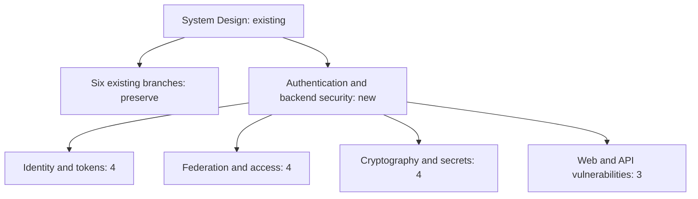
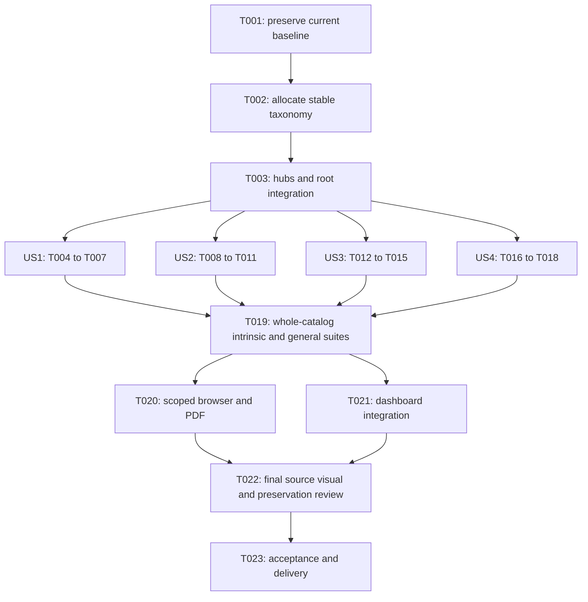

# Authentication & Backend Security

**Stage:** Implementation and validation complete; all 23 tasks and seven publication gates passed.\
**Requested:** 2026-11-17. **Profile:** Compact content publishing; constitution v1.3.0.\
**Branch:** `main`. **Git HEAD:** `928715cd2b7a86a7781464eab6ed7c66e8fbaff2`.

## Outcome and taxonomy audit

Learners can distinguish identity from permission, choose an authentication lifecycle,
reason about delegated identity and access policies, protect credentials and data, and
diagnose common web/API vulnerabilities under explicit production constraints. Deliver
15 complete lessons using the existing dashboard contract. This specification records
the requested bundle at the specification stage. The Delivered bundle records the
completed implementation; earlier audit/plan/task handoff notes remain historical.

The audited working-tree `manifest.json` has `schemaVersion: 1` and recursive `roots`.
Every node has `id`, `kind`, `title` and `slug`; hubs also have `children`. Routes and files
derive from ancestry rather than explicit path fields. The current catalog contains
**121 nodes: 90 lessons and 31 hubs**, under System Design and six branches: Backend
Architecture, Database Design & Management, API Design & Communication, Caching Architecture,
Distributed Systems & Scalability, and Message Queues & Event-Driven Systems. The requested
parent, all four categories and all 15 exact lesson titles are absent.

**Manifest SHA256:** `a4aae878552832851ec2751d98f2480a2ac40088fe4e6d7a207fc17844f2c465`.
This baseline includes the completed, uncommitted messaging batch. Preserve that work as
existing content; do not use Git HEAD's older catalog as the next publication baseline.
Capture the then-current pre-edit manifest before implementation and re-audit any change.

**Placement justification:** Root: System Design > Parent: Authentication & Backend
Security > requested Sub-Category > Topic. The branch groups identity, delegated access,
credential/data protection and vulnerability prevention in a balanced four-level tree.
The existing API category Reliability, Security & Traffic Control retains its gateway,
rate-limiting and request-boundary focus; it is related, not a replacement parent for this
whole security curriculum. Do not move or duplicate its nodes.

Reuse root UUID `d3825659-12c2-4fc8-b6fe-bdd050762da3`. Append parent slug
**`authentication-backend-security`** after Message Queues & Event-Driven Systems and
preserve all six previous subtrees, IDs, metadata and recall keys. Allocate **20 unique
UUIDv4 IDs once during implementation**: five hubs and 15 lessons. No IDs are persisted
by this specification. Expected resulting inventory: **141 nodes, 105 lessons, 36 hubs**
and **seven** home branch cards if the audited baseline is unchanged.



## Exact lesson inventory and boundaries

Keep every row as a separate complete authoring item in later tasks. Files below are
relative to **`topics/system-design/authentication-backend-security/`**. Hash routes
mirror the ancestry without `topics/` or `.html`, prefixed by `#/`. Preserve the exact
titles, requested category order and **4/4/4/3** grouping. All lessons are pending.

| # | Category | Exact lesson title | Relative lesson file | Required distinct learning focus |
| --- | --- | --- | --- | --- |
| 1 | Identity & Token Authentication | Authentication vs Authorization | `identity-and-token-authentication/authentication-vs-authorization.html` | Identity proof versus permission; trusted principal, object/action/tenant checks, default denial, enforcement ownership and stale permission decisions. |
| 2 | Identity & Token Authentication | Session-Based Authentication | `identity-and-token-authentication/session-based-authentication.html` | Opaque session identity, server state, browser cookies, fixation prevention, login/privilege-change regeneration, expiry/logout, shared session storage and outage behavior. |
| 3 | Identity & Token Authentication | JWT Authentication | `identity-and-token-authentication/jwt-authentication.html` | Token representation versus protocol; decoding versus verified acceptance, signed versus encrypted content, issuer/audience/type/time/algorithm checks, trusted keys, rotation and revocation limits. |
| 4 | Identity & Token Authentication | Refresh Token Rotation | `identity-and-token-authentication/refresh-token-rotation.html` | Access versus refresh lifetime; atomic token-family transitions, replay/reuse detection, concurrent tabs and lost responses, expiry/revocation, storage and sender-constrained alternatives under a verified client model. |
| 5 | Federated Identity & Access Control | OAuth 2.0 | `federated-identity-and-access-control/oauth-2-0.html` | Delegated authorization, actors/grants/scopes, client types, authorization-code flow and PKCE, redirect/response binding, token handling, consent and modern security guidance; not authentication by itself. |
| 6 | Federated Identity & Access Control | OpenID Connect | `federated-identity-and-access-control/openid-connect.html` | Identity layer and ID Token versus access token, discovery/trusted metadata, issuer/subject/audience validation, flow-specific state/nonce/PKCE roles, account linking, key rotation and logout scope. |
| 7 | Federated Identity & Access Control | Role-Based Access Control (RBAC) | `federated-identity-and-access-control/role-based-access-control.html` | Permission-to-role and user-to-role assignment, tenant/resource scope, role hierarchy/separation of duties, enforcement, role explosion and revocation/cache freshness. |
| 8 | Federated Identity & Access Control | Attribute-Based Access Control (ABAC) | `federated-identity-and-access-control/attribute-based-access-control.html` | Subject/resource/action/environment attributes, trusted provenance and freshness, policy evaluation/enforcement, missing attributes, combining rules, decision explanation and policy change tests. |
| 9 | Cryptography & Secrets Management | Password Hashing (bcrypt / Argon2) | `cryptography-and-secrets-management/password-hashing.html` | Slow password verification versus encryption/fast hashes; salts/peppers, Argon2 variants and bcrypt input limits, current parameter guidance, bounded verification cost, migration/rehash and compromise response. |
| 10 | Cryptography & Secrets Management | API Key Management | `cryptography-and-secrets-management/api-key-management.html` | High-entropy machine credentials, identifier versus secret, issue/display/storage, scoped permissions, expiry/revocation/rotation, overlap windows, usage attribution and leak response. |
| 11 | Cryptography & Secrets Management | Encryption at Rest & In Transit | `cryptography-and-secrets-management/encryption-at-rest-and-in-transit.html` | Data lifecycle and threat boundaries; TLS endpoint authentication/termination, storage versus field encryption, authenticated encryption/key/nonce requirements, envelope encryption, backups and key availability/rotation. |
| 12 | Cryptography & Secrets Management | Secrets Management | `cryptography-and-secrets-management/secrets-management.html` | Central lifecycle and workload identity/bootstrap, least-privilege retrieval, dynamic/static credentials, distribution/caching, coordinated rotation, audit/redaction, manager outages and recovery. |
| 13 | Common Web & API Vulnerabilities | SQL Injection | `common-web-and-api-vulnerabilities/sql-injection.html` | Query code/data separation, bound values, dynamic identifier allowlists, ORM/raw query boundaries, second-order injection, database privilege and safe error/log handling. |
| 14 | Common Web & API Vulnerabilities | Cross-Site Scripting (XSS) | `common-web-and-api-vulnerabilities/cross-site-scripting.html` | Stored/reflected/DOM paths, source-to-sink/context analysis, output encoding versus rich-HTML sanitization, framework escape hatches, CSP defense in depth and credential/action consequences. |
| 15 | Common Web & API Vulnerabilities | CSRF Protection | `common-web-and-api-vulnerabilities/csrf-protection.html` | Ambient browser credentials and forged state changes, synchronizer/signed double-submit patterns, origin checks, SameSite and site-versus-origin scope, CORS limits and interaction with XSS/auth flows. |

## Existing overlap and cross-links

Preserve existing lessons and add related links from new content only. Hub related links
must remain outside their exact ordered immediate-child list. Cross-link relevant new
siblings as well; links supplement complete explanations rather than replace them.

- **Request Validation**, UUID `e0906628-551b-45db-8816-a6575c1604e9`, at
  `#/system-design/api-design-and-communication/reliability-security-and-traffic-control/request-validation`:
  link from Authentication vs Authorization and the vulnerability lessons. Distinguish
  acceptable input shape/meaning from permission, parameterized queries and safe output.
- **API Gateway**, UUID `87a2e67c-dc5f-4a8e-944f-9bad681f9699`, at
  `#/system-design/api-design-and-communication/reliability-security-and-traffic-control/api-gateway`:
  link from the new parent and relevant token/access lessons. Explain edge authentication
  without allowing it to replace service-owned object/action authorization. Retain the
  separate architectural API Gateway Pattern node as well.
- **Multi-Tenant Architecture**, UUID `689dd587-de37-4e22-9412-bd42b118da79`, at
  `#/system-design/backend-architecture/infrastructure-and-multi-tenancy/multi-tenant-architecture`:
  link from Authentication vs Authorization, RBAC and ABAC for tenant/resource isolation;
  untrusted tenant headers or token role names alone are not sufficient policy authority.
- Link Password Hashing/API Key Management and appropriate authentication scenarios to
  existing **Rate Limiting** at
  `#/system-design/api-design-and-communication/reliability-security-and-traffic-control/rate-limiting`.
  Link policy/session freshness decisions to **Cache Invalidation** at
  `#/system-design/caching-architecture/lifecycle-eviction-and-consistency/cache-invalidation`
  where relevant. These remain focused on traffic budgets and copy invalidation.

## Research scope and correctness requirements

Use the user-requested [System Design Primer](https://github.com/donnemartin/system-design-primer#security)
as a core orientation reference alongside primary security sources. Its Security section
was inspected on 2026-11-17 and explicitly says it needs updates; it offers brief encryption,
input-handling, parameterized-query and least-privilege guidance. Do not expand its generic
input-sanitization wording into a universal XSS/SQL-injection defense or use it as the sole
authority for protocol or cryptographic recommendations.

Initial primary-reference orientation was checked on 2026-11-17:

- [IETF RFC 9700: OAuth 2.0 Security Best Current Practice](https://www.rfc-editor.org/rfc/rfc9700.html)
  for modern OAuth flow/token security, including the client-specific refresh-token threat
  model. Consult the base RFCs and applicable updates/errata; do not treat an unfinalized
  OAuth revision as a ratified standard or recommend deprecated grants as the default.
- [OpenID Connect Core 1.0 incorporating errata set 2](https://openid.net/specs/openid-connect-core-1_0.html)
  for identity assertions, claims, flow-specific validation and the distinction from API
  access tokens. Verify discovery/logout extensions separately when used.
- [OWASP Password Storage Cheat Sheet](https://cheatsheetseries.owasp.org/cheatsheets/Password_Storage_Cheat_Sheet.html)
  for algorithm selection, work factors and migration concerns. Cite dated guidance and
  measured runtime assumptions; do not present one hardcoded cost as universally optimal.

Full lesson research remains pending. For every exact inventory concept, perform an
actual concept-specific interview/scenario search when available, then verify each answer
against applicable IETF/OpenID specifications, OWASP guidance and original/vendor/runtime
documentation. Use JWT BCP/JOSE sources for token validation, applicable access-control
standards for RBAC/ABAC, and focused OWASP session, authorization, secrets, cryptographic
storage, TLS, SQL injection, XSS and CSRF references. These are research targets, not a
claim that every source or question has already been verified. Record dates and versions;
reuse checked results across stages instead of repeating identical research.

Each lesson needs one concise `research/topics/<immutable-id>.json` record following the
existing validator: actual query/date/result, checked source roles/support, ordered scenario
keys/source mappings, assumptions/limitations, public disclosure/URLs and substantive
findings for all eight editorial criteria. Mark reviewed only after substantive review.
Question popularity/company claims need actual interview evidence; technical documentation
alone does not establish frequency. Label inferred questions as adapted production scenarios
and disclose unavailable search or insufficient frequency evidence without reducing counts.

Security-specific review must distinguish cookie transport from token format; OAuth
delegation from OIDC identity; signature verification from authorization/confidentiality;
logout from globally immediate revocation; password hashing from recoverable encryption;
TLS endpoint hops from end-to-end data protection; SQL binding from identifier selection;
and XSS encoding/sanitization from CSRF prevention/CORS. Cover race conditions, stale policy,
key rotation, compromised credentials and dependency outages under explicit threat models.
Explain state, nonce and PKCE according to their actual flow responsibilities. Verify library
APIs/settings for any concrete code; never invent security guarantees from pseudocode.

## User scenarios, scope and delivery

1. **Choose identity and token lifecycles:** A learner compares sessions and JWT-based
   designs, traces login/refresh/logout and compromise, and explains what each check proves.
2. **Delegate identity and enforce access:** A learner follows OAuth/OIDC actors and then
   chooses RBAC/ABAC enforcement for a tenant-scoped resource, including stale or missing policy.
3. **Protect credentials and data:** A learner chooses hashing, credential rotation, key
   boundaries and secret distribution, defending the cost and recovery behavior during failure.
4. **Diagnose vulnerable requests/rendering:** A learner follows untrusted data or ambient
   credentials to an actual sink/action and selects a context-appropriate defense, recognizing
   what input validation, CORS, CSP, cookie flags and encryption do or do not establish.

Create the parent `_overview.html` and one `_overview.html` under each of the four category
directories above. Every hub needs ELI5 orientation, an explained readable Mermaid roadmap,
reading guidance and exact ordered immediate-child hash links. Update the existing System
Design overview introduction, roadmap and child links for all seven branches, retaining its ID.

Every lesson must render in the existing canvas with no manual core CSS/JS edits. Security
payload examples must appear as escaped inert text/code, never active scripts, handlers or
networking forms in a partial. Use synthetic credentials and clearly identify executable
models versus conceptual traces; execute/test examples before claiming they were run.

This is educational content, not implementation of user accounts, an identity provider,
authorization middleware, real credential storage or a vulnerability scanner in the dashboard.
Keep the application static, zero-build and compatible with relative paths/hash routing on
GitHub Pages. No shell/schema/progress changes, historical lesson backfill, cloud resources,
new dependencies or deployment changes are included. Commit/push only when requested.

Delivery must include the placement justification, paste-ready applied manifest parent
object with actual stable IDs, links to all 15 complete partials, five new hubs, root overview
and reviewed research records, plus honest verification results and remaining limitations.

## Inherited publication acceptance checklist

These inherited publication gates are satisfied by the final delivery evidence below. Earlier stage handoff notes describe their historical state.

- [X] **Taxonomy and coverage:** All 15 exact lessons in 4/4/4/3 order, five new hubs,
  one root overview update, kebab-case ancestry paths and 20 unique immutable IDs. Preserve
  all six old subtrees and their state identities, including uncommitted messaging work.
  Reconcile the expected 141-node/105-lesson/36-hub inventory against the actual baseline.
- [X] **Complete teaching:** Every lesson has all six ordered modules: problem/why and
  ELI5 before jargon; valid explained accessible Mermaid; complete collapsible mechanics;
  a meaningful decision table; concrete Symptom → Root Cause → Fix/Prevention stories;
  and mastery/real-world impact. Teach a worked request/lifecycle/failure trace with actors,
  trust boundaries and explicit assumptions. No placeholders or abbreviated substitutes.
- [X] **Recall and interviews:** Every lesson includes a visible Feynman summary box with
  “Summarize this in your own words,” 3–5 foundational cards and a separate nested
  **Tricky & Most-Asked Interview Scenarios** subsection containing 5–7 distinct production
  questions: 75–105 scenarios across the batch. Each independent initially closed native
  `<details>` card has a stable recall key, specific constraints and three complete parts:
  **The Scenario & Constraint**, **The Direct Answer & Architectural Decision**, and
  **Key Trade-Offs & Follow-Up Traps**. Require an actionable justified decision, costs,
  alternatives and changed-constraint follow-ups, spanning debugging and design choices.
- [X] **Research and correctness:** All 15 concepts receive actual question research when
  available, primary-source verification, reviewed compact records and matching public
  source notes. Include the primer alongside applicable authoritative guidance. Verify
  protocols, libraries, threat models, cryptographic settings and current recommendations.
  Disclose adapted questions/frequency gaps. Substantive source/editorial review remains
  distinct from structural checks; payloads remain inert and example-execution claims honest.
- [X] **Boundaries and links:** Existing API Gateway, Request Validation and Multi-Tenant
  Architecture cross-links work with unchanged identities and explanations remain complete.
  Related links stay outside hub child lists. The requested identity/access/security
  distinctions are correct; no duplicated categories, copied scenario sets or universal
  “JWT/HTTPS/CORS solves security” claims replace scoped reasoning.
- [X] **Dashboard and learning:** All affected routes load/reload at `/` and `/backend-lab/`;
  all new title/path searches, seven category cards, breadcrumbs/sidebar, mobile drawer and
  themes work. Mastery derives from 105 lessons if the baseline holds. New progress starts
  independently; known records from all six old branches and unknown backup records survive
  reload/export/import. Confidence and explicit mastery/review work; opening/rating cannot
  imply mastery or complete a review. Controlled due/not-due records behave correctly.
- [X] **Focused verification and print:** Whole-catalog intrinsic and existing general
  content/catalog/state tests pass. Scoped checks cover 15 lessons, five new hubs and root:
  expected **21 partials, 63 browser cases and 42 light/dark PDFs**. Require correct relative
  fetches, zero console/Mermaid/layout errors, independent keyboard disclosures, persisted
  confidence, explicit mastery and working links. PDFs contain complete answers/code/diagram
  labels, hide controls and restore disclosures. Inspect actual print contrast and wrapping,
  including dark theme; use diagram shapes/short labels supported by current styles.
  Use explicit paths with the pre-edit manifest to exclude unrelated uncommitted content;
  reuse only matching complete evidence. Keep pending gates pending and historical baselines
  frozen; broaden only for actual shared runtime/style/state changes.

## Specification review and handoff

**Review:** Passed for specification completeness: exact inventory/paths, taxonomy reuse,
explicit security boundaries, research obligations, full teaching/scenario requirements,
preservation and measurable publication criteria are covered. No clarification is required.
Later tasks must retain one complete authoring task per lesson and group shared work once.

**Specification validation:** Passed a read-only prospective catalog check: 15 exact titles,
4/4/4/3 grouping, canonical paths, 20 unique temporary UUIDv4s, 141 nodes/105 lessons/36 hubs,
all existing cross-link targets and exactly 21 affected partials. All six existing subtrees
remain identical, and all 206 protected current files match their pre-specification hashes.
Temporary validation IDs were not persisted.
No manifest, lesson/hub, research or runtime file is changed by this stage. Existing messaging
changes remain intact. Specification review is not lesson research or publication acceptance.

`.specify/extensions.yml` is absent; no before/after-specify hooks are configured.
**Handoff:** Specification validation passed; ready for `$speckit-plan`. Reuse this compact
request document; do not generate an unrelated feature directory or resume a prior batch.

## Implementation plan

**Planned:** 2026-11-17 on `main`. **Plan artifact:** this section of
`docs/topic-requests/authentication-backend-security.md`. The audited manifest hash and
121-node/90-lesson baseline above still match. Existing uncommitted messaging content
is part of the current baseline and must remain intact. This named stage changes only
this document; no new IDs, topics, research records or runtime changes are delivered yet.

### Inspected contract and implementation decisions

Inspected the actual manifest, `tools/validate_content.py`, `tools/check_topics.py`,
`tests/content/publishing.json`, the host recall/enhancement code and current styles.
Inspected the complete Request Validation partial at
`topics/system-design/api-design-and-communication/reliability-security-and-traffic-control/request-validation.html`
and the Messaging & Event Patterns `_overview.html` under the completed messaging batch.
The samples confirm the established identity, section, diagram, table and recall markup.

- **Manifest:** Retain `{schemaVersion: 1, roots: [...]}`. Nodes use exactly `id`, `kind`,
  `title`, `slug`, plus `children` for hubs. Reuse the System Design root and append the
  new parent with four category hubs and 15 leaves in the inventory's 4/4/4/3 order.
  Derive routes/files from ancestry; add no explicit URL/file fields, schema extension,
  duplicate aliases or hard-coded dashboard counts. Allocate 20 UUIDv4s once and retain
  them on resumed runs. Reusing the current schema avoids a platform migration.
- **Runtime:** Use the existing static shell, hash router, partial fetcher, Mermaid and
  Highlight.js enhancement, theme controls and client-side learning state. Published
  content requires no build, authentication service or new dependency. Application
  assets and progress schemas remain unchanged. Separate authentication functionality
  in the knowledge base would be a different feature.
- **Lesson envelope:** One `article.kb-topic[data-node-id="UUID"]`, exact-title `h1`,
  and six direct sections in this order: `hook-eli5`, `big-picture`, `mechanics`,
  `trade-offs`, `pitfalls`, `mastery`. Each section ID is `node-UUID-SECTION`.
  Use native mechanics `details > summary`, `.kb-diagram` figures containing
  `pre.mermaid` plus explanatory captions, `.kb-table-wrap` tables with headings,
  and the existing structure/insight/impact/pitfall callouts. Put the Feynman prompt
  in a visible `.kb-callout--insight` inside mastery. No new selectors are needed.
- **Recall integration:** Use independent initially closed `details.kb-question` with
  stable `data-recall-id` and explicit foundational/interview kind. Mastery directly
  contains one `section[data-interview-scenarios]`, labeled by the exact-title `h3`
  ID `node-UUID-interview-scenarios`. Interview keys start `interview-`; set an honest
  `data-scenario-basis`. Each card has three direct ordered `div[data-scenario-part]`
  elements (`scenario`, `decision`, `trade-offs`), each beginning with the exact bold
  constitutional label followed by full prose. Never nest recall cards, share an
  exclusive `name`, set `open`, or embed rating/mastery buttons. The host owns those
  controls and persistence. Keep a visible `aside[data-interview-research]` outside
  closed cards, with matching public disclosure and ordered source URLs.
- **Hubs:** Use `article.kb-hub` with matching identity/title, ELI5 orientation,
  explained roadmap, reading guidance and exactly one `[data-child-links]` list
  matching immediate children in order. Put related links outside that list. Create
  the five `_overview.html` files identified by the inventory ancestry and update
  only the existing System Design overview for seven branches. All other old partials
  remain unchanged; new-to-old links provide integration without historical rewrites.
- **Diagrams and examples:** Select diagrams that teach actual actors, trust boundaries,
  success checks and failure paths; several scenarios can reference one suitable diagram.
  Use accessible titles/descriptions, short labels and captions. Prefer rectangular
  flow nodes and sequence diagrams supported by current dark-print styling; review actual
  output rather than assuming text extraction proves contrast. Escape code/payload text
  before insertion into HTML. Use `pre > code.language-*` for examples, never executable
  scripts, event attributes, forms or fake host controls inside a partial.
- **Research storage:** Keep one `research/topics/<UUID>.json` per new lesson, using
  constitution `1.3.0` and the current `constitution-1.2` recall profile. The existing
  default research directory covers new lessons; do not modify legacy research mappings,
  publishing configuration or frozen migration baselines. Concise findings/source mappings
  are sufficient; duplicating full answers in research evidence adds no learning value.

### Execution sequence and research work packages

**A. Preserve and integrate taxonomy once.** Re-audit against the recorded working-tree
hash. Before the first edit, capture the pre-edit manifest once at
`.cache/topic-checks/authentication-backend-security-manifest-before.json` and record
protected current lesson/research/runtime/prior-request/report hashes separately under
the same feature prefix. Reuse these originals on resumed runs; never refresh them to
conceal changes. Append the new branch and create its five hubs, then update the root
overview. Preserve the six complete previous subtrees byte-for-byte in the manifest.

**B. Research, author and review each complete lesson.** Keep 15 individual authoring
items, corresponding one-to-one to inventory rows and L01–L15 below. Each item includes
question research, primary verification, all six story modules, the Feynman box, 3–5
foundational cards, 5–7 distinct complete interview scenarios and its reviewed research
record. Finish a lesson's explanation and source review before marking its task complete.
Do not replace a difficult lesson with a related link or a smaller scenario set.

The following are research assignments and candidate failure cases, not completed searches
or verified interview-frequency claims. Search each exact lesson title with production/
interview terms and its listed constraints; verify resulting decisions with the named
source families. Reuse the dated primer/RFC 9700/OIDC/password-storage orientation already
recorded above, and record additional checks without pretending planned work has run.

| Work package | Lesson | Source/verification focus | Distinct production cases to develop |
| --- | --- | --- | --- |
| L01 | Authentication vs Authorization | OWASP authentication/authorization and trusted enforcement boundaries. | Valid login accessing another tenant's object; direct-service bypass; stale or missing permission state. |
| L02 | Session-Based Authentication | OWASP session guidance, cookie/browser rules and the actual selected session framework. | Fixation/regeneration; shared-store outage; expiry/logout races and cross-origin cookie deployment. |
| L03 | JWT Authentication | JWT/JOSE specifications, JWT BCP and selected verification library/version. | Wrong audience/type accepted; algorithm/key confusion; key rollover/cache outage; delayed revocation. |
| L04 | Refresh Token Rotation | RFC 9700 and applicable provider/client/storage semantics. | Concurrent refresh; lost response versus reuse; compromised token family; safe revocation/expiry recovery. |
| L05 | OAuth 2.0 | Base OAuth specifications, RFC 9700, PKCE and applicable client/platform guidance. | Redirect/response substitution; public-client secret assumptions; scope escalation and missing consent; deprecated-flow migration. |
| L06 | OpenID Connect | OIDC Core plus verified discovery/logout extensions and SDK validation behavior. | ID Token used at an API; wrong issuer/audience; nonce/response binding; unsafe account linking and incomplete logout. |
| L07 | Role-Based Access Control (RBAC) | Authoritative RBAC model and OWASP authorization; concrete policy/cache implementation where used. | Cross-tenant role collision; role explosion; conflicting duties; role removal and stale cached permissions. |
| L08 | Attribute-Based Access Control (ABAC) | Authoritative ABAC guidance and selected policy-engine semantics. | Spoofed tenant attributes; stale resource classification; missing attributes/combining rules; safe policy rollout and audit. |
| L09 | Password Hashing (bcrypt / Argon2) | OWASP password storage, Argon2 specification and exact library/runtime limits. | Legacy rehash; byte-length behavior; verification resource exhaustion; pepper compromise and migration. |
| L10 | API Key Management | OWASP credential/API guidance and documented key lifecycle/storage APIs. | Leaked key response; no-downtime rotation; secret display/recovery limits; tenant-scoped usage and rapid revocation. |
| L11 | Encryption at Rest & In Transit | TLS/cryptographic standards, OWASP guidance and chosen KMS/storage boundaries. | TLS termination gaps; stolen backups versus running-app access; key-service outage; key/nonce misuse and rotation. |
| L12 | Secrets Management | OWASP secrets guidance and original workload-identity/secret-manager documentation. | Bootstrap without hardcoded master credentials; rotation overlap; stale caches/manager outage; logs/build artifacts leaking values. |
| L13 | SQL Injection | OWASP SQL injection guidance and real database/driver parameter binding. | ORM raw-query escape; user-selected sort identifier; stored second-order payload; least-privilege failure containment. |
| L14 | Cross-Site Scripting (XSS) | OWASP XSS/DOM guidance and exact template/sanitizer/browser sink behavior. | Stored rich text; unsafe DOM sink; wrong-context encoding; CSP bypass assumptions and actions possible despite HttpOnly. |
| L15 | CSRF Protection | OWASP CSRF guidance and verified cookie/origin/framework semantics. | Cookie-authenticated cross-site write; sibling-origin/site distinction; token binding and login flows; CORS/XSS misconception. |

For every source-backed decision, record the flow, actor, trusted inputs, enforcement
location, version/settings and failure assumptions that change the answer. Security
examples must be complete within their stated scope, use synthetic values and avoid
hand-written cryptography or token-verification substitutes. Choose an actual supported
library when executable security code is useful; otherwise label the trace conceptual.
If an example is executed, check meaningful success/rejection/failure boundaries and
record exactly what ran. A local model does not establish deployed protocol security.

**C. Shared verification.** After all lessons and research records exist, run the existing
general suites once and the scoped publication checks below. Fix failures in the content
or examples, preserving shared contracts. Recheck affected inputs after changes; only
reuse completed browser/PDF evidence with matching fingerprints and valid PDF hashes.
Do not run full-catalog browser/PDF regression merely because an unrelated old batch is
uncommitted. Broaden scope if implementation actually changes shared runtime/styles/state.

**D. Editorial acceptance and delivery.** Review all 15 complete narratives, source
mappings, distinct scenarios and guarantee boundaries. Inspect actual browser/mobile and
light/dark PDF output, including diagrams, code/payload text, long labels, tables, Feynman
boxes and fully expanded answers. Compare protected files and all six old subtrees to
the original snapshots, then close the seven inherited gates with current evidence and
append the delivery bundle/actual manifest object here. Commit/push only when requested.

### Validation commands and focused dashboard checks

Use the pinned development tooling in `tests/dashboard/requirements.txt` and the setup in
`docs/topic-publishing.md`; reuse an available matching browser environment rather than
reinstalling it. Chromium and `pdftotext` are needed for real browser/PDF acceptance, and
the local server needs localhost socket access. Browser/PDF and editorial gates remain
pending if prerequisites cannot run; static-only results cannot stand in for them.

Run from the repository root after implementation, using the interpreter/environment with
the documented pinned dependencies. The baseline file is captured once before any edit,
not reconstructed from the older Git HEAD or a previous feature's baseline.

```sh
python3 tools/validate_content.py --report .cache/topic-checks/authentication-backend-security-static.json
python3 -m unittest discover -s tests/content -q
node --experimental-default-type=module tests/dashboard/test_catalog.mjs
node --experimental-default-type=module tests/dashboard/test_learning_state.mjs
python3 tools/check_topics.py \
  --baseline .cache/topic-checks/authentication-backend-security-manifest-before.json \
  --paths manifest.json topics/system-design/_overview.html topics/system-design/authentication-backend-security/_overview.html \
  --report .cache/topic-checks/authentication-backend-security-report.json \
  --pdf-dir .cache/topic-checks/authentication-backend-security-pdfs
```

The explicit paths plus baseline select exactly the 20 new partials and the changed root,
excluding the already completed messaging batch. Expected scope is **21 partials, 63 browser
cases and 42 actual light/dark PDFs**. Require relative fetches and route reloads at both
`/` and `/backend-lab/`, rendered Mermaid/code, zero console/layout errors, all immediate
hub links, independent keyboard disclosures and persisted per-card confidence. Verify
explicit mastery, full printed text/diagram labels, hidden controls and restored disclosure
state. Review payload examples as inert displayed code; they must not execute, navigate,
inject dashboard markup or issue example requests during route changes.

Add a focused real-dashboard exercise at both serving bases, with evidence in
`.cache/topic-checks/authentication-backend-security-integration.json`:

- Search all 15 titles and paths at both bases (**60 search cases**), navigate all seven
  home branch cards, and verify breadcrumbs, active sidebar, mobile drawer and both themes.
- Follow the specified new-to-old API Gateway, Request Validation and Multi-Tenant links;
  confirm original identities and independent new-topic progress. Preserve old content
  and keep hub related links outside immediate-child lists.
- Seed representative status/confidence/review records from all six existing branches
  plus an unknown backup record. With a controlled clock, exercise a new lesson's Not
  Started → In Progress → Mastered transitions, Hard/Good/Easy, reload and JSON export/import.
  Compare the complete old/unknown records; do not silently drop or rewrite them.
- Verify due/not-due records and explicit start/complete review. Opening a lesson/card or
  rating confidence must not imply mastery or complete a review. Derive expected mastery
  from **105 lessons**, not a copied percentage or an earlier batch's denominator.

Keep evidence under this feature's ignored `.cache/topic-checks/` prefix. General suites,
intrinsic validation, browser/PDF checks, source correctness and visual/editorial acceptance
are different gates; record honest outcomes without copying full lesson answers into logs.

### Constitution check and planning handoff

The design preserves ELI5-first narrative, all six modules, purposeful Mermaid coverage,
full trade-off/failure analysis, 3–5 foundational cards and 5–7 researched structured
scenarios per lesson. It reuses the existing content/learning contract, preserves immutable
identities, keeps mobile/print acceptance, and delivers all required hubs and file links.
No constitutional exception, new data model, separate contract document or shell change
is required. There is no unresolved product decision requiring clarification; lesson-level
source/library/version verification remains explicitly assigned to authorship.

**Plan validation:** Passed: exact manifest schema and both inspected sample contracts;
15 matched inventory/work-package rows; prospective 141-node/105-lesson/36-hub catalog;
21 selected partials with only the existing root affected; all six prior subtrees unchanged.
All 210 protected current file hashes match. Validation UUIDs stayed in memory.
All seven publication gates remain pending; no lesson acceptance is implied.

`.specify/extensions.yml` remains absent; no before/after-plan hooks are configured.
**Plan handoff:** Plan validation passed; ready for `$speckit-tasks`. Retain one complete
authoring task for each of the 15 HTML lessons and group shared baseline, taxonomy,
verification and delivery work once in this same document.

## Implementation tasks

**Generated:** 2026-11-17. **Status:** All 23 implementation tasks are complete. This
section is the compact profile's task artifact; use it directly without creating a
separate `tasks.md` or changing the shell. T004–T018 are 15 separate complete lesson
tasks, matching inventory rows and L01–L15 one-to-one. The eight shared tasks handle
baseline/taxonomy/hubs, verification and delivery once. Mark a task complete only after
its stated work passes; the seven inherited publication gates remain separate acceptance.

### Complete-lesson definition for T004–T018

Every lesson task includes its own exact-concept interview/scenario searches when
available, primary-source verification, complete HTML authorship and substantive review.
Use the UUID allocated in T002 for both the partial identity and its matching
`research/topics/<UUID>.json`. Each task must deliver all of the following:

- Six ordered story modules: problem/why and ELI5 analogy before jargon; valid explained
  accessible Mermaid; full collapsible mechanics; a meaningful comparison/decision table;
  practical Symptom → Root Cause → Fix/Prevention stories; mastery and real-world impact.
  Include a worked request/lifecycle/failure trace naming actors, trusted inputs and
  enforcement boundaries. Related links supplement self-contained teaching.
- A visible Feynman summary box with **Summarize this in your own words**, 3–5 foundational
  cards and the separate nested **Tricky & Most-Asked Interview Scenarios** subsection
  with 5–7 materially different production questions. Every independent initially closed
  native `<details>` card needs stable recall identity, explicit constraints, an actionable
  defended decision, costs/alternatives and a changed-constraint follow-up. Include all
  three exact labels: **The Scenario & Constraint**, **The Direct Answer & Architectural
  Decision**, and **Key Trade-Offs & Follow-Up Traps**. Cover debugging and design choices.
- A reviewed compact research record with actual queries/dates/results, checked source
  roles/support, ordered scenario/source mappings, assumptions/limitations and concrete
  findings for all eight editorial criteria. Match the visible public disclosure/URLs.
  Use the primer alongside appropriate primary guidance; disclose adapted questions and
  insufficient frequency evidence. Do not invent research, popularity or company claims.
- The supported `.kb-*` envelope/section/card markup and host-owned confidence/mastery
  controls. Keep code/payloads escaped and inert, use synthetic credentials, and verify
  concrete library versions/settings. State which examples are conceptual or executed;
  run meaningful success/rejection/failure checks before claiming execution. No embedded
  scripts/forms, custom cryptographic substitutes or manual core CSS/JS changes.

Shared browser/PDF/dashboard acceptance is completed in T019–T022, not inferred from
authoring or an intrinsic validator pass. Preserve existing lesson IDs and recall keys.

### Shared baseline and taxonomy prerequisites

- [X] T001 Re-audit `manifest.json` against the recorded working-tree SHA256 and 121-node/90-lesson baseline, including the uncommitted messaging batch. Capture its pre-edit contents once in `.cache/topic-checks/authentication-backend-security-manifest-before.json` and protected current lesson/research/runtime/prior-request/report hashes in `.cache/topic-checks/authentication-backend-security-protected.json`; reuse originals on resumed runs. Reconcile changed input before editing, preserve all six old subtrees/IDs/recall keys, and identify `topics/system-design/_overview.html` as the intended existing HTML change.
- [X] T002 Append the Authentication & Backend Security parent, four category hubs and 15 exact-title leaves to `manifest.json`, allocating 20 canonical UUIDv4 IDs once. Use `authentication-backend-security` and the inventory's exact 4/4/4/3 order and kebab-case ancestry; derive paths/routes without extending the schema. Preserve the System Design root and all six old subtrees/metadata. Verify the expected 141 nodes, 105 lessons, 36 hubs and seven home branches against the actual baseline; retain allocated IDs on reruns.
- [X] T003 Create `topics/system-design/authentication-backend-security/_overview.html`, `topics/system-design/authentication-backend-security/identity-and-token-authentication/_overview.html`, `topics/system-design/authentication-backend-security/federated-identity-and-access-control/_overview.html`, `topics/system-design/authentication-backend-security/cryptography-and-secrets-management/_overview.html`, and `topics/system-design/authentication-backend-security/common-web-and-api-vulnerabilities/_overview.html`. Give every hub matching identity/title, ELI5 orientation, an explained accessible Mermaid roadmap, reading guidance and exact ordered immediate-child links. Update `topics/system-design/_overview.html` for seven branches. Add the new parent's existing API Gateway link separately from its child list; use short labels/shapes compatible with current print styles.

### US1 — Choose identity and token lifecycles

**Priority:** First reviewable learning increment. **Goal:** Distinguish identity/permission
and defend session, token and refresh lifecycles during failure or compromise.
**Independent review:** All four US1 partials load at their exact routes, explain a complete
success/failure lifecycle and meet the complete-lesson definition. Their category hub links
to all four in order; recall disclosures work independently with host confidence controls.

- [X] T004 [P] [US1] Research, author and review **Authentication vs Authorization** in `topics/system-design/authentication-backend-security/identity-and-token-authentication/authentication-vs-authorization.html` and its UUID JSON under `research/topics/`, meeting the complete-lesson definition and L01. Trace trusted principal to object/action/tenant permission, direct-service enforcement and stale/missing decisions. Cross-link existing Request Validation and Multi-Tenant Architecture without copying their scenario sets or treating valid input/login as permission.
- [X] T005 [P] [US1] Research, author and review **Session-Based Authentication** in `topics/system-design/authentication-backend-security/identity-and-token-authentication/session-based-authentication.html` and its UUID JSON under `research/topics/`, meeting the complete-lesson definition and L02. Verify selected framework/browser-cookie semantics; cover server-side state, fixation/regeneration, privilege changes, shared-store scaling/outage, idle/absolute expiry and logout races. Distinguish cookie flags, CSRF defenses and XSS consequences; link relevant new lessons and existing traffic-control material.
- [X] T006 [P] [US1] Research, author and review **JWT Authentication** in `topics/system-design/authentication-backend-security/identity-and-token-authentication/jwt-authentication.html` and its UUID JSON under `research/topics/`, meeting the complete-lesson definition and L03. Verify the JWT/JOSE/BCP and chosen library boundary; distinguish decode, signature, confidentiality and authorization. Trace issuer/audience/type/time/algorithm checks, trusted key selection/rotation, cache outage and revocation limits. Link existing API Gateway without implying edge acceptance replaces service authorization.
- [X] T007 [P] [US1] Research, author and review **Refresh Token Rotation** in `topics/system-design/authentication-backend-security/identity-and-token-authentication/refresh-token-rotation.html` and its UUID JSON under `research/topics/`, meeting the complete-lesson definition and L04. Use RFC 9700 with explicit client/provider assumptions; explain atomic token-family transitions, replay/reuse response, concurrent tabs, lost refresh responses, expiry/revocation and sender-constrained alternatives. Distinguish legitimate retry ambiguity from a universally safe grace period or unconditional reuse policy.

### US2 — Delegate identity and enforce access

**Priority:** Second learning increment. **Goal:** Trace delegated authorization and
identity assertions, then choose enforceable tenant/resource policies.
**Independent review:** All four US2 partials and their category hub work. A learner can
separate OAuth/OIDC roles and tokens, justify RBAC/ABAC decisions and explain an incorrect
issuer, resource scope or attribute result using complete sourced scenarios.

- [X] T008 [P] [US2] Research, author and review **OAuth 2.0** in `topics/system-design/authentication-backend-security/federated-identity-and-access-control/oauth-2-0.html` and its UUID JSON under `research/topics/`, meeting the complete-lesson definition and L05. Verify base specifications, RFC 9700 and PKCE guidance; trace actors, public/confidential clients, code exchange, redirects, scopes/consent and token lifecycle. Keep delegation distinct from authentication, explain response binding and avoid recommending deprecated grants or an unfinalized revision as the default standard.
- [X] T009 [P] [US2] Research, author and review **OpenID Connect** in `topics/system-design/authentication-backend-security/federated-identity-and-access-control/openid-connect.html` and its UUID JSON under `research/topics/`, meeting the complete-lesson definition and L06. Verify Core and any discovery/logout extensions used; trace ID Token versus access token, trusted metadata, issuer/subject/audience and flow-specific state/nonce/PKCE checks. Cover account linking, key rotation and logout boundaries without equating ID Token acceptance with arbitrary API authorization.
- [X] T010 [P] [US2] Research, author and review **Role-Based Access Control (RBAC)** in `topics/system-design/authentication-backend-security/federated-identity-and-access-control/role-based-access-control.html` and its UUID JSON under `research/topics/`, meeting the complete-lesson definition and L07. Explain role/permission/assignment boundaries, tenant/resource scope, hierarchy/separation of duties, role explosion and role-removal freshness. Verify policy/cache assumptions, link Multi-Tenant Architecture and relevant Cache Invalidation material, and show why a client-supplied role or stale token is insufficient enforcement.
- [X] T011 [P] [US2] Research, author and review **Attribute-Based Access Control (ABAC)** in `topics/system-design/authentication-backend-security/federated-identity-and-access-control/attribute-based-access-control.html` and its UUID JSON under `research/topics/`, meeting the complete-lesson definition and L08. Verify authoritative ABAC guidance and any concrete engine semantics; trace trusted subject/resource/action/environment attributes, freshness, missing values, combining rules and decision enforcement. Include policy rollout/audit and tenant isolation; defend RBAC/ABAC/hybrid choices under actual constraints rather than a universal ranking.

### US3 — Protect credentials and data

**Priority:** Third learning increment. **Goal:** Choose password/credential, encryption
and secret-distribution lifecycles with defensible compromise and outage recovery.
**Independent review:** All four US3 partials and their hub work. Each describes what its
protection covers, what remains exposed, how keys/credentials rotate and what happens when
the verifier, key service or secret manager is unavailable.

- [X] T012 [P] [US3] Research, author and review **Password Hashing (bcrypt / Argon2)** in `topics/system-design/authentication-backend-security/cryptography-and-secrets-management/password-hashing.html` and its UUID JSON under `research/topics/`, meeting the complete-lesson definition and L09. Verify current OWASP guidance, Argon2 variants and exact runtime/library behavior, including bcrypt byte limits. Explain salts/peppers, bounded verification cost, dated parameter choices, rehash/migration and compromise recovery; link Rate Limiting. Do not substitute reversible encryption or a fast general hash for password verification.
- [X] T013 [P] [US3] Research, author and review **API Key Management** in `topics/system-design/authentication-backend-security/cryptography-and-secrets-management/api-key-management.html` and its UUID JSON under `research/topics/`, meeting the complete-lesson definition and L10. Trace high-entropy issuance, identifier/secret separation, one-time display and appropriate verifier storage, tenant-scoped permissions, expiry/revocation, usage attribution, overlap rotation and leak response. Verify the chosen key lifecycle API assumptions and distinguish machine credentials from end-user delegated identity.
- [X] T014 [P] [US3] Research, author and review **Encryption at Rest & In Transit** in `topics/system-design/authentication-backend-security/cryptography-and-secrets-management/encryption-at-rest-and-in-transit.html` and its UUID JSON under `research/topics/`, meeting the complete-lesson definition and L11. Verify TLS/crypto and selected storage/KMS boundaries; trace endpoint authentication/termination, disk versus field encryption, authenticated encryption/key/nonce requirements, envelope encryption, backups and key availability/rotation. State which attacker/access boundary remains outside each protection; use supported primitives rather than custom cryptography.
- [X] T015 [P] [US3] Research, author and review **Secrets Management** in `topics/system-design/authentication-backend-security/cryptography-and-secrets-management/secrets-management.html` and its UUID JSON under `research/topics/`, meeting the complete-lesson definition and L12. Verify workload-identity and manager/version assumptions; explain bootstrap, least-privilege retrieval, static/dynamic credentials, cache lifetime, coordinated rotation, redaction/audit, dependency outage and recovery. Distinguish this distribution lifecycle from API-key product lifecycle and encryption-key protection while cross-linking both.

### US4 — Diagnose vulnerable requests and rendering

**Priority:** Fourth learning increment. **Goal:** Follow untrusted data or ambient browser
credentials to the actual sink/action and choose a context-appropriate defense.
**Independent review:** All three US4 partials and their hub work. Learners can diagnose
injection, wrong-context rendering and forged state changes; all demonstration payloads
remain inert text/code in both the dashboard and print output.

- [X] T016 [P] [US4] Research, author and review **SQL Injection** in `topics/system-design/authentication-backend-security/common-web-and-api-vulnerabilities/sql-injection.html` and its UUID JSON under `research/topics/`, meeting the complete-lesson definition and L13. Verify real database/driver binding behavior; trace code/data separation, raw ORM paths, second-order injection, dynamic identifier allowlists, database privileges and safe diagnostics. Cross-link Request Validation and show why generic sanitization or ORM use alone is not the query boundary. Keep all payload examples escaped and local.
- [X] T017 [P] [US4] Research, author and review **Cross-Site Scripting (XSS)** in `topics/system-design/authentication-backend-security/common-web-and-api-vulnerabilities/cross-site-scripting.html` and its UUID JSON under `research/topics/`, meeting the complete-lesson definition and L14. Verify context-specific browser/template/sanitizer semantics; trace stored/reflected/DOM sources and sinks, output encoding versus rich-HTML sanitization, framework escape hatches, CSP and HttpOnly limitations. Cross-link Request Validation/session material; display payloads inertly without executable HTML or requests in the lesson.
- [X] T018 [P] [US4] Research, author and review **CSRF Protection** in `topics/system-design/authentication-backend-security/common-web-and-api-vulnerabilities/csrf-protection.html` and its UUID JSON under `research/topics/`, meeting the complete-lesson definition and L15. Verify browser/framework cookie, origin and token rules; trace ambient credentials, unsafe state changes, synchronizer/signed double-submit patterns, SameSite/site-versus-origin and CORS limits. Distinguish XSS and flow-specific OAuth/login protections; use inert request examples and cross-link Request Validation plus relevant session/OAuth lessons.

### Shared verification and delivery

- [X] T019 Run whole-catalog `tools/validate_content.py` and existing general suites `tests/content/`, `tests/dashboard/test_catalog.mjs` and `tests/dashboard/test_learning_state.mjs` using the plan commands. Write `.cache/topic-checks/authentication-backend-security-static.json`; verify all 15 lessons/five hubs/root, 15 reviewed research records, cross-links, identities, markup and manifest-derived counts. Fix failures without changing validators, publishing mappings or frozen evidence to conceal content defects; do not add infrastructure for the unchanged shell.
- [X] T020 Run `tools/check_topics.py` with `.cache/topic-checks/authentication-backend-security-manifest-before.json` and the plan's explicit paths, writing `.cache/topic-checks/authentication-backend-security-report.json` and `.cache/topic-checks/authentication-backend-security-pdfs/`. Require 21 selected partials, 63 browser cases and 42 actual light/dark PDFs from this baseline: root/subdirectory reloads/relative fetches, Mermaid/code, console/layout, mobile/themes, independent keyboard cards, persisted ratings, explicit mastery and hub links. Require complete printed answers/code/labels, hidden controls and restored disclosures; refresh affected evidence after fixes, reusing only matching complete results.
- [X] T021 Exercise the real dashboard at `/` and `/backend-lab/`, recording `.cache/topic-checks/authentication-backend-security-integration.json`: all 60 title/path searches, seven home cards, breadcrumbs/sidebar, mobile drawer/themes and specified old/new cross-links. Seed complete representative records from all six old branches plus an unknown backup record; verify independent new status, Hard/Good/Easy, explicit mastery/review, controlled due/not-due behavior, reload and JSON export/import. Preserve old records and derive progress from 105 lessons. Confirm opening/rating never implies mastery/review completion; verify payload examples display inertly without injected controls, dialogs, example navigation or requests.
- [X] T022 Complete substantive source/narrative review of all 15 HTML lessons and `research/topics/` records against the complete-lesson definition, checking threat models, protocol/library versions, distinct scenario decisions, evidence honesty and execution claims. Run any authored executable examples through meaningful positive/rejection/failure cases and record exact local limits under `.cache/topic-checks/authentication-backend-security-examples.json` when applicable. Visually review actual PDFs/mobile/light/dark output for code/payload escaping, full answers, tables, Feynman boxes and diagram contrast/wrapping. Compare `manifest.json` and protected files against T001: preserve all six old subtrees and existing work except the intended root overview. Correct issues and refresh affected evidence before acceptance.
- [X] T023 Close all seven publication gates only after research/editorial, intrinsic, integration, browser and print acceptance passes. Record delivery in `docs/topic-requests/authentication-backend-security.md`: individual outcomes for all 15 lessons, placement justification, paste-ready applied manifest object with actual immutable IDs, links to every complete lesson/five hubs/root/research record, and honest checks/limitations. Verify no task or publication gate remains pending and `.specify/extensions.yml` hooks are handled if present at implementation time. Commit/push only when requested.

### Dependencies, execution opportunities and completion strategy



T001–T003 run sequentially before lesson work. All 15 `[P]` lesson tasks then write
different partials and UUID research files; their implementation does not depend on
another lesson's text being finished. References can be assigned from T002's full manifest,
while actual destination rendering must pass before batch acceptance. Shared manifest,
hub and request-checklist edits remain serialized; `[P]` is an independence marker, not
an instruction to spawn agents. Research can batch independent queries without repeating
them across stages or deferring a lesson's own review.

Examples of independent work within each story are T004/T005, T008/T010, T012/T014 and
T016/T018. Complete all four lessons in US1 as the first reviewable curriculum increment,
then US2, US3 and US4 in inventory order by default. An MVP review of US1 does not reduce
the requested 15-lesson delivery scope or waive any gate. Story-level review uses the
independent criteria above; run shared whole-catalog/publication checks after all lessons
exist rather than repeatedly treating unfinished sibling lessons as regressions.

T019 waits for every lesson/research record. T020 and T021 can run independently against
the same stable content using separate server contexts and report files. T022's final
visual/preservation sign-off waits for both; technical review and executable-example checks
can begin earlier as lessons finish. Any correction invalidates affected evidence and
reopens acceptance until rerun. T023 depends on all preceding tasks and passes every gate.

**Task summary:** 23 total: US1 = 4, US2 = 4, US3 = 4, US4 = 3; shared = 8. All 15
authoring tasks are independent after prerequisites. No shell/dependency setup, new
data-model/contracts, historical migration or actual authentication-service tasks apply.

**Task validation:** Passed: 23 sequential checklist IDs with file paths; one complete
authoring task per inventory/L01–L15 row; correct 4/4/4/3 story labels and independence
markers; explicit shared prerequisites, acceptance dependencies and per-story review
criteria. The manifest remains at 121 nodes/90 lessons; all 413 protected current file
hashes match. Only this request document changed; no lesson or research was implemented.
All tasks and all seven publication gates remain pending implementation.

`.specify/extensions.yml` remains absent; no before/after-tasks hooks are configured.
**Tasks handoff:** Task validation passed; ready for `$speckit-implement`. Execute this
section in place; keep full lesson quality and shared evidence requirements intact.


## Delivered bundle

**Completed:** 2026-11-17. **Placement justification:** Root: System Design > Parent:
Authentication & Backend Security > the four requested sub-categories > the 15 exact-title
lessons. The four-level tree groups identity/token lifecycles, federation/access policy,
credential/data protection and web/API vulnerability prevention without moving old nodes.
All 23 tasks and seven publication gates passed. The catalog now has **141 nodes:
105 lessons and 36 hubs**, across seven branches. All six previous subtrees, including
uncommitted Message Queues & Event-Driven Systems work, remain unchanged.

### Complete lesson partials and reviewed research

Each lesson delivers all six ELI5-first modules, one explained accessible Mermaid diagram,
six collapsible mechanics steps, a four-alternative decision matrix, three concrete failure
stories, a Feynman summary box, four foundational cards and six structured production
scenarios. The batch adds **60 foundational cards and 90 scenario cards**, with complete
answers available in print.
Lesson lengths are 2,011–2,192 word tokens, about 2,102 on average; none was replaced by a summary or a link to another lesson.

| # | Complete lesson | Reviewed research | Specific reviewed outcome |
| --- | --- | --- | --- |
| 1 | [Authentication vs Authorization](../../topics/system-design/authentication-backend-security/identity-and-token-authentication/authentication-vs-authorization.html) | [Source/scenario record](../../research/topics/d76f36d2-5f16-4ee8-b1ce-85e91c3c8290.json) | Trusted principal, scoped resource/action policy, enforcement ownership and revocation freshness are separate checks. |
| 2 | [Session-Based Authentication](../../topics/system-design/authentication-backend-security/identity-and-token-authentication/session-based-authentication.html) | [Source/scenario record](../../research/topics/e549d388-02ef-40ac-b5ae-be62477f52bb.json) | Opaque server state, cookie scope, fixation/regeneration, expiry, logout and shared-store failure form one lifecycle. |
| 3 | [JWT Authentication](../../topics/system-design/authentication-backend-security/identity-and-token-authentication/jwt-authentication.html) | [Source/scenario record](../../research/topics/5cd89282-500f-4b6c-b55a-1e4bb3d2d12f.json) | Purpose-specific signature/key/issuer/audience/type/time validation remains separate from authorization, confidentiality and revocation. |
| 4 | [Refresh Token Rotation](../../topics/system-design/authentication-backend-security/identity-and-token-authentication/refresh-token-rotation.html) | [Source/scenario record](../../research/topics/d9cf9dbc-14b5-4040-bc94-bc5101ff1bff.json) | Atomic family transition, concurrent refresh, uncertain replies and scoped replay response are distinguished from access-token validity. |
| 5 | [OAuth 2.0](../../topics/system-design/authentication-backend-security/federated-identity-and-access-control/oauth-2-0.html) | [Source/scenario record](../../research/topics/1b420c09-ea67-433f-a9ac-d98f510a9fdc.json) | Delegated authorization roles, public/confidential clients, code/PKCE, redirect/response binding and API permission are explicit. |
| 6 | [OpenID Connect](../../topics/system-design/authentication-backend-security/federated-identity-and-access-control/openid-connect.html) | [Source/scenario record](../../research/topics/edf712a1-aa89-4636-89a5-1196650896f2.json) | Trusted provider/client identity validation, issuer/subject mapping, deliberate account linking and scoped logout use the appropriate specifications. |
| 7 | [Role-Based Access Control (RBAC)](../../topics/system-design/authentication-backend-security/federated-identity-and-access-control/role-based-access-control.html) | [Source/scenario record](../../research/topics/e6576320-0358-4d26-9a83-be3045125360.json) | Scoped assignment and permission mapping, duty conflicts, role growth and cache/removal behavior are covered; local model tested. |
| 8 | [Attribute-Based Access Control (ABAC)](../../topics/system-design/authentication-backend-security/federated-identity-and-access-control/attribute-based-access-control.html) | [Source/scenario record](../../research/topics/2e5da957-9623-4478-8a9c-388ac35e7d8c.json) | Attribute provenance/freshness, policy combining, missing facts, enforcement and rollout are explicit without vendor-engine assumptions. |
| 9 | [Password Hashing (bcrypt / Argon2)](../../topics/system-design/authentication-backend-security/cryptography-and-secrets-management/password-hashing.html) | [Source/scenario record](../../research/topics/9aebfca9-2a3e-4b50-a18f-e22e91685bb6.json) | Argon2id/bcrypt distinctions, dated costs, byte semantics, salt/pepper, bounded verification and migration/compromise are covered. |
| 10 | [API Key Management](../../topics/system-design/authentication-backend-security/cryptography-and-secrets-management/api-key-management.html) | [Source/scenario record](../../research/topics/b9057d85-f10b-497f-9469-9f45417f3a6a.json) | Machine authority, identifier/secret separation, verifier versus recoverable storage, scoped rotation/revocation and leak response are distinct. |
| 11 | [Encryption at Rest & In Transit](../../topics/system-design/authentication-backend-security/cryptography-and-secrets-management/encryption-at-rest-and-in-transit.html) | [Source/scenario record](../../research/topics/cb035cf6-271e-48b6-8561-86d42b1ae621.json) | Network hops/plaintext points, storage versus field protection, authenticated primitives, envelope keys and historical recovery are scoped. |
| 12 | [Secrets Management](../../topics/system-design/authentication-backend-security/cryptography-and-secrets-management/secrets-management.html) | [Source/scenario record](../../research/topics/21ac5532-632d-4c85-ad75-8dd2e116b347.json) | Bootstrap, workload trust, retrieval authority, static/dynamic lifecycle, cache/pool rotation and outage recovery remain deployment-specific. |
| 13 | [SQL Injection](../../topics/system-design/authentication-backend-security/common-web-and-api-vulnerabilities/sql-injection.html) | [Source/scenario record](../../research/topics/e3175c62-8182-4d2f-a5f5-71d76556d102.json) | Bound values and fixed structural choices preserve the query boundary; ORM/second-order paths, privilege and authorization are separate. |
| 14 | [Cross-Site Scripting (XSS)](../../topics/system-design/authentication-backend-security/common-web-and-api-vulnerabilities/cross-site-scripting.html) | [Source/scenario record](../../research/topics/b4e2e63a-4696-4da7-b71d-d701aeb62924.json) | Source-to-sink context, text versus rich HTML, encoding/sanitization and CSP/HttpOnly limits are explained; payload stays inert. |
| 15 | [CSRF Protection](../../topics/system-design/authentication-backend-security/common-web-and-api-vulnerabilities/csrf-protection.html) | [Source/scenario record](../../research/topics/70048dd8-c45b-454b-b17f-0554073d531e.json) | Ambient credentials, request/session token binding, origin versus site, CORS/SameSite and XSS interactions have explicit limits. |

All 15 lessons passed rendering, recall/confidence integration and both-theme print checks.
Actual concept-specific interview searches informed the original scenarios; frequency,
rankings and company attribution were not independently established. Public notes and
records identify every question as an **adapted production scenario** and map its ordered
stable key to technical sources, assumptions and concise editorial findings.

The required System Design Primer Security section supplies core orientation alongside
primary OWASP, IETF/OpenID and NIST sources. Its brief historical guidance is not used
as the sole protocol/cryptographic authority. OAuth includes RFC 9700 and the published
August 2026 browser-app BCP, RFC 10017. OIDC Core/Discovery and RP-Initiated Logout retain
separate scopes. NIST RBAC material is identified as model/history rather than a claim
about the latest standard. Password cost guidance is dated and requires actual platform
measurement. No live identity provider, production policy engine, cryptographic SDK,
secret manager, cloud account or external attack target was deployed or tested.

### Hub partials and cross-links

- [Authentication & Backend Security](../../topics/system-design/authentication-backend-security/_overview.html): complete orientation, explained roadmap, reading guide and exact ordered immediate-child links.
- [Identity & Token Authentication](../../topics/system-design/authentication-backend-security/identity-and-token-authentication/_overview.html): complete orientation, explained roadmap, reading guide and exact ordered immediate-child links.
- [Federated Identity & Access Control](../../topics/system-design/authentication-backend-security/federated-identity-and-access-control/_overview.html): complete orientation, explained roadmap, reading guide and exact ordered immediate-child links.
- [Cryptography & Secrets Management](../../topics/system-design/authentication-backend-security/cryptography-and-secrets-management/_overview.html): complete orientation, explained roadmap, reading guide and exact ordered immediate-child links.
- [Common Web & API Vulnerabilities](../../topics/system-design/authentication-backend-security/common-web-and-api-vulnerabilities/_overview.html): complete orientation, explained roadmap, reading guide and exact ordered immediate-child links.
- [System Design overview](../../topics/system-design/_overview.html): updated for seven branches while retaining its root identity.

Related old-topic links remain separate from hub child lists. The new parent and JWT lesson
link to the existing API Gateway; identity/access lessons link to Multi-Tenant Architecture;
identity/vulnerability lessons link to Request Validation. Nine specified source/target
pairs were followed at each serving base with unchanged destination identities and separate
new-topic progress. Relevant lessons also link to Rate Limiting, Cache Invalidation, BFF
and other new lessons without duplicating their nodes or requiring historical rewrites.

### Verification and preservation

- **Intrinsic validation:** All 141 nodes passed, including 233 diagrams, 421 foundational
  cards and 630 interview scenarios (1,051 cards total). Evidence:
  `.cache/topic-checks/authentication-backend-security-static.json`.
- **General tests:** All 72 Python content/publishing tests and 14 JavaScript catalog/state
  tests passed with the required localhost access. No validators, runtime, styles,
  dependencies, publishing mappings or frozen historical baselines were changed. Evidence:
  `.cache/topic-checks/authentication-backend-security-test-results.json`.
- **Scoped browser/PDF:** All 21 affected partials passed 63 browser cases and 42 actual
  light/dark PDF checks at root and `/backend-lab/`, including route reloads/relative
  fetches, Mermaid/code, zero console/layout errors, mobile/themes, keyboard disclosures,
  persisted confidence, explicit mastery and hub links. PDFs contain full answers/code/
  diagram labels, hide controls and restore disclosure state. Final input fingerprints
  and PDF hashes match. Evidence: `.cache/topic-checks/authentication-backend-security-report.json`
  and `.cache/topic-checks/authentication-backend-security-pdfs/`.
- **Dashboard integration:** Both bases passed 60 title/path searches, seven branch-card
  navigation checks, nine old-topic link pairs, breadcrumbs/sidebar, mobile drawer and theme
  behavior. Representative records from all six previous branches plus an unknown backup
  record survive reload/export/import unchanged. New status/confidence/mastery and explicit
  review start/completion work; opening/rating implies neither mastery nor review completion.
  Controlled due/not-due records behave correctly. Progress changes from 2/105 = 2% to
  3/105 = 3% through explicit mastery. Evidence:
  `.cache/topic-checks/authentication-backend-security-integration.json`.
- **Inert examples and execution:** SQL injection, XSS and CSRF examples were checked at
  both serving bases: no active payload elements/handlers, dialogs, unexpected example
  navigation or requests. Executed two HTML-extracted Python models (tenant-scoped role
  permissions and SQLite bound values/approved structure) plus one isolated Chromium safe-text
  DOM example. Additional checks cover denied/missing/cross-tenant/unknown role state,
  permission changes, quote/payload data and rejected structure. These demonstrations are
  local and scoped, not a security assessment of deployed authentication or a sanitizer.
  Evidence: `.cache/topic-checks/authentication-backend-security-examples.json`.
- **Visual/editorial review:** Inspected all 42 opening PDF pages, 12 selected mechanics/
  scenario/code pages, 12 print-diagram pages, eight additional root/table/detail pages,
  all 15 browser diagrams and mobile light/dark
  views. Reviewed diagram contrast/wrapping, tables, Feynman boxes, full answers and inert
  code text. Shortened the SQL query-template diagram label after observing an awkward
  mid-word wrap, then refreshed affected evidence. Current print pagination can move intact figures to a following page; section
  emoji depend on installed fonts. Main text and labels remain readable. Reviewed each
  lesson's source mappings, assumptions, distinct decisions and execution limits. Evidence:
  `.cache/topic-checks/authentication-backend-security-editorial.json` and
  `.cache/topic-checks/authentication-backend-security-visual/`.
- **Preservation:** All six pre-existing manifest subtrees compare equal to the captured
  working-tree baseline. Of 445 protected current files, 443 remain byte-for-byte unchanged;
  only the intended `manifest.json` and System Design overview differ. Existing lessons,
  research, application files, prior requests/evidence, IDs and recall keys remain intact.
  Evidence: `.cache/topic-checks/authentication-backend-security-preservation.json`.

The application remains static and zero-build. `.specify/extensions.yml` is absent, so
no before/after-implement hooks apply. The owner subsequently requested publication to `main`
and a merge into `deployment`; the repository branch history records the publication commits.

### Applied manifest snippet

The complete object below is already appended to `roots[0].children` in
[manifest.json](../../manifest.json), after Message Queues & Event-Driven Systems. To apply
the same bundle to the captured baseline, append it once, keeping root UUID
`d3825659-12c2-4fc8-b6fe-bdd050762da3` and all six previous children unchanged. Preserve the
new IDs through future title/path changes.

```json
{
  "id": "cf051d84-5b8d-4a05-b401-fc70af07653f",
  "kind": "hub",
  "title": "Authentication & Backend Security",
  "slug": "authentication-backend-security",
  "children": [
    {
      "id": "2a7e347e-150a-4ba5-b0d2-cd618ec4d79e",
      "kind": "hub",
      "title": "Identity & Token Authentication",
      "slug": "identity-and-token-authentication",
      "children": [
        {
          "id": "d76f36d2-5f16-4ee8-b1ce-85e91c3c8290",
          "kind": "topic",
          "title": "Authentication vs Authorization",
          "slug": "authentication-vs-authorization"
        },
        {
          "id": "e549d388-02ef-40ac-b5ae-be62477f52bb",
          "kind": "topic",
          "title": "Session-Based Authentication",
          "slug": "session-based-authentication"
        },
        {
          "id": "5cd89282-500f-4b6c-b55a-1e4bb3d2d12f",
          "kind": "topic",
          "title": "JWT Authentication",
          "slug": "jwt-authentication"
        },
        {
          "id": "d9cf9dbc-14b5-4040-bc94-bc5101ff1bff",
          "kind": "topic",
          "title": "Refresh Token Rotation",
          "slug": "refresh-token-rotation"
        }
      ]
    },
    {
      "id": "95bc8c10-8edb-4b9a-b39d-610add8dcb6b",
      "kind": "hub",
      "title": "Federated Identity & Access Control",
      "slug": "federated-identity-and-access-control",
      "children": [
        {
          "id": "1b420c09-ea67-433f-a9ac-d98f510a9fdc",
          "kind": "topic",
          "title": "OAuth 2.0",
          "slug": "oauth-2-0"
        },
        {
          "id": "edf712a1-aa89-4636-89a5-1196650896f2",
          "kind": "topic",
          "title": "OpenID Connect",
          "slug": "openid-connect"
        },
        {
          "id": "e6576320-0358-4d26-9a83-be3045125360",
          "kind": "topic",
          "title": "Role-Based Access Control (RBAC)",
          "slug": "role-based-access-control"
        },
        {
          "id": "2e5da957-9623-4478-8a9c-388ac35e7d8c",
          "kind": "topic",
          "title": "Attribute-Based Access Control (ABAC)",
          "slug": "attribute-based-access-control"
        }
      ]
    },
    {
      "id": "8fa60396-8123-4474-9628-2b945aa03b27",
      "kind": "hub",
      "title": "Cryptography & Secrets Management",
      "slug": "cryptography-and-secrets-management",
      "children": [
        {
          "id": "9aebfca9-2a3e-4b50-a18f-e22e91685bb6",
          "kind": "topic",
          "title": "Password Hashing (bcrypt / Argon2)",
          "slug": "password-hashing"
        },
        {
          "id": "b9057d85-f10b-497f-9469-9f45417f3a6a",
          "kind": "topic",
          "title": "API Key Management",
          "slug": "api-key-management"
        },
        {
          "id": "cb035cf6-271e-48b6-8561-86d42b1ae621",
          "kind": "topic",
          "title": "Encryption at Rest & In Transit",
          "slug": "encryption-at-rest-and-in-transit"
        },
        {
          "id": "21ac5532-632d-4c85-ad75-8dd2e116b347",
          "kind": "topic",
          "title": "Secrets Management",
          "slug": "secrets-management"
        }
      ]
    },
    {
      "id": "158a06bf-62ed-47ec-b844-44d3f8cff783",
      "kind": "hub",
      "title": "Common Web & API Vulnerabilities",
      "slug": "common-web-and-api-vulnerabilities",
      "children": [
        {
          "id": "e3175c62-8182-4d2f-a5f5-71d76556d102",
          "kind": "topic",
          "title": "SQL Injection",
          "slug": "sql-injection"
        },
        {
          "id": "b4e2e63a-4696-4da7-b71d-d701aeb62924",
          "kind": "topic",
          "title": "Cross-Site Scripting (XSS)",
          "slug": "cross-site-scripting"
        },
        {
          "id": "70048dd8-c45b-454b-b17f-0554073d531e",
          "kind": "topic",
          "title": "CSRF Protection",
          "slug": "csrf-protection"
        }
      ]
    }
  ]
}
```
