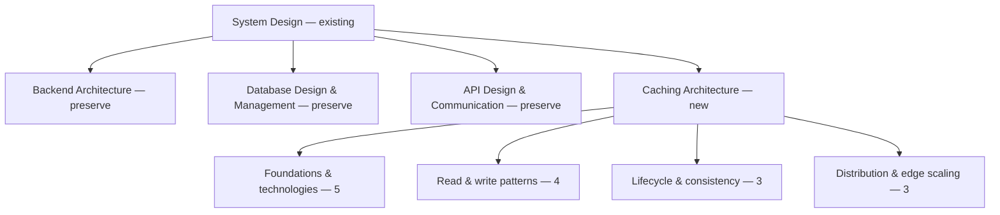

# Caching Architecture

**Stage:** Implementation and validation complete; all 23 tasks and seven acceptance gates passed.\
**Requested:** 2026-11-17. **Profile:** Compact content publishing; constitution v1.3.0.\
**Branch:** `main`. **Git HEAD:** `58d55ff076690804a2f71e5e70b1a4b8f3a68730`.

## Outcome and current taxonomy audit

Learners can decide what is worth caching, choose its placement and technology, trace read
and write patterns, explain freshness and failure behavior, and protect the origin when
cached data expires or becomes unavailable. Deliver 15 complete lessons through the four
requested learning paths, preserving the existing dashboard and learning contract.

The audited working `manifest.json` has `schemaVersion: 1` and a recursive `roots` array.
Every node has immutable `id`, `kind`, `title` and kebab-case `slug` fields; only `hub` nodes
have `children`. Routes and HTML locations derive from ancestry. The catalog contains
**61 nodes: 45 lessons and 16 hubs**, under one System Design root with three children:
Backend Architecture, Database Design & Management, and API Design & Communication.
Neither Caching Architecture nor any of the 15 requested dedicated lesson titles exists.

**Working-tree baseline:** Both completed database and API batches remain uncommitted.
Their manifest entries, lesson/hub files, research, request documents and acceptance
evidence are existing work to preserve. Git HEAD and earlier batch snapshots do not
represent this catalog. Current manifest SHA256:
`af1fec29a14c3fd81e826e0da971537af627a9f3d67c92487dd19382d5745478`.
Capture the then-current pre-edit manifest at implementation start; re-audit if it changes.

**Placement justification:** Root: System Design > Parent: Caching Architecture > one of
the four requested categories > Topic. This branch teaches reusable-data lifecycle and
origin protection alongside system boundaries, authoritative databases and API contracts.
Reuse the existing System Design root, ID `d3825659-12c2-4fc8-b6fe-bdd050762da3`.

Append the new parent after API Design & Communication. Preserve all three existing
subtrees, optional metadata, IDs and recall keys. Keep category/topic order exactly as
requested, using four levels including the leaf. Allocate 20 unique UUIDv4 IDs once during
implementation: five hubs and 15 topics. No IDs or catalog changes are applied by this spec.



## Lesson inventory and boundaries

Every row must remain a separate complete authoring item in subsequent tasks and
implementation. All are complete; final outcomes are recorded below. File paths are relative to
`topics/system-design/caching-architecture/`. Hash routes use the same ancestry without
`topics/` or `.html`, prefixed with `#/`.

| # | Category | Exact lesson title | Relative lesson file | Distinct learning focus |
| --- | --- | --- | --- | --- |
| 1 | Caching Foundations & Technologies | Caching Fundamentals | `caching-foundations-and-technologies/caching-fundamentals.html` | Reuse, locality, hit/miss paths, origin ownership, freshness budgets, cost and evidence for caching. |
| 2 | Caching Foundations & Technologies | Client-Side vs Server-Side Caching | `caching-foundations-and-technologies/client-side-vs-server-side-caching.html` | Placement and trust boundaries across browser/client, process, shared service and intermediaries; scope, isolation and invalidation ownership. |
| 3 | Caching Foundations & Technologies | In-Memory Caching | `caching-foundations-and-technologies/in-memory-caching.html` | Bounded local memory, object lifetime, copy/serialization costs, process restarts, multi-instance divergence and capacity measurement. |
| 4 | Caching Foundations & Technologies | Redis | `caching-foundations-and-technologies/redis.html` | Concrete Redis caching operations, key/data modeling, atomicity boundaries, expiry, eviction, memory and deployment/failure assumptions at an explicit version. |
| 5 | Caching Foundations & Technologies | Memcached | `caching-foundations-and-technologies/memcached.html` | Concrete Memcached item access, lifetime, memory allocation, compare-and-set/concurrency behavior, client routing and operational limits at an explicit version. |
| 6 | Read & Write Caching Patterns | Cache-Aside Pattern | `read-and-write-caching-patterns/cache-aside-pattern.html` | Application-owned miss loading and cache maintenance, write ordering, stale repopulation and failure recovery. |
| 7 | Read & Write Caching Patterns | Read-Through Cache | `read-and-write-caching-patterns/read-through-cache.html` | Cache abstraction/loader owns misses; loader boundaries, error/absence semantics, concurrency and origin-load control. |
| 8 | Read & Write Caching Patterns | Write-Through Cache | `read-and-write-caching-patterns/write-through-cache.html` | Synchronous write path, acknowledgment boundary, origin/cache partial failures, latency and recovery; explicit guarantees rather than a pattern label. |
| 9 | Read & Write Caching Patterns | Write-Behind Cache | `read-and-write-caching-patterns/write-behind-cache.html` | Deferred origin writes, queue durability, acknowledgment, ordering/coalescing, retries, backpressure, crash recovery and acceptable loss. |
| 10 | Lifecycle, Eviction & Consistency | Cache Invalidation | `lifecycle-eviction-and-consistency/cache-invalidation.html` | Choosing obsolete entries, dependencies, versioned keys/events, invalidation loss/races, replay and repair. |
| 11 | Lifecycle, Eviction & Consistency | TTL & Eviction Policies | `lifecycle-eviction-and-consistency/ttl-and-eviction-policies.html` | Freshness-driven expiry versus capacity-driven eviction, policy choice, jitter, hot/cold data, memory budgets and observed behavior. |
| 12 | Lifecycle, Eviction & Consistency | Cache Consistency | `lifecycle-eviction-and-consistency/cache-consistency.html` | Reader-visible freshness/session promises across cache tiers, concurrent reads/writes, stale fills, version checks and correctness-sensitive bypass. |
| 13 | Distributed Caching & Edge Scaling | Distributed Caching | `distributed-caching-and-edge-scaling/distributed-caching.html` | Key placement, replication/failover assumptions, membership changes, hot keys, multi-tier coherence, isolation and origin protection. |
| 14 | Distributed Caching & Edge Scaling | CDN Caching | `distributed-caching-and-edge-scaling/cdn-caching.html` | HTTP edge eligibility, cache keys/variation, validators, public/private content, purge/versioned assets, stale behavior and provider-scoped controls. |
| 15 | Distributed Caching & Edge Scaling | Cache Stampede | `distributed-caching-and-edge-scaling/cache-stampede.html` | Concurrent miss amplification, per-key coalescing, refresh ownership, jitter, negative caching, stale serving and bounded origin admission. |

## Existing overlap and required cross-links

- **HTTP and gateway caching:** Link Client-Side vs Server-Side Caching and CDN Caching
  to existing REST API Design at
  `#/system-design/api-design-and-communication/api-styles-and-protocols/rest-api-design`
  and API Gateway at
  `#/system-design/api-design-and-communication/reliability-security-and-traffic-control/api-gateway`.
  Those lessons retain their API-policy focus. New lessons own caching placement, lifecycle
  and edge behavior, including representation variation, private/shared boundaries and
  authorization on hits. Existing API Gateway Pattern remains the architectural placement
  reference, not a new caching lesson to duplicate.
- **Process-local reuse:** Link In-Memory Caching to the existing GraphQL lesson where
  request-scoped DataLoader illustrates context/lifetime isolation. Explain request-local,
  process-local and shared caching separately; do not turn the new lesson into another
  GraphQL execution tutorial or imply all in-memory caches have the same scope.
- **Authoritative and derived data:** Link Cache Consistency, Cache Invalidation and the
  write-pattern lessons to relevant existing Database Denormalization, Database Transactions
  and Replication lessons. Distinguish a rebuildable cached copy from authoritative storage,
  and cache freshness from database isolation/replica durability. Cover the caching decision
  fully without reproducing the database curriculum.
- **Distribution and failure:** Link Distributed Caching to Distributed System Fundamentals
  and Sharding for shared failure/placement vocabulary while teaching cache-specific
  membership, capacity and origin effects here. Do not equate losing a rebuildable cache
  partition with losing an authoritative database shard.
- **Protection during misses:** Link Cache Stampede to the existing Rate Limiting and
  Idempotency lessons where admission/retries need those distinctions. Separate per-key
  regeneration control from a general traffic quota, and a refresh lock from duplicate-safe
  business execution. A new cache must not become the implicit owner of a durable promise.

All cross-links must resolve against the current manifest. Existing lessons need no
reciprocal edits for this batch; preserve them unchanged. Each new lesson remains
self-contained even if the learner does not follow its related links.

## Shared integration and content scope

Create `_overview.html` for the new Caching Architecture parent and each of its four
category directories. Every hub needs an intuitive orientation, explained Mermaid roadmap,
suggested reading path and links to all immediate children in manifest order. Update the
existing `topics/system-design/_overview.html` prose, roadmap and links for all four
branches while retaining root identity. Use concise diagram labels where long names wrap
poorly; full navigation titles remain exact.

Deliver 15 full HTML lessons, five new hubs, the root hub update, manifest integration and
15 matching `research/topics/<immutable-topic-id>.json` records. Reuse the supported
`.kb-*` partial vocabulary, six-module structure, native independent disclosures and
host-owned recall controls inspected in the existing API lessons. No core-shell, style,
storage, dependency, manifest-schema or learning-standard change is requested.

Research must identify actual product/protocol versions and verify technical claims with
primary documentation. Pattern names must identify who loads/writes data, when a caller
is acknowledged, which copy is authoritative and what happens on partial failure. Explain
expiry, eviction, invalidation and correctness as distinct decisions. Compare Redis and
Memcached through verified workload/operational behavior rather than unsupported universal
performance rankings or claims that every deployment has the same durability/consistency.
Question selection and detailed technical research remain pending, not claimed by this spec.

The eventual delivery bundle must include a placement justification, applied manifest
snippet with allocated IDs, links to every complete lesson/hub and honest verification
results/limitations. Preserve the existing database/API work and their reports; keep caching
acceptance artifacts separate. Reuse this document across explicitly requested stages.

## Inherited acceptance checklist

These gates govern the delivered bundle; completion reflects the final evidence below.

- [X] **Taxonomy and coverage:** Exactly the 15 requested lessons occur once in their
  5/4/3/3 grouping and requested order, under the existing System Design root and one new
  Caching Architecture parent. Five new hubs plus the root update have accurate ordered
  links and meaningful roadmaps. Paths mirror the tree in kebab-case, all 20 new IDs are
  unique/immutable and all old IDs/metadata survive. From this baseline the catalog becomes
  **81 nodes: 60 lessons and 21 hubs**; rederive counts if the starting catalog changes.
- [X] **Complete teaching:** Every lesson follows all six story modules in order, starts
  with a problem/why and ELI5 analogy before jargon, explains valid Mermaid visuals, and
  includes full collapsible mechanics, a decision matrix, Symptom → Root Cause →
  Fix/Prevention failure stories and real-world takeaways. Give each read/write pattern a
  concrete hit/miss/write/failure trace as applicable. No placeholders or shortened lessons.
- [X] **Recall and interviews:** Every lesson contains the Feynman prompt, 3–5 foundational
  cards and a dedicated **Tricky & Most-Asked Interview Scenarios** subsection inside mastery
  with 5–7 distinct constrained production questions: 75–105 scenarios across this batch.
  Every independently collapsible scenario has **The Scenario & Constraint**, **The Direct
  Answer & Architectural Decision**, and **Key Trade-Offs & Follow-Up Traps**, with explicit
  assumptions, an actionable defended decision, costs/alternatives and a changed-constraint
  follow-up. Keep stable recall keys, keyboard support and hidden initial answers.
- [X] **Research and correctness:** Search each exact concept's system-design/debugging/
  trade-off interview situations when web search is available, then verify answers against
  primary sources. Keep actual queries/dates/results, scenario/source mappings and concise
  substantive editorial findings in the reviewed research records and associated visible
  source notes. Evidence must support any frequency/company claim; disclose adaptations,
  unavailable search or insufficient evidence honestly. Do not omit scenarios due to a
  research gap or treat technical documentation as proof of interview popularity.
- [X] **Boundaries and decisions:** Related API/database/architecture links resolve, with
  existing content preserved. Examples explicitly cover authoritative data, acknowledgment,
  stale-fill/invalidation races, isolation, cache outage and bounded origin recovery where
  relevant. Distinguish absent data from fetch failure, expiry from capacity eviction,
  accepted deferred writes from durable origin completion, and cache mechanisms from
  business authorization/transaction guarantees. State product/version-specific limits.
- [X] **Dashboard and learning:** All new lessons/hubs load and reload with correct hash
  routes at `/` and `/backend-lab/`; breadcrumbs, search, sidebar, mobile drawer and four
  home branch cards remain usable. Mastery uses all current lessons and remains explicit;
  opening/rating cards does not imply completion. Existing/new status, review/confidence
  and unknown backup records survive reload and JSON export/import through existing controls.
- [X] **Focused verification and print:** Whole-catalog intrinsic validation and existing
  general tests pass. Render/keyboard/theme/mobile checks cover 15 new lessons, five new
  hubs and the affected root: **21 partials, 63 browser cases and 42 light/dark PDFs** from
  this audit. Require complete answers/diagram labels in print, hidden controls and restored
  disclosure state; visually review new layouts and substantively review every lesson.
  Use the current pre-edit manifest and explicit caching/root paths, not unfiltered
  `--changed` that would include the uncommitted database/API batches. Reuse unchanged
  successful results only under supported input/artifact checks; broaden for actual shared
  runtime changes. Leave frozen historical migration evidence intact.

## Specification review and handoff

**Review:** Passed: exact titles/inventory/order, four-level placement, overlap boundaries,
all hub work, full learning/research requirements, preservation of the current working
catalog and measurable focused acceptance are explicit. No clarification is needed.
The 15 lessons must remain separate complete authoring tasks in any later breakdown.

**Specification validation:** An in-memory check with the existing manifest indexer and
publishing selector passed all 15 paths, the 5/4/3/3 grouping, existing cross-link routes
and the prospective 81-node catalog. Exactly 21 affected partials were selected; the root
was the only existing selection. No temporary IDs were persisted. All 97 protected current
files matched their pre-spec hashes, including completed API/database work and the manifest.

`.specify/extensions.yml` is absent; no before/after-specify hooks are configured.
**Specification handoff:** Completed through the compact content profile. Planning below
extends this document; specification did not change the manifest, lesson/hub files, existing
request documents or application. No lesson research or browser/PDF acceptance was claimed.

## Implementation plan

**Planned:** 2026-11-17 on `main`, against the working-tree baseline above. This is a
content-only publication using the supported dashboard contract. Keep the 15 inventory
paths and their 5/4/3/3 grouping; append Caching Architecture as the fourth System Design
branch. No shell, stylesheet, persistence, manifest-schema, dependency or learning-standard
change is planned. Reuse this document rather than generating separate feature artifacts.

### Inspected contract and presentation

- **Exact manifest:** `{"schemaVersion": 1, "roots": [...]}`. Current hub fields are
  `id`, `kind: "hub"`, `title`, `slug`, `children`; topics use the identity fields with
  `kind: "topic"` and no `children`. Preserve optional metadata if present. The existing
  indexer derives routes from ancestor slugs and partials as `topics/<route>.html` or
  `topics/<route>/_overview.html`; do not add redundant route/file properties. The audit
  still has 61 nodes, 45 lessons and the three completed branches; its manifest hash matches
  the specification. Preserve System Design ID `d3825659-12c2-4fc8-b6fe-bdd050762da3`.
- **Actual lesson inspected:**
  `topics/system-design/api-design-and-communication/reliability-security-and-traffic-control/api-gateway.html`,
  ID `87a2e67c-dc5f-4a8e-944f-9bad681f9699`. It uses a single
  `<article class="kb-topic" data-node-id="UUID">`, exact-title `h1`, and six direct
  `section[data-section]` modules: `hook-eli5`, `big-picture`, `mechanics`, `trade-offs`,
  `pitfalls`, `mastery`. Section IDs follow `node-<UUID>-<key>`.
- **Reuse its styles and disclosures:** `.kb-callout--insight`, `.kb-callout--pitfall`,
  `.kb-callout--impact`, `.kb-diagram`, `pre.mermaid`, explained `figcaption`,
  `.kb-table-wrap`, `.kb-question` and `.kb-references`; use `code.language-*` for relevant
  examples. Mechanics and recall use native independently closed `<details>` without a
  shared `name`. No inline styles/scripts/handlers, outer page shell or duplicate host controls.
- **Recall integration:** The sample has four foundational and six interview cards;
  inherit the constitutional ranges of 3–5 and 5–7 rather than imposing new fixed counts.
  Keep the Feynman prompt and foundational cards separate from the nested
  `section[data-interview-scenarios]` inside mastery. Its exact heading is **Tricky &
  Most-Asked Interview Scenarios**, with ID/ARIA target `node-<UUID>-interview-scenarios`.
  Interview cards use stable `interview-<kebab-key>` IDs, `data-recall-kind="interview"`,
  accurate basis labels and direct `data-scenario-part="scenario|decision|trade-offs"`
  divisions bearing the three exact labels in the specification. Keep one associated
  visible `aside[data-interview-research]` outside the closed cards.
- **Actual hub inspected:** `topics/system-design/api-design-and-communication/_overview.html`.
  Reuse `.kb-hub` identity/title, ELI5 orientation, Mermaid roadmap, reading guide,
  `[data-child-links]` matching immediate manifest children in order, and parent hash link.
  Create five caching hubs and update the existing System Design root's prose/roadmap/list.
  Use concise diagram labels while keeping full titles in navigation and headings.
- **Existing host owns behavior:** Relative fetching/hash routing, Mermaid/Highlight.js
  enhancement, confidence buttons, mastery, themes, JSON backups and print remain unchanged.
  New research records use constitution `1.3.0`; the supported markup profile remains
  `constitution-1.2`. Use the default `research/topics/<topic-id>.json` location without
  adding publishing-registry entries or editing historical research/migration records.

### Concept-specific research and complete authoring queue

Each L01–L15 row corresponds one-to-one with its lesson/path in the inventory. Subsequent
tasks must retain a separate complete HTML authoring task for each row. Each includes its
own exact-concept question search, primary-source verification, full story, research JSON
and substantive editorial review; related lessons must not be collapsed into summaries.

For each concept search its exact title plus production/system-design, debugging and
trade-off interview terms before selecting 5–7 scenarios. Batch independent searches and
reuse checked references where relevant. Record actual queries, results, dates and source
mappings once in that lesson's research record. Identify product/server/client versions
and deployment assumptions during verification. The source families below are **research
targets**, not checked references or a completed interview-frequency study.

| Item | Complete lesson | Production questions and distinctions to investigate | Primary verification targets |
| --- | --- | --- | --- |
| L01 | Caching Fundamentals | Whether caching helps the measured workload; hit/miss latency and cost; skew; freshness budget; absent values versus origin failures; origin capacity after cache loss. | Original caching/system references and official cache/origin measurement guidance for the chosen example. |
| L02 | Client-Side vs Server-Side Caching | Request/browser/process/shared scope; identity and representation variation; logout/permission changes; offline behavior; which layer owns invalidation. | HTTP caching specification, browser HTTP/Cache API documentation and the selected server-cache documentation; distinguish mechanisms explicitly. |
| L03 | In-Memory Caching | Bounded memory/object lifetime; mutation of cached objects; process restarts; multi-worker divergence; request versus process scope; expensive serialization/GC. | Official selected runtime/cache-library documentation and the original DataLoader documentation for the request-scoped comparison. |
| L04 | Redis | Key/value modeling and atomic operation boundaries; expiry/eviction; memory exhaustion; pipelining versus transaction semantics; persistence/failover assumptions; hot keys. | Official Redis command, memory/eviction, expiry, persistence, replication and clustering documentation at explicitly identified versions/configurations. |
| L05 | Memcached | Item lifetime/expiration encoding; memory allocation and eviction; large items; compare-and-set conflicts; client key routing; node restart/failure and origin fallback. | Official Memcached protocol, user/operations and memory-management documentation plus the chosen client/version behavior. |
| L06 | Cache-Aside Pattern | Concurrent miss fills; read/write ordering; stale repopulation after invalidation; negative caching; fetch failure versus absence; bounded fallback during outages. | Original or official cache-aside pattern documentation and the chosen origin/cache client's actual concurrency operations. |
| L07 | Read-Through Cache | Which component owns the loader; coalesced versus duplicated loads; loader timeouts; absent/error results; bulk loads and recursive dependencies. | Official cache-loader/provider documentation for one explicitly scoped example; verify what its abstraction actually guarantees. |
| L08 | Write-Through Cache | Exact synchronous acknowledgment point; partial cache/origin failures; retries; stale concurrent loads; write latency and recovery after timeout. | Official provider write-through/store documentation and authoritative-store transaction/conditional-write semantics. |
| L09 | Write-Behind Cache | What survives acknowledged writes; queue durability; ordering and coalescing; retry identity; backpressure; failed batches/restarts; flush/shutdown behavior. | Official provider asynchronous write-behind documentation and queue/persistence guarantees at the selected configuration. |
| L10 | Cache Invalidation | Dependency/fan-out keys; stale-fill races; versioned namespaces; lost/out-of-order invalidation events; replay/repair; changed permissions and deletion. | Primary invalidation/client-tracking/versioning documentation and the chosen change-publication mechanism's delivery/ordering contract. |
| L11 | TTL & Eviction Policies | Freshness expiry versus memory-pressure eviction; policy/size choice; jitter; negative entries; tiered TTLs; metrics and expired-key behavior. | Official selected engine expiry/eviction/memory documentation and HTTP freshness rules where an HTTP example is used. |
| L12 | Cache Consistency | Reader-visible freshness/session guarantees; concurrent stale fills; versions; layered caches; invalidate/update ordering; correctness-sensitive reads and bypass. | Original consistency references and selected cache/origin concurrency documentation; compare with existing database lessons without conflating guarantees. |
| L13 | Distributed Caching | Key placement and membership changes; replicas/failover; partition and hot-key behavior; rebalancing; isolation; multi-tier coherence and cold-start load. | Official cluster/client-routing/replication documentation for explicitly named deployments and original distribution/failure references. |
| L14 | CDN Caching | Eligibility and private/shared representations; variation/cache keys; validators; purge/versioned assets; stale directives; authenticated content and edge/origin disagreement. | HTTP Caching/Semantics specifications and one named CDN provider's current official cache-key/purge/TTL documentation; scope provider-specific behavior. |
| L15 | Cache Stampede | One hot missing key versus many simultaneous expiries; refresh ownership; coalescing; jitter; stale responses; nonexistent keys; bounded origin admission after cache failure. | Primary request-coalescing/stale-serving/cache-pattern guidance and exact lock/lease/conditional-operation behavior used by the example. |

Author each lesson as a complete ELI5-first narrative with a concrete worked example,
fully explained mechanics, trade-off matrix, failure stories and real-world takeaways.
For caching patterns, explicitly identify the actor doing a load/write, authoritative
copy, acknowledgment boundary and recovery path. Use explained flow diagrams for hit/miss
or placement and sequence diagrams where a race/ordering timeline teaches more; keep
readable labels and valid Mermaid statements. There is no per-scenario diagram quota.
Honor the overlap and mandatory related links in the specification while keeping each
lesson self-contained. State whether illustrative commands/workflows were actually run.

Every lesson also delivers the Feynman prompt, 3–5 foundational cards and 5–7 materially
distinct constrained interview scenarios with all three answer parts, including debugging,
costs/alternatives and a changed-assumption follow-up. Select these after searching rather
than generating a generic identical set for all products/patterns. Technical documentation
does not establish interview frequency: label adaptations and disclose insufficient or
unavailable evidence; reserve reported recurrence for the precise supported claim.

Write one concise `research/topics/<immutable-topic-id>.json` per lesson using
`docs/topic-publishing.md`/`check_research`: actual searches, checked primary sources,
ordered stable scenario keys/bases, selection/technical mappings, assumptions/limitations,
eight concrete editorial findings per scenario and matching public disclosure/source URLs.
Mark reviewed only after source and substantive review; do not duplicate full answers in
evidence. The detailed searches, source checks and scenario selection remain **pending
authoring work**; this plan makes no researched product recommendation or popularity claim.

### Dependency order and preservation

1. **Freeze the working baseline before catalog edits.** Re-audit the then-current manifest
   and capture it once in `.cache/topic-checks/caching-architecture-manifest-before.json`.
   On resumed runs reuse the original snapshot; do not overwrite it with the expanded
   catalog. Protect existing lesson/research/runtime files, both completed request documents
   and prior API/database acceptance reports. Record the root hub separately as the planned
   existing HTML edit. Preserve the three existing manifest subtrees as JSON values and all
   IDs/metadata/recall keys. Update audit-derived counts if the starting state changed.
2. **Integrate shared taxonomy and hubs once.** Allocate 20 new canonical UUIDv4 IDs and
   append the requested parent/categories/topics in order. Create the five matching
   `_overview.html` files and update the root overview. Keep the inventory's exact paths;
   draft empty pages or placeholder content are not deliverables. Keep these shared edits
   separate from independent lesson authoring.
3. **Complete L01–L15 individually.** For each row research, author its full partial, write
   its reviewed record and review correctness/teaching depth before marking the task done.
   Publishable acceptance waits for the complete bundle and shared checks. No infrastructure
   setup or core-shell work is needed for these supported partials.
4. **Verify the bundle and fix affected failures.** Run the whole-catalog cheap checks and
   focused browser/PDF acceptance below; inspect visual patterns and substantive quality.
   A correction invalidates affected results; use the supported input/artifact cache to
   avoid repeating unrelated expensive work. Pending/failed checks are not acceptance.
5. **Record final delivery here.** Include concise per-lesson outcomes, limitations,
   acceptance results, placement line, applied manifest snippet and complete partial links.
   Preserve the previous requests/reports; commit/push only if requested.

### Focused verification commands and scope

The pre-edit snapshot must include the completed database/API batches. Git HEAD and their
older snapshots would classify unrelated work as part of caching. Use explicit paths and
caching-specific report/PDF locations to retain the existing acceptance artifacts.

At implementation start, create the snapshot **once before the first catalog edit**:

```sh
mkdir -p .cache/topic-checks
cp manifest.json .cache/topic-checks/caching-architecture-manifest-before.json
```

After all lessons/hubs/research are complete, run the generic whole-catalog checks:

```sh
python3 tools/validate_content.py --report .cache/topic-checks/caching-architecture-static.json
python3 -m unittest discover -s tests/content -q
node --experimental-default-type=module tests/dashboard/test_catalog.mjs
node --experimental-default-type=module tests/dashboard/test_learning_state.mjs
```

Using the pinned browser tooling described in `docs/topic-publishing.md`, run:

```sh
python3 tools/check_topics.py \
  --baseline .cache/topic-checks/caching-architecture-manifest-before.json \
  --paths manifest.json topics/system-design/_overview.html topics/system-design/caching-architecture/_overview.html \
  --report .cache/topic-checks/caching-architecture-report.json \
  --pdf-dir .cache/topic-checks/caching-architecture-pdfs
```

The manifest delta selects all 20 new nodes and the existing root, even though the command
names only the new parent partial explicitly. Expected scope from this audit is **21
partials, 63 layout/theme browser cases and 42 actual PDFs**; intrinsic validation still
checks all 81 nodes. The runner owns server startup/cleanup at `/` and `/backend-lab/` and
checks route reloads, identities, all diagrams, independent keyboard disclosures, every
confidence key, explicit mastery, mobile light/dark layouts, hub links and both-theme
print text/diagram completeness, hidden controls and restored disclosure state. Verify
final fingerprints and PDF hashes; `--static-only` cannot satisfy publication acceptance.

Add a focused integration pass for all 15 exact-title searches under both deployment bases,
four home branch cards and a mastery denominator derived from the current manifest. In
isolated browser storage carry an existing known topic's status/review/confidence and an
unknown archived record through export/import; add a new caching topic's confidence and
explicit mastery, reload and verify both generations survive. Confirm opening/rating
cards does not imply mastery. Check new-branch breadcrumbs, active/expanded sidebar and
mobile drawer. Record a concise result in
`.cache/topic-checks/caching-architecture-integration.json`; keep temporary fixtures outside
the publication tree and reuse existing controls/tests rather than adding another framework.

Review actual light/dark/mobile layouts and PDF pages for new patterns, especially race
timelines, long cache policy matrices, code/command examples and expanded scenario answers.
Shorten diagram labels if they fragment; keep exact navigation titles. Review every lesson
for correct ownership, acknowledgment, failure assumptions, narrative and non-duplicated
decisions; automation cannot prove these. Compare protected hashes and existing subtrees
to the working baseline, allowing only the planned root overview change. Never update or
require frozen migration expectations for this catalog expansion. Broaden regression scope
only if shared runtime/style/state behavior actually changes.

### Plan review and handoff

Constitution gates pass at design level: all six story modules, exact-concept web research,
primary verification, foundational practice, full scenario counts/three-part answers,
stable IDs, supported accessible cards, source honesty and complete print delivery are
explicitly covered. Existing contracts/validators suffice; no design clarification is
required before task generation. Product versions and scenario evidence will be resolved
during each lesson's authoring, without claiming they were researched here.

**Planning validation:** An in-memory dry run confirmed the 15 research rows match the
inventory exactly, preserve its 5/4/3/3 grouping and produce the expected 81-node catalog.
The planned runner arguments selected exactly 21 partials; the System Design root was the
only existing selection. All 101 protected existing files matched their pre-plan hashes.
No prospective UUIDs/catalog entries were persisted and no caching partials were created.

`.specify/extensions.yml` is absent; no before/after-plan hooks are configured.
**Plan handoff:** The compact checklist below retains one separate complete HTML authoring
task for each of L01–L15. Planning changed only this request document; manifest integration,
lesson authoring and browser/PDF acceptance remain pending.

## Implementation tasks

**Generated and completed:** 2026-11-17. All 23 tasks are complete. This is the compact
content profile's task artifact; continue in this document rather than creating another
`specs/` feature or executing a historical feature's `tasks.md`. Paths are relative to the
repository root. The inventory, research matrix and inspected partial contract above are
part of every applicable task.

### Complete-lesson definition for T004–T018

Every lesson task includes **exact-concept research → complete HTML → its research record
→ substantive review**. Use its L01–L15 research row before selecting questions. Search
the concept's production/system-design, debugging and trade-off interview situations when
available; verify answers against checked primary sources with explicit server/client/
protocol versions and deployment assumptions. Reuse useful checked material without
repeating searches. Record actual queries/results, dates, source mappings and honest
frequency/search limitations in `research/topics/<that-lesson-manifest-id>.json`, using
the stable identity allocated by T002.

Each HTML partial must deliver all six ordered ELI5-first modules, a concrete worked
example, explained valid Mermaid visuals, full collapsible mechanics, a decision matrix,
Symptom → Root Cause → Fix/Prevention stories and real-world takeaways. Include the Feynman
prompt **“Summarize this in your own words”**, **3–5 foundational cards** and **5–7 distinct
production interview scenarios** inside the dedicated mastery subsection. Each scenario
uses its own native `<details>` and the exact three labels **The Scenario & Constraint**,
**The Direct Answer & Architectural Decision**, **Key Trade-Offs & Follow-Up Traps**.
Provide explicit constraints, an actionable defended decision, costs, a viable alternative
and a changed-assumption follow-up. Keep stable recall keys, initially hidden independent
answers, accurate basis labels and the inspected `.kb-*` contract/host controls.

Explain who owns the data, who loads/writes it, what acknowledgment means and how partial
failures recover wherever applicable. Use meaningful hit/miss diagrams or race timelines
without a per-card diagram quota. Honor the specified cross-links, keeping existing lessons
unchanged and each new lesson self-contained. State whether examples were actually run;
do not imply illustrative commands prove deployed interoperability, performance or durability.

Each research JSON must meet `docs/topic-publishing.md` and `tools/validate_content.py`:
constitution `1.3.0`, ordered scenario keys/bases and source mappings, eight concise concrete
editorial findings per scenario, and exact agreement with the visible public disclosure
and source-note URLs. Mark `state: "reviewed"` only after technical/editorial review. Claims
of interview recurrence need specific evidence; use honest adaptation/fallback labels when
appropriate. No truncated lessons, generic duplicated scenario sets, placeholders or copied
answer ledgers satisfy a task. Full browser/print acceptance remains a shared later gate.

### Shared baseline, taxonomy and hubs

- [X] T001 Re-audit `manifest.json` and the sample lesson/hub in the plan; before edits, save the working catalog once to `.cache/topic-checks/caching-architecture-manifest-before.json` and protected existing lesson/research/runtime/request-document/acceptance-report hashes to `.cache/topic-checks/caching-architecture-protected.json`. Record the root hub separately as the intended existing HTML change. Preserve the uncommitted database/API batches and reuse the original snapshot on resumed runs; rederive counts if the starting catalog changed.
- [X] T002 Append Caching Architecture, its four requested categories and all 15 exact-title topics to `manifest.json` in inventory order, allocating exactly 20 new canonical UUIDv4 IDs once. Preserve the existing root ID, three complete old subtrees, metadata and recall identities. Use the existing schema and derived kebab-case routes/files; do not change publishing registries or frozen migration baselines.
- [X] T003 Create `topics/system-design/caching-architecture/_overview.html` and its four category hubs: `topics/system-design/caching-architecture/caching-foundations-and-technologies/_overview.html`, `topics/system-design/caching-architecture/read-and-write-caching-patterns/_overview.html`, `topics/system-design/caching-architecture/lifecycle-eviction-and-consistency/_overview.html`, and `topics/system-design/caching-architecture/distributed-caching-and-edge-scaling/_overview.html`. Update `topics/system-design/_overview.html` for all four branches. Match IDs/titles, add ELI5 orientation, explained readable Mermaid roadmaps, reading guidance and every immediate-child hash link in order.

### Caching Foundations & Technologies — five complete lessons

Independent acceptance: five full lessons and reviewed research records explain why/where
to cache and distinguish local memory from concrete products and deployment guarantees.
Their hub links, diagrams, recall/scenarios and affected render/print checks must pass.

- [X] T004 [P] Research, author and review **Caching Fundamentals** in `topics/system-design/caching-architecture/caching-foundations-and-technologies/caching-fundamentals.html` and its stable-ID JSON under `research/topics/`, meeting the complete-lesson definition and L01. Work through hit/miss behavior, locality, measured value/cost, freshness and authoritative ownership; distinguish missing data from fetch failure and explain origin capacity after cache loss.
- [X] T005 [P] Research, author and review **Client-Side vs Server-Side Caching** in `topics/system-design/caching-architecture/caching-foundations-and-technologies/client-side-vs-server-side-caching.html` and its stable-ID JSON under `research/topics/`, meeting the complete-lesson definition and L02. Compare request/browser/process/shared/intermediary placement, identity/visibility, offline behavior and invalidation ownership; link existing REST API Design and API Gateway without duplicating their API-policy scope.
- [X] T006 [P] Research, author and review **In-Memory Caching** in `topics/system-design/caching-architecture/caching-foundations-and-technologies/in-memory-caching.html` and its stable-ID JSON under `research/topics/`, meeting the complete-lesson definition and L03. Explain bounded memory/lifetimes, object mutation, process restarts, worker divergence and measured copy/serialization costs; link GraphQL's request-scoped DataLoader example while distinguishing request, process and shared cache scope.
- [X] T007 [P] Research, author and review **Redis** in `topics/system-design/caching-architecture/caching-foundations-and-technologies/redis.html` and its stable-ID JSON under `research/topics/`, meeting the complete-lesson definition and L04. Verify explicit Redis/client versions and configuration; teach cache key/data operations, atomicity boundaries, expiry/eviction, memory exhaustion, persistence/replication/failover assumptions and hot keys without unsupported universal speed or durability claims.
- [X] T008 [P] Research, author and review **Memcached** in `topics/system-design/caching-architecture/caching-foundations-and-technologies/memcached.html` and its stable-ID JSON under `research/topics/`, meeting the complete-lesson definition and L05. Verify the selected server/client protocol and versions; explain item access/lifetime/expiration encoding, memory allocation/eviction, compare-and-set conflicts, client routing and origin recovery after node loss; keep Redis comparisons workload-specific.

### Read & Write Caching Patterns — four complete lessons

Independent acceptance: four separate lessons and reviewed research records trace actual
load/write actors, the authoritative copy, acknowledgment and partial-failure recovery.
Read-through and cache-aside remain distinct; synchronous/deferred writes carry explicit
guarantees. Category links and affected browser/print checks must pass.

- [X] T009 [P] Research, author and review **Cache-Aside Pattern** in `topics/system-design/caching-architecture/read-and-write-caching-patterns/cache-aside-pattern.html` and its stable-ID JSON under `research/topics/`, meeting the complete-lesson definition and L06. Trace application-owned misses/fills, writes/invalidation, concurrent stale repopulation, absence/error distinction, negative caching and bounded origin fallback. Explain the ordering race with an appropriate visual and link related invalidation/consistency lessons.
- [X] T010 [P] Research, author and review **Read-Through Cache** in `topics/system-design/caching-architecture/read-and-write-caching-patterns/read-through-cache.html` and its stable-ID JSON under `research/topics/`, meeting the complete-lesson definition and L07. Identify the actual cache abstraction/loader, verify its selected implementation, and cover load coalescing, timeout/error/absence semantics, bulk access and recursive dependencies; distinguish ownership from application-managed cache-aside.
- [X] T011 [P] Research, author and review **Write-Through Cache** in `topics/system-design/caching-architecture/read-and-write-caching-patterns/write-through-cache.html` and its stable-ID JSON under `research/topics/`, meeting the complete-lesson definition and L08. Trace the synchronous write/acknowledgment boundary, origin/cache partial failures, uncertain retries, concurrent fills and latency costs. Link relevant existing database transaction/derived-data material without claiming the pattern name makes two stores atomic.
- [X] T012 [P] Research, author and review **Write-Behind Cache** in `topics/system-design/caching-architecture/read-and-write-caching-patterns/write-behind-cache.html` and its stable-ID JSON under `research/topics/`, meeting the complete-lesson definition and L09. State what survives acknowledgment, who owns deferred data and how queue durability, ordering/coalescing, retry identity, backpressure, failed batches/restarts and shutdown recovery work under explicit assumptions; cross-link relevant database lessons.

### Lifecycle, Eviction & Consistency — three complete lessons

Independent acceptance: three complete lessons and reviewed records distinguish making
copies obsolete, expiration, capacity eviction and reader-visible correctness. Worked races,
failure repair, related database links and affected browser/print checks must pass.

- [X] T013 [P] Research, author and review **Cache Invalidation** in `topics/system-design/caching-architecture/lifecycle-eviction-and-consistency/cache-invalidation.html` and its stable-ID JSON under `research/topics/`, meeting the complete-lesson definition and L10. Cover dependency keys/fan-out, stale-fill races, versioned namespaces, lost/out-of-order invalidation, replay/repair and permission/deletion changes; link relevant existing Database Denormalization, Database Transactions and Replication material.
- [X] T014 [P] Research, author and review **TTL & Eviction Policies** in `topics/system-design/caching-architecture/lifecycle-eviction-and-consistency/ttl-and-eviction-policies.html` and its stable-ID JSON under `research/topics/`, meeting the complete-lesson definition and L11. Separate freshness expiry from memory-pressure eviction, verify actual engine behavior, compare policies with measured workloads, and cover jitter, negative entries, tiered lifetimes and memory budgets without promising freshness solely from a configured TTL.
- [X] T015 [P] Research, author and review **Cache Consistency** in `topics/system-design/caching-architecture/lifecycle-eviction-and-consistency/cache-consistency.html` and its stable-ID JSON under `research/topics/`, meeting the complete-lesson definition and L12. Define reader/session freshness promises, illustrate concurrent stale fills and layered-cache races, compare versions/invalidation/update ordering and correctness-sensitive bypass, and link existing database lessons without equating cache freshness with transaction isolation or replica durability.

### Distributed Caching & Edge Scaling — three complete lessons

Independent acceptance: three full lessons and reviewed records explain distributed/edge
placement and origin protection under miss/failure load, retain the stated API/architecture
boundaries, and pass all category-link and affected render/print checks.

- [X] T016 [P] Research, author and review **Distributed Caching** in `topics/system-design/caching-architecture/distributed-caching-and-edge-scaling/distributed-caching.html` and its stable-ID JSON under `research/topics/`, meeting the complete-lesson definition and L13. Explain key ownership/routing, membership/rebalancing, replication/failover assumptions, partitions/hot keys, isolation and cold-start origin load in explicitly scoped deployments; link Distributed System Fundamentals and Sharding while distinguishing rebuildable cache partitions from authoritative data shards.
- [X] T017 [P] Research, author and review **CDN Caching** in `topics/system-design/caching-architecture/distributed-caching-and-edge-scaling/cdn-caching.html` and its stable-ID JSON under `research/topics/`, meeting the complete-lesson definition and L14. Verify HTTP and named-provider semantics for eligibility, private/shared visibility, cache keys/variation, validators, purge/versioned assets and stale behavior; link existing REST API Design and API Gateway, keeping provider guarantees scoped and authorization explicit on cache hits.
- [X] T018 [P] Research, author and review **Cache Stampede** in `topics/system-design/caching-architecture/distributed-caching-and-edge-scaling/cache-stampede.html` and its stable-ID JSON under `research/topics/`, meeting the complete-lesson definition and L15. Distinguish one hot-key regeneration from many-key expiry, and evaluate coalescing/refresh ownership, jitter, stale serving, nonexistent-key handling and bounded origin admission. Link Rate Limiting and Idempotency without treating a refresh lock as duplicate-safe business execution.

### Shared verification and delivery

- [X] T019 Run whole-catalog intrinsic validation via `tools/validate_content.py`, writing `.cache/topic-checks/caching-architecture-static.json`; run the existing general `tests/content/` suite plus `tests/dashboard/test_catalog.mjs` and `tests/dashboard/test_learning_state.mjs` using the plan's commands. Fix content/research/link failures under the generic publishing profile, derive counts from `manifest.json` and preserve frozen migration fixtures. Check any executable lesson examples as appropriate and record illustrative versus executed scope honestly.
- [X] T020 Run `tools/check_topics.py` with T001's pre-edit manifest, the explicit caching/root paths and caching-specific report/PDF locations in the plan. Require complete passing results for all 21 affected partials, 63 browser cases and 42 actual light/dark PDFs from this baseline, recomputing if the catalog changed. Verify both deployment bases, reloads/identities, every diagram/card confidence key, independent keyboard disclosures, explicit mastery, mobile/themes, hub links, full printed answers/diagram labels, hidden controls and restored disclosure state. Fix and rerun affected failures; pending results do not satisfy acceptance.
- [X] T021 Perform the plan's focused real-app integration pass at `/` and `/backend-lab/`, recording `.cache/topic-checks/caching-architecture-integration.json`. Require all 15 exact-title searches at both bases, four home branch cards, manifest-derived mastery, new breadcrumb/sidebar/drawer behavior, and old/new status/review/confidence plus an unknown archived record preserved through reload and JSON export/import. Use isolated storage/temporary fixtures; opening/rating cards must not imply mastery.
- [X] T022 Review every final lesson/source for substantive correctness, complete narrative, ownership/acknowledgment/failure assumptions and distinct decisions; inspect actual mobile/theme layouts and PDFs in `.cache/topic-checks/caching-architecture-pdfs/` for race timelines, matrices, code and expanded scenario answers. Compare protected hashes and the three original subtrees to T001, permitting only the planned root overview edit with its ID preserved. Fix clipping/fragmented labels or teaching defects and repeat affected T019–T021 checks so final fingerprints and artifacts match final content; preserve prior API/database acceptance evidence.
- [X] T023 Complete `docs/topic-requests/caching-architecture.md` with concise per-lesson outcomes, source/example-execution limitations, final acceptance results, placement justification, the applied `manifest.json` snippet preserving existing API/database branches and links to all 15 full lessons, five new hubs and updated root. Check off only completed tasks/gates with current evidence. Report delivery without committing or pushing unless requested.

### Dependencies and execution guidance

Run **T001 → T002 → T003** before lesson authoring. T004–T018 are independent after
stable identities and shared integration are fixed: each writes its own HTML partial and
stable-ID research JSON. `[P]` describes conditional file independence; it does not waive
prerequisites or require additional agents. For example, T004–T008 can proceed independently
within Foundations, T009–T012 within Patterns, T013–T015 within Lifecycle and T016–T018
within Distribution. Keep manifest/shared hub edits in T002–T003 and consolidate request
document results in T023 to avoid edit conflicts.

Complete all 15 lesson tasks before **T019 → T020 → T021 → T022 → T023**. Review fixes
loop back through affected checks; unchanged successful browser/PDF results may be reused
only through supported fingerprints/output hashes. A useful first complete authoring slice
is T004 after shared setup, using its full research/story standard; this is not acceptance
of an incomplete batch. Final acceptance requires all four learning paths and all seven
inherited gates. Do not add application infrastructure or historical migration work for
the unchanged shell.

### Task-stage review and handoff

Allocation: three shared baseline/catalog/hub tasks, **15 separate full lesson tasks
(5 + 4 + 3 + 3)**, and five shared verification/delivery tasks: **23 total**. Each completed task retains a unique sequential ID and a repository-relative target path.
Every learning path has independent acceptance criteria above; the full bundle uses the
plan's common integration/print gates. Task generation itself did not implement content or establish acceptance; final delivery below records the completed work.

`.specify/extensions.yml` is absent; no before/after-tasks hooks are configured.
**Implementation handoff:** T001–T023 were executed through the compact content profile. Task generation itself changed only this request document; final delivery follows.


## Final delivery — 2026-11-17

**Placement:** Root: System Design > Parent: Caching Architecture > the four requested
categories > 15 complete lessons. The branch teaches reusable-data ownership, lifecycle
and origin protection alongside the existing architecture, database and API branches.

All lessons deliver the complete six-module ELI5-first story, meaningful Mermaid visuals,
collapsible mechanics, comparisons, failure analysis, Feynman prompt, four foundational
cards and six full independently collapsible three-part interview scenarios: **60 new
foundational cards and 90 new scenarios**. Each has a reviewed stable-ID research record.
Five overview hubs and the existing root roadmap/links integrate the requested 5/4/3/3
grouping. The catalog now contains **60 lessons and 21 hubs** under one System Design root.

### Complete lesson partials and research

Each lesson passed content/source/editorial review and the affected browser/print checks.
The linked HTML files contain full lessons; the records carry checked sources and concise
scenario mappings rather than copied answers.

| Complete lesson | HTML partial | Research record | Recall / scenarios |
| --- | --- | --- | --- |
| Caching Fundamentals | [Complete HTML](../../topics/system-design/caching-architecture/caching-foundations-and-technologies/caching-fundamentals.html) | [Reviewed sources](../../research/topics/1d30f8cc-a5b4-4926-878a-544d77547108.json) | 4 / 6 |
| Client-Side vs Server-Side Caching | [Complete HTML](../../topics/system-design/caching-architecture/caching-foundations-and-technologies/client-side-vs-server-side-caching.html) | [Reviewed sources](../../research/topics/c4c3eb6a-629a-495a-a619-77856040cb9a.json) | 4 / 6 |
| In-Memory Caching | [Complete HTML](../../topics/system-design/caching-architecture/caching-foundations-and-technologies/in-memory-caching.html) | [Reviewed sources](../../research/topics/201c66d6-03d3-43dc-97e5-feae00f82029.json) | 4 / 6 |
| Redis | [Complete HTML](../../topics/system-design/caching-architecture/caching-foundations-and-technologies/redis.html) | [Reviewed sources](../../research/topics/c47ba2d8-cfc4-456f-ad35-ac623df43ab4.json) | 4 / 6 |
| Memcached | [Complete HTML](../../topics/system-design/caching-architecture/caching-foundations-and-technologies/memcached.html) | [Reviewed sources](../../research/topics/a8fba99e-22a9-4926-8e3e-7aec33d2d602.json) | 4 / 6 |
| Cache-Aside Pattern | [Complete HTML](../../topics/system-design/caching-architecture/read-and-write-caching-patterns/cache-aside-pattern.html) | [Reviewed sources](../../research/topics/6dc74c43-8a26-4102-85ad-57cd75f22882.json) | 4 / 6 |
| Read-Through Cache | [Complete HTML](../../topics/system-design/caching-architecture/read-and-write-caching-patterns/read-through-cache.html) | [Reviewed sources](../../research/topics/4dfb44bc-6877-45a2-9d6c-3efadfd3e83d.json) | 4 / 6 |
| Write-Through Cache | [Complete HTML](../../topics/system-design/caching-architecture/read-and-write-caching-patterns/write-through-cache.html) | [Reviewed sources](../../research/topics/7b524700-f769-4cae-abba-35320830caa2.json) | 4 / 6 |
| Write-Behind Cache | [Complete HTML](../../topics/system-design/caching-architecture/read-and-write-caching-patterns/write-behind-cache.html) | [Reviewed sources](../../research/topics/061611a4-5cb5-424c-8f12-c712e942fe36.json) | 4 / 6 |
| Cache Invalidation | [Complete HTML](../../topics/system-design/caching-architecture/lifecycle-eviction-and-consistency/cache-invalidation.html) | [Reviewed sources](../../research/topics/919d1138-71dd-4c5e-a406-c42534617c8d.json) | 4 / 6 |
| TTL & Eviction Policies | [Complete HTML](../../topics/system-design/caching-architecture/lifecycle-eviction-and-consistency/ttl-and-eviction-policies.html) | [Reviewed sources](../../research/topics/ef286990-a311-4249-947a-7af1a4238abc.json) | 4 / 6 |
| Cache Consistency | [Complete HTML](../../topics/system-design/caching-architecture/lifecycle-eviction-and-consistency/cache-consistency.html) | [Reviewed sources](../../research/topics/3699cb2c-4cb0-41cd-9d7e-3665d2c39b3d.json) | 4 / 6 |
| Distributed Caching | [Complete HTML](../../topics/system-design/caching-architecture/distributed-caching-and-edge-scaling/distributed-caching.html) | [Reviewed sources](../../research/topics/65e04270-0521-48e9-a9ac-163519e7ec1a.json) | 4 / 6 |
| CDN Caching | [Complete HTML](../../topics/system-design/caching-architecture/distributed-caching-and-edge-scaling/cdn-caching.html) | [Reviewed sources](../../research/topics/10d50ab8-3b59-4f67-ac05-f0c9d388dfca.json) | 4 / 6 |
| Cache Stampede | [Complete HTML](../../topics/system-design/caching-architecture/distributed-caching-and-edge-scaling/cache-stampede.html) | [Reviewed sources](../../research/topics/064e6c3c-d9a7-449c-ac5e-4c8afeffcf54.json) | 4 / 6 |

### Complete hubs

- [System Design](../../topics/system-design/_overview.html) — existing root updated; identity preserved.
- [Caching Architecture](../../topics/system-design/caching-architecture/_overview.html) — new overview and roadmap.
- [Caching Foundations & Technologies](../../topics/system-design/caching-architecture/caching-foundations-and-technologies/_overview.html) — new overview and roadmap.
- [Read & Write Caching Patterns](../../topics/system-design/caching-architecture/read-and-write-caching-patterns/_overview.html) — new overview and roadmap.
- [Lifecycle, Eviction & Consistency](../../topics/system-design/caching-architecture/lifecycle-eviction-and-consistency/_overview.html) — new overview and roadmap.
- [Distributed Caching & Edge Scaling](../../topics/system-design/caching-architecture/distributed-caching-and-edge-scaling/_overview.html) — new overview and roadmap.

### Verification and preservation

- Whole-catalog intrinsic validation: **pass**, 81 nodes, 173 diagrams and 601 recall
  cards. Report: `.cache/topic-checks/caching-architecture-static.json`.
- Existing general suites: **72 Python + 14 Node tests passed**. Localhost-dependent
  checks ran with socket access; no application or test fixture changes were needed.
- Chromium publishing acceptance: **21 partials, 63 browser cases and 42 actual light/dark
  PDFs passed**. Covered `/` and `/backend-lab/` hash routes/reloads, identity, every diagram,
  independent keyboard disclosure, every confidence key, explicit mastery, mobile/themes,
  hub child links, full print text/diagram labels, hidden controls and restored disclosure
  state. Final fingerprints and PDF hashes match final inputs; any successful reuse obeyed
  the existing cache rules. Report: `.cache/topic-checks/caching-architecture-report.json`;
  PDFs: `.cache/topic-checks/caching-architecture-pdfs/`.
- Focused integration: **30 exact-title searches across both bases passed**, four home
  branch cards and the manifest-derived 60-topic denominator. Representative Backend,
  Database and API status/confidence/review records plus an unknown archived record
  survived alongside a new caching record through reload and JSON export/import. Opening
  or rating recall cards did not imply mastery. New-branch breadcrumbs, active sidebar,
  drawer and mobile theme behavior passed without console/page errors. Report:
  `.cache/topic-checks/caching-architecture-integration.json`.
- Teaching examples: all **three complete Python models executed successfully** (bounded
  local-cache lifetime/recency, the cache-aside stale-fill interleaving and known-version
  invalidation guard). JSON examples parsed. These are scoped single-threaded models,
  not production distributed/concurrent-cache implementations. Report:
  `.cache/topic-checks/caching-architecture-examples.json`.
- Visual/editorial review: inspected printed opening/diagram pages across affected
  partials, representative code, race, comparison and expanded scenario pages in both
  print themes, plus actual mobile light/dark views and diagram captures. Reviewed all
  15 lessons for ownership, acknowledgment, freshness, failure assumptions and complete
  decisions. Captures: `.cache/topic-checks/caching-architecture-visual/`.
- Preservation: all 108 protected pre-existing files other than the intentionally
  updated root hub are byte-identical, including prior request documents and API/database
  acceptance reports. All three old manifest subtrees remain equal to the pre-edit snapshot;
  existing IDs, metadata and recall keys survive. Root identity is unchanged. No shell,
  stylesheet, persistence, dependency, publishing-registry or frozen migration changes.

**Research and execution limits:** All 90 new questions are `adapted-production` prompts.
Exact interview frequency, rankings and company attribution were not independently
verified; every public source note discloses that limitation. Primary references support
technical decisions, not popularity claims. Product examples identify scope, including
Redis 8.0-compatible core commands, Memcached 1.6 basic text protocol, Ehcache 3.11 and
provider-specific CDN behavior. The 2013 Memcache paper's engineered lease extensions are
not claimed as stock product defaults. Hazelcast documentation retrieval was unavailable;
the three loader/writer records preserve that history and use verified Ehcache references.
Redis/Memcached servers, Ehcache/Go client deployments and live CDN configuration/purge
were not executed. No benchmark, production failover or interoperability acceptance is
claimed from documentation review or the Python teaching models.

### Applied manifest snippet

The following object is already appended after API Design & Communication in the
`children` of System Design (`d3825659-12c2-4fc8-b6fe-bdd050762da3`). It includes all five
new hubs and 15 lessons. Reuse these immutable IDs; existing siblings are preserved and
are not duplicated in this snippet.

```json
{
  "id": "72989d8a-ae02-49d1-ad51-be4faab32028",
  "kind": "hub",
  "title": "Caching Architecture",
  "slug": "caching-architecture",
  "children": [
    {
      "id": "6f16ecff-efd6-4151-9d1a-9dec744489b7",
      "kind": "hub",
      "title": "Caching Foundations & Technologies",
      "slug": "caching-foundations-and-technologies",
      "children": [
        {
          "id": "1d30f8cc-a5b4-4926-878a-544d77547108",
          "kind": "topic",
          "title": "Caching Fundamentals",
          "slug": "caching-fundamentals"
        },
        {
          "id": "c4c3eb6a-629a-495a-a619-77856040cb9a",
          "kind": "topic",
          "title": "Client-Side vs Server-Side Caching",
          "slug": "client-side-vs-server-side-caching"
        },
        {
          "id": "201c66d6-03d3-43dc-97e5-feae00f82029",
          "kind": "topic",
          "title": "In-Memory Caching",
          "slug": "in-memory-caching"
        },
        {
          "id": "c47ba2d8-cfc4-456f-ad35-ac623df43ab4",
          "kind": "topic",
          "title": "Redis",
          "slug": "redis"
        },
        {
          "id": "a8fba99e-22a9-4926-8e3e-7aec33d2d602",
          "kind": "topic",
          "title": "Memcached",
          "slug": "memcached"
        }
      ]
    },
    {
      "id": "efab7047-c925-4c80-86a6-75ade575c743",
      "kind": "hub",
      "title": "Read & Write Caching Patterns",
      "slug": "read-and-write-caching-patterns",
      "children": [
        {
          "id": "6dc74c43-8a26-4102-85ad-57cd75f22882",
          "kind": "topic",
          "title": "Cache-Aside Pattern",
          "slug": "cache-aside-pattern"
        },
        {
          "id": "4dfb44bc-6877-45a2-9d6c-3efadfd3e83d",
          "kind": "topic",
          "title": "Read-Through Cache",
          "slug": "read-through-cache"
        },
        {
          "id": "7b524700-f769-4cae-abba-35320830caa2",
          "kind": "topic",
          "title": "Write-Through Cache",
          "slug": "write-through-cache"
        },
        {
          "id": "061611a4-5cb5-424c-8f12-c712e942fe36",
          "kind": "topic",
          "title": "Write-Behind Cache",
          "slug": "write-behind-cache"
        }
      ]
    },
    {
      "id": "60ab852a-4343-4a57-89cf-55a9031bc56d",
      "kind": "hub",
      "title": "Lifecycle, Eviction & Consistency",
      "slug": "lifecycle-eviction-and-consistency",
      "children": [
        {
          "id": "919d1138-71dd-4c5e-a406-c42534617c8d",
          "kind": "topic",
          "title": "Cache Invalidation",
          "slug": "cache-invalidation"
        },
        {
          "id": "ef286990-a311-4249-947a-7af1a4238abc",
          "kind": "topic",
          "title": "TTL & Eviction Policies",
          "slug": "ttl-and-eviction-policies"
        },
        {
          "id": "3699cb2c-4cb0-41cd-9d7e-3665d2c39b3d",
          "kind": "topic",
          "title": "Cache Consistency",
          "slug": "cache-consistency"
        }
      ]
    },
    {
      "id": "7e6c8966-aff2-4f74-88b8-0f59287b895a",
      "kind": "hub",
      "title": "Distributed Caching & Edge Scaling",
      "slug": "distributed-caching-and-edge-scaling",
      "children": [
        {
          "id": "65e04270-0521-48e9-a9ac-163519e7ec1a",
          "kind": "topic",
          "title": "Distributed Caching",
          "slug": "distributed-caching"
        },
        {
          "id": "10d50ab8-3b59-4f67-ac05-f0c9d388dfca",
          "kind": "topic",
          "title": "CDN Caching",
          "slug": "cdn-caching"
        },
        {
          "id": "064e6c3c-d9a7-449c-ac5e-4c8afeffcf54",
          "kind": "topic",
          "title": "Cache Stampede",
          "slug": "cache-stampede"
        }
      ]
    }
  ]
}
```

Implementation hooks: `.specify/extensions.yml` is absent; no before/after-implement hooks were configured. No commit or push was performed for this request.
