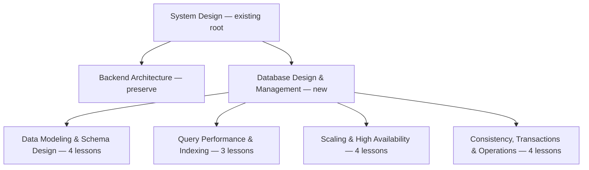
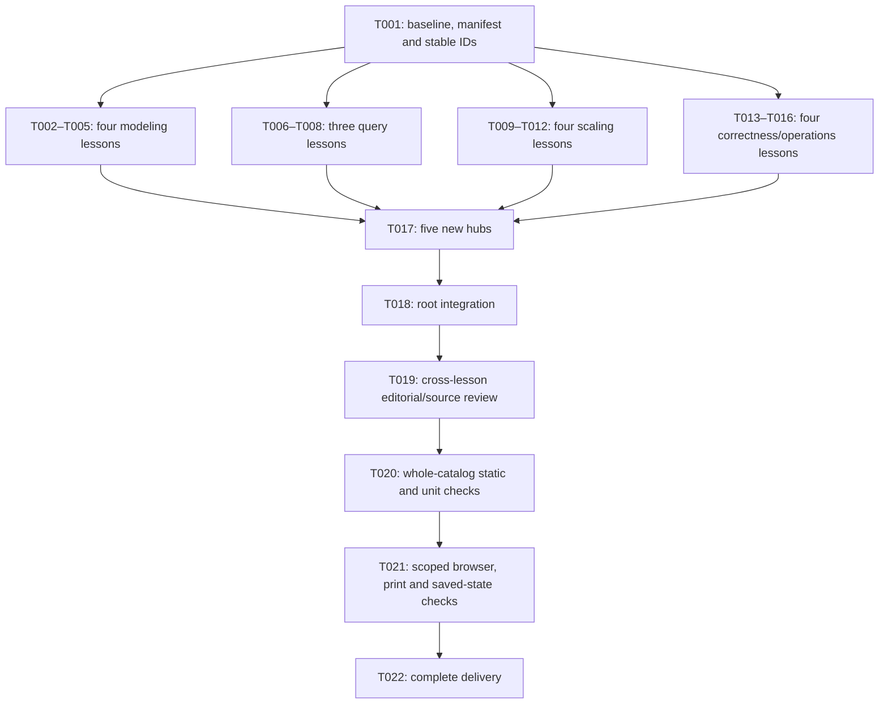

# Database Design & Management

**Stage:** Implemented and verified; all 22 tasks complete.\
**Requested:** 2026-11-17. **Profile:** Compact content publishing; constitution v1.3.0.\
**Baseline:** `58d55ff076690804a2f71e5e70b1a4b8f3a68730` on `main`.

## Outcome and taxonomy audit

Learners can explore 15 complete database lessons through four focused learning paths,
understand their practical decisions through ELI5-first explanations, and practice
production interview scenarios using the existing dashboard and learning engine.

The audited `manifest.json` uses `schemaVersion: 1`, a `roots` array, and recursive
`hub`/`topic` nodes with immutable `id`, `title` and kebab-case `slug` fields. Only hubs
have `children`; routes and partial paths derive from ancestry rather than explicit paths.
At the audited baseline it contained one root, six hubs and 15 lessons, all in Backend Architecture.
None of the requested database categories or lesson titles existed at that audit.

**Placement justification:** Root: System Design > Parent: Database Design & Management
> one of the four requested categories > Topic. Database decisions form a distinct sibling
learning path to Backend Architecture; reusing System Design avoids a duplicate domain
and keeps every lesson at four levels.

Reuse System Design ID `d3825659-12c2-4fc8-b6fe-bdd050762da3`. Preserve Backend Architecture
ID `401502d7-77c1-438c-a663-053fc5d18ada`, its complete subtree and all existing recall keys.
Append the new parent after Backend Architecture; preserve requested category/topic order.
During implementation, allocate 20 unique UUIDv4 IDs once before authoring matching
partials: five hubs and 15 lessons. No new root is needed.

Manifest SHA256 at audit: `e78bb55441e16e450fc19c602cc689cec102793bd2798ae974832d64281d89aa`.
Before implementation, snapshot the then-current manifest; re-audit if it differs.



## Lesson inventory and boundaries

Every row is a separate complete lesson authoring item, now **complete**. All lesson
paths below are relative to `topics/system-design/database-design-management/`; hash routes
use the same ancestry without `topics/` or `.html`, prefixed by `#/`.

| # | Category | Exact lesson title | Relative lesson file | Distinct learning focus |
| --- | --- | --- | --- | --- |
| 1 | Data Modeling & Schema Design | SQL vs NoSQL | `data-modeling-and-schema-design/sql-vs-nosql.html` | Choose a data model using workload, invariants and operating constraints; avoid blanket feature claims. |
| 2 | Data Modeling & Schema Design | Relational Database Design | `data-modeling-and-schema-design/relational-database-design.html` | Translate requirements into entities, relationships, keys and integrity constraints. |
| 3 | Data Modeling & Schema Design | Database Normalization | `data-modeling-and-schema-design/database-normalization.html` | Reason about dependencies and update anomalies through a worked schema. |
| 4 | Data Modeling & Schema Design | Database Denormalization | `data-modeling-and-schema-design/database-denormalization.html` | Design deliberate duplication for a measured workload, including update ownership and repair. |
| 5 | Query Performance & Indexing | Indexing Strategies | `query-performance-and-indexing/indexing-strategies.html` | Select indexes from query patterns, execution evidence and maintenance costs. |
| 6 | Query Performance & Indexing | Composite Indexes | `query-performance-and-indexing/composite-indexes.html` | Reason about multi-column access, ordering and engine-specific planner behavior. |
| 7 | Query Performance & Indexing | Connection Pooling | `query-performance-and-indexing/connection-pooling.html` | Manage connection budgets, saturation, wait time and transaction/session lifetimes. |
| 8 | Scaling & High Availability | Database Partitioning | `scaling-and-high-availability/database-partitioning.html` | Choose partition boundaries, pruning and lifecycle policies; distinguish distribution choices. |
| 9 | Scaling & High Availability | Sharding | `scaling-and-high-availability/sharding.html` | Choose distribution keys and reason about routing, hotspots, rebalancing and cross-shard work. |
| 10 | Scaling & High Availability | Replication | `scaling-and-high-availability/replication.html` | Compare replication guarantees, lag, read behavior and recovery across topologies. |
| 11 | Scaling & High Availability | Master-Slave Architecture | `scaling-and-high-availability/master-slave-architecture.html` | Examine the primary–replica topology, read routing, promotion, fencing and operational ownership. |
| 12 | Consistency, Transactions & Operations | ACID Properties | `consistency-transactions-and-operations/acid-properties.html` | Connect each property to an invariant, failure and observable guarantee. |
| 13 | Consistency, Transactions & Operations | CAP Theorem | `consistency-transactions-and-operations/cap-theorem.html` | Reason about guarantees during network partitions; distinguish CAP consistency from ACID consistency. |
| 14 | Consistency, Transactions & Operations | Database Transactions | `consistency-transactions-and-operations/database-transactions.html` | Apply transaction boundaries, isolation, concurrency handling and safe retries. |
| 15 | Consistency, Transactions & Operations | Database Migration Strategies | `consistency-transactions-and-operations/database-migration-strategies.html` | Plan compatible schema/data changes, backfills, cutover, verification and recovery. |

Retain the requested title **Master-Slave Architecture** and its slug; introduce current
primary–replica terminology in the lesson. Cross-reference related lessons without merging
their scopes or copying answers. Engine-specific guarantees, syntax and limits must identify
the engine and relevant version/context rather than generalizing to every database.

## Shared integration scope

Create `_overview.html` at the new parent and in each of its four category directories.
Each hub needs an ELI5 orientation, meaningful Mermaid roadmap, suggested reading sequence
and complete immediate-child links in manifest order. Update
`topics/system-design/_overview.html` so its prose, roadmap and child list introduce both
branches. Reuse the existing partial/style contract, inspected in the System Design and
Infrastructure & Multi-Tenancy hubs and the Domain-Driven Design lesson.

Deliver all 15 lessons, five new hubs, the existing root hub update, and matching manifest
changes together. Use the existing shell without application, storage or schema changes.
Create one concise `research/topics/<topic-id>.json` record per new lesson using the
established publishing format; no new record registry entries are needed for these IDs.
Final delivery includes placement justification, the applied manifest snippet and links to
every complete partial. No unfinished lessons, unrelated taxonomy changes or new framework.

## Inherited acceptance checklist

All delivery gates below passed; see the delivery record for results and limitations:

- [X] **Coverage:** All 15 exact titles appear once in the specified four categories;
  five new hubs and the updated root overview link correctly. Existing IDs, metadata,
  lessons and recall keys remain intact. From this baseline, the catalog becomes
  30 lessons and 11 hubs; derive counts anew if the starting catalog changes.
- [X] **Complete teaching:** Every lesson follows all six modules in order: Hook & ELI5,
  Big Picture, Mechanics, Comparisons & Trade-Offs, Pitfalls, Active Recall & Mastery.
  Include the analogy before jargon, explained valid Mermaid visuals, collapsible deep
  mechanics, a decision matrix, Symptom → Root Cause → Fix/Prevention stories, and impact.
  Relevant explained diagrams may serve several scenarios; there is no diagram-per-card quota.
- [X] **Practice:** Every lesson has the Feynman prompt, 3–5 foundational recall cards,
  and a separate **Tricky & Most-Asked Interview Scenarios** subsection inside mastery
  with 5–7 distinct production decision questions: 75–105 interview scenarios in this batch.
  Each scenario includes **The Scenario & Constraint**, **The Direct Answer & Architectural
  Decision**, and **Key Trade-Offs & Follow-Up Traps**, including assumptions, a defensible
  action, costs, alternatives and changed-constraint follow-ups. No definition-only fillers.
- [X] **Research/editorial:** Search the web for each exact concept before selecting its
  scenarios when available; verify technical decisions against primary sources. Record
  concise source mappings and substantive editorial findings. Distinguish reported recurring
  questions from adaptations; disclose insufficient frequency evidence or unavailable search.
  Source links and complete answers remain useful independently; reviewed research records are linked below.
- [X] **Integration:** All new lessons and hubs load and reload through their hash routes
  from both `/` and `/backend-lab/`, with correct breadcrumbs/sidebar state and no console,
  Mermaid or highlighting errors. New titles appear in existing fuzzy search. Mastery totals
  include new lessons; existing status, confidence, review history and backups remain usable.
- [X] **Interaction/accessibility:** Recall cards start closed, open independently by
  keyboard, and receive the shared Hard/Good/Easy controls with stable question keys.
  Confidence survives reload; revealing or rating an answer never implies mastery.
  Mobile light/dark layouts remain readable without page overflow or duplicated controls.
- [X] **Verification:** Whole-catalog intrinsic and general unit checks pass. Run scoped
  browser/print checks against the pre-edit manifest for all new lessons/hubs and affected
  ancestors. From this audit that is 21 partials, each checked in both print themes
  (42 PDFs), with complete answers/diagram labels, hidden controls and restored disclosure
  state. Review new visual patterns and editorial quality; do not infer them from structure.
  Broaden regression only if shared runtime changes become necessary. Frozen migration
  evidence remains unchanged and is not a publishing gate for the expanded catalog.

## Specification review and handoff

**Review:** Passed: all requested titles/order captured, placement audited, overlaps bounded,
hub work explicit, research/recall requirements inherited, outcomes measurable and validation
scope proportional. No unresolved clarification is required. `.specify/extensions.yml` is
absent, so no before/after-specify hooks are configured.

**Status:** Implementation and verification are complete; see Delivery below. This file
retains the compact specification, plan and per-lesson tasks. No new full Spec Kit feature
directory was created and feature 003 was not resumed.

## Implementation plan

**Branch:** `main`. **Plan artifact:** this section, extending the existing request. No
new application data model, interface contract or feature pointer is required. Re-audit
confirmed the same manifest digest, 21 nodes and 15 lessons recorded above.

### Reuse the actual host contract

The inspected API Gateway Pattern partial passes `check_article` and demonstrates the
current envelope, six sections, `.kb-callout--insight`, `.kb-callout--pitfall`,
`.kb-callout--impact`, `.kb-table-wrap`, `.kb-diagram`, `.kb-question`, `.kb-references`,
`pre.mermaid` and `code.language-*` conventions. Match these supported classes; reuse
native mechanics disclosures and the exact interview markup in the publishing guide.
Use `node-<immutable-id>-<section-key>` IDs and permanent local recall keys. Leave status,
confidence, highlighting, theme rerendering and print preparation to the existing host.
New lessons need no preservation-marker comments or per-lesson script/style additions.

### Authoring sequence

1. **Baseline and identity:** Before edits, save the current manifest at
   `.cache/topic-checks/database-design-management-manifest-before.json`. Confirm the
   recorded root ID and reuse all existing nodes. Allocate the 20 new node IDs once;
   add the requested branch/order using only the existing manifest fields. Record new IDs
   in that manifest and use them consistently in partials and research records.
2. **Fifteen independent complete lessons:** Follow inventory rows 1–15, keeping one
   authoring item per HTML file. For each: perform exact-concept question research,
   verify primary technical support, select 5–7 distinct constrained production problems,
   write all six modules and both recall sets, and complete its concise research/review
   record. Start with modeling, then indexing, scaling, and transactions/operations; retain
   cross-links for related concepts without making another lesson necessary to understand
   the current one. Run scoped intrinsic checks while authoring; repair each lesson in full.
3. **Shared hubs and integration:** Complete the five new overview files against their
   actual immediate children. Update only the existing System Design overview's prose,
   roadmap and child list. Check all cross-links, title/ID matches, taxonomy order and
   relative hash routes. Deliver the expanded catalog only when every referenced file is
   complete; leave the Backend Architecture subtree and shared runtime unchanged.
4. **Editorial and source review:** Review ELI5 order, narrative, examples, correctness,
   differentiated topic scopes, realistic decisions, alternatives and follow-up traps.
   Mark each source record reviewed only after its findings pass. Reuse prior source
   discovery where relevant; do not copy lesson answers into a second evidence narrative.
5. **Shared acceptance:** Run the whole-catalog static/unit checks, then the scoped
   browser/PDF command below. Inspect new diagram/table patterns on mobile and in print.
   Fix affected lessons and rerun only invalidated checks. Pending gates stay pending;
   there is no shell redesign, framework setup or historical backfill acceptance cycle.

### Research needs and starting references

Technical-source discovery was performed on 2026-11-17 using these actual query groups:
PostgreSQL constraints/indexes/isolation/partitioning/standby; MongoDB modeling/sharding/
replication/transactions; PgBouncer pooling features; Gilbert–Lynch CAP papers; Microsoft
normalization basics; and Fowler evolutionary database design/expand-contract. The primary
pages below were opened as starting references, not as proof of interview frequency.

- **P:** PostgreSQL 18 [constraints](https://www.postgresql.org/docs/18/ddl-constraints.html),
  [multicolumn indexes](https://www.postgresql.org/docs/18/indexes-multicolumn.html),
  [partitioning](https://www.postgresql.org/docs/18/ddl-partitioning.html),
  [isolation](https://www.postgresql.org/docs/18/transaction-iso.html), and
  [standby replication](https://www.postgresql.org/docs/18/warm-standby.html).
- **M:** MongoDB [data modeling](https://www.mongodb.com/docs/manual/data-modeling/) and
  [sharding](https://www.mongodb.com/docs/manual/sharding/); extend with the specific
  transaction, read/write concern and replica-set documentation used by each answer.
- **G:** [PgBouncer feature compatibility](https://www.pgbouncer.org/features).
- **N:** Microsoft's [database design basics](https://support.microsoft.com/en-us/access/database-design-basics)
  as a normalization primer; supplement formal dependency/normal-form claims as needed.
- **C:** Gilbert and Lynch's [Perspectives on the CAP Theorem](https://dspace.mit.edu/entities/publication/dfcb6512-af44-4fc9-8e8b-1a8f28f1b53a).
- **F:** [Evolutionary Database Design](https://martinfowler.com/articles/evodb.html) and
  [Parallel Change](https://martinfowler.com/bliki/ParallelChange.html).

For every row, search the **exact lesson title** together with interview, system design,
production/debugging and its risk below; record the actual queries/dates/results in that
lesson's research JSON. Technical pages support decisions, not hiring-frequency claims.
Identify credible recurring interview evidence separately; otherwise label scenarios as
adapted production variants and disclose the limitation. The following matrix identifies
research needs, not completed question sets or reviewed source mappings.

| Inventory row / lesson | Starting sources | Distinct decisions and verification risks |
| --- | --- | --- |
| 1. SQL vs NoSQL | P, M | Model/workload fit, invariant boundaries, evolving schema; avoid relational/nonrelational feature absolutes. |
| 2. Relational Database Design | P, N | Keys, cardinalities, junction tables, concurrent constraint enforcement and deletion rules. |
| 3. Database Normalization | N, then primary normal-form sources | Functional dependencies, candidate keys, lossless decomposition, normal forms and concrete anomalies. |
| 4. Database Denormalization | M, N | Measured read needs, update ownership, stale views, repair and reconciliation costs. |
| 5. Indexing Strategies | P, then index/EXPLAIN documentation | Access paths versus maintenance cost, selectivity, plan evidence and workload-dependent index types. |
| 6. Composite Indexes | P | Column order, range/order predicates, covering access and version-specific planner exceptions such as skip scan. |
| 7. Connection Pooling | G, P | Total connection budget across app instances, saturation, timeouts, leaked transactions and pooling-mode compatibility. |
| 8. Database Partitioning | P | Pruning, retention, uniqueness constraints, partition maintenance and engine-specific locking behavior. |
| 9. Sharding | M | Routing keys, hotspots, scatter/gather, resharding and cross-shard operation assumptions. |
| 10. Replication | P, M | Acknowledgment guarantees, lag, stale reads, synchronous/asynchronous costs and recovery evidence. |
| 11. Master-Slave Architecture | P, then failover/replica-set documentation | Primary–replica routing, promotion, fencing, split-brain prevention and recovery objectives. |
| 12. ACID Properties | P, then durability/transaction documentation | Each property's invariant, crash/concurrency failures, acknowledged commits and configuration assumptions. |
| 13. CAP Theorem | C | Precise consistency/availability/partition definitions, partition-time decisions and distinction from ACID consistency. |
| 14. Database Transactions | P | Isolation anomalies, lock/serialization failures, retry boundaries and external-effect idempotency. |
| 15. Database Migration Strategies | F, P | Mixed app versions, expand/migrate/contract, resumable backfills, validation, cutover and recovery limits. |

Use PostgreSQL 18 for concrete SQL examples where suitable, explicitly labeled as such;
use MongoDB/PgBouncer only where their behavior is actually being illustrated. Pin the
relevant version/configuration in claims and source records. Do not convert an example
engine into a universal rule or an application runtime dependency. At planning time, exact interview research,
complete question selection and per-answer technical/editorial review remained authoring work;
the reviewed lesson records now document completion.

### Focused verification and completion

Use the existing general publishing profile (`constitution-1.2` markup, v1.3.0 research
records). Whole-catalog checks always rerun; no change to the validator is planned.

```sh
python3 tools/validate_content.py --report .cache/topic-checks/content-static.json
python3 -m unittest discover -s tests/content -q
node --experimental-default-type=module tests/dashboard/test_catalog.mjs
node --experimental-default-type=module tests/dashboard/test_learning_state.mjs
python3 tools/check_topics.py \
  --baseline .cache/topic-checks/database-design-management-manifest-before.json \
  --changed
```

Run after integration using the pinned browser tooling documented in the publishing guide.
The saved baseline plus changed-file discovery should select the 15 new lessons, five new
hubs and updated System Design root: 21 partials, not all 41 catalog nodes. The expected
browser matrix is 63 cases (three per partial), plus 42 actual PDFs across both themes.
Derive these counts again if scope changes. Verify new search results and the 30-lesson
mastery denominator, and check an existing saved topic/unknown backup record remains usable
without replaying the entire historical state suite. Use existing platform tests for any
unexpected state/router/runtime changes, broadening render/print scope for shared styles.

Reuse successful cached node results only through the runner's input/artifact checks;
`--static-only` is not full acceptance. Do not run or regenerate the frozen 003 migration
baseline against the intentionally expanded manifest as a publication requirement.

**Plan review:** Constitution and supported markup align; no new infrastructure or schema
is needed. All 15 authoring items remain separate, six hub files are accounted for,
research needs and claim limits are explicit, and focused acceptance has runnable commands.
No planning clarification is outstanding. There are no configured before/after-plan hooks.
At the planning stage only this request document changed; completed implementation is recorded below.

## Implementation tasks

All 22 tasks below are complete. This is the compact task artifact; do not create a
second `tasks.md`, data model or migration ledger for the same request. Every lesson task
T002–T016 includes exact-concept web question research, primary-source verification, full
six-module ELI5-first authorship, 3–5 foundational cards and 5–7 complete independently
collapsible production scenarios with the three required answer parts. Each also owns its
`research/topics/<assigned-topic-id>.json` source/editorial record, honest public disclosure,
stable recall keys and scoped intrinsic validation. The research matrix and inherited
acceptance checklist above apply to every lesson; no row permits a summary or placeholder.

### Shared prerequisite

- [X] T001 Re-audit `manifest.json`; save its pre-edit contents to `.cache/topic-checks/database-design-management-manifest-before.json`, allocate the 20 new immutable UUIDv4 IDs once, and add the parent, four categories and 15 topic entries in the specified order. Preserve all existing nodes/metadata and use the assigned IDs in every subsequent partial and research record.

### US1 — Model data and make schema trade-offs

Review criterion: independently explain a relational model, diagnose an update anomaly,
and justify normalization or deliberate duplication under explicit workload constraints.

- [X] T002 [P] [US1] Research, author and review **SQL vs NoSQL** in `topics/system-design/database-design-management/data-modeling-and-schema-design/sql-vs-nosql.html`, including its own complete source record and the common lesson requirements above.
- [X] T003 [P] [US1] Research, author and review **Relational Database Design** in `topics/system-design/database-design-management/data-modeling-and-schema-design/relational-database-design.html`, including its own complete source record and the common lesson requirements above.
- [X] T004 [P] [US1] Research, author and review **Database Normalization** in `topics/system-design/database-design-management/data-modeling-and-schema-design/database-normalization.html`, including its own complete source record and the common lesson requirements above.
- [X] T005 [P] [US1] Research, author and review **Database Denormalization** in `topics/system-design/database-design-management/data-modeling-and-schema-design/database-denormalization.html`, including its own complete source record and the common lesson requirements above.

### US2 — Diagnose query and connection bottlenecks

Review criterion: use a worked query/access plan to defend an index and column order,
then reason about a bounded connection budget without treating pooling as unlimited capacity.

- [X] T006 [P] [US2] Research, author and review **Indexing Strategies** in `topics/system-design/database-design-management/query-performance-and-indexing/indexing-strategies.html`, including its own complete source record and the common lesson requirements above.
- [X] T007 [P] [US2] Research, author and review **Composite Indexes** in `topics/system-design/database-design-management/query-performance-and-indexing/composite-indexes.html`, including its own complete source record and the common lesson requirements above.
- [X] T008 [P] [US2] Research, author and review **Connection Pooling** in `topics/system-design/database-design-management/query-performance-and-indexing/connection-pooling.html`, including its own complete source record and the common lesson requirements above.

### US3 — Scale data and reason about failures

Review criterion: distinguish partitioning, sharding, replication and primary–replica
topology, then explain the routing, data-loss, recovery and operational assumptions of a choice.

- [X] T009 [P] [US3] Research, author and review **Database Partitioning** in `topics/system-design/database-design-management/scaling-and-high-availability/database-partitioning.html`, including its own complete source record and the common lesson requirements above.
- [X] T010 [P] [US3] Research, author and review **Sharding** in `topics/system-design/database-design-management/scaling-and-high-availability/sharding.html`, including its own complete source record and the common lesson requirements above.
- [X] T011 [P] [US3] Research, author and review **Replication** in `topics/system-design/database-design-management/scaling-and-high-availability/replication.html`, including its own complete source record and the common lesson requirements above.
- [X] T012 [P] [US3] Research, author and review **Master-Slave Architecture** in `topics/system-design/database-design-management/scaling-and-high-availability/master-slave-architecture.html`, retaining the requested title while teaching primary–replica terminology, and including its own complete source record and all common lesson requirements.

### US4 — Preserve correctness through transactions and change

Review criterion: distinguish ACID properties from CAP guarantees, analyze a concurrent
transaction failure, and defend a compatible migration/cutover and recovery plan.

- [X] T013 [P] [US4] Research, author and review **ACID Properties** in `topics/system-design/database-design-management/consistency-transactions-and-operations/acid-properties.html`, including its own complete source record and the common lesson requirements above.
- [X] T014 [P] [US4] Research, author and review **CAP Theorem** in `topics/system-design/database-design-management/consistency-transactions-and-operations/cap-theorem.html`, including its own complete source record and the common lesson requirements above.
- [X] T015 [P] [US4] Research, author and review **Database Transactions** in `topics/system-design/database-design-management/consistency-transactions-and-operations/database-transactions.html`, including its own complete source record and the common lesson requirements above.
- [X] T016 [P] [US4] Research, author and review **Database Migration Strategies** in `topics/system-design/database-design-management/consistency-transactions-and-operations/database-migration-strategies.html`, including its own complete source record and the common lesson requirements above.

### Shared hubs, review and acceptance

- [X] T017 Author `topics/system-design/database-design-management/_overview.html` and the four category hubs below, each with ELI5 orientation, Mermaid roadmap, reading guidance and ordered immediate-child links:
  `topics/system-design/database-design-management/data-modeling-and-schema-design/_overview.html`,
  `topics/system-design/database-design-management/query-performance-and-indexing/_overview.html`,
  `topics/system-design/database-design-management/scaling-and-high-availability/_overview.html`, and
  `topics/system-design/database-design-management/consistency-transactions-and-operations/_overview.html`.
- [X] T018 Update `topics/system-design/_overview.html` to introduce both Backend Architecture and Database Design & Management in its prose, roadmap and child links; reconcile every new title, route, ID and child order with `manifest.json` without modifying the existing Backend Architecture subtree or shell.
- [X] T019 Complete a cross-lesson editorial/source review of the 15 files under `topics/system-design/database-design-management/` and their 15 `research/topics/<assigned-topic-id>.json` records. Check topic/scenario distinctness, assumptions, engine/version claims, full decisions/traps and source honesty; repair findings and record reviewed status only when all required dispositions pass.
- [X] T020 Run the whole-catalog validator and general Python/JavaScript unit commands from the plan using `tools/validate_content.py`, `tests/content/`, `tests/dashboard/test_catalog.mjs` and `tests/dashboard/test_learning_state.mjs`; save `.cache/topic-checks/content-static.json`. Confirm the expected 30 lessons/11 hubs, preserved existing IDs/metadata/recall content, and no missing/orphan partials. Do not substitute the frozen migration suite for publishing validation.
- [X] T021 Run `tools/check_topics.py --baseline .cache/topic-checks/database-design-management-manifest-before.json --changed`; resolve all failures in the 21 affected partials, expected 63 browser cases and 42 light/dark PDFs. Review new layouts visually, verify all 15 new search results, and confirm existing saved progress plus unknown backup records remain usable with the 30-lesson denominator. Retain the runner's report/PDFs in `.cache/topic-checks/`; any skipped or pending gate remains incomplete.
- [X] T022 Complete the delivery record in `docs/topic-requests/database-design-management.md`: update task/acceptance statuses only from passing evidence, supply the placement justification and paste-ready manifest change, link all 15 complete lessons and five new hubs plus the updated root hub, and report checks and genuine research limitations. Deliver the whole batch; commit/push only if requested.

### Dependencies and completion rules



After T001, the 15 `[P]` lesson tasks write different HTML/source-record files and can
proceed independently; for example T002, T006, T009 and T013 have no inter-task dependency.
Concurrency is optional. Individual learning paths may be reviewed incrementally, but shared
catalog writes, final integration and acceptance follow the graph. Every lesson remains
self-contained; the complete 15-lesson batch is the delivery scope, not a partial-category MVP.

**Task review:** 22 sequential, unique task IDs; 15 one-file lesson tasks split 4/3/4/4
across US1–US4, plus seven shared tasks. All tasks have paths and observable completion
criteria; implementation checkboxes now reflect completed work and passing acceptance. No before/after-tasks hooks are
configured. Only this request document changes during task generation.


## Delivery — complete

**Placement:** Root: System Design > Parent: Database Design & Management > the four
requested categories > 15 topics. The new parent is a sibling of Backend Architecture;
all existing node IDs, lesson bytes and recall keys are preserved.

Delivered 15 full ELI5-first six-module lessons, 60 foundational recall cards and 90
structured production interview scenarios, plus 15 reviewed source records. Created five
new overview hubs and updated the existing System Design overview. The catalog now has
30 lessons and 11 hubs. Shared application, stylesheet and renderer files are unchanged.

### Complete lesson files and research

| Lesson | Complete HTML partial | Reviewed research |
| --- | --- | --- |
| SQL vs NoSQL | [Lesson](../../topics/system-design/database-design-management/data-modeling-and-schema-design/sql-vs-nosql.html) | [Sources](../../research/topics/651ff4c7-44ee-4cec-bc4d-895730ec3cb3.json) |
| Relational Database Design | [Lesson](../../topics/system-design/database-design-management/data-modeling-and-schema-design/relational-database-design.html) | [Sources](../../research/topics/3c35bc85-2f09-4a65-91a5-94bda1301b68.json) |
| Database Normalization | [Lesson](../../topics/system-design/database-design-management/data-modeling-and-schema-design/database-normalization.html) | [Sources](../../research/topics/eaee23bf-dd70-41e1-bc5b-4b8a1e07b62d.json) |
| Database Denormalization | [Lesson](../../topics/system-design/database-design-management/data-modeling-and-schema-design/database-denormalization.html) | [Sources](../../research/topics/f26e98b3-db3a-47a1-9492-460e31758354.json) |
| Indexing Strategies | [Lesson](../../topics/system-design/database-design-management/query-performance-and-indexing/indexing-strategies.html) | [Sources](../../research/topics/f6aa87b1-65e6-48d8-81f9-52363a5eaaf3.json) |
| Composite Indexes | [Lesson](../../topics/system-design/database-design-management/query-performance-and-indexing/composite-indexes.html) | [Sources](../../research/topics/9a9e2e97-75ff-47e4-8f80-3fd408917cb6.json) |
| Connection Pooling | [Lesson](../../topics/system-design/database-design-management/query-performance-and-indexing/connection-pooling.html) | [Sources](../../research/topics/3e0d9e12-176f-4271-8c7b-ee1b5c37d411.json) |
| Database Partitioning | [Lesson](../../topics/system-design/database-design-management/scaling-and-high-availability/database-partitioning.html) | [Sources](../../research/topics/5733db2c-4b92-4f6c-9a3f-b09321227cc0.json) |
| Sharding | [Lesson](../../topics/system-design/database-design-management/scaling-and-high-availability/sharding.html) | [Sources](../../research/topics/f94feea8-8c7e-41b3-a110-39e69714b0d4.json) |
| Replication | [Lesson](../../topics/system-design/database-design-management/scaling-and-high-availability/replication.html) | [Sources](../../research/topics/2d228451-de51-44a1-9b17-06942413e9f8.json) |
| Master-Slave Architecture | [Lesson](../../topics/system-design/database-design-management/scaling-and-high-availability/master-slave-architecture.html) | [Sources](../../research/topics/dd9a8690-fac2-458d-8e05-a5aa4ab19577.json) |
| ACID Properties | [Lesson](../../topics/system-design/database-design-management/consistency-transactions-and-operations/acid-properties.html) | [Sources](../../research/topics/e240299e-afaa-4545-a556-094f3e0a95d3.json) |
| CAP Theorem | [Lesson](../../topics/system-design/database-design-management/consistency-transactions-and-operations/cap-theorem.html) | [Sources](../../research/topics/8e929724-b8ec-4b58-81ea-af34e571d414.json) |
| Database Transactions | [Lesson](../../topics/system-design/database-design-management/consistency-transactions-and-operations/database-transactions.html) | [Sources](../../research/topics/fbf4ecdd-1825-4cf8-aa36-005ffc30b159.json) |
| Database Migration Strategies | [Lesson](../../topics/system-design/database-design-management/consistency-transactions-and-operations/database-migration-strategies.html) | [Sources](../../research/topics/069e1478-6ed8-4647-b3a0-5c13fb5fcdfa.json) |

### Overview hubs

- [Database Design & Management](../../topics/system-design/database-design-management/_overview.html) — complete new hub.
- [Data Modeling & Schema Design](../../topics/system-design/database-design-management/data-modeling-and-schema-design/_overview.html) — complete new hub.
- [Query Performance & Indexing](../../topics/system-design/database-design-management/query-performance-and-indexing/_overview.html) — complete new hub.
- [Scaling & High Availability](../../topics/system-design/database-design-management/scaling-and-high-availability/_overview.html) — complete new hub.
- [Consistency, Transactions & Operations](../../topics/system-design/database-design-management/consistency-transactions-and-operations/_overview.html) — complete new hub.
- [System Design](../../topics/system-design/_overview.html) — updated existing root.

### Applied manifest snippet

The complete new parent object below is already the second item in `children` of the
existing System Design root, ID `d3825659-12c2-4fc8-b6fe-bdd050762da3`. When reusing this
snippet, preserve the existing Backend Architecture child and use normal JSON array comma
separation. The full applied catalog is [manifest.json](../../manifest.json).

<details>
<summary>Complete Database Design &amp; Management manifest entry</summary>

```json
{
  "id": "fc2bf3d0-f309-4007-86e1-8540b6df0880",
  "kind": "hub",
  "title": "Database Design & Management",
  "slug": "database-design-management",
  "children": [
    {
      "id": "87997824-62a9-4d55-8fa9-8c0d0205f407",
      "kind": "hub",
      "title": "Data Modeling & Schema Design",
      "slug": "data-modeling-and-schema-design",
      "children": [
        {
          "id": "651ff4c7-44ee-4cec-bc4d-895730ec3cb3",
          "kind": "topic",
          "title": "SQL vs NoSQL",
          "slug": "sql-vs-nosql"
        },
        {
          "id": "3c35bc85-2f09-4a65-91a5-94bda1301b68",
          "kind": "topic",
          "title": "Relational Database Design",
          "slug": "relational-database-design"
        },
        {
          "id": "eaee23bf-dd70-41e1-bc5b-4b8a1e07b62d",
          "kind": "topic",
          "title": "Database Normalization",
          "slug": "database-normalization"
        },
        {
          "id": "f26e98b3-db3a-47a1-9492-460e31758354",
          "kind": "topic",
          "title": "Database Denormalization",
          "slug": "database-denormalization"
        }
      ]
    },
    {
      "id": "9eddf55b-35e6-46a5-b8c7-fb5a2341cd4a",
      "kind": "hub",
      "title": "Query Performance & Indexing",
      "slug": "query-performance-and-indexing",
      "children": [
        {
          "id": "f6aa87b1-65e6-48d8-81f9-52363a5eaaf3",
          "kind": "topic",
          "title": "Indexing Strategies",
          "slug": "indexing-strategies"
        },
        {
          "id": "9a9e2e97-75ff-47e4-8f80-3fd408917cb6",
          "kind": "topic",
          "title": "Composite Indexes",
          "slug": "composite-indexes"
        },
        {
          "id": "3e0d9e12-176f-4271-8c7b-ee1b5c37d411",
          "kind": "topic",
          "title": "Connection Pooling",
          "slug": "connection-pooling"
        }
      ]
    },
    {
      "id": "4dc17940-2d8f-4f00-a02b-71939b3e660c",
      "kind": "hub",
      "title": "Scaling & High Availability",
      "slug": "scaling-and-high-availability",
      "children": [
        {
          "id": "5733db2c-4b92-4f6c-9a3f-b09321227cc0",
          "kind": "topic",
          "title": "Database Partitioning",
          "slug": "database-partitioning"
        },
        {
          "id": "f94feea8-8c7e-41b3-a110-39e69714b0d4",
          "kind": "topic",
          "title": "Sharding",
          "slug": "sharding"
        },
        {
          "id": "2d228451-de51-44a1-9b17-06942413e9f8",
          "kind": "topic",
          "title": "Replication",
          "slug": "replication"
        },
        {
          "id": "dd9a8690-fac2-458d-8e05-a5aa4ab19577",
          "kind": "topic",
          "title": "Master-Slave Architecture",
          "slug": "master-slave-architecture"
        }
      ]
    },
    {
      "id": "177830da-5dc2-4217-999b-74293a6c8048",
      "kind": "hub",
      "title": "Consistency, Transactions & Operations",
      "slug": "consistency-transactions-and-operations",
      "children": [
        {
          "id": "e240299e-afaa-4545-a556-094f3e0a95d3",
          "kind": "topic",
          "title": "ACID Properties",
          "slug": "acid-properties"
        },
        {
          "id": "8e929724-b8ec-4b58-81ea-af34e571d414",
          "kind": "topic",
          "title": "CAP Theorem",
          "slug": "cap-theorem"
        },
        {
          "id": "fbf4ecdd-1825-4cf8-aa36-005ffc30b159",
          "kind": "topic",
          "title": "Database Transactions",
          "slug": "database-transactions"
        },
        {
          "id": "069e1478-6ed8-4647-b3a0-5c13fb5fcdfa",
          "kind": "topic",
          "title": "Database Migration Strategies",
          "slug": "database-migration-strategies"
        }
      ]
    }
  ]
}
```

</details>

### Verification results

| Gate | Result |
| --- | --- |
| Whole-catalog intrinsic validation and pre-edit ID/history comparison | PASS — 41 nodes, 30 lessons, 11 hubs; no missing/orphan HTML or unresolved research mappings. |
| General unit checks | PASS — 72 Python content/workflow tests and 14 JavaScript catalog/state tests. |
| Scoped browser acceptance | PASS — all 21 affected partials, 63 root/project-subdirectory, desktop/mobile and theme cases; no remaining console or diagram failures. |
| Interactive learning | PASS — all 150 new recall cards exercised; confidence persisted, mastery remained explicit, and the denominator is 30 lessons. |
| Actual print output | PASS — 42 light/dark PDFs; complete source text and rendered diagram labels, hidden host controls and restored disclosure state. |
| Search and backup/state integration | PASS — all 15 exact titles ranked first; existing and unknown saved records preserved through JSON export/import; mobile drawer works. |
| Visual review | PASS — overview/flowchart/sequence layouts and representative full-answer PDF pages inspected; six text-dense diagrams refined and reverified. |
| Preservation | PASS — all 137 protected Backend Architecture, shared runtime and historical migration artifacts retain their pre-edit hashes. |

Reproduce with the commands in the plan. Local reports and PDFs are intentionally ignored
under `.cache/topic-checks/`: `content-static.json`, `report.json`,
`database-integration.json`, `pdfs/` and `visual-final/`. The final browser/PDF report checks
current per-node inputs and artifact hashes; unchanged verified nodes were reused rather
than rerunning unrelated lessons. The frozen historical migration baseline was not changed.

**Research limitation:** All 90 scenario prompts are disclosed as adapted production
variants. Concept-specific web searches and primary technical references informed them;
exact interview frequency, rankings and named-company attribution were not established.
SQL examples were reviewed as educational PostgreSQL 18 examples; no live database was
started to execute them. Browser acceptance verifies their presentation, not query execution.

No before/after-implement hooks are configured. No commit, push or deployment was performed
as part of this implementation request.
