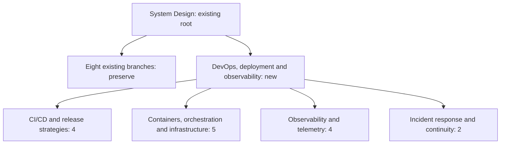
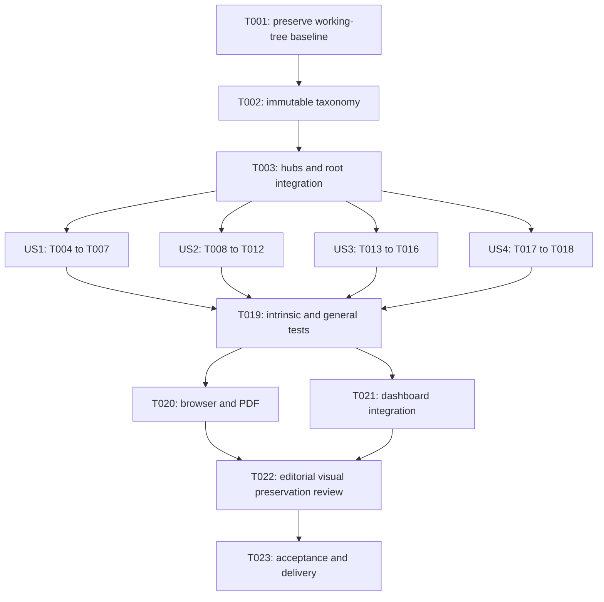

# DevOps, Deployment & Observability

**Stage:** Implementation complete; all 23 tasks and seven publication gates passed.\
**Requested:** 2026-11-22. **Profile:** Compact content publishing; constitution v1.3.0.\
**Branch:** `main`. **Audited HEAD:** `7da7147262aa44b60fb549f5eacabf9db3661414`.

## Outcome and taxonomy audit

Learners can explain a safe release from verified source to serving workloads, distinguish
container and orchestration responsibilities, design useful telemetry pipelines, and reason
about incident coordination and recoverable business state. Deliver 15 complete lessons
through the existing dashboard contract. This explicitly requested specification stage
records the scope; lesson publication belongs to implementation. Reuse this document for
later plan, tasks and delivery stages.

The working-tree `manifest.json` has `schemaVersion: 1` and recursive `roots`. Nodes use
`id`, `kind`, `title`, `slug`; hubs also have `children`. Routes and file paths derive from
ancestry rather than stored URL/file fields. The current catalog contains **161 nodes:
120 lessons and 41 hubs**, under System Design and eight branches: Backend Architecture;
Database Design & Management; API Design & Communication; Caching Architecture; Distributed
Systems & Scalability; Message Queues & Event-Driven Systems; Authentication & Backend
Security; Performance & Reliability. The requested parent, four categories and all 15
exact lesson titles are absent.

**Manifest SHA256:** `ed78bdd5be4f29109f9ed6093a80a90b15b981312eecd333140d41a94ccf90f8`.
This working-tree baseline includes completed, uncommitted Performance & Reliability
content. Preserve that content, its research/request records and unrelated `docs/project/`
files; Git HEAD's older catalog is not a valid substitute. Capture the then-current manifest
again before implementation and reconcile any intervening changes.

**Placement justification:** Root: System Design > Parent: DevOps, Deployment &
Observability > requested Sub-Category > Topic. The four-level branch connects delivery,
workload control, telemetry and operational recovery. Performance & Reliability retains
runtime diagnosis and user-outcome measurement; Backend Architecture retains service
structure. Neither existing parent replaces the requested delivery/operations curriculum.

Reuse System Design UUID `d3825659-12c2-4fc8-b6fe-bdd050762da3`. Append parent slug
**`devops-deployment-observability`** after Performance & Reliability, preserving all eight
old subtrees, metadata, IDs and recall keys. Allocate **20 new UUIDv4 IDs once during
implementation**: five hubs and 15 lessons. No persistent IDs are allocated by this spec.
Expected result against this baseline: **181 nodes, 135 lessons, 46 hubs, nine branch cards**.



This is a proposed learning roadmap; the arrows express navigation, not mandatory
technical dependencies or an executable deployment process.

## Exact lesson inventory and boundaries

Preserve exact titles, category order and the **4/5/4/2** grouping. Each row must become
its own complete authoring task later. Paths below are relative to
**`topics/system-design/devops-deployment-observability/`**. Routes mirror ancestry without
`topics/` or `.html`, prefixed by `#/`. All 15 lessons remain pending.

| # | Category | Exact lesson title | Relative lesson file | Distinct learning focus |
| --- | --- | --- | --- | --- |
| 1 | CI/CD & Release Strategies | CI/CD Pipelines | `ci-cd-and-release-strategies/ci-cd-pipelines.html` | Source-to-artifact-to-environment flow; continuous integration, delivery and deployment distinctions; reproducible artifacts, gates, credentials, promotion, concurrency and rollback ownership. |
| 2 | CI/CD & Release Strategies | Blue-Green Deployment | `ci-cd-and-release-strategies/blue-green-deployment.html` | Parallel environment readiness, routing cutover, session/connection draining, capacity and cost; shared data compatibility, background jobs and limits of reverting traffic. |
| 3 | CI/CD & Release Strategies | Canary Deployment | `ci-cd-and-release-strategies/canary-deployment.html` | Incremental exposure, cohort/traffic selection, comparable baselines, observation windows, success/failure thresholds, halt/promotion decisions, rare failures and persistent data effects. |
| 4 | CI/CD & Release Strategies | Rolling Deployments | `ci-cd-and-release-strategies/rolling-deployments.html` | Mixed-version operation, availability/surge budgets, readiness and graceful termination, resource headroom, stalled rollout diagnosis and application/data compatibility. |
| 5 | Containers, Orchestration & Infrastructure | Docker & Containerization | `containers-orchestration-and-infrastructure/docker-and-containerization.html` | Image versus running container, layers/build context, process/filesystem/network isolation, volumes and limits; reproducibility, image provenance, least privilege and shared-kernel boundaries. |
| 6 | Containers, Orchestration & Infrastructure | Kubernetes | `containers-orchestration-and-infrastructure/kubernetes.html` | Concrete desired-state control plane, scheduling, Pods/controllers, Services/configuration/storage and lifecycle; trace a deployment and diagnose pending/unready work with explicit ownership boundaries. |
| 7 | Containers, Orchestration & Infrastructure | Container Orchestration | `containers-orchestration-and-infrastructure/container-orchestration.html` | Platform-independent scheduling, reconciliation, placement, service discovery, rollout, resource and failure-domain responsibilities; compare orchestration choices and when simpler hosting suffices. |
| 8 | Containers, Orchestration & Infrastructure | Infrastructure as Code | `containers-orchestration-and-infrastructure/infrastructure-as-code.html` | Versioned desired infrastructure, preview/apply lifecycle, state and locking, drift, dependency ordering, safe concurrent changes, secrets, imports and recovery from partial application. |
| 9 | Containers, Orchestration & Infrastructure | Horizontal Pod Autoscaling | `containers-orchestration-and-infrastructure/horizontal-pod-autoscaling.html` | Kubernetes replica control loop, resource/custom/external metrics, utilization/request assumptions, bounds and stabilization, startup lag and missing metrics; distinguish Pod scaling from node capacity. |
| 10 | Observability & Telemetry Pillars | Centralized Logging | `observability-and-telemetry-pillars/centralized-logging.html` | Structured event collection, agent/collector transport, buffering, indexing/querying, correlation, clock/order ambiguity, retention and redaction; overload, duplicates/loss and required-audit boundaries. |
| 11 | Observability & Telemetry Pillars | Metrics & Monitoring | `observability-and-telemetry-pillars/metrics-and-monitoring.html` | RED/USE methods, time-series types/labels, SLIs/SLOs and error budgets; collection/export, Prometheus scrape/storage/query/rules and Grafana visualization, distribution aggregation and pipeline health. Mandatory Performance Monitoring cross-link. |
| 12 | Observability & Telemetry Pillars | Distributed Tracing | `observability-and-telemetry-pillars/distributed-tracing.html` | Spans, causal context, asynchronous parent/link semantics, propagation, sampling and critical-path/wait attribution; partial traces, clock skew, sensitive attributes and diagnostic limits. |
| 13 | Observability & Telemetry Pillars | OpenTelemetry | `observability-and-telemetry-pillars/opentelemetry.html` | APIs/SDKs, instrumentation, context/resource/semantic conventions, OTLP and Collector receive/process/export paths; sampling, queues/retries/redaction, component maturity and backend boundaries. |
| 14 | Incident Response & Business Continuity | Alerting & Incident Management | `incident-response-and-business-continuity/alerting-and-incident-management.html` | Actionable symptoms/SLO signals, alert routing/grouping/inhibition, severity, ownership/escalation, incident command and communication, mitigation versus diagnosis, evidence/timeline and blameless learning. |
| 15 | Incident Response & Business Continuity | Disaster Recovery & Backup Strategies | `incident-response-and-business-continuity/disaster-recovery-and-backup-strategies.html` | Business recovery priorities, RPO/RTO, backup consistency/retention/isolation, restore dependencies and integrity, point-in-time and regional recovery choices; failover/failback, key access and tested restore evidence. |

## Existing overlap and required cross-links

Cross-links supplement full explanations. Add them from new content; preserve old files
and progress identities. Hub related links stay outside their exact immediate-child list.

- **Performance Monitoring**, UUID `20994b9a-22ea-4b17-8b3b-ca71c6238497`, at
  `#/system-design/performance-reliability/lifecycle-and-production-observability/performance-monitoring`.
  Link from the new Metrics & Monitoring lesson and observability hub. The existing lesson
  already covers user denominators, signal selection, distribution aggregation, context,
  cardinality and causal investigation. The new lesson must add worked RED/USE selection,
  SLI/SLO/error-budget reasoning and a concrete Prometheus/Grafana pipeline, including its
  own failures. OpenTelemetry teaches instrumentation/transport ownership; Distributed Tracing
  teaches request causality/sampling. Those lessons must not simply repeat this overview.
- **Health Checks**, UUID `e66bf481-00b7-4273-8c00-81575ca0cf27`, at
  `#/system-design/performance-reliability/lifecycle-and-production-observability/health-checks`,
  and **Graceful Shutdown**, UUID `fb4f6ee5-00a3-4c38-9c74-1805e220912e`, at
  `#/system-design/performance-reliability/lifecycle-and-production-observability/graceful-shutdown`:
  link from relevant rollout/Kubernetes lessons. Use their probe/draining foundations while
  teaching release coordination, mixed versions and rollout availability/capacity decisions.
- HPA and Container Orchestration link **Horizontal vs Vertical Scaling** at
  `#/system-design/distributed-systems-scalability/scaling-and-traffic-distribution/horizontal-vs-vertical-scaling`.
  Release/routing explanations link **Load Balancing** at
  `#/system-design/distributed-systems-scalability/scaling-and-traffic-distribution/load-balancing`
  where applicable. Existing architecture/capacity principles remain separate from concrete
  platform control-loop and deployment operations.
- Kubernetes/Container Orchestration link **Service Discovery** at
  `#/system-design/backend-architecture/infrastructure-and-multi-tenancy/service-discovery`;
  use the existing **Service Mesh** lesson at
  `#/system-design/backend-architecture/infrastructure-and-multi-tenancy/service-mesh`
  where distinguishing workload orchestration from traffic policy/telemetry infrastructure.
- Release/data compatibility links **Database Migration Strategies** at
  `#/system-design/database-design-management/consistency-transactions-and-operations/database-migration-strategies`.
  Recovery links **Replication** at
  `#/system-design/database-design-management/scaling-and-high-availability/replication` and
  **Fault Tolerance** at
  `#/system-design/distributed-systems-scalability/resilience-and-fault-tolerance-patterns/fault-tolerance`.
  Distinguish a release rollback, high availability, replication and a tested restore path.
- Pipeline, IaC, collector and recovery credential examples link **Secrets Management** at
  `#/system-design/authentication-backend-security/cryptography-and-secrets-management/secrets-management`
  when relevant; do not duplicate its credential-lifecycle curriculum. Link new siblings
  for release comparisons, Kubernetes/orchestration/HPA, telemetry-to-alerting and incident-to-DR.

## Research needs and correctness boundaries

Initial primary-source orientation was checked on 2026-11-22:

- [Kubernetes: Horizontal Pod Autoscaling](https://kubernetes.io/docs/concepts/workloads/autoscaling/horizontal-pod-autoscale/)
  for periodic replica control, metric sources and utilization assumptions. Verify the
  deployed API/version, metric availability and scaling behavior before concrete examples.
- [OpenTelemetry: Collector](https://opentelemetry.io/docs/collector/)
  for receive/process/export responsibilities and varying component stability. Verify
  actual distribution/component support rather than assuming all signals/configurations
  have the same maturity or that collection supplies backend storage and visualization.
- [Brendan Gregg: The USE Method](https://www.brendangregg.com/usemethod.html)
  for resource-oriented utilization, saturation and error investigation. Complement it
  with original RED guidance and the user-objective/pipeline perspective during authorship.

Full topic and question research remains pending. Search each exact concept for actual
production, debugging and architectural interview situations when available. Verify answers
against primary Docker, Kubernetes, CI/CD provider, chosen IaC tool, Prometheus/Grafana,
OpenTelemetry and backup/storage documentation plus original SRE/incident references.
Record versions, query/date/results and source limitations. Reuse checked sources across
stages where applicable; research assignments are not evidence of completed question research.

Review must preserve these distinctions: build once/promote an identifiable artifact versus
rebuild separately; traffic reversal versus reversal of schema/data/external effects;
canary evidence versus a guaranteed safe rollout; container isolation versus a full VM or
security boundary; general orchestration versus Kubernetes implementation; desired replicas
versus schedulable/ready capacity; planned infrastructure versus applied state and drift;
metrics/logs/traces versus their instrumentation/export/collection backends; service objectives
versus dashboard thresholds; replicated state versus independent recoverable backups.

Require explicit metrics/units and assumptions for HPA examples, including the relevant
resource request denominator, missing observations, readiness/startup lag and downstream
capacity. IaC examples must address plan/apply races, state/lock ownership and partial failure,
without assuming rollback is automatic. Canary examples must state cohort, baseline and
observation limits. DR examples must work through backup age, restoration/integrity, required
keys/dependencies and measured versus hypothetical recovery timing; availability/failover
alone does not establish recoverability. Keep telemetry/incident examples clear about sampling,
redaction, cardinality, loss/backpressure and operator ownership. No unsupported production
guarantees, unverified tool defaults or fabricated execution/restore evidence are acceptable.

Each new lesson ultimately needs `research/topics/<immutable-topic-id>.json` using the
existing validator: actual searches; checked source roles/support; ordered scenario mappings;
assumptions/limitations; matching public disclosure/source links; and substantive findings
for all eight editorial criteria. Mark reviewed only after review. Claim frequency, rankings
or company attribution only with supporting interview evidence. Otherwise label scenarios
as adaptations and disclose the evidence gap without reducing required question counts.

## User scenarios, scope and delivery

1. **Ship a compatible release:** A learner follows a source change through verified artifact
   promotion and chooses blue-green, canary or rolling exposure under stated risk, capacity
   and data-compatibility constraints, explaining detection, halt and recovery decisions.
2. **Operate a workload platform:** A learner distinguishes containers, general orchestration
   and Kubernetes responsibilities, traces desired versus ready capacity, diagnoses an HPA
   shortfall and explains safe versioned infrastructure changes and their failure boundaries.
3. **Build useful telemetry:** A learner chooses complementary logs, metrics and traces,
   applies RED/USE and user objectives, follows a Prometheus/Grafana or OpenTelemetry path,
   and diagnoses missing/delayed/misleading evidence using the existing monitoring cross-link.
4. **Coordinate response and recovery:** A learner routes an actionable incident, assigns
   ownership and communication, chooses mitigation and demonstrates what evidence would
   establish a successful restore within the stated business recovery objectives.

Create the new parent `_overview.html` and one `_overview.html` in each of the four category
directories above. All five hubs need ELI5 orientation, explained accessible Mermaid roadmaps,
reading guidance and exact ordered immediate-child hash links. Update the existing System
Design overview's introduction, roadmap and child list for nine branches, retaining its ID.

Use existing `.kb-*` partials and the `constitution-1.2` recall profile under constitution
v1.3.0. This is educational content, not authorization to provision infrastructure, configure
real pipelines, install a cluster/telemetry stack, send incident messages or change this site's
deployment. No shell, schema, persistence, dependency, historical lesson or migration-baseline
change is included. Preserve relative paths/hash routing and zero-build Pages compatibility.
Commit/push only when requested.

Final delivery includes the placement justification, paste-ready applied manifest parent
object with actual stable IDs, links to all 15 complete lessons, five new hubs, updated root,
15 reviewed research records, and honest verification/editorial results and limitations.

## Inherited publication acceptance checklist

All seven publication gates passed with the implementation evidence in the Delivered bundle below.

- [X] **Taxonomy and coverage:** All 15 exact lessons in 4/5/4/2 order, five new hubs,
  updated root, 20 unique immutable IDs and kebab-case ancestry. Preserve eight old subtrees,
  all IDs/recall keys and uncommitted work. Reconcile 181 nodes/135 lessons/46 hubs against
  the then-current baseline. Keep one complete authoring task per HTML lesson.
- [X] **Complete teaching:** Every lesson follows `hook-eli5`, `big-picture`, `mechanics`,
  `trade-offs`, `pitfalls`, `mastery`: intuitive problem/why before jargon; valid explained
  accessible Mermaid; full collapsible mechanics; decision matrix; Symptom → Root Cause →
  Fix/Prevention stories; worked lifecycle/failure examples and real-world impact. No filler
  or abbreviated replacements. Reuse relevant diagrams purposefully and verify print contrast.
- [X] **Recall and interviews:** Visible Feynman summary box with “Summarize this in your
  own words,” 3–5 foundational cards plus a separate nested **Tricky & Most-Asked Interview
  Scenarios** subsection with 5–7 distinct production decisions per lesson (75–105 total).
  Each initially closed independent native `<details>` card has a stable key and complete
  **The Scenario & Constraint**, **The Direct Answer & Architectural Decision**, **Key
  Trade-Offs & Follow-Up Traps** parts, with justified actions, costs, alternatives and
  changed-assumption follow-ups spanning diagnosis and design.
- [X] **Research and correctness:** Actual available exact-concept searches, primary answer
  verification, reviewed records and matching public source notes for all 15 lessons.
  Verify platform/tool versions, control loops, release/data guarantees, telemetry pipeline
  semantics and recovery assumptions. Disclose adapted questions and frequency/search gaps.
  Substantive editorial review is required beyond structural validation; execution and
  recovery measurements must be accurately distinguished from conceptual examples.
- [X] **Boundaries and cross-links:** Metrics & Monitoring and its hub link the exact
  existing Performance Monitoring identity/route. Deliver RED/USE, time-series, SLI/SLO
  and Prometheus/Grafana depth rather than paraphrasing it. Distinguish tracing, OpenTelemetry,
  orchestration/Kubernetes and release strategies; resolve all required related links while
  preserving existing lessons and keeping hub related links outside child lists.
- [X] **Dashboard and learning state:** Nine home cards, recursive navigation, breadcrumbs,
  title/path search, Continue Learning and review queue derive from the manifest. New
  progress uses independent IDs and the current lesson denominator (expected 135); status,
  confidence, explicit mastery/reviews, due intervals and JSON backup/restore work. Preserve
  representative records from all eight old branches plus unknown imported records. Opening,
  revealing or rating must not imply mastery or review completion.
- [X] **Verification and presentation:** Whole-catalog intrinsic and general content/catalog/
  state checks, followed by the pre-edit-baseline scoped runner for 15 lessons, five hubs
  and affected root (expected 21 partials, 63 browser cases, 42 light/dark PDFs with the
  unchanged runner). Verify `/` and `/backend-lab/`, relative fetches/reloads, identity,
  hub/related links, no console/Mermaid errors, keyboard disclosure, confidence persistence,
  mobile/themes, tables/diagrams and all printed answers. Review actual visual output;
  broaden regression only for actual shared-runtime changes. Pending/failed checks remain
  pending and frozen migration evidence remains unchanged.

## Specification review and handoff

Specification checks passed: all 15 exact titles are new, the four categories retain the
requested 4/5/4/2 grouping, and temporary in-memory IDs produce a valid prospective catalog
of 181 nodes/135 lessons/46 hubs and nine branches. The scoped selector identifies exactly
21 affected partials, including only the existing root. All 11 existing cross-links resolve,
including the required Performance Monitoring identity. All eight prior subtrees and 515
protected existing file hashes are unchanged; the manifest is byte-identical to the audited
working-tree baseline. No persistent IDs, topic/hub partials or research records were created.

Scope, outcomes, inventory, boundaries and acceptance criteria were reviewed for completeness
and testability. No material product decision needs clarification. All seven publication
gates remain unchecked; no implementation, full question research, browser or PDF acceptance
is claimed. `.specify/extensions.yml` is absent at both specification boundaries, so no
before/after-specify hooks are configured.

**Specification handoff:** Handed to `$speckit-plan`, reusing this document. The compact profile creates no
separate feature directory, data model, contract or migration ledger for this content batch.

## Implementation plan

**Planned:** 2026-11-22 on `main`. **Plan artifact:** this section of
`docs/topic-requests/devops-deployment-observability.md`. The recorded working-tree manifest
hash still matches: 161 nodes, 120 lessons, 41 hubs and eight branches. This planning stage
changes only this document. All lesson research, authorship and publication gates remain
pending; no persistent IDs or new topic/hub files are created here.

### Inspected contract and design decisions

Inspected the exact manifest, publishing profile, indexing/scoped-selection code, host recall
controls, partial loader and existing CSS. Parsed the complete current sample lesson
`topics/system-design/performance-reliability/lifecycle-and-production-observability/performance-monitoring.html`
and its category `_overview.html`, checking identity, all sections, callouts, tables,
Feynman prompt, four foundational cards, six structured interview cards and child navigation.
Both samples pass the existing structural checker. The plan reuses their supported contract.

- **Manifest and placement:** Retain `{schemaVersion: 1, roots: [...]}` and node fields
  `id`, `kind`, `title`, `slug`, with `children` only on hubs. Append the new parent to
  System Design after Performance & Reliability; use the inventory's four category slugs,
  exact lesson titles and 4/5/4/2 order. Allocate 20 canonical UUIDv4 IDs once during
  implementation and retain them on resume. Derive routes/files from ancestry; add no
  URL/path fields, aliases, progress keys based on titles or hard-coded dashboard counts.
- **Static runtime:** Reuse the relative-path/hash router, partial fetcher, existing
  Mermaid/Highlight.js enhancement, theme controls and local learning state. Publishing
  lessons about pipelines, infrastructure and telemetry does not introduce those systems
  into this dashboard. Reusing the established contract avoids a shell or data migration.
- **Lesson markup and styles:** One `article.kb-topic[data-node-id="UUID"]` with exact
  `h1`; six direct sections in the specified order, each `id="node-UUID-SECTION"`.
  Reuse `.kb-callout--structure`, `--insight`, `--impact`, `--pitfall`, native mechanics
  `details > summary`, `.kb-diagram` figures with `pre.mermaid` and captions, and
  `.kb-table-wrap` comparison tables. Use a visible insight callout for the Feynman box.
  No new CSS selectors, scripts, inline handlers, storage or document shell in partials.
- **Recall integration:** Use independent initially closed `details.kb-question` with
  stable `data-recall-id` and explicit foundational/interview kind. Inside mastery, one
  direct `section[data-interview-scenarios]` is labeled by the matching exact-title `h3`
  with ID `node-UUID-interview-scenarios`. Each interview card has an `interview-` key,
  accurate `data-scenario-basis` and three direct ordered `div[data-scenario-part]` blocks:
  `scenario`, `decision`, `trade-offs`. Each begins with the exact bold constitutional
  label followed by complete prose. No nested recall cards, `open` or exclusive `name`.
  The host supplies confidence/mastery controls and persistence. Keep the public research
  disclosure/source note outside closed answers and consistent with its research record.
- **Hubs and integration:** Create the parent and four category `_overview.html` files
  from the exact inventory ancestry. Use `article.kb-hub`, matching identity/title, ELI5
  orientation, explained accessible roadmap, reading guidance and one `[data-child-links]`
  list matching every immediate child in order. Update only System Design's existing
  overview introduction, roadmap and child list for nine branches. Add Performance
  Monitoring to the new observability hub as a related link outside its child list.
- **Overlap boundaries:** Metrics & Monitoring adds worked RED/USE selection, time-series
  collection/query/rules/visualization and SLI/SLO/error-budget reasoning. It links the
  existing Performance Monitoring lesson and preserves that lesson's diagnostic focus.
  Distributed Tracing owns causal request reconstruction; OpenTelemetry owns concrete
  instrumentation/collection/export responsibilities; general orchestration compares
  platform responsibilities while Kubernetes teaches its specific control architecture.
  New-to-old links integrate release, health, shutdown, data migration and recovery material
  without rewriting old lessons or their scenario sets.
- **Research, examples and visual choices:** One `research/topics/<UUID>.json` per lesson,
  constitution `1.3.0` and recall profile `constitution-1.2`. Use the existing default
  research directory without changing legacy mappings or frozen evidence. Select a named
  tool/platform version for concrete examples during research; no cloud/provider choice is
  needed from the user for this educational batch. Escape complete examples as inert
  `pre > code.language-*`; use supported loaded languages or plaintext for unsupported
  syntax. Show actors, artifact/state ownership, feedback and failure paths purposefully,
  with accessible labels/captions. Choose comparison flowcharts where they communicate
  better than complex sequence frames; inspect actual dark-print label contrast rather
  than assume a Mermaid parse or text extraction proves visual legibility.

### Execution sequence and research work packages

**A. Preserve the baseline and integrate taxonomy once.** Re-audit the then-current tree,
including the uncommitted Performance & Reliability bundle and unrelated `docs/project/`
files. Before the first edit, capture the actual manifest at
`.cache/topic-checks/devops-deployment-observability-manifest-before.json` and protected
existing lesson/research/runtime/prior-request/evidence hashes under the same feature prefix.
Reuse these originals on resume, never refresh them to conceal a change. Append the 20
nodes, create the five hubs and update the root. Preserve all eight old manifest subtrees;
the only planned pre-existing HTML edit is `topics/system-design/_overview.html`.

**B. Research, author and review each complete lesson.** Later tasks must retain 15
separate full authoring items matching inventory rows and L01–L15 below. Each includes
actual exact-concept question searches, primary technical verification, six complete modules,
worked lifecycle/failure examples, purposeful Mermaid, trade-offs/pitfalls, Feynman box,
3–5 foundational cards, 5–7 complete distinct production cards and a reviewed research record.
Keep concise concrete source/editorial findings rather than repeat full answers in logs.

The following are assignments and candidate production cases, not completed searches or
verified interview-frequency claims. Reuse the dated HPA, Collector and USE orientation
already recorded above; batch independent searches and reuse sources where they actually
support a decision. Verify selected versions/settings before authoring concrete commands.
Tool-specific details are authorship research items, not unresolved dashboard design choices.

| Package | Exact lesson | Primary verification targets | Distinct production constraints to develop |
| --- | --- | --- | --- |
| L01 | CI/CD Pipelines | Chosen CI/CD provider, artifact registry and original delivery guidance. | Untrusted changes and credentials; build-once promotion; concurrent releases; failed gates and partially completed deployments. |
| L02 | Blue-Green Deployment | Original deployment/routing guidance and selected platform behavior. | Cutover propagation; session/stream draining; duplicated background jobs; shared schema incompatibility and rollback limits. |
| L03 | Canary Deployment | Original canary-analysis guidance and chosen routing/rollout implementation. | Cohort bias; low-volume rare failures; baseline comparison; halt/promotion signals; persistent side effects despite traffic rollback. |
| L04 | Rolling Deployments | Kubernetes Deployment documentation and chosen application/data compatibility contracts. | Mixed versions; surge/unavailability budgets; scarce node/database headroom; unready/stuck rollout; termination and reversible changes. |
| L05 | Docker & Containerization | Docker build/image/runtime/storage docs and relevant kernel isolation guidance. | Image/container confusion; mutable tags and provenance; leaked build secrets; writable/volume state; root/shared-kernel and resource limits. |
| L06 | Kubernetes | Kubernetes concepts, controllers, scheduling, networking and storage docs. | Desired versus ready state; unschedulable Pods; failed mounts/configuration; unavailable Services; control-plane versus application responsibility. |
| L07 | Container Orchestration | Original orchestration/platform documentation for concrete comparisons. | Placement and failure domains; reconciliation versus one-off scripts; scheduling/storage constraints; operational cost versus simpler hosting. |
| L08 | Infrastructure as Code | Chosen IaC tool's state, lock, plan/apply, import and provider docs. | Concurrent applies; preview-to-apply drift; leaked state secrets; partial changes; lost state and controlled recovery without assumed automatic rollback. |
| L09 | Horizontal Pod Autoscaling | Kubernetes HPA algorithm/API, metrics APIs and selected adapter behavior. | Request-normalized utilization; absent/stale metrics; startup delay; oscillation; ready capacity versus desired replicas/node availability. |
| L10 | Centralized Logging | Chosen collector/logging backend docs and original logging/operational guidance. | Slow/unavailable sinks; bounded buffering and loss/duplicates; cross-service timestamps; secret redaction; retention and required-audit ownership. |
| L11 | Metrics & Monitoring | Original RED/USE guidance, Prometheus/Grafana docs and original SLI/SLO references. | Request symptoms versus resource saturation; counter/rate/quantile mistakes; scrape/query gaps; cardinality; error-budget and dashboard/pipeline evidence. |
| L12 | Distributed Tracing | W3C trace-context specifications and original tracing/selected SDK/backend docs. | Lost async context; parent versus links for batch/retry work; head/tail sampling gaps; clock skew; sensitive attributes and critical-path interpretation. |
| L13 | OpenTelemetry | OpenTelemetry API/SDK, semantic conventions, OTLP and Collector docs. | Duplicate/missing instrumentation; propagation/export boundaries; bounded queues/retries; redaction; component maturity and backend outage behavior. |
| L14 | Alerting & Incident Management | Prometheus Alertmanager and original SRE incident/alerting guidance. | Paging noise; grouping/inhibition and missing-data behavior; severity/ownership escalation; mitigation and communication roles; incident timeline and follow-up. |
| L15 | Disaster Recovery & Backup Strategies | Chosen database/storage backup/restore docs and original recovery guidance. | RPO/RTO trade-offs; inconsistent or corrupt backups; independent copies and ransomware/deletion; key/dependency loss; tested restore, failover and failback. |

Develop complete scenario decisions with explicit workload, authority, state, timing and
failure assumptions. Use one coherent artifact/deployment example across release lessons
where useful, while keeping their decisions distinct. For HPA, SLI/SLO and recovery examples,
verify units, denominators, detection/restore windows and any formulas. Label hypothetical
results; execute safe local examples when meaningful and record exactly what ran. Educational
examples do not authorize actual infrastructure changes, incident messages or production tests.

**C. Validate integrated content and affected behavior.** Once lessons, records and hubs
exist, run whole-catalog intrinsic checks and the existing general suites, then the scoped
runner below. Fix content/example failures and repeat affected checks. Reuse browser/PDF
results only through matching fingerprints and valid PDF hashes. Do not repeat the completed
Performance batch's browser/PDF audit just because it is uncommitted. If shared runtime,
styles, state or schema actually changes, broaden scope according to the publishing workflow.

**D. Complete editorial/visual review and deliver.** Review all 15 explanations, scenario
sets and source mappings separately from structural checks. Inspect real mobile/theme and
light/dark PDF output for diagrams, complete answers, tables, Feynman boxes and escaped
configuration/query examples. Compare old subtrees/protected files with the originals. Close
the seven publication gates only with actual evidence, then append placement, actual manifest
snippet and all complete file/research links here. Commit/push only when requested.

### Focused validation commands and dashboard checks

Run from the repository root after implementation using the matching pinned development
environment in `tests/dashboard/requirements.txt` (Playwright 1.56.0, jsonschema 4.25.1),
Chromium and `pdftotext`. Reuse existing tooling instead of reinstalling it. The scoped
runner needs localhost socket/browser access and owns its server/readiness/cleanup. Missing
prerequisites or `--static-only` leave browser/print gates pending rather than proving acceptance.

```sh
python3 tools/validate_content.py --report .cache/topic-checks/devops-deployment-observability-static.json
python3 -m unittest discover -s tests/content -q
node --experimental-default-type=module tests/dashboard/test_catalog.mjs
node --experimental-default-type=module tests/dashboard/test_learning_state.mjs
python3 tools/check_topics.py \
  --baseline .cache/topic-checks/devops-deployment-observability-manifest-before.json \
  --paths manifest.json topics/system-design/_overview.html topics/system-design/devops-deployment-observability/_overview.html \
  --report .cache/topic-checks/devops-deployment-observability-report.json \
  --pdf-dir .cache/topic-checks/devops-deployment-observability-pdfs
```

The current selector with the manifest delta must cover **21 partials**: 15 lessons, five
new hubs and the existing root. With the unchanged runner this is **63 browser cases**
(root desktop light; project-base mobile light/dark) and **42 actual light/dark PDFs**.
Require route reloads/relative fetches, correct identity, successful Mermaid/code enhancement,
zero console/layout errors, every immediate child link, independent keyboard cards,
confidence persistence, explicit mastery, themes/mobile reading and full printed answers/
diagram labels. Visually review diagram contrast and table/code wrapping in actual output.

Add a focused real-dashboard exercise at `/` and `/backend-lab/`, recording concise results
at `.cache/topic-checks/devops-deployment-observability-integration.json`:

- Search all 15 new titles and paths at both bases (**60 search cases**), visit all nine
  home branch cards, and confirm breadcrumbs, active sidebar, mobile drawer and themes.
- Follow Metrics & Monitoring's and its hub's existing Performance Monitoring links and
  the other specified new-to-old links. Verify exact destination IDs and independent new
  progress; related links must not enter the immediate-child list. Preserve all old lessons.
- Seed representative status/confidence/review records from each of the eight old branches
  plus an unknown imported record. Exercise a new lesson's status transitions, Hard/Good/Easy,
  explicit mastery and review, reload and JSON export/import; compare old/unknown records
  for preservation. Verify not-due/due boundaries with a controlled clock for 3/7/14/30 days.
- Verify opening/revealing/rating alone does not imply mastery or review completion.
  Derive global/category progress from the actual manifest (expected **135 lessons**).
  Exercise Continue Learning with a strictly latest new-topic visit, avoiding equal-time
  fixture ambiguity; confirm review shortcuts resolve to the intended identities.

Keep reports and PDFs under this feature's ignored `.cache/topic-checks/` prefix, separate
from prior feature evidence. Source/editorial correctness, intrinsic checks, interactive
acceptance and visual/print review remain separate gates with honest pending/pass outcomes.

### Constitution check and planning handoff

The design retains ELI5-first narrative, all six modules, purposeful Mermaid, full mechanics/
trade-off/failure analysis, Feynman boxes, 3–5 foundational cards and 5–7 researched complete
production scenarios per lesson. It preserves immutable identities, eight old subtrees,
uncommitted content, existing learning state and mobile/full-answer print requirements.
No constitutional exception, application change, new schema/model or separate contract
artifact is required. Full lesson/question research remains assigned to authorship rather
than being represented as completed by planning.

**Plan validation:** Passed: all 15 work packages match the inventory one-to-one; the
inspected schema accepts a prospective 181-node/135-lesson/46-hub catalog with the requested
4/5/4/2 grouping and temporary in-memory IDs. The existing selector identifies 21 affected
partials, including only the pre-existing root. All eight prior subtrees and 515 protected
file hashes remain unchanged; manifest bytes match the planning baseline. Existing sample
lesson/hub structural checks pass, and the proposed runner flags/test paths exist. All
seven publication gates remain unchecked; no full question research, browser/PDF or lesson
acceptance is claimed by this planning stage.

`.specify/extensions.yml` is absent at both planning boundaries; no before/after-plan hooks
are configured. **Plan handoff:** Handed to `$speckit-tasks`, reusing this document with one
complete authoring task per lesson and shared baseline, taxonomy/hub, verification and
delivery work. No new feature directory, data model or contract artifact was required.

## Implementation tasks

**Generated:** 2026-11-22. **Status:** All 23 implementation tasks are complete. This section is the compact
profile's task artifact, reused directly across stages. T004–T018 are 15 separate complete
lesson tasks matching inventory rows/L01–L15; eight shared tasks handle baseline, taxonomy,
hubs, verification and delivery once. No shell infrastructure or separate task file is needed.

### Complete-lesson definition for T004–T018

Each lesson task includes every item below. A skeleton, summary, related link, source list
or structural-validator pass alone does not satisfy complete authorship.

1. Perform actual available exact-concept production/interview/debugging/trade-off searches.
   Verify technical decisions with primary references for the selected tool/platform/version;
   reuse applicable checked sources rather than repeating research per stage. Disclose search
   failures and unverified frequency/ranking/company claims. L01–L15 candidate cases are
   research assignments, not evidence of recurring interview questions.
2. Write the complete partial using the inspected contract: ELI5 problem/why and analogy
   before jargon; all six ordered story modules; valid explained accessible Mermaid; complete
   collapsible mechanics; a decision matrix; concrete Symptom → Root Cause → Fix/Prevention
   stories; worked lifecycle/failure examples and real-world takeaways. No placeholders,
   abbreviated sections or unrelated repeated diagrams. Name assumptions, resource owners
   and failure boundaries; label hypothetical numbers/results.
3. Include a visible Feynman summary box, 3–5 foundational cards and the separate nested
   **Tricky & Most-Asked Interview Scenarios** subsection with 5–7 distinct complete production
   decisions. Each initially closed independent native `<details>` card has stable recall
   identity, accurate basis and three full labeled parts: **The Scenario & Constraint**,
   **The Direct Answer & Architectural Decision**, **Key Trade-Offs & Follow-Up Traps**.
   Give specific constraints, actionable justified decisions, costs/alternatives and
   changed-assumption follow-ups spanning design and diagnosis; avoid definition-only cards.
4. Write `research/topics/<topic-id>.json`, substituting the immutable UUID assigned to that
   lesson by T002. This filename rule does not permit an unresolved evidence placeholder.
   Include actual query/date/results, checked source roles/support, ordered scenario mappings,
   assumptions/limitations, matching public disclosure/URLs and concrete findings for all
   eight editorial criteria. Mark reviewed only after substantive source/content review.
5. Reuse supported `.kb-*` styles and host controls. Escape complete code/configuration
   examples as inert text and use a loaded highlighting language or plaintext. Resolve the
   required sibling/existing-topic links without making the explanation depend on them.
   Review technical accuracy, distinct scenarios, mobile/print readability and dark-print
   diagram contrast. Record concise findings in the UUID research record rather than copy
   complete answers into evidence. Do not execute infrastructure changes or send messages
   merely because the lesson illustrates those operations.

### Shared baseline and taxonomy prerequisites

- [X] T001 Re-audit `manifest.json` against the recorded SHA256 and working-tree 161-node/120-lesson/41-hub baseline, including the completed uncommitted Performance & Reliability bundle. Capture original manifest bytes once at `.cache/topic-checks/devops-deployment-observability-manifest-before.json` and protected existing lesson/research/runtime/prior-request/evidence hashes at `.cache/topic-checks/devops-deployment-observability-protected.json`. Preserve all eight old subtrees/IDs/recall keys, existing work and unrelated `docs/project/` files; reconcile changed inputs before editing and reuse originals on resume. Identify `topics/system-design/_overview.html` as the only intended old HTML change and reuse matching tooling from `tests/dashboard/requirements.txt`.
- [X] T002 Append DevOps, Deployment & Observability, its four category hubs and 15 exact-title leaves to `manifest.json`, allocating 20 canonical UUIDv4 IDs once and retaining them on resumed work. Use parent slug `devops-deployment-observability` and the inventory's exact paths/order (4/5/4/2), derive routes without new schema fields, and preserve the System Design root and eight complete old subtrees/metadata. Reconcile the expected 181 nodes/135 lessons/46 hubs/nine home branches against the actual baseline; no new IDs for old lessons or hard-coded dashboard counts.
- [X] T003 Create `topics/system-design/devops-deployment-observability/_overview.html`, `topics/system-design/devops-deployment-observability/ci-cd-and-release-strategies/_overview.html`, `topics/system-design/devops-deployment-observability/containers-orchestration-and-infrastructure/_overview.html`, `topics/system-design/devops-deployment-observability/observability-and-telemetry-pillars/_overview.html`, and `topics/system-design/devops-deployment-observability/incident-response-and-business-continuity/_overview.html`. Each hub needs matching identity/title, ELI5 orientation, explained accessible Mermaid roadmap, reading guidance and exact ordered immediate-child links. Update `topics/system-design/_overview.html` for nine branches; add the existing Performance Monitoring related link on the new observability hub outside its child list. Preserve all other existing partials.

### US1 — Ship a compatible release

**Priority:** First reviewable increment (P1). **Goal:** Follow verified artifact promotion
and compare blue-green, canary and rolling exposure under explicit compatibility/risk budgets.
**Independent acceptance:** Four complete lessons and their ordered category hub load at the
specified routes. Worked traces distinguish deployment completion, user exposure, data
compatibility, detection and recovery. Each strategy explains when traffic reversal cannot
undo a persistent effect; recall cards work independently with existing host controls.

- [X] T004 [P] [US1] Research, author and review **CI/CD Pipelines** in `topics/system-design/devops-deployment-observability/ci-cd-and-release-strategies/ci-cd-pipelines.html` and its UUID record in `research/topics/`, satisfying the complete-lesson definition and L01. Trace source verification, an identifiable reproducible artifact, gates, environment promotion and failure ownership; distinguish continuous integration/delivery/deployment. Cover untrusted changes/credentials, concurrent releases and partial deployment without installing or changing this repository's real pipeline.
- [X] T005 [P] [US1] Research, author and review **Blue-Green Deployment** in `topics/system-design/devops-deployment-observability/ci-cd-and-release-strategies/blue-green-deployment.html` and its UUID record in `research/topics/`, satisfying the complete-lesson definition and L02. Trace parallel-environment readiness, cutover propagation, sessions/streams and background-job ownership. Explain capacity cost and shared schema/data compatibility, truthful rollback limits and relevant Health Checks, Graceful Shutdown, Load Balancing and Database Migration Strategies cross-links.
- [X] T006 [P] [US1] Research, author and review **Canary Deployment** in `topics/system-design/devops-deployment-observability/ci-cd-and-release-strategies/canary-deployment.html` and its UUID record in `research/topics/`, satisfying the complete-lesson definition and L03. Define exposure/cohort selection, comparable baseline, observation window, useful success/failure signals and explicit halt/promotion decisions. Analyze cohort bias, rare/low-volume failures and persistent effects; compare other release strategies without claiming a small canary proves a universally safe rollout.
- [X] T007 [P] [US1] Research, author and review **Rolling Deployments** in `topics/system-design/devops-deployment-observability/ci-cd-and-release-strategies/rolling-deployments.html` and its UUID record in `research/topics/`, satisfying the complete-lesson definition and L04. Verify selected Deployment availability/surge semantics and show mixed-version compatibility, readiness, graceful termination and capacity headroom. Diagnose stalled/unready rollouts and data migration constraints; link existing lifecycle/migration lessons rather than copying their explanations or assuming rollback reverses database changes.

### US2 — Operate a workload platform

**Priority:** Second reviewable increment (P2). **Goal:** Distinguish container, orchestrator
and Kubernetes ownership, then explain desired/ready capacity and safe infrastructure changes.
**Independent acceptance:** Five complete lessons and their ordered hub load. A worked
deployment separates image, process, scheduling, resource, service and storage responsibilities;
HPA examples state metric units/denominators and schedulability limits. IaC examples trace
state/drift/concurrent ownership and partial failure without implying automatic rollback.

- [X] T008 [P] [US2] Research, author and review **Docker & Containerization** in `topics/system-design/devops-deployment-observability/containers-orchestration-and-infrastructure/docker-and-containerization.html` and its UUID record in `research/topics/`, satisfying the complete-lesson definition and L05. Explain image/container, layers/build context, process/filesystem/network isolation, writable state/volumes and resource limits. Verify selected Docker behavior; cover mutable tags/provenance, build-secret exposure, least privilege and shared-kernel boundaries without claiming containers supply VM-equivalent isolation.
- [X] T009 [P] [US2] Research, author and review **Kubernetes** in `topics/system-design/devops-deployment-observability/containers-orchestration-and-infrastructure/kubernetes.html` and its UUID record in `research/topics/`, satisfying the complete-lesson definition and L06. Trace desired-state controllers, scheduling, Pods, Services, configuration/storage and lifecycle through an explicit deployment. Diagnose Pending/unready workloads, resource/mount/configuration faults and routing ownership; cross-link existing Service Discovery, Service Mesh, Health Checks and Graceful Shutdown where relevant. Keep the concrete platform lesson distinct from general orchestration.
- [X] T010 [P] [US2] Research, author and review **Container Orchestration** in `topics/system-design/devops-deployment-observability/containers-orchestration-and-infrastructure/container-orchestration.html` and its UUID record in `research/topics/`, satisfying the complete-lesson definition and L07. Teach platform-independent scheduling, reconciliation, placement/failure domains, discovery, resource/storage and rollout duties. Compare operational choices including simpler hosting under explicit constraints, naming concrete platform assumptions when used; link Kubernetes and existing scaling/discovery foundations without duplicating a Kubernetes API tour.
- [X] T011 [P] [US2] Research, author and review **Infrastructure as Code** in `topics/system-design/devops-deployment-observability/containers-orchestration-and-infrastructure/infrastructure-as-code.html` and its UUID record in `research/topics/`, satisfying the complete-lesson definition and L08. Verify a named tool's preview/apply, state/locking, imports and provider semantics. Trace drift, plan-to-apply races, dependency order, concurrent change, partial application and lost-state recovery; link Secrets Management for sensitive state/credentials. Examples must not provision or modify real infrastructure.
- [X] T012 [P] [US2] Research, author and review **Horizontal Pod Autoscaling** in `topics/system-design/devops-deployment-observability/containers-orchestration-and-infrastructure/horizontal-pod-autoscaling.html` and its UUID record in `research/topics/`, satisfying the complete-lesson definition and L09. Explain the periodic replica control loop, verified resource/custom/external metric behavior, request-normalized utilization, bounds/stabilization and startup/missing-data effects. Work through units/assumptions and desired versus ready/schedulable capacity; distinguish node scaling and downstream bottlenecks, linking Horizontal vs Vertical Scaling and relevant lifecycle lessons.

### US3 — Build useful telemetry

**Priority:** Third reviewable increment (P2). **Goal:** Select complementary logs, metrics
and traces, connect instrumentation to backend evidence and diagnose misleading/missing signals.
**Independent acceptance:** Four complete lessons and their hub load; the required Performance
Monitoring cross-links resolve to its existing ID. Worked traces separate logging transport,
metric population/time-series processing, causal trace reconstruction and OpenTelemetry
instrumentation/export responsibilities. Each covers bounded failure behavior and evidence limits.

- [X] T013 [P] [US3] Research, author and review **Centralized Logging** in `topics/system-design/devops-deployment-observability/observability-and-telemetry-pillars/centralized-logging.html` and its UUID record in `research/topics/`, satisfying the complete-lesson definition and L10. Trace structured events through bounded collection/transport/buffering to indexing/querying, correlation and retention. Cover slow/unavailable sinks, ordering/clock ambiguity, duplicates/loss, sensitive-field redaction and required-audit ownership; verify selected collector/backend behavior and avoid presenting best-effort logs as a durable business ledger.
- [X] T014 [P] [US3] Research, author and review **Metrics & Monitoring** in `topics/system-design/devops-deployment-observability/observability-and-telemetry-pillars/metrics-and-monitoring.html` and its UUID record in `research/topics/`, satisfying the complete-lesson definition and L11. Add worked RED/USE method selection, metric types/labels/time-series, SLIs/SLOs/error budgets and a verified Prometheus collection/storage/query/rules → Grafana visualization path. Cover rates/resets/distribution aggregation, cardinality, scrape/query gaps and pipeline health. Explicitly link existing Performance Monitoring; add the requested operational pipeline depth without paraphrasing its diagnostic overview.
- [X] T015 [P] [US3] Research, author and review **Distributed Tracing** in `topics/system-design/devops-deployment-observability/observability-and-telemetry-pillars/distributed-tracing.html` and its UUID record in `research/topics/`, satisfying the complete-lesson definition and L12. Explain spans/context, causal parent/link semantics across asynchronous/batched/retried work, propagation and critical-path/wait attribution. Verify selected trace-context/SDK/backend semantics; cover sampling gaps, partial traces, clock skew and sensitive attributes. Distinguish trace interpretation from OpenTelemetry transport/tooling and never treat context as authorization.
- [X] T016 [P] [US3] Research, author and review **OpenTelemetry** in `topics/system-design/devops-deployment-observability/observability-and-telemetry-pillars/opentelemetry.html` and its UUID record in `research/topics/`, satisfying the complete-lesson definition and L13. Trace APIs/SDKs, automatic/manual instrumentation, context/resources/semantic conventions, OTLP and Collector receive/process/export ownership. Verify actual component/distribution maturity and queue/retry/redaction behavior; cover duplicate/missing instrumentation and backend outages. Keep backend storage/query/visualization distinct and link the logging, metrics, tracing and existing Performance Monitoring lessons.

### US4 — Coordinate response and recovery

**Priority:** Fourth reviewable increment (P2). **Goal:** Route actionable incidents, coordinate
mitigation and establish what evidence proves business recovery within stated objectives.
**Independent acceptance:** Two complete lessons and their hub load. An incident trace names
signals, severity, decision/communication owners and mitigation verification; a recovery trace
defines RPO/RTO, backup/restore dependencies and integrity checks. Neither page claims that
replication, a green alert or an untested backup alone establishes successful business recovery.

- [X] T017 [P] [US4] Research, author and review **Alerting & Incident Management** in `topics/system-design/devops-deployment-observability/incident-response-and-business-continuity/alerting-and-incident-management.html` and its UUID record in `research/topics/`, satisfying the complete-lesson definition and L14. Verify selected Alertmanager routing/grouping/inhibition and missing-data behavior alongside original SRE guidance. Teach actionable user/SLO symptoms, severity, ownership/escalation, command/communication roles, mitigation versus diagnosis, timeline/evidence and blameless follow-up. Cross-link telemetry and recovery lessons; keep example incident messages inert rather than sending them.
- [X] T018 [P] [US4] Research, author and review **Disaster Recovery & Backup Strategies** in `topics/system-design/devops-deployment-observability/incident-response-and-business-continuity/disaster-recovery-and-backup-strategies.html` and its UUID record in `research/topics/`, satisfying the complete-lesson definition and L15. Work through business recovery priorities, RPO/RTO, consistent backups, retention/independent copies, keys/dependencies, point-in-time/regional choices, restore integrity and failover/failback. Verify chosen storage/database semantics, include corruption/deletion/key-loss cases, and link Replication/Fault Tolerance without equating them with backups. Distinguish measured local restore evidence from hypothetical timing; do not touch production recovery resources.

### Shared verification and delivery

- [X] T019 Run the plan's whole-catalog intrinsic and existing regression checks in `tools/validate_content.py`, `tests/content/`, `tests/dashboard/test_catalog.mjs` and `tests/dashboard/test_learning_state.mjs`; write `.cache/topic-checks/devops-deployment-observability-static.json`. Verify all 15 lessons/records, five new hubs/root, cross-links, identities, markup and manifest-derived inventory. Fix content defects without weakening validators, changing historical mappings or refreshing frozen migration evidence. No new shell/test infrastructure is required for this content-only batch.
- [X] T020 Run `tools/check_topics.py` with `.cache/topic-checks/devops-deployment-observability-manifest-before.json` and the plan's explicit paths, writing `.cache/topic-checks/devops-deployment-observability-report.json` and `.cache/topic-checks/devops-deployment-observability-pdfs/`. Require the baseline-derived 21 partials, 63 browser cases and 42 real light/dark PDFs: root/project-base relative fetches and reloads, identities, Mermaid/code, zero console/layout errors, hub links, independent keyboard disclosures, confidence persistence, explicit mastery and mobile/themes. Require all printed answers/diagram labels, hidden controls and restored disclosure state; refresh affected evidence after fixes and reuse only valid matching results. Static-only or unavailable browser/PDF checks leave this task pending.
- [X] T021 Exercise the real dashboard at `/` and `/backend-lab/`, writing `.cache/topic-checks/devops-deployment-observability-integration.json`: all 60 title/path searches, nine home cards, breadcrumbs/sidebar/drawer/themes, Continue Learning/review shortcuts and specified new-to-old links. Verify Metrics & Monitoring and its hub reach the original Performance Monitoring ID, with independent new-topic progress. Seed representative complete records from all eight old branches plus an unknown backup record; test status, Hard/Good/Easy, explicit mastery/review, controlled before/at-due 3/7/14/30-day boundaries, reload and JSON export/import while preserving old/unknown records. Use a strictly latest visit for Continue Learning and derive mastery from the actual manifest (expected 135 lessons); revealing/rating alone must not complete mastery or review.
- [X] T022 Complete substantive source/narrative and visual review of all 15 HTML lessons and their `research/topics/` records against the complete-lesson definition: exact-concept depth, distinct scenario decisions, correct release/data boundaries, platform versions/control loops, telemetry semantics, resource/metric units and recovery evidence. Execute meaningful safe local examples when applicable and record exact limits at `.cache/topic-checks/devops-deployment-observability-examples.json`; make no unexecuted pipeline/cluster/restore claims. Review actual mobile/themes and PDFs for full answers, Feynman boxes, tables, escaped snippets, readable diagrams and dark-print contrast. Compare `manifest.json` old subtrees and protected files against T001, preserving all eight branches and existing work except the intended root overview; correct issues and refresh affected checks before acceptance.
- [X] T023 After all required evidence passes, close the seven publication gates and append delivery to `docs/topic-requests/devops-deployment-observability.md`: concise individual lesson findings, placement justification, paste-ready applied manifest parent object with actual stable IDs, links to every complete lesson/five hubs/root/15 research records, and honest checks/limitations. Confirm all tasks/gates are complete before claiming publication; handle implementation-stage hooks if configured. Commit, push, provision infrastructure, send messages or change deployments only under a separate applicable user instruction.

### Dependencies and completion strategy



T001–T003 run sequentially before authoring. Each `[P]` lesson task then owns a separate
HTML partial and UUID research record and can be authored independently of other lessons'
prose. T002 defines every destination; all linked partials must exist and pass by batch
acceptance. Shared manifest, hub and request-checklist edits remain serialized. `[P]` marks
file independence, not an instruction to spawn agents; independent web queries may be batched.

Per-story independent opportunities after prerequisites: T004/T005/T006/T007 (US1),
T008/T009/T010/T011/T012 (US2), T013/T014/T015/T016 (US3), T017/T018 (US4).
Use a coherent example across siblings without making one author's completion depend on
another's unfinished text. Source correctness and complete delivery remain per-lesson duties.

US1 is the suggested first reviewable increment: the four complete release lessons and
their category hub. This is not permission to publish the requested batch with the other
eleven lessons absent or summarized. Complete US2–US4 as well; every story feeds T019.
T020/T021 can run independently after T019 using isolated browser contexts and separate
reports. T022 depends on their actual output, and T023 follows final acceptance. If a fix
changes previously checked inputs, refresh affected evidence before closure. Preserve finished
work and matching reusable results on interruption; unfinished tasks/gates stay unchecked.

### Task-generation review and handoff

**Task validation:** Passed: 23 sequential checklist tasks with valid IDs/labels/file paths;
15 unique lesson paths match inventory rows/L01–L15 exactly once. Story counts are US1: 4,
US2: 5, US3: 4, US4: 2, plus eight shared tasks. Each story has independent acceptance
criteria and explicit file-independent opportunities after T001–T003. The dependency flow
covers baseline → taxonomy/hubs → all stories → shared checks → review/delivery.
The prospective catalog remains 181 nodes/135 lessons/46 hubs with 21 selected partials.
All eight old subtrees, manifest bytes and 515 protected file hashes are unchanged; earlier
spec/plan text is preserved except stage/handoff updates. All 23 tasks and seven publication
gates remain unchecked; no implementation acceptance is claimed.

`.specify/extensions.yml` is absent at both task-generation boundaries; no before/after-tasks
hooks are configured. **Task handoff:** Ready for `$speckit-implement`.
The next requested stage is `$speckit-implement`, using this task section directly. Generating
the checklist does not execute tasks, allocate persistent IDs or alter the live catalog.

## Delivered bundle

**Delivered:** 2026-11-22. All 23 tasks and seven publication gates passed. Earlier-stage
baseline, pending-lesson and handoff statements above describe their historical stage;
this section records the implemented bundle and final acceptance.

**Placement justification:** Root: System Design > Parent: DevOps, Deployment &
Observability > the four requested Sub-Categories > 15 Topics (4/5/4/2). This extends
delivery, workload control, telemetry pipelines and recovery without moving the existing
runtime/performance, architecture, database or distributed-pattern lessons.

The catalog now has **181 nodes: 135 lessons and 46 hubs**, with nine System Design
branches. All eight original subtrees, 161 existing IDs and 120 existing lessons are
preserved, including the completed uncommitted Performance & Reliability batch. Twenty
new UUIDv4 IDs identify five hubs and 15 leaves. No application, stylesheet, dependency,
storage or publishing-configuration change was needed. Only the existing manifest and
System Design overview changed outside the new content/research/request bundle.

### Complete lessons and reviewed research

Every full lesson has six story modules, an ELI5 opening, an accessible explained Mermaid
diagram, collapsible mechanics, a decision table, failure stories, a Feynman prompt, four
foundational cards and six fully answered production scenarios: **60 foundational + 90
interview cards**. Exact-concept searches and checked primary sources are recorded for
each topic. Public research notes explicitly disclose the unverified frequency/ranking/
company attribution; the scenarios are original adaptations rather than reported rankings.

| # | Complete lesson partial | Reviewed research | Distinct editorial result |
| --- | --- | --- | --- |
| 1 | [CI/CD Pipelines](../../topics/system-design/devops-deployment-observability/ci-cd-and-release-strategies/ci-cd-pipelines.html) | [Sources and scenario review](../../research/topics/f5c730b3-fe65-46d1-b191-cd7192cb61c5.json) | Traces verified artifact identity, meaningful gates, build/deploy trust separation and coordinated environment ownership; partial migrations and caches retain explicit boundaries. |
| 2 | [Blue-Green Deployment](../../topics/system-design/devops-deployment-observability/ci-cd-and-release-strategies/blue-green-deployment.html) | [Sources and scenario review](../../research/topics/33a50887-bb06-4085-814a-dde4a2b61a53.json) | Separates prepared environments and routing reversal from persistent writes, background job ownership and long-lived sessions; retirement ends the fast-switch window. |
| 3 | [Canary Deployment](../../topics/system-design/devops-deployment-observability/ci-cd-and-release-strategies/canary-deployment.html) | [Sources and scenario review](../../research/topics/c6704130-66bf-4232-a331-1695631889dd.json) | Uses representative cohorts, concurrent control and scoped outcomes; diluted errors, missing telemetry, rare-path coverage and delayed leaks do not become automatic promotion. |
| 4 | [Rolling Deployments](../../topics/system-design/devops-deployment-observability/ci-cd-and-release-strategies/rolling-deployments.html) | [Sources and scenario review](../../research/topics/d32e3029-f5ad-4d25-b091-4c40ea027263.json) | Works integer surge/availability budgets without claiming a physical-process ceiling; distinguishes placement, readiness, draining and deadline detection from automatic rollback. |
| 5 | [Docker & Containerization](../../topics/system-design/devops-deployment-observability/containers-orchestration-and-infrastructure/docker-and-containerization.html) | [Sources and scenario review](../../research/topics/676c2386-d2c6-4cd3-bae0-6a800bd84725.json) | Separates image identity, per-container writes, durable volumes and shared-kernel authority; covers secret layers, cache freshness and privileged daemon access. |
| 6 | [Kubernetes](../../topics/system-design/devops-deployment-observability/containers-orchestration-and-infrastructure/kubernetes.html) | [Sources and scenario review](../../research/topics/a5bf7a71-cd5f-4c06-a3f4-3a5e0d95989d.json) | Traces intent through controllers, feasible placement, node execution and usable Service endpoints; storage binding and control-plane health do not establish business recovery. |
| 7 | [Container Orchestration](../../topics/system-design/devops-deployment-observability/containers-orchestration-and-infrastructure/container-orchestration.html) | [Sources and scenario review](../../research/topics/c300697e-b064-4e73-b675-160cb8cc5e39.json) | Compares platform ownership against simpler hosting; models surviving failure-domain capacity and preserves fencing/data responsibilities during uncertain replacement. |
| 8 | [Infrastructure as Code](../../topics/system-design/devops-deployment-observability/containers-orchestration-and-infrastructure/infrastructure-as-code.html) | [Sources and scenario review](../../research/topics/41822f50-775b-4a8f-8130-ab816c42f7fc.json) | Distinguishes configuration, state, plan and reality; verifies backend-dependent locks, drift, import, sensitive state and nontransactional partial apply recovery. |
| 9 | [Horizontal Pod Autoscaling](../../topics/system-design/devops-deployment-observability/containers-orchestration-and-infrastructure/horizontal-pod-autoscaling.html) | [Sources and scenario review](../../research/topics/f1de0b67-a92d-4d2f-88cd-596e51cef369.json) | Works request-normalized CPU math with explicit simplified assumptions; handles unknown metrics, policies, pending Pods, startup delay and total dependency budgets. |
| 10 | [Centralized Logging](../../topics/system-design/devops-deployment-observability/observability-and-telemetry-pillars/centralized-logging.html) | [Sources and scenario review](../../research/topics/408c31b5-a1af-4709-9973-b785fa261bcb.json) | Follows source/rotation/collector/buffer/index boundaries with byte units; distinguishes retry duplicates, privacy, ordering uncertainty and required audit durability. |
| 11 | [Metrics & Monitoring](../../topics/system-design/devops-deployment-observability/observability-and-telemetry-pillars/metrics-and-monitoring.html) | [Sources and scenario review](../../research/topics/b96d23dc-db15-49b7-a1e0-773b3b72f7e9.json) | Adds RED/USE, request-based SLO/error-budget and concrete Prometheus/Grafana pipeline depth; rates, quantiles, labels and absent data retain correct semantics. |
| 12 | [Distributed Tracing](../../topics/system-design/devops-deployment-observability/observability-and-telemetry-pillars/distributed-tracing.html) | [Sources and scenario review](../../research/topics/48743329-a4b3-47ec-b769-26ca72c5d055.json) | Uses causal parents/links and explicit async propagation; parallel critical paths, sampling bias, clock skew and untrusted context limit interpretation. |
| 13 | [OpenTelemetry](../../topics/system-design/devops-deployment-observability/observability-and-telemetry-pillars/opentelemetry.html) | [Sources and scenario review](../../research/topics/e1eabb1f-2f49-4678-a5e6-be63753d763e.json) | Separates API/SDK, instrumentation, active Collector pipelines and backend duties; checks dated component-specific maturity, finite queues and redaction order. |
| 14 | [Alerting & Incident Management](../../topics/system-design/devops-deployment-observability/incident-response-and-business-continuity/alerting-and-incident-management.html) | [Sources and scenario review](../../research/topics/63fcfe67-764e-4f4f-a62c-97a566c16206.json) | Separates rule evidence, routing, suppression and recovery; scopes grouping/inhibition, missing data, escalation and command/operations/communication ownership. |
| 15 | [Disaster Recovery & Backup Strategies](../../topics/system-design/devops-deployment-observability/incident-response-and-business-continuity/disaster-recovery-and-backup-strategies.html) | [Sources and scenario review](../../research/topics/afec6446-5ca6-43e1-8932-ca38c72a4028.json) | Works actual recoverable-point gaps and serial recovery arithmetic; verifies PostgreSQL base/WAL requirements, key availability, retention and controlled failback. |

### Hub partials and integration

- [System Design overview](../../topics/system-design/_overview.html) — updated nine-branch roadmap and navigation.
- [DevOps, Deployment & Observability overview](../../topics/system-design/devops-deployment-observability/_overview.html) — ELI5 orientation, accessible roadmap, guide and exact ordered child links.
- [CI/CD & Release Strategies overview](../../topics/system-design/devops-deployment-observability/ci-cd-and-release-strategies/_overview.html) — ELI5 orientation, accessible roadmap, guide and exact ordered child links.
- [Containers, Orchestration & Infrastructure overview](../../topics/system-design/devops-deployment-observability/containers-orchestration-and-infrastructure/_overview.html) — ELI5 orientation, accessible roadmap, guide and exact ordered child links.
- [Observability & Telemetry Pillars overview](../../topics/system-design/devops-deployment-observability/observability-and-telemetry-pillars/_overview.html) — ELI5 orientation, accessible roadmap, guide and exact ordered child links.
- [Incident Response & Business Continuity overview](../../topics/system-design/devops-deployment-observability/incident-response-and-business-continuity/_overview.html) — ELI5 orientation, accessible roadmap, guide and exact ordered child links.

Metrics & Monitoring and the observability hub both reach the original Performance
Monitoring UUID `20994b9a-22ea-4b17-8b3b-ca71c6238497`. Their progress remains independent.
New lessons link the existing Health Checks, Graceful Shutdown, Horizontal vs Vertical
Scaling, Load Balancing, Service Discovery, Service Mesh, Database Migration Strategies,
Replication, Fault Tolerance and Secrets Management lessons where relevant. Related links
remain outside hub immediate-child lists; all old destinations and identities are unchanged.

### Verification and preservation

- **Whole-catalog intrinsic validation:** passed for 181 nodes, 135 lessons, 46 hubs,
  273 diagrams, 541 foundational cards and 810 interview scenarios (1,351 total cards).
- **Existing regression suites:** all 72 Python content tests and 14 JavaScript catalog/
  learning-state tests passed. Localhost/browser checks used the required socket access;
  validators, tests and historical content mappings were not weakened or rewritten.
- **Scoped browser and print:** all 21 affected partials passed 63 browser cases and
  produced 42 real light/dark PDFs. Checks include root/project-subdirectory relative
  fetches and hash reloads, identities, diagrams/highlighting, zero console/layout errors,
  hub-child links, independent keyboard disclosures, confidence persistence, explicit
  mastery and complete printed answers/diagram labels with hidden controls and restored
  disclosure state. Changed evidence was refreshed; cache reuse requires matching source/
  runtime/browser fingerprints and valid PDF hashes.
- **Dashboard integration:** all 60 title/path searches and nine home cards worked at
  `/` and `/backend-lab/`. Breadcrumbs, sidebar, mobile drawer, themes, Continue Learning,
  new-to-old links and independent Metrics/Performance Monitoring state passed. Seeded
  records from all eight old branches and an unknown backup record survived status,
  Hard/Good/Easy, explicit mastery/review, reload and JSON export/import. Controlled checks
  passed immediately before and at the 3/7/14/30-day due boundaries. Revealing/rating alone
  did not complete mastery or a review; progress uses the actual 135-lesson denominator.
- **Editorial/source and visual review:** each of the 15 narratives and distinct scenario
  sets was reviewed for stated assumptions, decisions, costs, traps and supporting primary
  references. Real light/dark diagrams, mobile reading and representative PDF openings,
  tables, diagram pages and complete scenarios were inspected separately from structural
  checks. The remaining specified legacy cross-links were added during review and affected
  evidence refreshed afterward.
- **Worked examples:** 24 local arithmetic/negative-boundary checks passed for canary
  mixture/probability, rolling budgets, surviving zone capacity, HPA denominators/replicas,
  database connection ceilings, log bytes, request error budgets, parallel critical path,
  queue units and RPO/RTO. These substantiate teaching calculations only: no real pipeline,
  Docker build/run, Terraform apply, Kubernetes/HPA cluster, telemetry backend, incident
  notification, cloud change or database restore/failover was executed or claimed.
- **Preservation:** all 513 protected existing files and all eight original manifest
  subtrees match the pre-edit originals. Old lessons, IDs, recall keys, research/request
  records, runtime, unrelated `docs/project/` work and frozen migration evidence are intact.

Detailed ignored local evidence uses `.cache/topic-checks/devops-deployment-observability-`
with suffixes `static.json`, `report.json`, `integration.json`, `editorial.json`,
`examples.json`, `pdfs/` and `visual/`. Publication gates are complete. No extension file
was present at implementation start or finish, so no before/after hooks were configured.
No commit, push or deployment action was part of this implementation request.

### Applied manifest snippet

The complete parent object below is already appended after Performance & Reliability in
`roots[0].children`. It is paste-ready for reproducing the change against the pre-edit
baseline; do not insert twice or regenerate its stable IDs.

```json
{
  "id": "3e6ae2aa-f9f9-415a-a5a3-a6dcbd21b190",
  "kind": "hub",
  "title": "DevOps, Deployment & Observability",
  "slug": "devops-deployment-observability",
  "children": [
    {
      "id": "9411ce7b-d75b-47b2-aece-94cbae5c6364",
      "kind": "hub",
      "title": "CI/CD & Release Strategies",
      "slug": "ci-cd-and-release-strategies",
      "children": [
        {
          "id": "f5c730b3-fe65-46d1-b191-cd7192cb61c5",
          "kind": "topic",
          "title": "CI/CD Pipelines",
          "slug": "ci-cd-pipelines"
        },
        {
          "id": "33a50887-bb06-4085-814a-dde4a2b61a53",
          "kind": "topic",
          "title": "Blue-Green Deployment",
          "slug": "blue-green-deployment"
        },
        {
          "id": "c6704130-66bf-4232-a331-1695631889dd",
          "kind": "topic",
          "title": "Canary Deployment",
          "slug": "canary-deployment"
        },
        {
          "id": "d32e3029-f5ad-4d25-b091-4c40ea027263",
          "kind": "topic",
          "title": "Rolling Deployments",
          "slug": "rolling-deployments"
        }
      ]
    },
    {
      "id": "0a008229-ea81-4d37-aba5-63046dbb0a49",
      "kind": "hub",
      "title": "Containers, Orchestration & Infrastructure",
      "slug": "containers-orchestration-and-infrastructure",
      "children": [
        {
          "id": "676c2386-d2c6-4cd3-bae0-6a800bd84725",
          "kind": "topic",
          "title": "Docker & Containerization",
          "slug": "docker-and-containerization"
        },
        {
          "id": "a5bf7a71-cd5f-4c06-a3f4-3a5e0d95989d",
          "kind": "topic",
          "title": "Kubernetes",
          "slug": "kubernetes"
        },
        {
          "id": "c300697e-b064-4e73-b675-160cb8cc5e39",
          "kind": "topic",
          "title": "Container Orchestration",
          "slug": "container-orchestration"
        },
        {
          "id": "41822f50-775b-4a8f-8130-ab816c42f7fc",
          "kind": "topic",
          "title": "Infrastructure as Code",
          "slug": "infrastructure-as-code"
        },
        {
          "id": "f1de0b67-a92d-4d2f-88cd-596e51cef369",
          "kind": "topic",
          "title": "Horizontal Pod Autoscaling",
          "slug": "horizontal-pod-autoscaling"
        }
      ]
    },
    {
      "id": "6ec86081-a518-4a78-8999-0331ec921600",
      "kind": "hub",
      "title": "Observability & Telemetry Pillars",
      "slug": "observability-and-telemetry-pillars",
      "children": [
        {
          "id": "408c31b5-a1af-4709-9973-b785fa261bcb",
          "kind": "topic",
          "title": "Centralized Logging",
          "slug": "centralized-logging"
        },
        {
          "id": "b96d23dc-db15-49b7-a1e0-773b3b72f7e9",
          "kind": "topic",
          "title": "Metrics & Monitoring",
          "slug": "metrics-and-monitoring"
        },
        {
          "id": "48743329-a4b3-47ec-b769-26ca72c5d055",
          "kind": "topic",
          "title": "Distributed Tracing",
          "slug": "distributed-tracing"
        },
        {
          "id": "e1eabb1f-2f49-4678-a5e6-be63753d763e",
          "kind": "topic",
          "title": "OpenTelemetry",
          "slug": "opentelemetry"
        }
      ]
    },
    {
      "id": "72689760-abd1-4397-9a57-f84d94689ee5",
      "kind": "hub",
      "title": "Incident Response & Business Continuity",
      "slug": "incident-response-and-business-continuity",
      "children": [
        {
          "id": "63fcfe67-764e-4f4f-a62c-97a566c16206",
          "kind": "topic",
          "title": "Alerting & Incident Management",
          "slug": "alerting-and-incident-management"
        },
        {
          "id": "afec6446-5ca6-43e1-8932-ca38c72a4028",
          "kind": "topic",
          "title": "Disaster Recovery & Backup Strategies",
          "slug": "disaster-recovery-and-backup-strategies"
        }
      ]
    }
  ]
}
```
