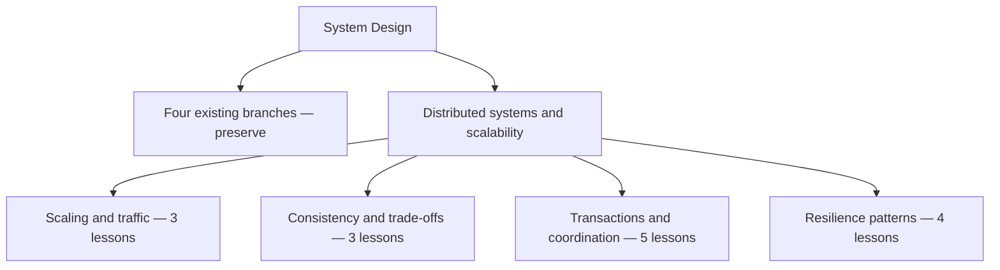
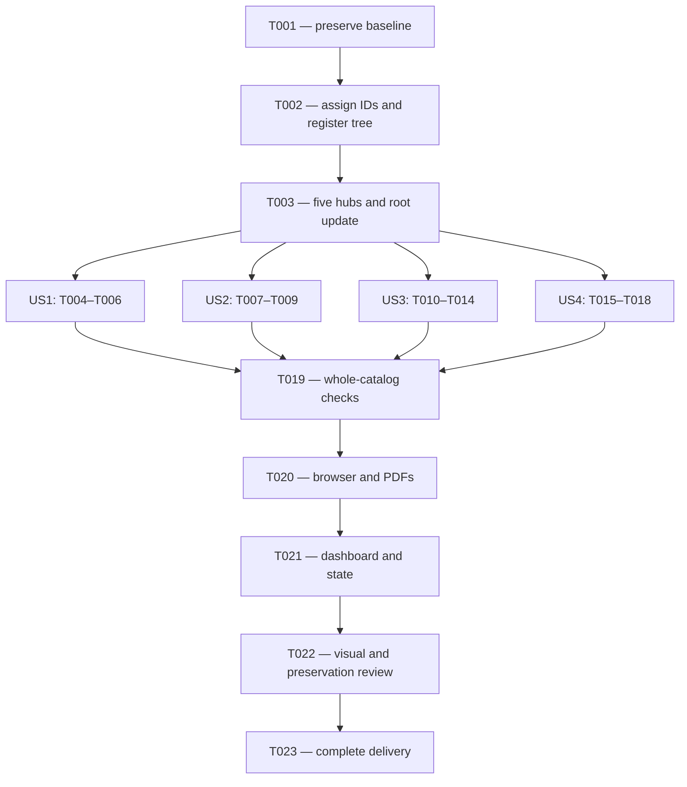

# Distributed Systems & Scalability

**Stage:** Implementation and validation complete; all 23 tasks and seven publication gates passed.\
**Requested:** 2026-11-17. **Profile:** Compact content publishing; constitution v1.3.0.\
**Branch:** `main`. **Git HEAD:** `04b897706e45200f9e20a8f6c5507081c0198def`.

## Outcome and taxonomy audit

Learners can identify scaling bottlenecks, distribute traffic and keys, choose explicit
consistency guarantees, coordinate work across failures, and contain overload. Deliver
15 complete lessons through the four requested paths, preserving the existing application
and learning contract. This document carries the specification, plan, task checklist and
completed delivery together; the final bundle and verification evidence appear below.

The audited `manifest.json` has `schemaVersion: 1` and a recursive `roots` array.
Nodes contain `id`, `kind`, `title` and `slug`; hubs alone contain `children`. File locations
and hash routes derive from ancestry, without additional path or route fields. The pre-edit,
committed catalog contained **81 nodes: 60 lessons and 21 hubs**, under one System Design
root with four children, in order: Backend Architecture, Database Design & Management,
API Design & Communication, and Caching Architecture.

Manifest SHA256: `30e4b66fcee84b352e8894bf2de825921dc44a9955fa80102b9fcaa101142b93`.
Capture the then-current pre-edit manifest before implementation and re-audit if it changes.
Neither the requested parent nor its four categories exists. Of the requested dedicated
lesson titles, CAP Theorem already exists; its deliberate separate scope is defined below.

**Placement justification:** Root: System Design > Parent: Distributed Systems & Scalability
> requested Sub-Category > Topic. This branch owns cross-node scaling, coordination and
failure contracts, complementing the existing architecture, database, API and cache branches.

Reuse System Design root ID `d3825659-12c2-4fc8-b6fe-bdd050762da3`. Append the new parent
after Caching Architecture, preserving all four existing subtrees and optional metadata.
Use the explicitly requested parent slug **`distributed-systems-scalability`**. Keep the
four-level hierarchy and requested category/lesson order. Allocate **20 unique UUIDv4 IDs
once during implementation**: five hubs and 15 lessons. Preserve every existing ID and
recall key; the new CAP lesson must receive its own ID. No IDs are allocated by this spec.



## Lesson inventory and distinct scope

Each row must remain a separate complete authoring item in future tasks. Paths below are
relative to **`topics/system-design/distributed-systems-scalability/`**. Hash routes mirror
the file ancestry without `topics/` or `.html`, prefixed by `#/`. All 15 are complete; delivery evidence follows below.

| # | Category | Exact lesson title | Relative lesson file | Required learning focus |
| --- | --- | --- | --- | --- |
| 1 | Scaling & Traffic Distribution | Horizontal vs Vertical Scaling | `scaling-and-traffic-distribution/horizontal-vs-vertical-scaling.html` | Measure the actual bottleneck; compare scale-up/out limits, state placement, coordination, downstream capacity and workload-specific costs. |
| 2 | Scaling & Traffic Distribution | Load Balancing | `scaling-and-traffic-distribution/load-balancing.html` | L4/L7 placement, request versus connection distribution, algorithms, health checks, draining, skew, affinity and balancer redundancy. |
| 3 | Scaling & Traffic Distribution | Consistent Hashing | `scaling-and-traffic-distribution/consistent-hashing.html` | Key ownership and membership changes, remapping, virtual nodes, capacity weighting, skew and hot keys; separate placement from replication and consistency. |
| 4 | Consistency Models & Trade-Offs | CAP Theorem | `consistency-models-and-trade-offs/cap-theorem.html` | Trace network partitions and operation-specific CP/AP decisions; extend to PACELC and normal-operation latency/consistency trade-offs; cross-link the database CAP lesson. |
| 5 | Consistency Models & Trade-Offs | Eventual Consistency | `consistency-models-and-trade-offs/eventual-consistency.html` | Convergence assumptions, propagation, conflicts and repair; reader/session expectations and business invariants that convergence alone cannot protect. |
| 6 | Consistency Models & Trade-Offs | Strong Consistency | `consistency-models-and-trade-offs/strong-consistency.html` | Define the actual guarantee and its scope; trace real-time read/write histories, coordination and failure behavior; distinguish linearizability, serializability and durability. |
| 7 | Distributed Transactions & Coordination | Distributed Transactions | `distributed-transactions-and-coordination/distributed-transactions.html` | Multi-participant invariants, atomicity boundaries, uncertain outcomes and recovery; decide between distributed commit, local transactions and business workflows. |
| 8 | Distributed Transactions & Coordination | Two-Phase Commit (2PC) | `distributed-transactions-and-coordination/two-phase-commit.html` | Prepare/vote and durable decision, participant/coordinator recovery, in-doubt blocking and resource costs; distinguish commit from consensus and two-phase locking. |
| 9 | Distributed Transactions & Coordination | Saga Pattern | `distributed-transactions-and-coordination/saga-pattern.html` | Local commits and compensating actions, orchestration/choreography, intermediate visibility, irreversible effects, duplicate delivery, ordering and recovery. |
| 10 | Distributed Transactions & Coordination | Leader Election | `distributed-transactions-and-coordination/leader-election.html` | Safety versus liveness, quorum/term or epoch assumptions, partitions, stale leaders, restart and failover; distinguish winning leadership from enforcing exclusive effects. |
| 11 | Distributed Transactions & Coordination | Distributed Locking | `distributed-transactions-and-coordination/distributed-locking.html` | Owner identity, safe release, leases, pauses and expiry, fencing at the protected resource, failure assumptions and alternatives to a shared lock. |
| 12 | Resilience & Fault-Tolerance Patterns | Fault Tolerance | `resilience-and-fault-tolerance-patterns/fault-tolerance.html` | Failure models/domains, redundancy, detection, failover, graceful degradation, recovery objectives and recovery drills; distinguish availability targets from data-loss guarantees. |
| 13 | Resilience & Fault-Tolerance Patterns | Circuit Breaker Pattern | `resilience-and-fault-tolerance-patterns/circuit-breaker-pattern.html` | Closed/open/half-open transitions, thresholds and sampling, bounded probes, fallback correctness and interaction with timeouts, retries and recovery. |
| 14 | Resilience & Fault-Tolerance Patterns | Bulkhead Pattern | `resilience-and-fault-tolerance-patterns/bulkhead-pattern.html` | Resource pools, concurrency caps, bounded queues and tenant/dependency isolation; admission policy, reserved capacity, starvation and overload propagation. |
| 15 | Resilience & Fault-Tolerance Patterns | Retry & Backoff Strategies | `resilience-and-fault-tolerance-patterns/retry-and-backoff-strategies.html` | Transient versus permanent failures, timeouts and unknown outcomes, exponential backoff/jitter, deadlines, retry budgets, retry ownership and idempotent effects. |

## Existing overlap and cross-links

- **CAP:** Preserve the existing database lesson and ID
  `8e929724-b8ec-4b58-81ea-af34e571d414`, at
  `#/system-design/database-design-management/consistency-transactions-and-operations/cap-theorem`.
  The new lesson must link there explicitly. Teach the requested partition/CP/AP/PACELC
  emphasis through new distributed-service scenarios rather than reproducing that lesson.
  Keep the exact requested title; breadcrumbs and paths distinguish the two search results.
  Existing CAP progress must neither transfer to nor be overwritten by the new lesson.
- **Foundations and data distribution:** Link the scaling, consistency and fault-tolerance
  lessons as relevant to existing Distributed System Fundamentals, Sharding and Replication:
  `#/system-design/backend-architecture/core-system-topologies/distributed-system-fundamentals`,
  `#/system-design/database-design-management/scaling-and-high-availability/sharding`, and
  `#/system-design/database-design-management/scaling-and-high-availability/replication`.
  New Consistent Hashing teaches the placement algorithm, not another sharding survey.
- **Transaction boundaries:** Link Distributed Transactions and 2PC to
  `#/system-design/database-design-management/consistency-transactions-and-operations/database-transactions`
  and `#/system-design/database-design-management/consistency-transactions-and-operations/acid-properties`.
  Link Saga Pattern to
  `#/system-design/backend-architecture/communication-and-routing/event-driven-architecture`.
  Distinguish local isolation/atomicity, distributed commit and semantic compensation.
- **Traffic versus service policy:** Link Load Balancing to
  `#/system-design/backend-architecture/infrastructure-and-multi-tenancy/service-discovery`
  and `#/system-design/backend-architecture/communication-and-routing/api-gateway-pattern`.
  Explain target discovery and architectural placement without duplicating gateway auth,
  payload transformation or API quota lessons.
- **Cache and lock boundaries:** Link Consistent Hashing to
  `#/system-design/caching-architecture/distributed-caching-and-edge-scaling/distributed-caching`,
  Eventual Consistency to
  `#/system-design/caching-architecture/lifecycle-eviction-and-consistency/cache-consistency`,
  and Distributed Locking to
  `#/system-design/caching-architecture/distributed-caching-and-edge-scaling/cache-stampede`.
  Distinguish refresh coordination for rebuildable data from correctness-sensitive exclusive
  effects; key placement, leases and cache freshness are different contracts.
- **Retries versus duplicate effects:** Link Retry & Backoff Strategies and Saga Pattern to
  `#/system-design/api-design-and-communication/reliability-security-and-traffic-control/idempotency`.
  Link overload examples to the adjacent `rate-limiting` lesson. New lessons own retry
  amplification and recovery rather than repeating the API idempotency/quota tutorials.

All links must resolve against the current manifest. Existing lessons need no reciprocal
edits. New lessons must remain self-contained when readers do not follow related links.

## Shared publishing and research scope

Create the parent `_overview.html` plus one in each of the four inventory category
directories: **five new hubs**. Each needs ELI5 orientation, an explained Mermaid roadmap,
reading guidance and all immediate child links in manifest order. Update the existing
`topics/system-design/_overview.html` orientation, roadmap and ordered links for five
branches, preserving its identity. Use readable short diagram labels with exact full titles
in navigation. Deliver all 15 full lessons, five new hubs, root update, manifest integration
and **15 `research/topics/<immutable-topic-id>.json` records**.

The inspected database CAP lesson and caching parent overview establish the existing
`.kb-*` vocabulary, callouts, diagrams, comparison wrappers, independent disclosures and
host-owned learning controls. Inherit the supported contract in `docs/topic-publishing.md`;
retain six top-level story modules and place interviews within mastery. Include a visible
Feynman summary box/prompt using existing supported styles. No manual core-shell CSS/JS
edits, new runtime dependencies, manifest schema, storage or learning-standard changes.

**Reference reviewed at specification stage:** The user-suggested
[System Design Primer](https://github.com/donnemartin/system-design-primer) was inspected on
2026-11-17 for its scalability, availability/consistency, consistency-pattern and load-balancer
coverage. Use it as a secondary orientation and source-discovery reference. Independently
verify formal guarantees and product behavior with original papers or official technical
documentation; do not inherit simplified slogans or treat this reference as proof of
interview frequency. Record the actual source/version used during authoring. This review
is not completion of the 15 exact-concept interview searches or technical reviews.

Research must distinguish CAP consistency from ACID invariant consistency, explicit
consistency guarantees from vague “strong” labels, and quorum arithmetic from a complete
protocol. State partition, crash, timing, membership and recovery assumptions. Separate
replication, consensus, atomic commit, leader selection and fencing. Show production
failure traces for acknowledgment uncertainty, prepared participants, compensation failure,
stale owners/leaders, dependency overload and recovery where relevant. Do not claim generic
exactly-once execution, universal CP/AP product labels, guaranteed zero-downtime failover,
or universal cost/performance superiority. Verify PACELC separately and cite real-world
examples at their actual documented scope/version.

For each exact concept, search interview/debugging/trade-off situations before selecting
its scenario set; verify answers against primary sources. Record actual queries, dates,
source mappings and substantive editorial findings in the existing compact research schema.
Disclose adapted production scenarios and unverified frequency honestly in both the record
and the associated visible source note. Do not fabricate “most asked” or company claims.

The eventual delivery bundle includes a placement justification, applied paste-ready
manifest snippet with allocated IDs, links to every complete lesson/hub and honest check
results/limitations. Preserve prior batch documents, research and acceptance artifacts;
use separate distributed-systems report/PDF paths.

## Inherited publication acceptance checklist

These inherited publication gates are satisfied by the final delivery evidence below.

- [X] **Taxonomy and coverage:** Exactly 15 lessons in the requested **3/3/5/4** grouping
  and order, five new hubs and the affected root update. Paths mirror the requested
  `distributed-systems-scalability` branch, all 20 new IDs are unique/immutable, and all
  81 old nodes retain IDs/metadata. Expected catalog: **101 nodes, 75 lessons, 26 hubs**;
  rederive if the baseline changes. All immediate-child links and roadmaps are accurate.
- [X] **Complete teaching:** All six story modules in order for every lesson; problem/why
  and ELI5 before jargon, valid explained Mermaid, complete collapsible mechanics, a
  decision matrix, concrete Symptom → Root Cause → Fix/Prevention stories and takeaways.
  Every lesson is substantive and self-contained; no placeholders, abbreviated stubs or
  substitution of another lesson for required explanations.
- [X] **Recall and interviews:** Each lesson includes the Feynman summary box/prompt,
  **3–5 foundational cards**, and **5–7 distinct production scenarios** in the dedicated
  **Tricky & Most-Asked Interview Scenarios** subsection: **75–105 scenarios** in total.
  Every independent native `<details>` card has hidden initial answers, a stable recall
  key, explicit constraints and all three labeled parts: **The Scenario & Constraint**,
  **The Direct Answer & Architectural Decision**, and **Key Trade-Offs & Follow-Up Traps**.
  Each gives an actionable defended decision, alternatives/costs and a changed-constraint
  follow-up; include materially different debugging and architecture decisions.
- [X] **Research and correctness:** All 15 exact concepts receive actual web-grounded
  scenario selection when available, primary-source answer verification, concise reviewed
  records and visible associated source notes. Frequency/company claims have evidence;
  adaptations/search gaps are disclosed without removing required cards. All protocol and
  product claims name assumptions, guarantee boundaries and relevant versions. Structural
  validation does not substitute for substantive source/editorial review of every lesson.
- [X] **Boundaries and decisions:** Required cross-links resolve. The two CAP lessons
  have separate scopes and progress IDs; PACELC is taught explicitly. Partition traces,
  convergence, transaction/commit/compensation boundaries, stale leadership/locking and
  bounded overload recovery are explained in their relevant lessons. Existing lessons,
  research and learning identities remain unchanged; no duplicate synonymous categories.
- [X] **Dashboard and learning:** New/affected routes load and reload at `/` and
  `/backend-lab/`; search, breadcrumbs, sidebar, mobile drawer and all **five** home branch
  cards work. Search distinguishes both CAP results. Mastery derives from **75** lessons
  after this addition, with explicit completion. Opening/rating cards does not imply
  mastery or complete a review. Existing/new statuses, confidence, review data and unknown
  backup records survive reload and JSON export/import; new CAP starts independently.
- [X] **Focused verification and print:** Whole-catalog intrinsic checks and existing
  general content/catalog/state tests pass. Scoped route, keyboard, confidence, mobile,
  theme, Mermaid and print checks cover **21 affected partials: 15 lessons, five new hubs
  and the root**, giving **63 browser cases and 42 light/dark PDFs** with current tooling.
  Require complete answers/diagram labels, hidden controls and restored disclosures in
  print, plus visual review of introduced layouts. Use explicit changed/root paths with
  the captured pre-edit manifest; `--changed` is also valid while the baseline remains
  clean. Never overwrite earlier batch reports or frozen migration baselines. Reuse only
  supported unchanged-input/artifact results; broaden for actual shared runtime changes.

## Specification review and handoff

**Review:** Passed: exact inventory/order, four-level placement, explicit folder spelling,
intentional CAP overlap, hub/root integration, complete learning and research requirements,
preservation boundaries and measurable acceptance are defined. No clarification is needed.
Keep all 15 lessons as separate complete authoring tasks in subsequent stages; group
shared setup, integration and verification once.

**Specification validation:** The existing manifest indexer and publishing selector passed
an in-memory prospective tree: all 15 paths, 3/3/5/4 grouping, unique temporary UUIDv4s,
101-node/75-lesson inventory and existing cross-link routes. Exactly 21 affected partials
were selected; the root was the only existing selection. All four prior branches remained
identical and all 137 protected current files matched their pre-spec hashes. Temporary
validation IDs were not persisted.

`.specify/extensions.yml` is absent; no before/after-specify hooks are configured.
Specification-only review is complete and ready for `$speckit-plan`. Manifest, lesson/hub,
research and application files are unchanged. Topic research, implementation, browser and
PDF acceptance are pending; no publication completion is claimed.

## Implementation plan

**Planned:** 2026-11-17 on `main`, against the unchanged 81-node catalog and manifest hash
above. The only untracked change is this request document. Use the compact content
profile: extend the existing static dashboard contract without application, dependency,
storage or schema changes. No separate data model, contracts, migration ledger or feature
scaffold is needed. The existing 15-row inventory is authoritative for titles and paths.

### Inspected integration contract

- **Manifest:** Rechecked `manifest.json`: `schemaVersion: 1`, recursive `roots`, hub
  fields `id/kind/title/slug/children`, topic fields `id/kind/title/slug`. Append one parent
  with four category hubs and 15 leaves after Caching Architecture; preserve the four
  existing branches as JSON values. IDs are independent of titles/paths, and file/hash
  locations derive from ancestry. Do not add explicit route/file fields or fixed counts.
- **Actual lesson samples:** Inspected
  `topics/system-design/caching-architecture/distributed-caching-and-edge-scaling/cache-stampede.html`
  and `topics/system-design/database-design-management/consistency-transactions-and-operations/cap-theorem.html`.
  Both parse cleanly and use one `.kb-topic[data-node-id]`, exact-title `<h1>`, and six
  direct sections with keys `hook-eli5`, `big-picture`, `mechanics`, `trade-offs`,
  `pitfalls`, `mastery`; section IDs are `node-<UUID>-<key>`. Reuse their verified CSS
  vocabulary: `.kb-callout--insight`, `--pitfall`, `--impact`, `.kb-diagram` with
  `pre.mermaid`, accessible diagram title/description and explained caption,
  `.kb-table-wrap`, `.kb-question` and `.kb-references`. Use `code.language-*` for code.
  Keep mechanics/recall in native independent `<details>` cards, initially closed with
  no shared `name`. Use short diagram labels and full terminology in nearby prose.
- **Mastery:** Samples have four foundational and six interview cards; inherit the
  constitutional ranges, not a new fixed count. Put the Feynman prompt in an existing
  callout box; do not introduce a new persisted editor. Inside mastery, use a direct
  `section[data-interview-scenarios]` with heading/ARIA ID
  `node-<UUID>-interview-scenarios` and exact heading **Tricky & Most-Asked Interview Scenarios**.
  Each direct `details.kb-question` has `data-recall-kind="interview"`, a unique stable
  `data-recall-id="interview-<kebab-key>"` and accurate `data-scenario-basis`. Its three
  direct `div[data-scenario-part]` values are `scenario`, `decision`, `trade-offs`,
  each beginning with the corresponding exact bold label from the specification. Keep
  the visible `aside[data-interview-research]` outside the closed cards.
- **Hubs:** Inspected `topics/system-design/caching-architecture/_overview.html` and
  `topics/system-design/_overview.html`. Reuse `.kb-hub[data-node-id]`, exact heading,
  intuitive opening, explained roadmap, reading guide and `ul[data-child-links]` with
  all immediate children in manifest order, plus a parent hash link where applicable.
  Create five hubs at the new parent/category paths; update only the existing root's
  introduction, roadmap and child list to include the fifth branch.
- **Host ownership:** Existing relative fetching/hash routing, Mermaid/Highlight.js,
  confidence buttons, explicit mastery, review state, themes, backups and print handle
  supported content. Partials contain no scripts, styles, handlers, outer document or
  duplicated host controls. Research records use constitution `1.3.0`; the markup profile
  remains `constitution-1.2`. New UUID records use the default `research/topics/` directory;
  do not change the publishing registry or historical migration/research records.

### Research and complete authoring queue

Each L01–L15 maps one-to-one to the corresponding inventory row/file. Preserve a separate
complete authoring task per lesson in the subsequent breakdown. Each includes exact-concept
question research, primary-source verification, full HTML, research JSON and substantive
editorial review. Shared references may be checked once and reused where relevant.

Before selecting a topic's 5–7 scenarios, search its exact concept with system-design,
debugging, production and trade-off interview terms. Batch independent queries; record
actual queries/dates/results once. The source families below are **verification targets**,
not newly checked references, fixed scenario sets or evidence of interview popularity.
The specification-stage primer review remains available; do not repeat it unnecessarily.

| Item | Complete lesson | Production decisions to investigate | Primary verification targets |
| --- | --- | --- | --- |
| L01 | Horizontal vs Vertical Scaling | CPU versus storage/coordination limits; stateful workers; burst versus sustained demand; extra app instances overwhelming a database; capacity/cost and rollback of a scaling decision. | Original scalability references and official capacity/autoscaling guidance for the concrete example, with explicit workload and deployment assumptions. |
| L02 | Load Balancing | Long-lived connection skew; L4/L7 choice; misleading health checks; draining during deploys; sticky sessions; balancer failure and backend overload. | Official HAProxy/NGINX or selected balancer documentation for actual algorithms, health, draining, connection behavior and topology. |
| L03 | Consistent Hashing | Membership churn and remapping; unequal node capacity; hot keys versus broad skew; replica placement; failure/rejoin and safe migration. | Original consistent-hashing and Dynamo references plus the selected implementation's official routing/replication documentation; distinguish hashing variants and fixed-slot schemes. |
| L04 | CAP Theorem | Partitioned regional commands versus reads; CP/AP choices per operation; quorum/minority behavior; recovery conflicts; normal-network latency and PACELC; contrast the existing database scenarios. | Original CAP proof and PACELC publication, then official guarantees for any concrete service/configuration named. |
| L05 | Eventual Consistency | Read-your-writes expectations; lost/conflicting updates; delayed or out-of-order propagation; repair after outages; business invariants and session guarantees. | Original eventual/session/causal-consistency and conflict-resolution references, plus official semantics of the selected example. |
| L06 | Strong Consistency | Read after acknowledged write; concurrent histories; cross-region coordination loss; stale replica reads; multi-object invariants and transaction versus object scope. | Original linearizability/serializability definitions and the chosen system's official read, write, transaction and failover guarantees. |
| L07 | Distributed Transactions | Cross-service invariants; timeout with unknown outcome; partial participant failure; transactional publication; recovery/reconciliation versus a single-owner redesign. | Original transaction-processing/atomic-commit references and official supported distributed-transaction or outbox documentation for the example. |
| L08 | Two-Phase Commit (2PC) | Crash after prepare; lost final decision; prepared resource retention; coordinator recovery; unsafe unilateral abort; decision durability and the distinction from consensus/2PL. | Original atomic-commit references and official prepared-transaction/coordinator documentation for an explicitly chosen implementation/version. |
| L09 | Saga Pattern | Irreversible payment/shipment; compensation failure; duplicate/out-of-order events; visibility between steps; orchestration versus choreography; replay and manual recovery. | Original Sagas work, official workflow/saga references and actual transaction/outbox/idempotency boundaries used in the example. |
| L10 | Leader Election | Partitioned old leader; restart with obsolete term/state; quorum loss; failover churn; leadership versus authority over external writes; recovery and membership assumptions. | Original consensus/leader-election references and official etcd/ZooKeeper or selected coordination-system guarantees. |
| L11 | Distributed Locking | Lease expires during a process pause; old owner deletes a new lock; protected store lacks fencing; renewal/partition uncertainty; contention; replacing locks with ownership or conditional writes. | Original lease/fencing references and official lock/transaction semantics for the selected coordinator and protected resource; state safety assumptions explicitly. |
| L12 | Fault Tolerance | Correlated zone failure; unhealthy failover target; stale recovery data; graceful degradation; dependency failure; recovery drills and explicit RTO/RPO/SLO expectations. | Original fault-tolerance references, official architecture/reliability guidance and documented recovery guarantees for the actual example. |
| L13 | Circuit Breaker Pattern | Slow versus failed calls; per-target versus global breaker state; false trips; half-open probe storms; misleading fallback success; retry/timeout interaction and recovery. | Official circuit-breaker pattern and selected library documentation for transitions, windows, thresholds, isolation scope and probe controls. |
| L14 | Bulkhead Pattern | One dependency exhausts workers; noisy tenant; unbounded queue; blocked async/event-loop resources; pool sizing; reserved-capacity versus utilization trade-offs. | Official bulkhead/resource-isolation references and selected runtime/library concurrency, queue and cancellation semantics. |
| L15 | Retry & Backoff Strategies | Request timed out after an effect; layered retry multiplication; synchronized clients; deadline exhaustion; overload/retry hints; retry budget, cancellation and ownership. | Official reliability/backoff guidance, applicable HTTP/RPC semantics and selected client/library retry/deadline/idempotency behavior. |

For every row, verify an actionable decision under explicit assumptions, costs and at least
one viable alternative, plus how the answer changes with a follow-up constraint. Include
debugging/failure analysis and materially different situations. Use `reported-recurring`
only for precise supported recurrence claims; otherwise label adapted production variants
and disclose the frequency gap. Search failures remain visible and never remove cards.

Author full ELI5-first stories with a concrete worked example, explained diagrams,
progressive mechanics, comparison matrix, failure stories and impact. Use sequence diagrams
for partition, prepare/decision, stale-owner or retry timelines where they teach the
relationship better than a box chart; add distinct diagrams as needed without per-card
quotas. Cover the specification's scope boundaries and related links without relying on
them for missing explanations. Verify any concrete syntax/example against the named
version, execute practical local examples when appropriate and state execution limits.

Each lesson also delivers its Feynman summary box, 3–5 foundational cards and 5–7 complete
interview cards. Write one concise UUID-keyed research JSON with actual searches, checked
sources/roles, ordered scenario keys/bases and source mappings, assumptions/limitations,
eight substantive editorial findings per scenario and matching public disclosure/URLs.
Only mark a record reviewed after source and editorial review. No full answers duplicated
into research evidence. Detailed source checks and scenario selection remain pending.

### Dependency order and preservation

1. **Capture the current baseline once before edits.** Recheck the manifest hash/counts;
   preserve the pre-edit catalog at
   `.cache/topic-checks/distributed-systems-scalability-manifest-before.json` and reuse it
   on resumed runs. Do not overwrite it with the expanded catalog. Protect the four
   existing subtrees, all old lesson/research/runtime files and prior batch docs/reports;
   the root overview is the sole planned existing HTML edit.
2. **Prepare shared taxonomy once.** Allocate 20 new UUIDv4s, preserve all existing IDs,
   and append the requested branch in exact 3/3/5/4 order. Create the parent and four
   category overviews with complete roadmaps/child lists and update the root. The new CAP
   node has its own ID/path; the old CAP node and recall identities remain untouched.
   Catalog and files are accepted together; temporary missing/empty lessons are not a
   completed publication. No runtime or platform setup work is part of this batch.
3. **Complete L01–L15 individually.** Search, verify, fully author and substantively review
   each lesson and its research record. Coordination lessons may link to one another after
   manifest integration, but each teaches its own complete boundary. Keep per-lesson
   outcomes concise in this document; leave unresolved work pending.
4. **Verify the integrated bundle.** Run whole-catalog cheap checks, then scoped render,
   learning and print checks below; fix failures and repeat affected checks. Visually review
   introduced layouts and verify every lesson's technical/narrative quality. Supported
   cache reuse avoids repeating unaffected successful browser/PDF work.
5. **Deliver here.** Record evidence and limits, all acceptance outcomes, placement line,
   applied manifest snippet and links to every complete partial. Preserve prior request
   artifacts. Commit/push only on a separate user request.

### Verification guide

Use existing pinned development tooling. If absent, follow the one-time Python/Playwright,
Chromium and `pdftotext` setup in `docs/topic-publishing.md`; no deployment build is added.
After capturing the original baseline and completing the bundle, run from the repo root:

```sh
python3 tools/validate_content.py \
  --report .cache/topic-checks/distributed-systems-scalability-static.json
python3 -m unittest discover -s tests/content -q
node --experimental-default-type=module tests/dashboard/test_catalog.mjs
node --experimental-default-type=module tests/dashboard/test_learning_state.mjs

python3 tools/check_topics.py \
  --baseline .cache/topic-checks/distributed-systems-scalability-manifest-before.json \
  --paths manifest.json topics/system-design/_overview.html \
    topics/system-design/distributed-systems-scalability/_overview.html \
  --report .cache/topic-checks/distributed-systems-scalability-report.json \
  --pdf-dir .cache/topic-checks/distributed-systems-scalability-pdfs
```

Manifest delta discovery selects all 20 new nodes and the affected root: **21 partials**.
Check the selected set before accepting the report. The runner owns local server/port
startup, readiness and cleanup, testing `/` and `/backend-lab/`. Its three cases per
partial are 1440px light at root and 360px light/dark under the repository prefix:
**63 browser cases**, plus **42 light/dark PDFs**. Require route reload/identity, rendered
Mermaid, independent keyboard disclosure, confidence persistence, explicit mastery,
hub navigation and no console/layout errors. Print checks require all answers and diagram
labels, hidden controls and restored reading disclosures; inspect actual new visual
patterns in addition to automated text checks. `--static-only` cannot satisfy acceptance.

Add a focused integration pass at both serving bases using the real dashboard: search
each new title/path, distinguish both CAP results, open all five home branch cards and
check breadcrumbs/mobile navigation. Seed representative old branch records including
database CAP plus an unknown backup record; exercise new status, Hard/Good/Easy, explicit
mastery and review controls, reload, export/import, and confirm the old/unknown records
and review/confidence data survive. Verify new CAP remains independent and global/category
progress derives from the current 75 lessons rather than a fixed former denominator.
Check existing review scheduling with controlled due/not-due records using the existing
state contract; a topic addition must not alter it. Save concise integration evidence in
`.cache/topic-checks/distributed-systems-scalability-integration.json`.

Cheap checks always cover the entire current catalog. Expensive rendering/print stays
focused unless actual renderer/style/library changes require full-catalog regression;
route/state/backup changes require their relevant application regressions. Reuse results
only through matching runner fingerprints and intact PDF hashes. Never regenerate frozen
migration baselines or overwrite previous batch reports to accommodate catalog growth.

### Plan review and handoff

**Constitution check:** Passed for the proposed design: ELI5 depth, six ordered modules,
purposeful visuals, complete foundational/interview practice, web-grounded selection and
source honesty, immutable IDs/recall keys, complete hubs, mobile/print and state preservation
are inherited explicitly. Every new file uses supported markup and host behavior. At
planning handoff, all seven publication gates were left unchecked for implementation.

**Planning validation:** Reconfirmed the unchanged exact manifest/schema and parsed both
sample lessons and the hub without HTML errors; all named shared CSS classes exist. The
runner's documented arguments and three browser cases match current tooling. Queue
L01–L15 matches all 15 inventory rows in order; all planned content paths derive from that
inventory. Existing catalog/content/research/runtime hashes remain unchanged. Only this
request document was extended; no IDs, lesson files or research results were created.

`.specify/extensions.yml` remains absent; no before/after-plan hooks are configured.
**Plan handoff:** Complete and ready for `$speckit-tasks`. Detailed lesson research,
implementation and browser/PDF acceptance remain pending.

## Implementation tasks

**Generated:** 2026-11-17. **Status:** All 23 implementation tasks are complete. This is
the compact profile's task artifact; continue in this document rather than creating a
separate `tasks.md`. T004–T018 are **15 separate complete lesson tasks**, one per inventory
row and L01–L15 research item. Shared baseline, taxonomy, hubs and acceptance are grouped
once. No shell, infrastructure or new-test-suite work is requested.

### Complete-lesson definition for T004–T018

Each lesson task includes exact-concept interview searches, primary-source answer
verification, full HTML authorship and substantive editorial review. Its output is the
named HTML plus `research/topics/<that-lesson-immutable-id>.json`, using the ID allocated
in T002, the inspected partial contract and the corresponding L01–L15 research scope.
All of the following are required before marking any lesson task complete:

- Six ordered modules: problem/why and ELI5 analogy before jargon; explained valid
  Mermaid with accessible title/description/caption; full collapsible mechanics;
  trade-off decision table; concrete Symptom → Root Cause → Fix/Prevention stories;
  mastery and real-world takeaways. Use an actual worked example and explicit failure
  assumptions. No stubs or dependence on another lesson to supply missing explanations.
- A visible Feynman summary callout with **Summarize this in your own words**, **3–5
  foundational recall cards**, and the nested **Tricky & Most-Asked Interview Scenarios**
  subsection with **5–7 distinct constrained production questions**. Every independent,
  initially closed native `<details>` scenario has stable keys, accurate basis and all
  three labeled parts: **The Scenario & Constraint**, **The Direct Answer & Architectural
  Decision**, and **Key Trade-Offs & Follow-Up Traps**. Give actionable defended decisions,
  alternatives/costs, debugging coverage and changed-constraint follow-ups.
- Actual queries/dates/results, checked technical sources and scenario/source mappings
  in the compact JSON, with substantive findings for all eight editorial criteria per
  scenario. Match the public source note/disclosure and label adaptations or evidence
  limits honestly; never infer frequency from technical docs. Only mark reviewed after
  actual source/editorial review. Reuse checked references without redundant searches.
- Supported `.kb-*` markup, exact title/identity, scoped section IDs, all applicable
  specification cross-links and host-owned confidence/mastery controls. Keep all old
  lessons, IDs and recall keys unchanged. Source/narrative review is per lesson; shared
  browser/print acceptance remains separately pending until T020–T022.

### Shared baseline and taxonomy prerequisites

- [X] T001 Re-audit `manifest.json` against the recorded 81-node/60-lesson baseline and preserve its pre-edit contents once in `.cache/topic-checks/distributed-systems-scalability-manifest-before.json`; reuse the original snapshot on resumed runs. Preserve all four existing subtrees, old IDs/recall keys, lesson/research/runtime files and prior request/report artifacts; record baseline hashes in `.cache/topic-checks/distributed-systems-scalability-protected.json`, treating `topics/system-design/_overview.html` as the planned existing HTML edit. Reconcile changed assumptions before edits; never refresh a baseline to hide changes.
- [X] T002 Append the new Distributed Systems & Scalability parent, four requested category hubs and 15 exact-title leaves to `manifest.json`, allocating exactly 20 new unique canonical UUIDv4 IDs once. Keep inventory order and the explicit `distributed-systems-scalability` slug, preserve the System Design root and all four old subtrees/metadata, and derive routes/files from ancestry. Give new CAP a separate ID; leave database CAP ID `8e929724-b8ec-4b58-81ea-af34e571d414` untouched. Expected catalog is 101 nodes/75 lessons/26 hubs if the baseline remains unchanged; do not change registries, schema or historical baselines.
- [X] T003 Create `topics/system-design/distributed-systems-scalability/_overview.html`, `topics/system-design/distributed-systems-scalability/scaling-and-traffic-distribution/_overview.html`, `topics/system-design/distributed-systems-scalability/consistency-models-and-trade-offs/_overview.html`, `topics/system-design/distributed-systems-scalability/distributed-transactions-and-coordination/_overview.html`, and `topics/system-design/distributed-systems-scalability/resilience-and-fault-tolerance-patterns/_overview.html`. Update `topics/system-design/_overview.html` for five branches. Every hub must match its ID/title, start intuitively and include an explained readable Mermaid roadmap, reading guide and all immediate-child hash links in manifest order.

### US1 — Choose scaling and traffic distribution (3 lessons)

Goal: distinguish capacity growth, traffic assignment and key placement. Independent
acceptance: each of the three full lessons explains a worked scaling/traffic decision,
its failure behavior and alternatives; its own research/recall and category navigation
are correct. A completed category is a useful first review increment; all 15 lessons
remain required for this batch's acceptance.

- [X] T004 [P] [US1] Research, author and review **Horizontal vs Vertical Scaling** in `topics/system-design/distributed-systems-scalability/scaling-and-traffic-distribution/horizontal-vs-vertical-scaling.html` and its UUID JSON under `research/topics/`, meeting the complete-lesson definition and L01. Work from measured CPU/storage/coordination bottlenecks through scale-up/out, state placement, downstream saturation, burst capacity and workload-specific costs; link the existing fundamentals lesson without replacing the required explanation.
- [X] T005 [P] [US1] Research, author and review **Load Balancing** in `topics/system-design/distributed-systems-scalability/scaling-and-traffic-distribution/load-balancing.html` and its UUID JSON under `research/topics/`, meeting the complete-lesson definition and L02. Teach L4/L7 and request/connection assignment, actual algorithms, long-lived skew, health checks, draining, affinity, backend capacity and balancer failure; verify the chosen implementation and link existing Service Discovery/API Gateway Pattern without duplicating API policy.
- [X] T006 [P] [US1] Research, author and review **Consistent Hashing** in `topics/system-design/distributed-systems-scalability/scaling-and-traffic-distribution/consistent-hashing.html` and its UUID JSON under `research/topics/`, meeting the complete-lesson definition and L03. Trace key ownership before/after membership changes, remapping and virtual nodes, weighted capacity, skew/hot keys and migration; distinguish placement from replicas/consistency and fixed-slot schemes, and link Sharding/Distributed Caching.

### US2 — Choose explicit consistency contracts (3 lessons)

Goal: defend the reader-visible guarantee under both partition and normal operation.
Independent acceptance: the three complete lessons trace concrete operation histories,
state their assumptions and distinguish guarantees. The new CAP lesson explains PACELC,
links database CAP and has an independent identity; no existing content is replaced.

- [X] T007 [P] [US2] Research, author and review **CAP Theorem** in `topics/system-design/distributed-systems-scalability/consistency-models-and-trade-offs/cap-theorem.html` and its UUID JSON under `research/topics/`, meeting the complete-lesson definition and L04. Use distinct distributed-service partition traces and operation-specific CP/AP decisions, precise modeled availability/consistency, quorum/minority consequences, recovery and PACELC's normal-operation trade-off. Verify original CAP/PACELC sources, avoid universal product labels and link `#/system-design/database-design-management/consistency-transactions-and-operations/cap-theorem` without editing it.
- [X] T008 [P] [US2] Research, author and review **Eventual Consistency** in `topics/system-design/distributed-systems-scalability/consistency-models-and-trade-offs/eventual-consistency.html` and its UUID JSON under `research/topics/`, meeting the complete-lesson definition and L05. Explain convergence assumptions, delayed/out-of-order propagation, conflicting updates, reconciliation/repair, reader/session expectations and invariant limits; link existing Replication/Cache Consistency while separating authoritative state and cached freshness.
- [X] T009 [P] [US2] Research, author and review **Strong Consistency** in `topics/system-design/distributed-systems-scalability/consistency-models-and-trade-offs/strong-consistency.html` and its UUID JSON under `research/topics/`, meeting the complete-lesson definition and L06. Specify the actual guarantee and object/transaction scope, trace completed versus concurrent operations and stale reads, and cover cross-region coordination and failures; distinguish linearizability, serializability, invariant consistency and durability using verified definitions.

### US3 — Coordinate transactions and exclusive work (5 lessons)

Goal: select and defend a coordination boundary without confusing atomic commit,
compensation, leader selection and safe exclusive effects. Independent acceptance:
all five lessons have distinct full explanations and failure timelines, identify durable
decisions/uncertain outcomes or stale actors as applicable, and include supported recovery
decisions. Each remains understandable without reading its siblings first.

- [X] T010 [P] [US3] Research, author and review **Distributed Transactions** in `topics/system-design/distributed-systems-scalability/distributed-transactions-and-coordination/distributed-transactions.html` and its UUID JSON under `research/topics/`, meeting the complete-lesson definition and L07. Define multi-participant invariants and acknowledgment/atomicity boundaries; trace partial failure, unknown outcome, recovery and publication; compare supported distributed commit, local ownership and workflow redesign, and link existing Database Transactions/ACID Properties.
- [X] T011 [P] [US3] Research, author and review **Two-Phase Commit (2PC)** in `topics/system-design/distributed-systems-scalability/distributed-transactions-and-coordination/two-phase-commit.html` and its UUID JSON under `research/topics/`, meeting the complete-lesson definition and L08. Diagram prepare/vote, durable global decision and participant completion; explain coordinator/participant crashes, in-doubt resource retention, recovery and unsafe unilateral decisions under a named implementation. Distinguish 2PC from two-phase locking and consensus, and link existing Database Transactions.
- [X] T012 [P] [US3] Research, author and review **Saga Pattern** in `topics/system-design/distributed-systems-scalability/distributed-transactions-and-coordination/saga-pattern.html` and its UUID JSON under `research/topics/`, meeting the complete-lesson definition and L09. Trace local commits, orchestration/choreography, intermediate visibility, compensation failure, irreversible effects, duplicates/order and replay/manual recovery; distinguish semantic compensation from ACID rollback and link existing Event-Driven Architecture/Idempotency.
- [X] T013 [P] [US3] Research, author and review **Leader Election** in `topics/system-design/distributed-systems-scalability/distributed-transactions-and-coordination/leader-election.html` and its UUID JSON under `research/topics/`, meeting the complete-lesson definition and L10. Explain safety/liveness, quorum and term/epoch assumptions, partitions, stale leaders, restart, churn and failover; distinguish elected status from authority over replicated/external state and verify the selected coordinator/protocol guarantees.
- [X] T014 [P] [US3] Research, author and review **Distributed Locking** in `topics/system-design/distributed-systems-scalability/distributed-transactions-and-coordination/distributed-locking.html` and its UUID JSON under `research/topics/`, meeting the complete-lesson definition and L11. Trace owner-safe release, lease expiry during pauses, renewal/partition uncertainty and fencing enforced by the protected resource; compare ownership/conditional-write alternatives, state implementation assumptions and link Cache Stampede without implying a refresh lease ensures business-level exactly-once effects.

### US4 — Contain failures and recover without overload (4 lessons)

Goal: explain which failure/resource boundary each resilience mechanism controls.
Independent acceptance: four complete lessons defend different recovery decisions,
include correlated failures and overload where relevant, and distinguish fault tolerance,
breaker state, resource isolation and retry amplification rather than treating them as
interchangeable solutions.

- [X] T015 [P] [US4] Research, author and review **Fault Tolerance** in `topics/system-design/distributed-systems-scalability/resilience-and-fault-tolerance-patterns/fault-tolerance.html` and its UUID JSON under `research/topics/`, meeting the complete-lesson definition and L12. State failure models/domains, detection limits, redundancy, failover, degraded behavior and recovery drills; work through RTO/RPO and availability expectations without promising zero loss/downtime, and link existing fundamentals/Replication.
- [X] T016 [P] [US4] Research, author and review **Circuit Breaker Pattern** in `topics/system-design/distributed-systems-scalability/resilience-and-fault-tolerance-patterns/circuit-breaker-pattern.html` and its UUID JSON under `research/topics/`, meeting the complete-lesson definition and L13. Show closed/open/half-open behavior, observation windows, thresholds, breaker scope, bounded probes, fallback correctness, false trips and recovery; verify the selected library and distinguish breaker behavior from timeout, retry and isolation policies.
- [X] T017 [P] [US4] Research, author and review **Bulkhead Pattern** in `topics/system-design/distributed-systems-scalability/resilience-and-fault-tolerance-patterns/bulkhead-pattern.html` and its UUID JSON under `research/topics/`, meeting the complete-lesson definition and L14. Teach dependency/tenant resource isolation, concurrency and bounded queues, admission, reserved capacity, starvation and utilization costs; trace blocking/async resource exhaustion with verified runtime behavior and explicit rejection/cancellation policy.
- [X] T018 [P] [US4] Research, author and review **Retry & Backoff Strategies** in `topics/system-design/distributed-systems-scalability/resilience-and-fault-tolerance-patterns/retry-and-backoff-strategies.html` and its UUID JSON under `research/topics/`, meeting the complete-lesson definition and L15. Trace transient/permanent failures, timeouts with unknown effect, deadlines, exponential backoff/jitter, retry budgets, layered amplification, cancellation and retry ownership; verify relevant protocol/client semantics and link existing Idempotency/Rate Limiting without duplicating their API scope.

### Shared integration, acceptance and delivery

- [X] T019 Run whole-catalog intrinsic validation with `tools/validate_content.py` and the general suites `tests/content/`, `tests/dashboard/test_catalog.mjs` and `tests/dashboard/test_learning_state.mjs` using the plan's commands. Save `.cache/topic-checks/distributed-systems-scalability-static.json`; verify the 15/5/root bundle, requested ordering, all IDs/paths/cross-links and 15 reviewed `research/topics/` records, deriving counts from the current manifest. Fix content/research failures and repeat affected checks without weakening validators or frozen baselines.
- [X] T020 Run `tools/check_topics.py` with the captured `.cache/topic-checks/distributed-systems-scalability-manifest-before.json` and the explicit manifest/new-parent/root paths in the plan, writing `.cache/topic-checks/distributed-systems-scalability-report.json` and `.cache/topic-checks/distributed-systems-scalability-pdfs/`. Require exactly 21 selected partials from this baseline, 63 browser cases and 42 actual light/dark PDFs; check route reloads at root/repository-prefix bases, Mermaid/console, mobile/theme, independent keyboard cards, confidence persistence, explicit mastery and hub navigation. Require full printed answers/diagram labels, hidden controls and restored disclosures; fix and rerun affected failures. Static-only or pending output is incomplete.
- [X] T021 Exercise the real dashboard at `/` and `/backend-lab/` and record `.cache/topic-checks/distributed-systems-scalability-integration.json`: search all 15 titles/paths, distinguish both CAP results, open all five home cards, and verify breadcrumbs/mobile navigation. Seed representative records from all four old branches including database CAP and an unknown backup record; use existing controls to check new statuses, Hard/Good/Easy, explicit completion, due/not-due review behavior, reload and JSON export/import. Confirm preservation, independent new CAP progress and the current 75-lesson denominator; no opening/rating may imply mastery or complete a review.
- [X] T022 Review the actual outputs in `.cache/topic-checks/distributed-systems-scalability-pdfs/` and mobile/light/dark renderings for new layouts, long labels, tables, code and complete answer readability. Finish the per-lesson source/editorial review across the 15 new HTML files and `research/topics/` records, checking distinctness and all three answer parts against the complete-lesson definition. Compare `manifest.json` and protected files with T001's snapshots: only the intended root HTML edit may change among old partials; four old subtrees, other old content/research/runtime and prior batch artifacts must survive. Correct issues and refresh only affected validation evidence before closing acceptance.
- [X] T023 Complete all seven publication gates only with passing source/editorial/integration/render/print evidence, then record delivery in `docs/topic-requests/distributed-systems-scalability.md`: concise outcomes for all 15 lessons, placement justification, applied paste-ready manifest snippet with actual IDs, links to all 15 complete lessons/five new hubs/root update and honest check results/limitations. Confirm no task or gate is pending; do not commit or push unless separately requested.

### Dependencies and execution guidance



T001 precedes every catalog edit; T002 precedes identity-dependent hubs and lessons.
After T003, the 15 `[P]` tasks have no authoring dependency on one another: each edits
only its own HTML/research pair and uses its already assigned manifest ID. For example,
T004/T005 (US1), T007/T008 (US2), T010/T011 (US3) or T015/T016 (US4) can be authored
independently after shared setup, including across categories. This marks file independence,
not a requirement to spawn agents. Coordinate updates to this shared checklist rather
than competing edits; reuse checked sources without sharing mutable output records.

Use the requested category/lesson order for a straightforward sequential implementation.
Review the first complete US1 path as an early learning increment, then complete US2–US4;
the delivery scope remains all 15 complete lessons and all hubs. Story-level acceptance
checks its own material; catalog-wide acceptance waits for every registered file. Shared
checks run once after all lesson tasks, with only affected reruns after corrections.
Keep interrupted checks pending and broaden scope only for actual shared runtime changes.

### Task review and handoff

**Task review:** Passed: 23 sequential unique task IDs, 15 full lesson tasks matching
inventory/L01–L15 in order, **US1: 3, US2: 3, US3: 5, US4: 4**, and eight shared tasks.
At generation, every task had an unchecked checkbox, ID, concrete path and actionable
outcome. Lesson tasks carry story labels and conditional `[P]` markers; implementation
had not started at that handoff.
Dependency order, category acceptance, research, learning-state preservation, focused
browser/PDF scope and complete delivery are explicit. All seven publication gates were
left pending at task generation, with existing files unchanged at that stage.

`.specify/extensions.yml` remains absent; no before/after-tasks hooks are configured.
**Tasks handoff:** Complete and ready for `$speckit-implement`, using this document's
implementation plan and T001–T023 checklist. No separate generic feature artifacts were
created, and no lesson research or publication acceptance is claimed by task generation.


## Delivered bundle

**Completed:** 2026-11-17. **Placement:** Root: System Design > Parent: Distributed Systems
& Scalability > the four requested categories > the 15 exact-title topics. The branch
teaches cross-node capacity, consistency, coordination and recovery in a four-level tree.
All 15 lesson tasks and eight shared tasks are complete. The final catalog has **101 nodes:
75 lessons and 26 hubs**. The four old subtrees are unchanged, including database CAP and
its progress identity. The new CAP lesson has an independent UUID and a working cross-link.

### Complete lesson partials and research

Every row delivers six full ELI5-first modules, one explained Mermaid diagram, six
collapsible mechanics steps, four trade-off alternatives, three failure stories, a
Feynman summary callout, four foundational cards and six structured production scenarios.
That is **60 foundational cards and 90 scenario cards**, with all answers available in
print. Lesson lengths range from 1,926 to 2,150 words, about 2,037 on average; no lesson
was replaced by a summary or another lesson's link.

| # | Complete lesson | Reviewed research | Result |
| --- | --- | --- | --- |
| 1 | [Horizontal vs Vertical Scaling](../../topics/system-design/distributed-systems-scalability/scaling-and-traffic-distribution/horizontal-vs-vertical-scaling.html) | [Source and scenario record](../../research/topics/7018d866-3bba-4b0d-9eda-b2f9dccee551.json) | Complete; render, recall and both-theme print passed. |
| 2 | [Load Balancing](../../topics/system-design/distributed-systems-scalability/scaling-and-traffic-distribution/load-balancing.html) | [Source and scenario record](../../research/topics/ccdbf5c1-599c-4b49-992e-1d0c0a3773fb.json) | Complete; render, recall and both-theme print passed. |
| 3 | [Consistent Hashing](../../topics/system-design/distributed-systems-scalability/scaling-and-traffic-distribution/consistent-hashing.html) | [Source and scenario record](../../research/topics/7696fe07-3043-4f12-b9fb-e0fba472934d.json) | Complete; render, recall and both-theme print passed. |
| 4 | [CAP Theorem](../../topics/system-design/distributed-systems-scalability/consistency-models-and-trade-offs/cap-theorem.html) | [Source and scenario record](../../research/topics/5e383f18-b808-4a06-a6bc-172086450a64.json) | Complete; render, recall and both-theme print passed. |
| 5 | [Eventual Consistency](../../topics/system-design/distributed-systems-scalability/consistency-models-and-trade-offs/eventual-consistency.html) | [Source and scenario record](../../research/topics/d3264675-ea60-4faa-822e-9113345836ae.json) | Complete; render, recall and both-theme print passed. |
| 6 | [Strong Consistency](../../topics/system-design/distributed-systems-scalability/consistency-models-and-trade-offs/strong-consistency.html) | [Source and scenario record](../../research/topics/a8e8f310-fc69-46f5-84d0-3bea09b266c8.json) | Complete; render, recall and both-theme print passed. |
| 7 | [Distributed Transactions](../../topics/system-design/distributed-systems-scalability/distributed-transactions-and-coordination/distributed-transactions.html) | [Source and scenario record](../../research/topics/e771361a-494b-4381-9f03-f9b768f81a5f.json) | Complete; render, recall and both-theme print passed. |
| 8 | [Two-Phase Commit (2PC)](../../topics/system-design/distributed-systems-scalability/distributed-transactions-and-coordination/two-phase-commit.html) | [Source and scenario record](../../research/topics/263bac5a-9c8e-4ae4-a620-f53d2aec914b.json) | Complete; render, recall and both-theme print passed. |
| 9 | [Saga Pattern](../../topics/system-design/distributed-systems-scalability/distributed-transactions-and-coordination/saga-pattern.html) | [Source and scenario record](../../research/topics/78a62b42-80f8-4480-a5e3-f3759a802e15.json) | Complete; render, recall and both-theme print passed. |
| 10 | [Leader Election](../../topics/system-design/distributed-systems-scalability/distributed-transactions-and-coordination/leader-election.html) | [Source and scenario record](../../research/topics/c31b35c2-6b12-47eb-ba67-e941c79131dd.json) | Complete; render, recall and both-theme print passed. |
| 11 | [Distributed Locking](../../topics/system-design/distributed-systems-scalability/distributed-transactions-and-coordination/distributed-locking.html) | [Source and scenario record](../../research/topics/bc144bae-d486-4b91-8331-faf24bd1e12b.json) | Complete; render, recall and both-theme print passed. |
| 12 | [Fault Tolerance](../../topics/system-design/distributed-systems-scalability/resilience-and-fault-tolerance-patterns/fault-tolerance.html) | [Source and scenario record](../../research/topics/72a46518-8b6b-4359-80ff-ed946697b6ff.json) | Complete; render, recall and both-theme print passed. |
| 13 | [Circuit Breaker Pattern](../../topics/system-design/distributed-systems-scalability/resilience-and-fault-tolerance-patterns/circuit-breaker-pattern.html) | [Source and scenario record](../../research/topics/140db8b9-35a6-4fe6-b2b8-cd27cf62428c.json) | Complete; render, recall and both-theme print passed. |
| 14 | [Bulkhead Pattern](../../topics/system-design/distributed-systems-scalability/resilience-and-fault-tolerance-patterns/bulkhead-pattern.html) | [Source and scenario record](../../research/topics/0e405867-9057-4501-a031-82a7294baf04.json) | Complete; render, recall and both-theme print passed. |
| 15 | [Retry & Backoff Strategies](../../topics/system-design/distributed-systems-scalability/resilience-and-fault-tolerance-patterns/retry-and-backoff-strategies.html) | [Source and scenario record](../../research/topics/0812c6c5-e954-4362-b97a-d6e818aa0237.json) | Complete; render, recall and both-theme print passed. |

All questions are explicitly labeled **adapted production scenarios**. Actual exact-concept
interview searches and checked primary references inform them; interview frequency,
rankings and company attribution were not independently established. Each record maps
the ordered stable scenario keys to sources, assumptions and substantive editorial
findings. Public research notes make the same limitation visible. The user-suggested
primer was reviewed for orientation; formal/product guarantees use the primary sources
linked in the lessons. No live payment provider, database cluster, coordination service
or Java resilience library was deployed for these explanatory examples.

### Hub partials

- [Distributed Systems & Scalability](../../topics/system-design/distributed-systems-scalability/_overview.html): intuitive orientation, explained roadmap, reading guide and ordered immediate-child links.
- [Scaling & Traffic Distribution](../../topics/system-design/distributed-systems-scalability/scaling-and-traffic-distribution/_overview.html): intuitive orientation, explained roadmap, reading guide and ordered immediate-child links.
- [Consistency Models & Trade-Offs](../../topics/system-design/distributed-systems-scalability/consistency-models-and-trade-offs/_overview.html): intuitive orientation, explained roadmap, reading guide and ordered immediate-child links.
- [Distributed Transactions & Coordination](../../topics/system-design/distributed-systems-scalability/distributed-transactions-and-coordination/_overview.html): intuitive orientation, explained roadmap, reading guide and ordered immediate-child links.
- [Resilience & Fault-Tolerance Patterns](../../topics/system-design/distributed-systems-scalability/resilience-and-fault-tolerance-patterns/_overview.html): intuitive orientation, explained roadmap, reading guide and ordered immediate-child links.
- [System Design overview](../../topics/system-design/_overview.html): updated introduction, roadmap and links for all five branches, retaining the root ID.

### Verification and preservation

- **Intrinsic validation:** Entire 101-node catalog passed, with 193 diagrams, 301
  foundational cards and 450 interview scenarios across old and new content. Report:
  `.cache/topic-checks/distributed-systems-scalability-static.json`.
- **General tests:** All 72 Python content/publishing tests and all 14 JavaScript
  catalog/state tests passed. The local HTTP-server test needed socket access beyond
  the default sandbox; it passed on rerun with that access. No validators, runtime,
  CSS, dependencies or frozen migration baselines were changed.
- **Scoped rendering/print:** Exactly 21 partials passed 63 browser cases and 42
  light/dark PDF checks. Routes/reloads worked at `/` and `/backend-lab/`, with no
  console/Mermaid/layout errors, independent keyboard disclosures, persisted ratings,
  explicit mastery and working hub links. PDFs include complete text/diagram labels,
  hide controls and restore disclosure state. Report/PDFs:
  `.cache/topic-checks/distributed-systems-scalability-report.json` and
  `.cache/topic-checks/distributed-systems-scalability-pdfs/`.
- **Dashboard integration:** Both serving bases passed all 60 title/path searches,
  five branch-card navigation checks, CAP disambiguation/cross-link and separate progress.
  Representative old records from all four branches and an unknown backup record survived
  reload/export/import unchanged. New status, Hard/Good/Easy and review controls worked;
  opening/rating did not imply mastery or review completion. Controlled due/not-due
  records and explicit review completion behaved correctly. Mastery changed from
  2/75 = 3% to 3/75 = 4% through explicit completion. Evidence:
  `.cache/topic-checks/distributed-systems-scalability-integration.json`.
- **Executable examples:** The Bulkhead Pattern's sequential admission-budget model
  and Retry & Backoff Strategies' delay/deadline arithmetic model were executed, including
  saturation/release and deadline/boundary cases. They are illustrative Python models,
  not concurrent production implementations or network tests. Evidence:
  `.cache/topic-checks/distributed-systems-scalability-examples.json`.
- **Visual and editorial review:** Inspected all 42 PDF opening pages, 12 actual
  mechanics/scenario/code pages, 12 actual print-diagram pages, all 15 browser-rendered
  diagrams and mobile light/dark views. Visual review caught poor dark-print contrast
  on Mermaid diamond nodes despite text-completeness passing; the six affected lessons
  now use supported rectangular decision nodes with intact labels/branches. Their
  affected checks were rerun while unchanged successful artifacts were reused. Reviewed
  the corrected dark/light output; evidence is under
  `.cache/topic-checks/distributed-systems-scalability-visual/`.
- **Preservation:** All four pre-existing manifest subtrees compare equal to the captured
  baseline. Of 153 protected existing files, only the intended System Design overview
  changed; the other 152 hashes match. Existing content/research, application assets,
  prior requests/reports, IDs and recall keys were preserved. Final runner fingerprints,
  source hashes and all 42 PDF hashes were checked against the current files.

The application remains static and zero-build. `.specify/extensions.yml` is absent; no
before/after-implement hooks are configured. All seven publication gates are complete.
The implementation was verified before the subsequent commit, push and deployment-branch
merge requested by the project owner.

### Applied manifest snippet

Append this complete object to `roots[0].children` in [manifest.json](../../manifest.json),
after Caching Architecture, when applying the same bundle to the captured baseline.
The existing System Design root ID is `d3825659-12c2-4fc8-b6fe-bdd050762da3`; retain its
four earlier children unchanged. This object is already present in the delivered catalog.

```json
{
  "id": "3afa2785-7567-44a0-9706-7a1af581b1ec",
  "kind": "hub",
  "title": "Distributed Systems & Scalability",
  "slug": "distributed-systems-scalability",
  "children": [
    {
      "id": "3f0d443b-8e2a-4571-a490-115156934900",
      "kind": "hub",
      "title": "Scaling & Traffic Distribution",
      "slug": "scaling-and-traffic-distribution",
      "children": [
        {
          "id": "7018d866-3bba-4b0d-9eda-b2f9dccee551",
          "kind": "topic",
          "title": "Horizontal vs Vertical Scaling",
          "slug": "horizontal-vs-vertical-scaling"
        },
        {
          "id": "ccdbf5c1-599c-4b49-992e-1d0c0a3773fb",
          "kind": "topic",
          "title": "Load Balancing",
          "slug": "load-balancing"
        },
        {
          "id": "7696fe07-3043-4f12-b9fb-e0fba472934d",
          "kind": "topic",
          "title": "Consistent Hashing",
          "slug": "consistent-hashing"
        }
      ]
    },
    {
      "id": "ab9354bd-774e-4cbf-9775-88e22c1613c3",
      "kind": "hub",
      "title": "Consistency Models & Trade-Offs",
      "slug": "consistency-models-and-trade-offs",
      "children": [
        {
          "id": "5e383f18-b808-4a06-a6bc-172086450a64",
          "kind": "topic",
          "title": "CAP Theorem",
          "slug": "cap-theorem"
        },
        {
          "id": "d3264675-ea60-4faa-822e-9113345836ae",
          "kind": "topic",
          "title": "Eventual Consistency",
          "slug": "eventual-consistency"
        },
        {
          "id": "a8e8f310-fc69-46f5-84d0-3bea09b266c8",
          "kind": "topic",
          "title": "Strong Consistency",
          "slug": "strong-consistency"
        }
      ]
    },
    {
      "id": "62405529-8062-455c-8881-1cb865815bbe",
      "kind": "hub",
      "title": "Distributed Transactions & Coordination",
      "slug": "distributed-transactions-and-coordination",
      "children": [
        {
          "id": "e771361a-494b-4381-9f03-f9b768f81a5f",
          "kind": "topic",
          "title": "Distributed Transactions",
          "slug": "distributed-transactions"
        },
        {
          "id": "263bac5a-9c8e-4ae4-a620-f53d2aec914b",
          "kind": "topic",
          "title": "Two-Phase Commit (2PC)",
          "slug": "two-phase-commit"
        },
        {
          "id": "78a62b42-80f8-4480-a5e3-f3759a802e15",
          "kind": "topic",
          "title": "Saga Pattern",
          "slug": "saga-pattern"
        },
        {
          "id": "c31b35c2-6b12-47eb-ba67-e941c79131dd",
          "kind": "topic",
          "title": "Leader Election",
          "slug": "leader-election"
        },
        {
          "id": "bc144bae-d486-4b91-8331-faf24bd1e12b",
          "kind": "topic",
          "title": "Distributed Locking",
          "slug": "distributed-locking"
        }
      ]
    },
    {
      "id": "72a2ef2c-047d-4e61-aeb0-76db61089cca",
      "kind": "hub",
      "title": "Resilience & Fault-Tolerance Patterns",
      "slug": "resilience-and-fault-tolerance-patterns",
      "children": [
        {
          "id": "72a46518-8b6b-4359-80ff-ed946697b6ff",
          "kind": "topic",
          "title": "Fault Tolerance",
          "slug": "fault-tolerance"
        },
        {
          "id": "140db8b9-35a6-4fe6-b2b8-cd27cf62428c",
          "kind": "topic",
          "title": "Circuit Breaker Pattern",
          "slug": "circuit-breaker-pattern"
        },
        {
          "id": "0e405867-9057-4501-a031-82a7294baf04",
          "kind": "topic",
          "title": "Bulkhead Pattern",
          "slug": "bulkhead-pattern"
        },
        {
          "id": "0812c6c5-e954-4362-b97a-d6e818aa0237",
          "kind": "topic",
          "title": "Retry & Backoff Strategies",
          "slug": "retry-and-backoff-strategies"
        }
      ]
    }
  ]
}
```
