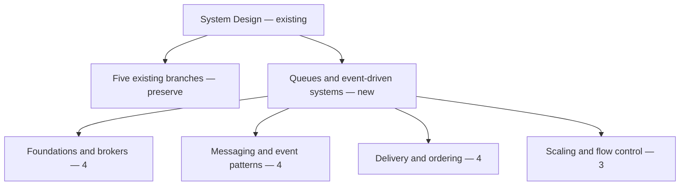
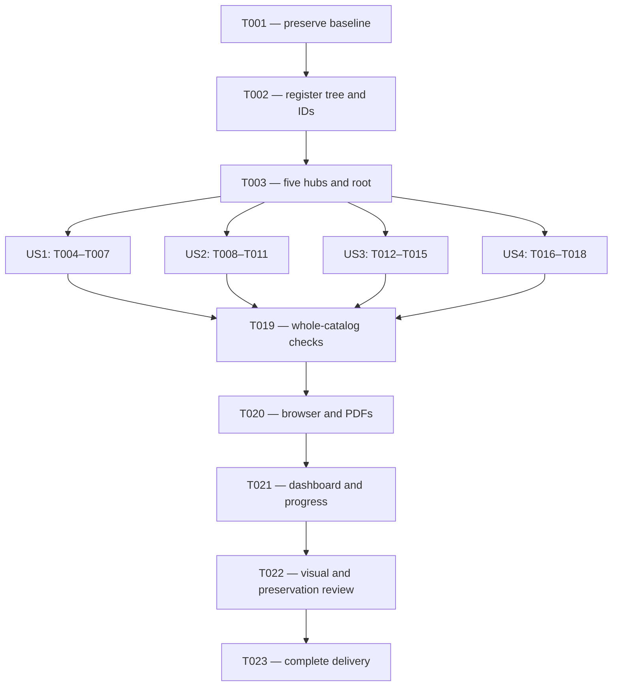

# Message Queues & Event-Driven Systems

**Stage:** Implementation and validation complete; all 23 tasks and seven publication gates passed.\
**Requested:** 2026-11-17. **Profile:** Compact content publishing; constitution v1.3.0.\
**Branch:** `main`. **Git HEAD:** `928715cd2b7a86a7781464eab6ed7c66e8fbaff2`.

## Outcome and taxonomy audit

Learners can choose a messaging abstraction and broker, trace durable acceptance through
processing, defend delivery/ordering guarantees, distinguish event patterns, and control
lag and failure recovery. Deliver 15 complete lessons in the four requested categories,
using the existing dashboard contract. The audit, specification, plan and task handoffs below
record their historical stage; the Delivered bundle records the completed implementation.

The audited `manifest.json` has `schemaVersion: 1` and a recursive `roots` array. Every node
has `id`, `kind`, `title` and `slug`; hubs alone have `children`. File locations and hash
routes derive from ancestry. The clean committed baseline contains **101 nodes: 75 lessons
and 26 hubs**, under one System Design root with five branches: Backend Architecture,
Database Design & Management, API Design & Communication, Caching Architecture, and
Distributed Systems & Scalability. The requested parent, categories and all 15 dedicated
lesson titles are absent. Related architecture/coordination lessons are preserved below.

**Manifest SHA256:** `2f5a3cd9c016b459e12b9e3471d542d2a0e14ca4bf6d098b45a0082b061fb112`.
Capture the then-current pre-edit manifest before implementation; re-audit if it changes.

**Placement justification:** Root: System Design > Parent: Message Queues & Event-Driven
Systems > requested Sub-Category > Topic. This branch teaches asynchronous handoff and
message-processing contracts alongside the existing architectural and distributed-system
boundaries, without duplicating their lesson identities.

Reuse root ID `d3825659-12c2-4fc8-b6fe-bdd050762da3`. Append the new parent after Distributed
Systems & Scalability, preserving the five complete existing subtrees, metadata and recall
keys. Use the explicitly requested parent slug **`message-queues-event-driven`**, with four
levels including each leaf. Keep category/topic order as requested. Allocate **20 unique
UUIDv4 IDs once during implementation**: five hubs and 15 lessons. No IDs are allocated
or persisted by this specification.



## Exact lesson inventory and boundaries

Every row must remain a separate complete authoring item in later tasks. Paths are relative
to **`topics/system-design/message-queues-event-driven/`**. Hash routes use the same ancestry
without `topics/` or `.html`, prefixed by `#/`. All 15 lessons are pending.

| # | Category | Exact lesson title | Relative lesson file | Required distinct learning focus |
| --- | --- | --- | --- | --- |
| 1 | Queue Foundations & Brokers | Message Queue Fundamentals | `queue-foundations-and-brokers/message-queue-fundamentals.html` | Producer/broker/consumer ownership, command/event/task distinctions, accepted versus completed work, durability/acknowledgment boundaries, retry and backlog lifecycle. |
| 2 | Queue Foundations & Brokers | Apache Kafka | `queue-foundations-and-brokers/apache-kafka.html` | Partitioned retained-log model, producers, consumer positions/groups, replication and acknowledgment, retention/replay, rebalances and scoped transaction/idempotence guarantees at verified versions/configurations. |
| 3 | Queue Foundations & Brokers | RabbitMQ | `queue-foundations-and-brokers/rabbitmq.html` | Exchange/binding/queue routing, publisher confirms versus consumer acknowledgments, queue types and durability assumptions, prefetch, redelivery and operational recovery in a verified deployment. |
| 4 | Queue Foundations & Brokers | AWS SQS | `queue-foundations-and-brokers/aws-sqs.html` | Managed queue interaction, Standard/FIFO distinctions, visibility/receipt/deletion, message groups, batching, retention, redrive and configuration-specific guarantees. |
| 5 | Messaging & Event Patterns | Publish-Subscribe Pattern | `messaging-and-event-patterns/publish-subscribe-pattern.html` | Independent subscribers versus competing workers, fan-out, subscription durability, filtering, slow subscribers, duplication and per-subscriber recovery. |
| 6 | Messaging & Event Patterns | Event Streaming | `messaging-and-event-patterns/event-streaming.html` | Retained event sequences, independent positions/replay, partitions, time/order assumptions, processing lag, retention and stateful processing boundaries. |
| 7 | Messaging & Event Patterns | Event Sourcing | `messaging-and-event-patterns/event-sourcing.html` | Events as the authoritative state history, append/concurrency boundaries, reconstruction, snapshots, event evolution, projection rebuild and suppression of unintended replay side effects. |
| 8 | Messaging & Event Patterns | CQRS | `messaging-and-event-patterns/cqrs.html` | Separate command and query responsibilities/models, synchronization and projection lag, read-your-writes needs, rebuild/recovery and when the extra complexity is justified; not inherently event sourcing. |
| 9 | Delivery Guarantees & Ordering | Message Ordering | `delivery-guarantees-and-ordering/message-ordering.html` | Global/per-key/per-partition order, publication/delivery/processing/effect order, concurrency/retries/rebalances, sequence/version checks and hot-key trade-offs. |
| 10 | Delivery Guarantees & Ordering | At-Least-Once Delivery | `delivery-guarantees-and-ordering/at-least-once-delivery.html` | Retried delivery/acknowledgment failure windows, durable consumer effects, deduplication identity/retention, poison messages and distinction from guaranteed business completion. |
| 11 | Delivery Guarantees & Ordering | At-Most-Once Delivery | `delivery-guarantees-and-ordering/at-most-once-delivery.html` | What is intentionally not retried, acknowledgment/position choices, loss windows, suitable expendable workloads and the boundary of the delivery promise. |
| 12 | Delivery Guarantees & Ordering | Exactly-Once Processing | `delivery-guarantees-and-ordering/exactly-once-processing.html` | Explicit input/state/output boundary, atomic progress/effect coordination, transactions or duplicate-safe effects, recovery/replay, retention and limits at external database/provider sinks. |
| 13 | Scaling, Reliability & Flow Control | Consumer Groups | `scaling-reliability-and-flow-control/consumer-groups.html` | Shared consumption versus independent subscriptions, partition assignment, parallelism, membership/rebalance, progress ownership, stale consumers and skew; product-specific terminology distinguished. |
| 14 | Scaling, Reliability & Flow Control | Dead Letter Queues (DLQ) | `scaling-reliability-and-flow-control/dead-letter-queues.html` | Failure classification, retry/redrive policy, retention/age, diagnosis, repair and controlled replay, ownership/observability and ordering consequences. |
| 15 | Scaling, Reliability & Flow Control | Backpressure Handling | `scaling-reliability-and-flow-control/backpressure-handling.html` | Propagating demand/capacity limits, bounded in-flight work and queues, lag/age signals, producer admission, overload/degradation, batch/concurrency tuning and recovery. |

## Existing overlap and required cross-links

- **Architectural context:** Preserve Event-Driven Architecture ID
  `0b36c2d3-9c94-47df-adce-d80bf6c3f720` and its route
  `#/system-design/backend-architecture/communication-and-routing/event-driven-architecture`.
  The new parent overview, Message Queue Fundamentals, Publish-Subscribe Pattern and
  relevant event-pattern lessons must link there. It owns architectural responsibility
  boundaries; the new lessons teach concrete messaging lifecycles, mechanisms and
  operational choices. Do not duplicate that node, migrate its progress, or copy its
  scenario set as the new curriculum. Other broker/guarantee lessons link as relevant.
- **Intent and duplicate effects:** Link delivery-guarantee, broker and replay lessons as
  appropriate to
  `#/system-design/api-design-and-communication/reliability-security-and-traffic-control/idempotency`.
  Teach message/attempt/business-intent identity and crash windows here without reproducing
  the API lesson. Broker acknowledgments, delivery suppression and safe external business
  effects are separate scopes; no unconditional end-to-end exactly-once claim.
- **Atomic publication and workflow recovery:** Link Exactly-Once Processing and relevant
  foundational/pattern lessons to
  `#/system-design/distributed-systems-scalability/distributed-transactions-and-coordination/distributed-transactions`
  and `#/system-design/distributed-systems-scalability/distributed-transactions-and-coordination/saga-pattern`.
  Explain local outbox/inbox/progress boundaries fully, while retaining those lessons'
  atomic-commit and compensation focus. Consumer redelivery or DLQ movement is not
  automatically an atomic business rollback or completed saga compensation.
- **Projection freshness and data ownership:** Link CQRS, Event Sourcing and Event Streaming
  as relevant to
  `#/system-design/distributed-systems-scalability/consistency-models-and-trade-offs/eventual-consistency`
  and `#/system-design/database-design-management/consistency-transactions-and-operations/database-transactions`.
  Distinguish authoritative events, derived query models, retained broker records and
  integration notifications. A broker log alone does not establish an event-sourced domain;
  CQRS does not require either event sourcing or separate physical databases.
- **Bounded recovery and load:** Link retry/DLQ/backpressure/group examples as appropriate
  to `#/system-design/distributed-systems-scalability/resilience-and-fault-tolerance-patterns/retry-and-backoff-strategies`
  and `#/system-design/distributed-systems-scalability/resilience-and-fault-tolerance-patterns/bulkhead-pattern`.
  The new lessons own message admission, consumer progress, retention and recovery load;
  backpressure is more than creating an unbounded queue or adding a local worker cap.
- **Streaming vocabulary:** Where comparing client notification with a durable event log,
  link `#/system-design/api-design-and-communication/real-time-and-async-communication/server-sent-events`.
  Network streaming transport and retained/replayable event processing are different
  contracts. Neither title should become a synonymous category or replace the other lesson.

All related links must resolve against the current manifest. Existing lessons need no
reciprocal edits; preserve them unchanged. Every new lesson remains self-contained.

## Hub, research and integration scope

Create `_overview.html` at the new parent and in each of the four inventory category
directories: **five new hubs**. Each needs ELI5 orientation, an explained Mermaid roadmap,
reading guidance and all immediate-child links in manifest order. Update the existing
`topics/system-design/_overview.html` introduction, roadmap and ordered child list for
**six branches**, retaining its ID. Include the architectural-context link in the new
parent separately from its immediate-child list so that list remains exact.

Deliver 15 complete HTML partials, five hubs, the root hub update, manifest integration and
15 matching `research/topics/<immutable-topic-id>.json` records. Reuse the inspected
Event-Driven Architecture/Saga Pattern lessons and Distributed Systems parent hub for the
supported `.kb-*` classes, scoped identities, tables, disclosures and host-owned controls.
Keep interviews inside the sixth module. Use an existing callout for the Feynman summary
box; no new persisted editor, shell CSS/JS, storage schema or runtime dependency is needed.

**Reference assumption and inspection:** The supplied `https://github.com` names no
repository. From the previous request and exact section names, interpret it as the
[System Design Primer](https://github.com/donnemartin/system-design-primer#asynchronism).
Its Asynchronism, Message Queues, Task Queues and Back Pressure sections were inspected
on 2026-11-17. Use these as a **core conceptual reference** for the asynchronous handoff,
background-work and bounded-load story, alongside industry engineering patterns. Verify
product behavior and guarantees independently against official Apache Kafka, RabbitMQ,
AWS and other applicable primary references at identified versions/configurations. Do not
repeat historical product comparisons as universal current facts or treat the primer as
evidence of interview frequency. Record the actual references/revisions used in authoring.

For each exact concept, search system-design/debugging/trade-off interview situations
before selecting its 5–7 scenarios. Preserve actual queries, dates, results and concise
selection/technical source mappings with substantive editorial findings. Visible associated
source notes must disclose adapted variants, unavailable search or insufficient frequency
evidence. Definition-only questions do not satisfy scenario counts. The primer inspection
does not complete the 15-topic question research or source verification; both remain pending.

Require worked failure traces identifying publish acceptance, broker durability, delivery,
consumer state/effect commit, progress acknowledgment and external outcome where relevant.
Name the precise scope and conditions of each guarantee. Distinguish send order, delivery
order and effect order; independent fan-out from competing workers; duplicate delivery
from duplicate effects; retries from guaranteed eventual business completion. Explain
crashes/rebalances, uncertain outcomes, stale consumers, retention/replay and overload
recovery under actual provider semantics. Compare brokers by workload and contract rather
than unsupported speed/cost rankings. State what illustrative commands were actually run.

The eventual delivery bundle includes a placement justification, applied paste-ready
manifest snippet with allocated IDs, links to every complete lesson/hub and honest check
results/limitations. Keep message-queues acceptance reports/PDFs separate from prior
batches, and preserve their research, request documents and frozen migration evidence.

## Inherited publication acceptance checklist

These inherited gates are satisfied by the final delivery evidence below. Earlier handoff notes record the state at their respective planning stages.

- [X] **Taxonomy and coverage:** Exactly 15 lessons in the requested **4/4/4/3** grouping
  and order, five new hubs and the root update. Paths mirror `message-queues-event-driven`,
  all 20 new UUIDv4 identities are unique/immutable and all old IDs/metadata/recall keys
  survive. Expected catalog: **121 nodes, 90 lessons and 31 hubs**; rederive if the baseline
  changes. Existing Event-Driven Architecture remains one unchanged node; hub lists and
  roadmap links match immediate children in order, with working related links separately.
- [X] **Complete teaching:** Each lesson delivers all six ordered story modules: problem,
  why and ELI5 before jargon; valid explained Mermaid; complete collapsible mechanics;
  a meaningful decision matrix; concrete Symptom → Root Cause → Fix/Prevention stories;
  and real-world impact. Include a worked lifecycle/failure example, explicit assumptions
  and full explanations; no placeholders, truncated lessons or dependency on related links.
- [X] **Recall and interviews:** Every lesson includes the Feynman summary box/prompt,
  **3–5 foundational cards** and the dedicated **Tricky & Most-Asked Interview Scenarios**
  subsection inside mastery with **5–7 distinct production scenarios**: **75–105** across
  the batch. Each independent native `<details>` card has a stable recall key and initially
  hidden answer, explicit constraints, an actionable defended decision, costs/alternatives
  and a changed-constraint follow-up. Its three labeled parts are **The Scenario &
  Constraint**, **The Direct Answer & Architectural Decision**, and **Key Trade-Offs &
  Follow-Up Traps**. Include materially different debugging and architecture decisions.
- [X] **Research and correctness:** All 15 exact concepts receive actual question searches
  when available, primary-source technical verification, reviewed compact records and
  matching public research notes. Use the identified primer sections as a core reference
  alongside industry/official sources. Evidence supports any popularity/company claim;
  disclose adaptations and research gaps without removing required cards. Verify actual
  broker/client versions, queue/stream modes and guarantee boundaries. Editorial/source
  review of every lesson remains separate from structural validation.
- [X] **Boundaries and decisions:** Required Event-Driven Architecture and other related
  links work, without duplicate IDs or synonymous categories. Explain acknowledgment and
  crash windows, order scope, replay/retention, progress/effect atomicity and external-sink
  limits in relevant lessons. Event Sourcing/CQRS/streaming/pub-sub remain distinct;
  consumer groups and broker modes use verified product-specific semantics. DLQ/redrive
  and backpressure examples address ownership, bounded recovery and overload honestly.
- [X] **Dashboard and learning:** All new/affected routes load and reload at `/` and
  `/backend-lab/`; search, breadcrumbs, recursive sidebar, mobile drawer and **six** home
  branch cards work. Progress derives from **90** lessons after the addition. Preserve
  old and new status, confidence, review history and unknown backup records through
  reload/export/import. New messaging IDs start independently of Event-Driven Architecture.
  Rating/opening a card does not imply mastery or complete a review; completion is explicit.
- [X] **Focused verification and print:** Whole-catalog intrinsic validation and existing
  general content/catalog/state tests pass. Check 15 lessons, five new hubs and the root:
  **21 partials, 63 browser cases and 42 light/dark PDFs** with current tooling. Require
  correct relative paths, Mermaid/console/layout behavior, keyboard/confidence integration,
  mobile/themes and complete printed answers/diagram labels with hidden controls and
  restored disclosures. Inspect actual print contrast as well as text completeness;
  choose shapes/labels supported by existing styles, incorporating the prior dark-print
  decision-node finding. Use explicit paths plus the pre-edit manifest or valid `--changed`
  discovery, separate reports and supported cache reuse. Broaden only for actual shared
  runtime changes; pending checks are not acceptance and historical baselines stay frozen.

## Specification review and handoff

**Review:** Passed: all 15 exact titles and paths, 4/4/4/3 grouping, balanced placement,
reference assumption, nonduplicating architectural cross-links, all hub/root work,
complete teaching/scenario/research requirements, preservation and measurable acceptance
are explicit. No clarification is needed. Preserve one complete authoring task per lesson
in later breakdowns; group shared setup, integration and verification once.

**Specification validation:** The existing manifest indexer/publishing selector passed an
in-memory prospective tree: all 15 paths, requested grouping, unique temporary UUIDv4s,
121-node/90-lesson inventory and existing cross-link targets. Exactly 21 affected partials
were selected; the root was the only existing selection. All five old subtrees remained
identical and all 174 protected current files matched their pre-spec hashes. No validation
IDs were persisted.

`.specify/extensions.yml` is absent; no before/after-specify hooks are configured.
**Specification handoff:** Complete and ready for `$speckit-plan`. Only this compact
request document was created. Manifest, topic/hub, research and application files are
unchanged. Full lesson research, implementation and browser/PDF acceptance remain pending.

## Implementation plan

**Planned:** 2026-11-17 on `main`, against the unchanged 101-node/75-lesson manifest and
hash above. The only untracked change is this request document. This is content publishing
through the existing dashboard; no application, dependency, manifest-schema, storage or
learning-standard change is needed. Extend this document for tasks and delivery rather
than creating separate feature, model, contracts or migration artifacts.

### Inspected contract and design decisions

- **Exact manifest:** Rechecked `manifest.json`: `schemaVersion: 1`, recursive `roots`,
  hubs with `id/kind/title/slug/children`, and topics with `id/kind/title/slug`. File/hash
  locations derive from ancestry. Append Message Queues & Event-Driven Systems after
  Distributed Systems & Scalability with the exact `message-queues-event-driven` slug,
  four category hubs and 15 leaves in inventory order. Allocate 20 UUIDv4 IDs once at
  implementation; preserve root and all five old subtrees/metadata. Do not add path fields,
  duplicate the Event-Driven Architecture node or hard-code the larger catalog count.
- **Actual lessons inspected:**
  `topics/system-design/backend-architecture/communication-and-routing/event-driven-architecture.html`
  and `topics/system-design/distributed-systems-scalability/distributed-transactions-and-coordination/saga-pattern.html`.
  Both parse cleanly and use `.kb-topic[data-node-id]`, exact-title `<h1>` and six direct
  sections with keys `hook-eli5`, `big-picture`, `mechanics`, `trade-offs`, `pitfalls`,
  `mastery`; IDs follow `node-<UUID>-<key>`. Reuse `.kb-callout--insight`, `--pitfall`,
  `--impact`, `.kb-diagram`, `pre.mermaid`, `.kb-table-wrap`, `.kb-question` and
  `.kb-references`. Their class rules exist in the current stylesheet. Use accessible
  diagram titles/descriptions and explanatory captions; code uses `language-*` classes.
- **Recall integration:** The samples have four foundational and six interview cards;
  inherit the allowed 3–5 and 5–7 ranges rather than making new fixed-count rules. Place
  the Feynman summary prompt in an existing callout, then foundational cards and a direct
  nested `section[data-interview-scenarios]` within mastery. Heading/ARIA target is
  `node-<UUID>-interview-scenarios`, with exact heading **Tricky & Most-Asked Interview Scenarios**.
  Each independent `details.kb-question` uses `data-recall-kind="interview"`, stable
  `data-recall-id="interview-<kebab-key>"`, an accurate `data-scenario-basis`, and the three
  direct `div[data-scenario-part]` values `scenario`, `decision`, `trade-offs`. Use the
  exact constitutional labels in the specification. No initial `open` or shared `name`;
  one associated visible `aside[data-interview-research]` stays outside the closed cards.
- **Actual hubs inspected:** `topics/system-design/distributed-systems-scalability/_overview.html`
  and `topics/system-design/_overview.html`. Reuse `.kb-hub[data-node-id]`, exact heading,
  ELI5 orientation, explained roadmap, reading guide and `ul[data-child-links]` containing
  all immediate children in manifest order. Create the five new overviews; update the
  root introduction/roadmap/list for six branches. Put the new parent's related
  Event-Driven Architecture link outside the immediate-child list and retain its old ID.
- **Host and print behavior:** Routing/relative fetches, Mermaid/Highlight.js, confidence,
  explicit mastery, review state, themes, backups and print stay host-owned. Partials
  contain no embedded scripts/styles, handlers, page shell or duplicated controls.
  Prefer rectangular decision nodes and readable short labels: the current print styles
  explicitly recolor supported shapes, and the previous batch found poor dark-print
  diamond contrast. Verify actual PDFs in both themes. A valid diagram/text inventory
  alone does not establish readable visual output; no shell CSS change is needed here.
- **Research contract:** Use `research/topics/<immutable-topic-id>.json` with constitution
  `1.3.0` and the existing `constitution-1.2` markup profile. Default directory resolution
  already supports new lessons; no publishing-registry or historical research edits.

### Concept-specific research and complete authoring queue

Each L01–L15 row maps one-to-one to its inventory lesson/file and must retain its own
complete authoring task later. Each includes exact-concept question search, technical
verification, full HTML, the compact research JSON and substantive editorial review.
Shared research/setup is reused where valid; related lessons are not collapsed into
summaries or given the same generic scenario set.

Before selecting 5–7 scenarios, search the exact concept plus production, system-design,
debugging and trade-off interview terms. Record actual queries/dates/results once per
lesson. Use the already inspected System Design Primer's **Asynchronism, Message Queues,
Task Queues and Back Pressure** sections as the required core conceptual reference, then
verify mechanisms with original/official sources and applicable industry engineering
accounts. Preserve its checked section links/revision context without repeating the same
orientation search at every stage. The source families below are **verification targets**;
they are not new completed checks, product recommendations or proof of interview frequency.

| Item | Complete lesson | Production decisions and failure traces to investigate | Primary verification targets |
| --- | --- | --- | --- |
| L01 | Message Queue Fundamentals | Accepted versus finished jobs; lost publish/ack replies; worker crash around effect/ack; task versus event ownership; backlog growth, expiry and user-visible job status. | Official broker lifecycle/acknowledgment guidance and original/industry asynchronous-job patterns, anchored to the primer's message/task-queue sections. |
| L02 | Apache Kafka | Key/partition choice; producer acknowledgment uncertainty; retention before catch-up; progress commits and rebalances; replicated durability; idempotent/transactional scope and an external sink. | Official Apache Kafka design, producer/consumer, group, transaction and configuration documentation for explicit broker/client versions and enabled settings. |
| L03 | RabbitMQ | Exchange/binding routing versus worker competition; unroutable publishing; publisher confirmation versus consumer ack; prefetch/unacked work; queue-type failures, poison messages and recovery. | Official RabbitMQ exchange, confirmation, consumer-ack/prefetch, queue-type and reliability documentation for the selected server/client/protocol and topology. |
| L04 | AWS SQS | Standard/FIFO choice; visibility expiry during long work; receive/delete uncertainty; message-group ordering; batch partial failures; retention and controlled redrive. | Official Amazon SQS developer/API guidance for the actual queue mode, visibility/receipt/delete, deduplication, ordering, batching and DLQ/redrive configuration. |
| L05 | Publish-Subscribe Pattern | Independent subscriber recovery; durable versus ephemeral subscriptions; competing workers within a subscription; filtering; slow subscriber isolation and failed fan-out publication. | Official publisher-subscriber pattern references and selected broker subscription/routing/retention semantics; keep the cross-product conceptual pattern separate from product syntax. |
| L06 | Event Streaming | Independent replay positions; consumer behind retention; partition/event-time assumptions; late/out-of-order records; stateful processing/rebuild and compatibility across producer changes. | Official retained-log/stream-processing documentation for the chosen implementation, including time/progress/retention and state/checkpoint guarantees. |
| L07 | Event Sourcing | Concurrent appends to one aggregate; event schema evolution; snapshots and reconstruction; rebuilding projections; irreversible effects during replay; correction of an invalid historical assumption. | Original event-sourcing references, official event-store expected-version/append/snapshot documentation and applicable event-evolution/replay engineering patterns. |
| L08 | CQRS | Whether separate models solve a real query problem; stale projections/read-your-writes; command rejection; view rebuild; synchronization failure; independent scaling without assuming event sourcing. | Original CQRS references and official CQRS/projection guidance, plus the chosen data owner's transaction and read-consistency guarantees. |
| L09 | Message Ordering | Publication versus processing/effect order; per-entity sequencing; parallel workers/retries; partition/group changes; missing sequence gaps and a hot key. | Official ordering/partition/group/acknowledgment behavior for the chosen broker modes, with any consumer sequence/conditional-update protocol verified separately. |
| L10 | At-Least-Once Delivery | Effect commits but acknowledgment is lost; redelivery and duplicate identity; dedup retention/replay; poison messages; publisher versus consumer boundaries and external effects. | Official redelivery/progress semantics and primary outbox/inbox/idempotent-consumer references; verify atomicity of any effect/dedup example. |
| L11 | At-Most-Once Delivery | Acknowledgment/progress before work; permanent loss on crash; expendable telemetry versus authoritative commands; upstream duplicates; accepting uncertainty without retry. | Official acknowledgment/offset/auto-ack semantics for the explicitly selected mechanism and primary delivery-semantics references; distinguish one consumer boundary from the entire pipeline. |
| L12 | Exactly-Once Processing | Atomic input progress/state/output; crash before/after commit; producer dedup versus processing transactions; replay beyond identity retention; external database/provider effects and nonparticipating sinks. | Official Kafka/selected engine transaction and processing-semantics documentation, primary transaction/idempotency references, and the actual sink's atomicity/intent/status guarantees. |
| L13 | Consumer Groups | Shared work versus independent applications; partition/worker parallelism; rebalances and in-flight effects; obsolete consumer progress; skew/hot partitions; long processing versus membership limits. | Official selected broker group assignment, membership/progress and rebalancing guidance at named versions; compare other brokers' worker/subscription concepts without equating their guarantees. |
| L14 | Dead Letter Queues (DLQ) | Retryable outage versus poison input; dead-letter routing failure; retry/retention/age rules; repairing messages; controlled redrive and duplicate effects; loss of per-key order. | Official RabbitMQ/SQS or selected platform's dead-letter/redrive/retention semantics and applicable production recovery patterns; verify mode-specific limits instead of inventing universal defaults. |
| L15 | Backpressure Handling | Arrival rate exceeds service rate; bounded admission/queues; downstream concurrency; slow consumers; batching/prefetch; replay/redrive storms; inability to slow the original producer. | Original demand/flow-control references, official broker/consumer flow-control semantics and primary overload/reliability engineering guidance, alongside the primer's back-pressure section. |

Choose an actual worked example per lesson and state its input, durable state, output and
acknowledgment boundaries. For broker comparisons, hold the workload/required guarantees
constant and explain differences without turning all three products into interchangeable
APIs. Verify server/client versions, queue or log type, deployment topology and configuration
before concrete commands or guarantees. Avoid unverified pricing/throughput rankings and
silent assumptions about managed/self-hosted offerings. State whether examples were run.

For delivery/order/processing lessons, include a failure-window timeline or decision matrix
covering when messages are accepted, when effects/progress become durable and what recovery
can repeat or lose. Add relevant explained Mermaid diagrams for handoff, fan-out, append/
projection, ordering, crash or demand relationships; one useful visual may support several
scenarios. Do not force a diagram per card or repeat generic boxes instead of explaining.

Every lesson delivers all six ELI5-first story modules, complete mechanics, trade-offs and
failure stories, a Feynman summary box, 3–5 foundational cards and 5–7 distinct production
scenarios. Every scenario needs explicit constraints, a defended actionable decision,
alternatives/costs and a changed-assumption trap, using all three exact labeled answer parts.
Include both debugging and architecture reasoning; preserve each lesson's distinct scope.

Record actual searches, checked source roles/support, ordered stable scenario keys/bases,
selection/technical mappings, assumptions/limitations, all eight substantive editorial
criteria per scenario and the matching public disclosure/source URLs. Mark a record
reviewed only after source and editorial review. Technical references can support an
adapted prompt's answer without proving interview recurrence. Reserve frequency/company
claims for supported evidence and disclose adaptations or search gaps without removing
cards. Do not copy full answers into evidence. Detailed research and scenario selection
remain pending; this plan does not claim broker-version or popularity verification.

### Dependency order and preservation

1. **Freeze the current catalog once before edits.** Re-audit counts/hash and capture
   `.cache/topic-checks/message-queues-event-driven-manifest-before.json`; keep that
   original snapshot for resumed runs. Protect all five old manifest subtrees and old
   lesson/research/runtime/request/report artifacts. The System Design overview is the
   only planned existing HTML edit. Do not overwrite a baseline with the expanded tree.
2. **Integrate taxonomy and hubs once.** Allocate the 20 IDs and append the requested
   4/4/4/3 branch in order. Create its five complete overviews and update the root. Add the
   Event-Driven Architecture related link separately from the parent's exact child list.
   Registration, full files and research form one accepted bundle; missing/placeholder
   leaves during construction are not a publishable increment.
3. **Complete L01–L15 individually.** Search, verify, author the entire lesson and research
   record, and review correctness/depth before closing its task. Follow inventory order
   for straightforward delivery; sibling links may use registered IDs/routes without
   making a lesson depend on another for missing explanations. Do not modify old lessons
   to manufacture reciprocal links or reuse their recall identities.
4. **Verify the bundle and fix affected failures.** Run whole-catalog cheap checks and
   scoped browser/print acceptance, plus focused dashboard/state integration below.
   Visually inspect introduced layouts, including dark-print diagram contrast; perform
   substantive source/narrative review of every lesson. Reuse only valid unchanged-input
   results, rerunning checks invalidated by content or research corrections.
5. **Record delivery in this document.** Include concise outcomes, the placement line,
   applied paste-ready manifest snippet, all complete lesson/hub/research links, evidence
   and honest limits. Preserve old reports and frozen migrations. Commit/push only on
   a user request; this plan authorizes no content publication or Git action by itself.

### Focused validation guide

Use the already available pinned development tooling; if it is missing in a later session,
follow the one-time Python/Playwright, Chromium and `pdftotext` setup in
`docs/topic-publishing.md`. No new deployment build or infrastructure task is required.
After preserving the pre-edit manifest and completing the bundle, run from the repo root:

```sh
python3 tools/validate_content.py \
  --report .cache/topic-checks/message-queues-event-driven-static.json
python3 -m unittest discover -s tests/content -q
node --experimental-default-type=module tests/dashboard/test_catalog.mjs
node --experimental-default-type=module tests/dashboard/test_learning_state.mjs

python3 tools/check_topics.py \
  --baseline .cache/topic-checks/message-queues-event-driven-manifest-before.json \
  --paths manifest.json topics/system-design/_overview.html \
    topics/system-design/message-queues-event-driven/_overview.html \
  --report .cache/topic-checks/message-queues-event-driven-report.json \
  --pdf-dir .cache/topic-checks/message-queues-event-driven-pdfs
```

The manifest delta selects 20 new nodes and the affected root: **21 partials** from this
baseline. Confirm that selection. The existing runner owns temporary server startup,
OS-assigned port, readiness and cleanup, serving `/` and `/backend-lab/`. Its three cases
per partial are desktop 1440px light at root and mobile 360px light/dark under the project
prefix: **63 browser cases**, plus **42 light/dark PDFs**. Require correct route reloads,
identity/heading, relative partial fetches, rendered Mermaid, no console/layout errors,
independent keyboard disclosures, persisted ratings, explicit mastery and hub navigation.
Print must include complete answers and diagram labels, hide controls and restore original
disclosure state. Inspect real diagram/table/code/card output and contrast in addition to
text checks. `--static-only` cannot satisfy publication acceptance.

At both serving bases, add a focused integration pass using the actual dashboard: search
all 15 lesson titles and paths, open all **six** home branch cards and check breadcrumbs,
sidebar/mobile drawer and theme behavior. Follow the new parent/foundational/pattern
links to the existing Event-Driven Architecture lesson, checking its unchanged identity
and the new lessons' independent progress. Confirm these related links do not appear as
extra immediate children in a hub list.

Seed representative existing learning records from all five branches, including
Event-Driven Architecture, plus an unknown backup record. Exercise new status transitions,
Hard/Good/Easy, explicit mastery, review start/completion and controlled due/not-due state;
reload and JSON-export/import through the host controls. Preserve old status/confidence/
review data and unknown records. Verify opening/rating does not imply mastery or complete
a review, and global/category progress derives from the current **90** lessons. Record
concise results in `.cache/topic-checks/message-queues-event-driven-integration.json`.

Cheap intrinsic checks always cover the full current catalog. Keep browser/PDF scope on
changed lessons/affected hubs unless actual renderer/style/library changes require full
catalog regression; actual router/state/backup changes require their relevant application
regressions. Check runner input fingerprints and output hashes before reusing successes.
Keep unfinished checks pending and historical migration baselines/reports intact. No new
test suite is needed merely to mirror lesson prose or unchanged shell implementation.

### Plan review and handoff

**Constitution check:** Passed for the proposed design: full ELI5-first stories, six
modules, purposeful visuals, separate foundational/scenario practice, web-grounded question
selection/source honesty, immutable identities, complete hubs, self-contained partials,
mobile/print and learning-state preservation are explicit. Each lesson retains one full
authoring item; shared work is grouped once. All seven publication gates remain pending.

**Planning validation:** Reconfirmed the exact unchanged 101-node manifest/schema and
parsed both sample lessons and two hubs without HTML errors. Shared class vocabulary
and current runner arguments are supported. L01–L15 matches the 15-row inventory in
order; the 4/4/4/3 grouping, 121-node/90-lesson prospect and 21-partial focused selection
remain valid. All 174 protected current files match the specification-stage snapshot.
Only this request document was extended; no IDs, lesson files or research results were
created, and no application or acceptance checks were claimed as implementation evidence.

`.specify/extensions.yml` remains absent; no before/after-plan hooks are configured.
**Plan handoff:** Complete and ready for `$speckit-tasks`. Lesson-level research,
authorship, integration and browser/PDF acceptance remain pending.

## Implementation tasks

**Generated:** 2026-11-17. **Status:** All 23 implementation tasks are complete. This
document is the compact profile's task artifact; continue here without creating a
separate `tasks.md`. T004–T018 are **15 separate complete authoring tasks**, matching
inventory rows and L01–L15 one-to-one. Shared work is grouped once. Unchecked boxes
track unfinished implementation and close only with evidence.

### Complete-lesson definition for T004–T018

Every lesson task includes exact-concept interview searches, primary-source technical
verification, complete HTML authorship and substantive source/editorial review. Deliver
its named HTML file and `research/topics/<that-lesson-immutable-id>.json`, using the ID
allocated in T002, the supported markup and corresponding L01–L15 research scope.
Before closing any lesson task, require:

- Six ordered story modules: problem/why and an ELI5 analogy before jargon; valid
  explained Mermaid with accessible title/description and caption; full collapsible
  mechanics; a comparison/decision table; concrete Symptom → Root Cause → Fix/Prevention
  stories; mastery and real-world takeaways. Include a worked lifecycle/failure trace
  naming actors, durable state, acknowledgment/progress and effect boundaries as relevant.
  Keep diagrams readable using shapes supported by existing light/dark print styles.
- A visible Feynman summary callout with **Summarize this in your own words**, **3–5
  foundational cards**, and a nested **Tricky & Most-Asked Interview Scenarios** subsection
  within mastery with **5–7 distinct production questions**. Every independent native
  `<details>` card starts closed, has a stable recall key and accurate scenario basis,
  and includes **The Scenario & Constraint**, **The Direct Answer & Architectural
  Decision**, and **Key Trade-Offs & Follow-Up Traps**. Give explicit constraints,
  an actionable defended decision, alternatives/costs and a changed-constraint follow-up;
  include materially different debugging and architectural decisions.
- Actual queries/dates/results, checked source roles/support, ordered scenario/source
  mappings, assumptions/limitations and substantive findings for all eight editorial
  criteria per scenario in the compact JSON. Match the visible research disclosure/URLs.
  Use the required primer sections where they support the concept, alongside applicable
  original/official and engineering references. Verify product/client versions, modes,
  topology and configuration. Disclose adaptations or frequency/search gaps honestly;
  mark reviewed only after actual review and state which examples were executed.
- Exact title/identity, scoped section IDs, supported `.kb-*` classes, independent
  disclosures, host-owned confidence/mastery integration and applicable specification
  cross-links. Full explanations remain self-contained. Preserve all old content, IDs
  and recall keys; avoid copied scenario sets or universal broker/exactly-once claims.
  Shared browser/PDF/dashboard gates remain separate work until T020–T022 pass.

### Shared baseline and taxonomy prerequisites

- [X] T001 Re-audit `manifest.json` against the recorded 101-node/75-lesson baseline and capture its pre-edit contents once in `.cache/topic-checks/message-queues-event-driven-manifest-before.json`; reuse the original snapshot on resumed runs. Record protected existing lesson/research/runtime/request/report hashes in `.cache/topic-checks/message-queues-event-driven-protected.json`, treating `topics/system-design/_overview.html` as the planned existing HTML edit. Preserve all five old subtrees, IDs and recall keys; reconcile a changed baseline before editing and never refresh snapshots to conceal changes.
- [X] T002 Append the new Message Queues & Event-Driven Systems parent, four category hubs and 15 exact-title leaves to `manifest.json`, allocating exactly 20 unique canonical UUIDv4 IDs once. Use `message-queues-event-driven` and the inventory's exact 4/4/4/3 order/paths; derive routes/files from ancestry. Preserve the System Design root, all five old subtrees/metadata and Event-Driven Architecture ID `0b36c2d3-9c94-47df-adce-d80bf6c3f720`. Expected catalog is 121 nodes/90 lessons/31 hubs if the baseline is unchanged; leave schema, publishing registries and frozen evidence intact.
- [X] T003 Create `topics/system-design/message-queues-event-driven/_overview.html`, `topics/system-design/message-queues-event-driven/queue-foundations-and-brokers/_overview.html`, `topics/system-design/message-queues-event-driven/messaging-and-event-patterns/_overview.html`, `topics/system-design/message-queues-event-driven/delivery-guarantees-and-ordering/_overview.html`, and `topics/system-design/message-queues-event-driven/scaling-reliability-and-flow-control/_overview.html`. Update `topics/system-design/_overview.html` for six branches. Each hub needs matching identity/title, ELI5 orientation, explained readable Mermaid roadmap, reading guidance and exact ordered immediate-child hash links. Put the new parent's related Event-Driven Architecture link outside its child list.

### US1 — Choose a queue model and broker (4 lessons)

Goal: trace asynchronous work from acceptance to completion and choose a broker against
explicit requirements. Independent acceptance: the four complete lessons and reviewed
records explain distinct mechanisms, failure/recovery boundaries and product modes;
their hub links and own recall/render/print behavior pass. This path is a useful first
review increment; the full requested batch still includes every lesson in US1–US4.

- [X] T004 [P] [US1] Research, author and review **Message Queue Fundamentals** in `topics/system-design/message-queues-event-driven/queue-foundations-and-brokers/message-queue-fundamentals.html` and its UUID JSON under `research/topics/`, meeting the complete-lesson definition and L01. Use the primer's message/task-queue sections and checked primary patterns to trace producer/broker/consumer ownership, accepted versus completed work, command/event/task meaning, durability/acknowledgment uncertainty, redelivery and bounded backlog. Link existing Event-Driven Architecture without copying its scenario set or identity.
- [X] T005 [P] [US1] Research, author and review **Apache Kafka** in `topics/system-design/message-queues-event-driven/queue-foundations-and-brokers/apache-kafka.html` and its UUID JSON under `research/topics/`, meeting the complete-lesson definition and L02. Verify explicit broker/client versions and configuration; explain retained partitions, producers, replication/acknowledgment, retention/replay, consumer positions/groups and rebalances. Scope producer idempotence and transactional processing separately from external sink effects, linking the relevant new ordering/group/guarantee lessons and existing Idempotency.
- [X] T006 [P] [US1] Research, author and review **RabbitMQ** in `topics/system-design/message-queues-event-driven/queue-foundations-and-brokers/rabbitmq.html` and its UUID JSON under `research/topics/`, meeting the complete-lesson definition and L03. Verify server/client/protocol, queue type and deployment; trace exchange/binding/queue routing, unroutable messages, publisher confirms, consumer acknowledgment/prefetch, redelivery and recovery. Keep routing, durable storage and completed business effects distinct; compare brokers against a stated workload.
- [X] T007 [P] [US1] Research, author and review **AWS SQS** in `topics/system-design/message-queues-event-driven/queue-foundations-and-brokers/aws-sqs.html` and its UUID JSON under `research/topics/`, meeting the complete-lesson definition and L04. Verify current official Standard/FIFO, visibility/receipt/delete, group/deduplication, batching, retention and redrive semantics. Trace long-running consumers, uncertain deletion and partial batch failure; do not infer universal end-to-end exactly-once effects, prices or performance from a queue label or historical primer comparison.

### US2 — Choose messaging and event-state patterns (4 lessons)

Goal: distinguish independent notification, retained event processing, authoritative
event history and separated read/write responsibilities. Independent acceptance: four
full lessons show different ownership/replay/visibility decisions, complete scenarios and
working architectural-context links; none treats the other patterns as prerequisites
that supply missing explanations.

- [X] T008 [P] [US2] Research, author and review **Publish-Subscribe Pattern** in `topics/system-design/message-queues-event-driven/messaging-and-event-patterns/publish-subscribe-pattern.html` and its UUID JSON under `research/topics/`, meeting the complete-lesson definition and L05. Trace independent subscribers versus competing workers, fan-out/filtering, durable versus ephemeral subscription, slow subscriber isolation and per-subscriber recovery. Verify the example's subscription semantics and link existing Event-Driven Architecture separately from immediate-child navigation.
- [X] T009 [P] [US2] Research, author and review **Event Streaming** in `topics/system-design/message-queues-event-driven/messaging-and-event-patterns/event-streaming.html` and its UUID JSON under `research/topics/`, meeting the complete-lesson definition and L06. Explain retained sequences, independent positions, partitions, replay/retention limits, event-time/order assumptions, late records, lag and stateful recovery. Link Event-Driven Architecture and relevant consistency material; distinguish a durable event-processing contract from the existing Server-Sent Events transport lesson.
- [X] T010 [P] [US2] Research, author and review **Event Sourcing** in `topics/system-design/message-queues-event-driven/messaging-and-event-patterns/event-sourcing.html` and its UUID JSON under `research/topics/`, meeting the complete-lesson definition and L07. Work through authoritative event history, expected-version/concurrent append, reconstruction/snapshots, schema evolution, corrections and projection rebuild, verifying the selected event store's boundary. Prevent unintended external effects during replay; link existing Event-Driven Architecture/Database Transactions and distinguish event sourcing from merely retaining broker events.
- [X] T011 [P] [US2] Research, author and review **CQRS** in `topics/system-design/message-queues-event-driven/messaging-and-event-patterns/cqrs.html` and its UUID JSON under `research/topics/`, meeting the complete-lesson definition and L08. Explain separate command/query responsibilities and when distinct models justify their cost; trace command rejection, projection synchronization/failure, stale reads/read-your-writes and rebuild. Link existing Event-Driven Architecture/Eventual Consistency, and make clear that event sourcing and separate physical databases are optional design choices.

### US3 — Defend delivery, processing and ordering guarantees (4 lessons)

Goal: name the exact boundary and failure assumptions behind each promise. Independent
acceptance: four complete lessons expose acknowledgment/progress/effect crash windows,
distinguish possible duplication/loss and ordering scope, and defend a recovery decision.
Exactly-Once Processing explicitly accounts for nonparticipating databases/providers;
none relies on an unqualified broker label as proof of business correctness.

- [X] T012 [P] [US3] Research, author and review **Message Ordering** in `topics/system-design/message-queues-event-driven/delivery-guarantees-and-ordering/message-ordering.html` and its UUID JSON under `research/topics/`, meeting the complete-lesson definition and L09. Trace send, delivery, processing and durable-effect order; compare global/per-key/per-partition scope, concurrent workers, retries, rebalances, sequence gaps and hot keys. Verify actual broker-mode guarantees and any sequence/conditional-update mechanism; link the related new broker/group lessons without assuming ordered receipt ensures ordered effects.
- [X] T013 [P] [US3] Research, author and review **At-Least-Once Delivery** in `topics/system-design/message-queues-event-driven/delivery-guarantees-and-ordering/at-least-once-delivery.html` and its UUID JSON under `research/topics/`, meeting the complete-lesson definition and L10. Diagram the effect-commit/acknowledgment failure window and redelivery; cover stable message/business-intent identity, deduplication retention and replay, atomic local effect/dedup handling, poison messages and external outcomes. Link existing Idempotency and appropriate transaction/saga context; distinguish transport redelivery from guaranteed business completion.
- [X] T014 [P] [US3] Research, author and review **At-Most-Once Delivery** in `topics/system-design/message-queues-event-driven/delivery-guarantees-and-ordering/at-most-once-delivery.html` and its UUID JSON under `research/topics/`, meeting the complete-lesson definition and L11. Trace a concrete acknowledgment/progress-before-work loss window under a verified mechanism; explain intentionally forgone retries, uncertainty and suitable expendable workloads. Define the consumer/pipeline scope and upstream duplicate assumptions; show why this contract is unsuitable for an authoritative command that cannot be lost.
- [X] T015 [P] [US3] Research, author and review **Exactly-Once Processing** in `topics/system-design/message-queues-event-driven/delivery-guarantees-and-ordering/exactly-once-processing.html` and its UUID JSON under `research/topics/`, meeting the complete-lesson definition and L12. Define the exact input/state/output boundary and trace crash/recovery around atomic progress/effect commit. Verify chosen transaction/idempotence/read modes and identity retention; distinguish producer deduplication from processing and external sink effects. Link existing Idempotency, Distributed Transactions and Saga Pattern, giving an actionable strategy when a provider cannot join the atomic boundary.

### US4 — Scale consumers and control failed or excess work (3 lessons)

Goal: manage ownership, lag and recovery load without discarding correctness assumptions.
Independent acceptance: three complete lessons explain distinct group-assignment,
dead-letter/replay and demand-control mechanisms, with bounded recovery and product-specific
semantics. Their scenarios cover failure/overload as well as normal operation.

- [X] T016 [P] [US4] Research, author and review **Consumer Groups** in `topics/system-design/message-queues-event-driven/scaling-reliability-and-flow-control/consumer-groups.html` and its UUID JSON under `research/topics/`, meeting the complete-lesson definition and L13. Explain shared work versus independent applications, partition assignment/parallelism, membership/rebalance, long processing, obsolete consumers, progress ownership and skew. Verify the named broker/client version and distinguish other brokers' competing-worker/subscription models; do not assume more consumers cure one hot ordered partition.
- [X] T017 [P] [US4] Research, author and review **Dead Letter Queues (DLQ)** in `topics/system-design/message-queues-event-driven/scaling-reliability-and-flow-control/dead-letter-queues.html` and its UUID JSON under `research/topics/`, meeting the complete-lesson definition and L14. Trace retryable outage versus poison input, dead-letter transfer, diagnosis/repair, retention/age, controlled redrive and recovery ownership/metrics under verified platform/mode rules. Explain duplicate effects and ordering consequences, link relevant Retry & Backoff Strategies/Saga Pattern, and avoid describing DLQ movement as automatic business rollback or resolution.
- [X] T018 [P] [US4] Research, author and review **Backpressure Handling** in `topics/system-design/message-queues-event-driven/scaling-reliability-and-flow-control/backpressure-handling.html` and its UUID JSON under `research/topics/`, meeting the complete-lesson definition and L15. Use the primer's Back Pressure section with checked primary flow-control/overload references to trace producer demand, bounded queues/in-flight work, consumer progress/age, batching/prefetch and downstream budgets. Include inability to slow producers, degraded/rejected work and redrive/replay storms; link existing Bulkhead Pattern/Retry & Backoff Strategies while distinguishing local caps from propagated backpressure.

### Shared integration, verification and delivery

- [X] T019 Run whole-catalog intrinsic validation with `tools/validate_content.py` and the existing general suites `tests/content/`, `tests/dashboard/test_catalog.mjs` and `tests/dashboard/test_learning_state.mjs` using the plan's commands. Write `.cache/topic-checks/message-queues-event-driven-static.json`; verify all 15 lessons/five hubs/root, 15 reviewed `research/topics/` records, IDs/order/paths/cross-links and actual manifest-derived counts. Fix failures and rerun affected checks without changing validators or frozen historical baselines to hide content defects.
- [X] T020 Run `tools/check_topics.py` with `.cache/topic-checks/message-queues-event-driven-manifest-before.json` and the plan's explicit manifest/new-parent/root paths, writing `.cache/topic-checks/message-queues-event-driven-report.json` and `.cache/topic-checks/message-queues-event-driven-pdfs/`. Require the expected 21 selected partials, 63 browser cases and 42 actual light/dark PDFs from this baseline. Verify root/subdirectory reloads and relative fetches, Mermaid/console/layout, mobile/themes, independent keyboard cards, persisted confidence, explicit mastery and hub navigation; require full printed answers/diagram labels, hidden controls and restored disclosures. Fix and rerun affected failures; static-only or pending output is incomplete.
- [X] T021 Exercise the real dashboard at `/` and `/backend-lab/`, recording `.cache/topic-checks/message-queues-event-driven-integration.json`: search all 15 titles and paths, navigate all six home branch cards, and check breadcrumbs/sidebar/mobile drawer/themes. Follow the new parent/foundational/pattern links to existing Event-Driven Architecture and verify its unchanged identity and independent new-topic progress, with related links outside hub child lists. Seed representative records from all five old branches plus an unknown backup record; check new status, Hard/Good/Easy, explicit mastery/review completion, controlled due/not-due records, reload and JSON export/import. Preserve old status/confidence/review data and unknown records, derive progress from 90 lessons, and confirm opening/rating never implies mastery or completes a review.
- [X] T022 Visually review actual outputs in `.cache/topic-checks/message-queues-event-driven-pdfs/` and mobile/light/dark renderings for diagrams, long labels, tables/code, Feynman boxes and expanded answers, including dark-print contrast rather than text presence alone. Complete substantive source/narrative review of all 15 new HTML files and their `research/topics/` records against the complete-lesson definition; confirm broker versions/modes, guarantee scopes, distinct scenario decisions and honest example-execution limits. Compare `manifest.json` and protected files with T001's snapshots: five old subtrees and all old lessons/research/runtime/prior artifacts remain unchanged except the intended System Design overview. Correct issues and refresh affected evidence before closing acceptance.
- [X] T023 Close all seven publication gates only with passing research/editorial, static, integration, browser and print evidence, then record delivery in `docs/topic-requests/message-queues-event-driven.md`: concise outcomes for all 15 lessons, placement justification, applied paste-ready manifest snippet with actual IDs, links to every complete lesson/five new hubs/root/research record and honest results/limitations. Confirm no implementation task or gate remains pending; commit/push only when requested.

### Dependencies and execution guidance



T001 precedes every catalog edit. T002 establishes identities and routes; T003 completes
shared hub edits before the lesson queue. After these prerequisites, each `[P]` lesson
task writes only its own HTML/research pair and has no authoring dependency on a sibling.
Examples within paths: T004/T005 (US1), T008/T009 (US2), T012/T013 (US3), T016/T017
(US4). Independent lessons can also be authored across categories; coordinate updates to
this shared checklist and shared source notes, and keep manifest/hub edits centralized.
The markers describe file independence; no agent delegation is required.

For sequential execution, follow requested category/lesson order. Review the complete
US1 learning path as an early increment, then finish US2–US4; final acceptance still
requires all 15 full lessons, five new hubs and the root update. Each category's content
is independently reviewable; whole-catalog acceptance waits until every registered file
is complete. Run shared verification once, then rerun only invalidated checks after fixes,
using supported fingerprint/artifact cache reuse. Leave interruptions pending and broaden
scope only when actual shared runtime changes justify it. No new infrastructure or test
suite is needed for the unchanged shell.

### Task review and handoff

**Task review:** Passed: 23 sequential unique IDs, 15 separate complete lesson tasks
matching inventory/L01–L15, **US1: 4, US2: 4, US3: 4, US4: 3**, plus eight shared tasks.
Every task has an unchecked checkbox, ID, concrete output/check paths and an actionable
outcome; lesson tasks have story labels and conditional `[P]` markers. Category goals,
independent acceptance, research requirements, dependencies, early review scope and full
delivery are explicit. All implementation tasks and seven publication gates remain pending.

`.specify/extensions.yml` remains absent; no before/after-tasks hooks are configured.
**Tasks handoff:** Complete and ready for `$speckit-implement`, using this document's plan
and T001–T023 checklist. Only this request document was extended. Manifest, old content,
research and application files remain unchanged; no IDs, new lessons, research findings
or publication acceptance are claimed by task generation.


## Delivered bundle

**Completed:** 2026-11-17. **Placement justification:** Root: System Design > Parent:
Message Queues & Event-Driven Systems > the four requested sub-categories > the 15 exact-title
lessons. The four-level path mirrors the files and keeps asynchronous handoff, event models,
delivery guarantees and operational recovery together. All 23 implementation tasks and seven
publication gates passed. The catalog now has **121 nodes: 90 lessons and 31 hubs** across
six branches. All five previous subtrees remain unchanged, including the existing Event-Driven
Architecture identity and content.

### Complete lesson partials and research

Each lesson contains six ELI5-first story modules, one explained accessible Mermaid diagram,
six collapsible mechanics steps, a four-alternative decision matrix, three failure stories,
a Feynman summary callout, four foundational cards and six complete structured production
scenarios. The batch adds **60 foundational cards and 90 scenario cards**. Full answers print.
Lesson lengths are 1,948–2,280 words (about 2,076 on average, counting word tokens in rendered article text); no lesson is replaced by a summary.

| # | Complete lesson | Reviewed research | Reviewed outcome |
| --- | --- | --- | --- |
| 1 | [Message Queue Fundamentals](../../topics/system-design/message-queues-event-driven/queue-foundations-and-brokers/message-queue-fundamentals.html) | [Source/scenario record](../../research/topics/fa0ad0e8-a1ff-43f2-85e2-0542706bc220.json) | Durable acceptance, versioned input lifetime and recoverable export result are separate from delivery acknowledgment. |
| 2 | [Apache Kafka](../../topics/system-design/message-queues-event-driven/queue-foundations-and-brokers/apache-kafka.html) | [Source/scenario record](../../research/topics/bec9d26a-d810-410d-8bb2-4090f3095d3e.json) | 4.1/Java 4.1.2 classic-group scope; retained partitions, safe completed prefix, ISR assumptions and external sink limits are explicit. |
| 3 | [RabbitMQ](../../topics/system-design/message-queues-event-driven/queue-foundations-and-brokers/rabbitmq.html) | [Source/scenario record](../../research/topics/8ccf62a5-0515-4aa7-9019-6d1a90d0b5e9.json) | 4.1 AMQP 0-9-1; routing/returns, queue type, confirms, channel-scoped acknowledgments and prefetch remain distinct. |
| 4 | [AWS SQS](../../topics/system-design/message-queues-event-driven/queue-foundations-and-brokers/aws-sqs.html) | [Source/scenario record](../../research/topics/7161059c-e0a9-45e7-8811-b554905227ba.json) | Current service/API sources; receipt handles, visibility uncertainty, five-minute FIFO send deduplication and partial batch failures are scoped. |
| 5 | [Publish-Subscribe Pattern](../../topics/system-design/message-queues-event-driven/messaging-and-event-patterns/publish-subscribe-pattern.html) | [Source/scenario record](../../research/topics/b4d6818a-21d1-45e0-b320-f033cc38d793.json) | Independent application subscriptions versus shared workers; durability, late bootstrap, filtering and mandatory coordination are distinguished. |
| 6 | [Event Streaming](../../topics/system-design/message-queues-event-driven/messaging-and-event-patterns/event-streaming.html) | [Source/scenario record](../../research/topics/d93cf373-8d7f-4066-a04d-02be7c79c039.json) | Retained input, state/progress recovery, event-time/late-data policy and replay effect isolation are explicit; SSE is only transport. |
| 7 | [Event Sourcing](../../topics/system-design/message-queues-event-driven/messaging-and-event-patterns/event-sourcing.html) | [Source/scenario record](../../research/topics/a03c2009-7241-4c3b-beab-af8b7155e6cb.json) | Authoritative accepted history, conditional expected-version append, historical values, snapshots and isolated reconstruction are required capabilities. |
| 8 | [CQRS](../../topics/system-design/message-queues-event-driven/messaging-and-event-patterns/cqrs.html) | [Source/scenario record](../../research/topics/aa059746-e25e-409e-b671-337b7c7b58a0.json) | Logical command/query separation can share storage; projection handoff, duplicate handling, scoped freshness tokens and rebuild are concrete. |
| 9 | [Message Ordering](../../topics/system-design/message-queues-event-driven/delivery-guarantees-and-ordering/message-ordering.html) | [Source/scenario record](../../research/topics/9df63d61-0e6a-41e9-812d-779f46876ba0.json) | Send/delivery/effect order differ; entity scope, gaps, completed prefix, hot keys, mapping changes and stale owners are covered. |
| 10 | [At-Least-Once Delivery](../../topics/system-design/message-queues-event-driven/delivery-guarantees-and-ordering/at-least-once-delivery.html) | [Source/scenario record](../../research/topics/b07e19c5-67dd-4128-9ead-388c633b1756.json) | Post-effect acknowledgment exposes redelivery; stable business identity, atomic local marker/effect and replay horizon protect the result. |
| 11 | [At-Most-Once Delivery](../../topics/system-design/message-queues-event-driven/delivery-guarantees-and-ordering/at-most-once-delivery.html) | [Source/scenario record](../../research/topics/a422b8b5-7b25-4493-90d3-986355f394ff.json) | Explicit progress-before-work loss window; ownership/commit uncertainty, batch omissions and upstream duplicates bound the promise. |
| 12 | [Exactly-Once Processing](../../topics/system-design/message-queues-event-driven/delivery-guarantees-and-ordering/exactly-once-processing.html) | [Source/scenario record](../../research/topics/9feb17c6-53b8-40b8-a2e9-3c7aac7d8a7e.json) | Input identity/state/output/progress boundary is named; local SQLite model, Kafka transactions and external provider recovery are separate. |
| 13 | [Consumer Groups](../../topics/system-design/message-queues-event-driven/scaling-reliability-and-flow-control/consumer-groups.html) | [Source/scenario record](../../research/topics/f2b1bc96-5928-436a-8963-0767481f952f.json) | Kafka classic membership and assignment scope; independent applications, poll/worker coordination, hot partition ceiling and obsolete external effects are covered. |
| 14 | [Dead Letter Queues (DLQ)](../../topics/system-design/message-queues-event-driven/scaling-reliability-and-flow-control/dead-letter-queues.html) | [Source/scenario record](../../research/topics/628fa4bf-df33-4a5a-b519-8eb68787a6c8.json) | Owned diagnosis and paced redrive; Rabbit quorum transfer is explicitly configured and SQS Standard/FIFO retention/order caveats are preserved. |
| 15 | [Backpressure Handling](../../topics/system-design/message-queues-event-driven/scaling-reliability-and-flow-control/backpressure-handling.html) | [Source/scenario record](../../research/topics/e9cbfe7e-a1f9-443f-bc12-172c034825f2.json) | Finite waiting plus active budget, real resource lifetime and cooperative feedback; noncooperative admission, fairness and retry/replay load are explicit. |

Every new lesson passed rendering, recall integration and both-theme printing. Actual
exact-concept interview searches informed the questions. The user-specified GitHub reference
was interpreted as the System Design Primer's Asynchronism/Message Queues/Task Queues/Back
Pressure sections, as recorded in the specification. It supplies core orientation; official
broker/API documentation, original pattern references, Reactive Streams and SRE guidance
support technical decisions. The public notes and per-scenario source mappings label all
questions **adapted production scenarios**: exact frequency, rankings and company attribution
were not independently established. No unsupported popularity claim is made.

Kafka examples explicitly use the 4.1 series/Java client 4.1.2 with the classic group protocol;
RabbitMQ examples use 4.1/AMQP 0-9-1 and named queue modes. They are chosen documentation
scopes, not latest-version claims. SQS uses service/API documentation checked on the research
date. Actual deployment versions, quotas, SDK behavior and settings still need deployment-specific
verification. No live broker/cloud service or external provider was deployed.

### Hubs and related navigation

- [Message Queues & Event-Driven Systems](../../topics/system-design/message-queues-event-driven/_overview.html): ELI5 orientation, explained roadmap, reading guide and all immediate children in order.
- [Queue Foundations & Brokers](../../topics/system-design/message-queues-event-driven/queue-foundations-and-brokers/_overview.html): ELI5 orientation, explained roadmap, reading guide and all immediate children in order.
- [Messaging & Event Patterns](../../topics/system-design/message-queues-event-driven/messaging-and-event-patterns/_overview.html): ELI5 orientation, explained roadmap, reading guide and all immediate children in order.
- [Delivery Guarantees & Ordering](../../topics/system-design/message-queues-event-driven/delivery-guarantees-and-ordering/_overview.html): ELI5 orientation, explained roadmap, reading guide and all immediate children in order.
- [Scaling, Reliability & Flow Control](../../topics/system-design/message-queues-event-driven/scaling-reliability-and-flow-control/_overview.html): ELI5 orientation, explained roadmap, reading guide and all immediate children in order.
- [System Design overview](../../topics/system-design/_overview.html): updated for all six branches, retaining the root identity.

Related Event-Driven Architecture links appear separately from hub immediate-child lists.
The parent, fundamentals and four event-pattern lessons link to the original architecture
lesson; its UUID remains `0b36c2d3-9c94-47df-adce-d80bf6c3f720`. New lesson progress is independent.
Other relevant links connect idempotency, transactions/sagas, eventual consistency, SSE,
retry/backoff and bulkhead lessons without adding duplicate nodes.

### Verification and preservation

- **Whole-catalog intrinsic checks:** Passed all 121 nodes, including 213 diagrams,
  361 foundational cards and 540 interview scenarios (901 cards total). Evidence:
  `.cache/topic-checks/message-queues-event-driven-static.json`.
- **General suites:** All 72 Python content/publishing tests and 14 JavaScript catalog/state
  tests passed. The server-lifecycle test initially encountered the sandbox's socket restriction
  and passed with approved localhost access. No validator, runtime, stylesheet, dependency or
  frozen migration baseline was modified. Evidence:
  `.cache/topic-checks/message-queues-event-driven-test-results.json`.
- **Scoped browser and print:** All 21 selected partials passed 63 browser cases and
  42 light/dark PDF checks. Root and `/backend-lab/` routes/reloads/relative fetches work;
  no console/Mermaid/layout errors were reported. Keyboard disclosures, independent cards,
  confidence persistence, explicit mastery and hub links passed. PDFs include complete
  answers/diagram labels, hide controls and restore disclosure state. Final fingerprints
  and all PDF hashes match current inputs. Evidence:
  `.cache/topic-checks/message-queues-event-driven-report.json` and
  `.cache/topic-checks/message-queues-event-driven-pdfs/`.
- **Dashboard integration:** Both bases passed all 60 title/path searches, navigation through
  six category cards, breadcrumbs/sidebar, mobile drawer and theme checks. Six new-page
  cross-links reach the unchanged Event-Driven Architecture node with independent progress.
  Representative records from all five prior branches plus an unknown record survive reload
  and JSON export/import unchanged. Not Started/In Progress/Mastered and Hard/Good/Easy
  controls work; opening/rating does not imply mastery or review completion. Controlled
  due/not-due records and explicit review completion work. Progress changes from 2/90 = 2%
  to 3/90 = 3% after explicit mastery. Evidence:
  `.cache/topic-checks/message-queues-event-driven-integration.json`.
- **Executed examples:** Extracted and ran three Python models: ordering sequence classification,
  SQLite local rollback/duplicate/conflicting-payload behavior, and bounded waiting-plus-active
  accounting. Additional checks cover sequence boundaries, a second intent, saturation/release
  and empty/zero-budget transitions. These are sequential local models, not concurrent or
  distributed production proofs. Evidence:
  `.cache/topic-checks/message-queues-event-driven-examples.json`.
- **Visual/editorial review:** Reviewed all 42 PDF opening pages, 12 mechanics/scenario/code
  pages, 12 diagram pages, eight additional continuation/root-roadmap pages, all 15 browser
  diagrams and mobile light/dark views. Shortened three labels after observing mid-word wraps;
  rechecked affected outputs. Rectangular/sequence diagrams retain readable dark-print labels.
  Printed code continues across pages without clipping. Existing print rules sometimes move
  intact diagrams to the next page, leaving opening-page space; section emoji depend on the
  environment's fonts. Content, labels and text headings remain readable. All 15 lessons and
  source mappings received substantive review for the topic-specific boundaries summarized
  above. Evidence: `.cache/topic-checks/message-queues-event-driven-editorial.json` and
  `.cache/topic-checks/message-queues-event-driven-visual/`.
- **Preservation:** All five pre-existing manifest subtrees compare equal to the original
  snapshot. Of 196 protected files, 195 remain byte-for-byte unchanged; only the intended
  System Design overview differs. Old lessons, research, runtime, previous request/report
  artifacts, IDs and recall keys are preserved. Evidence:
  `.cache/topic-checks/message-queues-event-driven-preservation.json`.

The application remains static and zero-build. `.specify/extensions.yml` is absent; no
before/after-implement hooks apply. The owner subsequently requested publication to `main`
and a merge into `deployment`; the repository branch history records the publication commits.

### Applied manifest snippet

This complete parent object is already appended to `roots[0].children` in
[manifest.json](../../manifest.json), after Distributed Systems & Scalability. To apply this
bundle to the captured baseline, append it once while retaining the existing System Design
root UUID `d3825659-12c2-4fc8-b6fe-bdd050762da3` and all five previous children unchanged.
Keep these new IDs stable through future title/path changes.

```json
{
  "id": "04b991bc-f6aa-4d9d-abda-ff9a6901963c",
  "kind": "hub",
  "title": "Message Queues & Event-Driven Systems",
  "slug": "message-queues-event-driven",
  "children": [
    {
      "id": "916b8e5f-16d7-4416-9738-430f4d1c17b6",
      "kind": "hub",
      "title": "Queue Foundations & Brokers",
      "slug": "queue-foundations-and-brokers",
      "children": [
        {
          "id": "fa0ad0e8-a1ff-43f2-85e2-0542706bc220",
          "kind": "topic",
          "title": "Message Queue Fundamentals",
          "slug": "message-queue-fundamentals"
        },
        {
          "id": "bec9d26a-d810-410d-8bb2-4090f3095d3e",
          "kind": "topic",
          "title": "Apache Kafka",
          "slug": "apache-kafka"
        },
        {
          "id": "8ccf62a5-0515-4aa7-9019-6d1a90d0b5e9",
          "kind": "topic",
          "title": "RabbitMQ",
          "slug": "rabbitmq"
        },
        {
          "id": "7161059c-e0a9-45e7-8811-b554905227ba",
          "kind": "topic",
          "title": "AWS SQS",
          "slug": "aws-sqs"
        }
      ]
    },
    {
      "id": "215b8192-4d05-4b2d-b464-d9535ad3ff66",
      "kind": "hub",
      "title": "Messaging & Event Patterns",
      "slug": "messaging-and-event-patterns",
      "children": [
        {
          "id": "b4d6818a-21d1-45e0-b320-f033cc38d793",
          "kind": "topic",
          "title": "Publish-Subscribe Pattern",
          "slug": "publish-subscribe-pattern"
        },
        {
          "id": "d93cf373-8d7f-4066-a04d-02be7c79c039",
          "kind": "topic",
          "title": "Event Streaming",
          "slug": "event-streaming"
        },
        {
          "id": "a03c2009-7241-4c3b-beab-af8b7155e6cb",
          "kind": "topic",
          "title": "Event Sourcing",
          "slug": "event-sourcing"
        },
        {
          "id": "aa059746-e25e-409e-b671-337b7c7b58a0",
          "kind": "topic",
          "title": "CQRS",
          "slug": "cqrs"
        }
      ]
    },
    {
      "id": "336ef7a1-adf0-4054-a4f5-0657a605ea5a",
      "kind": "hub",
      "title": "Delivery Guarantees & Ordering",
      "slug": "delivery-guarantees-and-ordering",
      "children": [
        {
          "id": "9df63d61-0e6a-41e9-812d-779f46876ba0",
          "kind": "topic",
          "title": "Message Ordering",
          "slug": "message-ordering"
        },
        {
          "id": "b07e19c5-67dd-4128-9ead-388c633b1756",
          "kind": "topic",
          "title": "At-Least-Once Delivery",
          "slug": "at-least-once-delivery"
        },
        {
          "id": "a422b8b5-7b25-4493-90d3-986355f394ff",
          "kind": "topic",
          "title": "At-Most-Once Delivery",
          "slug": "at-most-once-delivery"
        },
        {
          "id": "9feb17c6-53b8-40b8-a2e9-3c7aac7d8a7e",
          "kind": "topic",
          "title": "Exactly-Once Processing",
          "slug": "exactly-once-processing"
        }
      ]
    },
    {
      "id": "bd9347b5-a360-499c-8d94-799322981ac3",
      "kind": "hub",
      "title": "Scaling, Reliability & Flow Control",
      "slug": "scaling-reliability-and-flow-control",
      "children": [
        {
          "id": "f2b1bc96-5928-436a-8963-0767481f952f",
          "kind": "topic",
          "title": "Consumer Groups",
          "slug": "consumer-groups"
        },
        {
          "id": "628fa4bf-df33-4a5a-b519-8eb68787a6c8",
          "kind": "topic",
          "title": "Dead Letter Queues (DLQ)",
          "slug": "dead-letter-queues"
        },
        {
          "id": "e9cbfe7e-a1f9-443f-bc12-172c034825f2",
          "kind": "topic",
          "title": "Backpressure Handling",
          "slug": "backpressure-handling"
        }
      ]
    }
  ]
}
```
