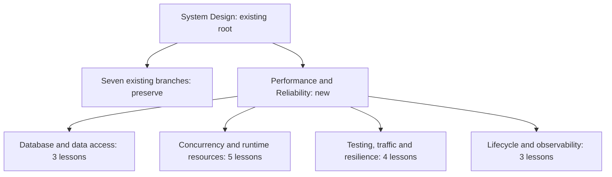
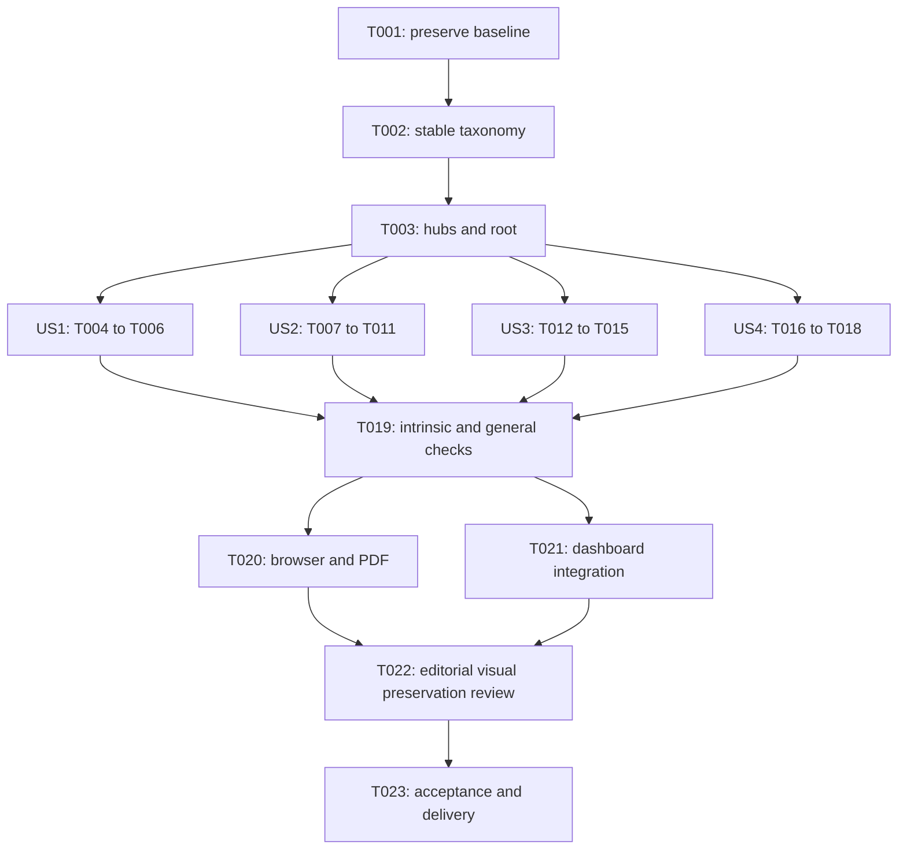

# Performance & Reliability

**Stage:** Implementation complete; all 23 tasks and seven publication gates passed.\
**Requested:** 2026-11-22. **Profile:** Compact content publishing; constitution v1.3.0.\
**Branch:** `main`. **Audited HEAD:** `7da7147262aa44b60fb549f5eacabf9db3661414`.

## Outcome and taxonomy audit

Learners can diagnose slow requests, budget runtime resources, test capacity and recovery,
contain overload, and operate safe service lifecycles using observable evidence. Add 15
complete lessons through the existing manifest/partial contract. This explicitly requested
specification stage defines the bundle; it does not publish lessons or change the application.
Reuse this single document for subsequent plan, tasks and delivery stages.

The working tree was clean before this specification. The audited `manifest.json` uses
`schemaVersion: 1` and recursive `roots`; each node has `id`, `kind`, `title`, `slug`, and
each hub has `children`. Routes and partial paths derive from ancestry, without stored
route/file fields. There are **141 nodes: 105 lessons and 36 hubs**. System Design has
seven branches: Backend Architecture; Database Design & Management; API Design & Communication;
Caching Architecture; Distributed Systems & Scalability; Message Queues & Event-Driven
Systems; Authentication & Backend Security.

**Manifest SHA256:** `61b75673a445d32c255c864402b63ac48358d07a4376eb3072f3e9daa716914f`.
The requested parent and four category paths are absent. Fourteen exact lesson titles are
new; Connection Pooling already exists in the database branch. Inspecting that complete
lesson, the API Rate Limiting opening, and the System Design hub established the overlap
and existing markup conventions. Capture the then-current manifest again before publication;
reconcile any intervening changes instead of treating these counts as permanent constants.

**Placement justification:** Root: System Design > Parent: Performance & Reliability >
requested Sub-Category > Topic. This branch organizes runtime diagnosis, measurement and
operational response across database, process and service boundaries in four balanced levels.
Existing storage, API, distributed-pattern and messaging categories retain their distinct roles.

Reuse System Design UUID `d3825659-12c2-4fc8-b6fe-bdd050762da3`. Append parent slug
**`performance-reliability`** after Authentication & Backend Security; preserve all seven
existing subtrees, IDs, metadata and recall keys. Allocate **20 new UUIDv4 IDs once at
implementation**: five hubs and 15 lessons. No permanent IDs are allocated by this spec.
Expected result against this baseline: **161 nodes, 120 lessons, 41 hubs, eight branch cards**.



This is a proposed navigation roadmap, not a dependency or execution graph.

## Exact lesson inventory and boundaries

Keep each row as a separate complete authoring task later. Preserve exact titles, category
order and the **3/5/4/3** grouping. Paths below are relative to
**`topics/system-design/performance-reliability/`**. Hash routes mirror ancestry without
`topics/` or `.html`, prefixed by `#/`. All 15 lessons remain pending.

| # | Category | Exact lesson title | Relative lesson file | Required distinct learning focus |
| --- | --- | --- | --- | --- |
| 1 | Database & Data Access Efficiency | Database Query Optimization | `database-and-data-access-efficiency/database-query-optimization.html` | Diagnose a slow request using query plans, cardinality/statistics, rows examined, waits, round trips and representative measurements; compare query rewrites, access paths and reduced work. Link existing index lessons. |
| 2 | Database & Data Access Efficiency | N+1 Query Problem | `database-and-data-access-efficiency/n-plus-one-query-problem.html` | Trace one parent query plus per-parent child fetches; detect query-count growth; compare eager loading, joins and request-scoped batching, including fan-out, pagination, tenant boundaries and memory costs. |
| 3 | Database & Data Access Efficiency | Connection Pooling | `database-and-data-access-efficiency/connection-pooling.html` | Work through runtime sizing with units, deployment surge/headroom, hold-time distributions, idle/acquisition/lifetime interactions, leak and nested-acquisition starvation diagnosis, and measured tuning. Mandatory database-lesson cross-link. |
| 4 | Concurrency & Runtime Resource Management | Asynchronous Processing | `concurrency-and-runtime-resource-management/asynchronous-processing.html` | Trace scheduling, completion, ownership, cancellation and error propagation; distinguish concurrency, CPU parallelism and durable job handoff; bound pending work and propagate deadlines/context. |
| 5 | Concurrency & Runtime Resource Management | Thread Pools | `concurrency-and-runtime-resource-management/thread-pools.html` | Budget workers and queue capacity for CPU- versus blocking-I/O work; diagnose saturation, nested waits, starvation and oversubscription; compare rejection, queuing and isolation policies under a named runtime. |
| 6 | Concurrency & Runtime Resource Management | Non-Blocking I/O | `concurrency-and-runtime-resource-management/non-blocking-io.html` | Explain readiness/completion and event-loop scheduling; identify blocking calls or CPU work on the loop, bounded buffers and slow peers; compare blocking worker and non-blocking execution costs. |
| 7 | Concurrency & Runtime Resource Management | Memory Management | `concurrency-and-runtime-resource-management/memory-management.html` | Follow allocation, ownership, reachability and release; distinguish retention leaks, allocation pressure, heap versus process/container memory, and runtime-specific collection behavior; bound queues/caches and verify fixes. |
| 8 | Concurrency & Runtime Resource Management | CPU Profiling | `concurrency-and-runtime-resource-management/cpu-profiling.html` | Choose sampling or instrumentation, interpret representative call stacks/flame graphs and CPU versus elapsed time, account for contention, quotas, symbols/JIT and overhead; verify a hotspot fix with comparable measurements. |
| 9 | Testing, Traffic Shaping & Resilience | Load Testing | `testing-traffic-shaping-and-resilience/load-testing.html` | Model expected/peak traffic, arrival rate versus concurrency, realistic state and latency/error targets; expose coordinated omission and generator limits; compare repeatable before/after results without fabricating benchmarks. |
| 10 | Testing, Traffic Shaping & Resilience | Stress Testing | `testing-traffic-shaping-and-resilience/stress-testing.html` | Exceed capacity in a controlled environment to find saturation, failure propagation, degradation and recovery; distinguish load, spike and soak questions, define stop conditions and observe post-overload recovery. |
| 11 | Testing, Traffic Shaping & Resilience | Rate Limiting & Throttling | `testing-traffic-shaping-and-resilience/rate-limiting-and-throttling.html` | Trace extreme surges across admission, bounded queues, delay/reject/shed decisions, priority/fairness and downstream backpressure; manage retry amplification and recovery. Mandatory existing API rate-limiting cross-link. |
| 12 | Testing, Traffic Shaping & Resilience | Fault Isolation | `testing-traffic-shaping-and-resilience/fault-isolation.html` | Map dependency, tenant and workload blast radius across shared threads, connections, memory and queues; allocate resource/deadline budgets and degradation paths; compare containment boundaries and their residual shared failures. |
| 13 | Lifecycle & Production Observability | Graceful Shutdown | `lifecycle-and-production-observability/graceful-shutdown.html` | Trace traffic withdrawal/propagation, stopping admission, bounded draining, cancellation, owned background work, acknowledgement and resource cleanup; account for platform signals, hard deadlines and abrupt crashes. |
| 14 | Lifecycle & Production Observability | Health Checks | `lifecycle-and-production-observability/health-checks.html` | Distinguish readiness, liveness and startup decisions; choose low-cost meaningful probes, thresholds and dependency treatment; diagnose false health and restart cascades, with version-specific platform examples. |
| 15 | Lifecycle & Production Observability | Performance Monitoring | `lifecycle-and-production-observability/performance-monitoring.html` | Connect user-facing latency/errors and service objectives to saturation, metrics, logs, traces and profiling; cover percentile aggregation, context, sampling, cardinality/cost and actionable alerts with verified instrumentation semantics. |

## Existing overlap and required cross-links

Use existing IDs/routes without moving, renaming or rewriting their lessons. New links
supplement self-contained explanations. Related links on hubs stay outside the exact ordered
immediate-child list. Add appropriate new sibling links, especially query/N+1/pooling,
async/thread/event-loop, load/stress/monitoring, and shutdown/health-check relationships.

- **Connection Pooling**, UUID `3e0d9e12-176f-4271-8c7b-ee1b5c37d411`, at
  `#/system-design/database-design-management/query-performance-and-indexing/connection-pooling`.
  The existing lesson already explains pool reuse/modes, fleet budgets, Little's-law intuition,
  hold time, deadlines, cleanup and starvation. The new same-title lesson must add a worked
  runtime-sizing and diagnosis sequence, including idle-timeout interactions and distinguishing
  leaks, long holds, nested waits and capacity shortage. Mere paraphrase fails review. Give it
  its own UUID/progress and explicit contextual related-link text; retain breadcrumb-based
  search disambiguation. Add the required link from the new lesson and data-access hub.
- **Rate Limiting**, UUID `374a5a99-6e3b-4f03-97ec-3f6853d5c14b`, at
  `#/system-design/api-design-and-communication/reliability-security-and-traffic-control/rate-limiting`.
  This is the existing API rate-limiting lesson referred to by the request. The new lesson
  centers on operational surge handling and coordinated load shedding rather than repeating
  its API admission/algorithm overview. Link it from the new lesson and testing/traffic hub.
  Also link **API Gateway**, UUID `87a2e67c-dc5f-4a8e-944f-9bad681f9699`, at
  `#/system-design/api-design-and-communication/reliability-security-and-traffic-control/api-gateway`
  when explaining gateway enforcement; do not create an invented gateway/rate-limiting route.
- Query Optimization links **Indexing Strategies** and **Composite Indexes** at
  `#/system-design/database-design-management/query-performance-and-indexing/indexing-strategies`
  and `#/system-design/database-design-management/query-performance-and-indexing/composite-indexes`.
  Those teach access-structure choices; the new lesson owns the broader diagnostic loop.
- Surge control and asynchronous work link **Backpressure Handling** at
  `#/system-design/message-queues-event-driven/scaling-reliability-and-flow-control/backpressure-handling`.
  Distinguish runtime scheduling from durable broker handoff; link **Message Queue Fundamentals**
  at `#/system-design/message-queues-event-driven/queue-foundations-and-brokers/message-queue-fundamentals`
  when durability is required.
- Fault Isolation links **Bulkhead Pattern**, **Circuit Breaker Pattern** and **Fault Tolerance**
  under `#/system-design/distributed-systems-scalability/resilience-and-fault-tolerance-patterns/`
  using leaf slugs `bulkhead-pattern`, `circuit-breaker-pattern`, `fault-tolerance`.
  The new lesson traces end-to-end resource ownership and residual shared bottlenecks; avoid
  repeating those individual pattern tutorials or equating isolation with extra capacity.

## Research and correctness requirements

Primary-reference orientation was checked on 2026-11-22:

- [HikariCP: About Pool Sizing](https://github.com/brettwooldridge/HikariCP/wiki/About-Pool-Sizing)
  motivates bounded concurrency and workload measurement. Treat its sizing heuristics as
  contextual starting points, not universal formulas for every database/runtime.
- [Google SRE: Handling Overload](https://sre.google/sre-book/handling-overload/)
  is an original operational reference for overload response; verify individual scenario
  decisions and chosen platform mechanisms during authorship.
- [Kubernetes: Liveness, Readiness, and Startup Probes](https://kubernetes.io/docs/concepts/workloads/pods/probes/)
  distinguishes the probe purposes and warns of cascading failures from inappropriate liveness
  checks. Verify termination behavior against the selected platform/version separately.
- [OpenTelemetry: Signals](https://opentelemetry.io/docs/concepts/signals/)
  supplies telemetry vocabulary; verify the selected SDK/exporter and signal maturity rather
  than assuming every signal has identical support.

Full lesson and interview-question research remains pending. For each exact concept, perform
actual concept-specific interview/debugging/trade-off searches when available, and verify
answers using primary database, ORM, runtime, profiler, load-tool and platform documentation
or original engineering references. Record selected versions, dates and limitations. Reuse
checked sources across lessons where applicable; do not repeat research solely for each stage.

For pool arithmetic, require a worked aggregate session budget including maximum replicas,
deployment overlap, background work and reserved capacity. A throughput-times-mean-hold-time
estimate needs consistent units and steady-state assumptions; it is not a tail-latency or
burst guarantee. Distinguish connection count from useful active-query capacity and map
acquisition, query, idle, lifetime and upstream timeout settings to their actual owner.
Verify those settings against the chosen driver/pooler version.

Runtime examples must name their execution/memory model and distinguish async from parallel
or durable work. Load and stress lessons must specify workload, measurement and recovery
criteria; do not claim real benchmarks or tests were executed without evidence. Health and
shutdown lessons must account for asynchronous traffic withdrawal and remaining deadline,
without promising protection from every crash. Monitoring must distinguish observation from
causal proof, and aggregatable distributions from averages of percentiles.

Each lesson requires a concise `research/topics/<immutable-topic-id>.json` record under the
existing validator: actual searches/date/results, sources with roles and support, ordered
scenario keys and mappings, assumptions/limitations, public disclosure/source URLs, and
concrete findings for all eight editorial criteria. Mark reviewed only after substantive
review. Technical documentation does not establish interview frequency. Label adaptations
honestly, and disclose unavailable search or insufficient frequency evidence without reducing
the required question count. The subsection title alone establishes no popularity claim.

## User scenarios, scope and delivery

1. **Diagnose data latency:** Given rising request latency and query counts, a learner
   separates inefficient SQL, N+1 round trips and pool waiting, then chooses a measured fix
   and explains its trade-offs using the new lessons and existing database cross-links.
2. **Budget runtime resources:** Given queued work and CPU/memory saturation, a learner
   traces ownership and wait time, selects a bounded execution model, and verifies the
   suspected bottleneck using a suitable profiler instead of assuming more workers help.
3. **Handle a surge:** A learner designs separate load and stress experiments, identifies
   saturation and recovery signals, and chooses shaping, rejection and isolation policies
   that preserve a stated critical workload while acknowledging discarded or delayed work.
4. **Operate service transitions:** A learner distinguishes probe actions, traces shutdown
   through traffic withdrawal and draining, and selects monitoring evidence for user impact
   and remaining work. A passing probe alone does not establish performance objectives.

Create five hubs: `performance-reliability/_overview.html` beneath `topics/system-design/`,
and `_overview.html` in each of the four category directories in the inventory. Each needs
ELI5 orientation, an explained readable Mermaid roadmap, suggested reading guidance and
every immediate child hash link in manifest order. Update System Design's existing overview
introduction, roadmap and child links to include the eighth branch while preserving its ID.

Use existing `.kb-*` markup and the `constitution-1.2` recall profile (v1.3.0 changes workflow,
not the schema). No application shell, manifest schema, storage model, library, dependency,
deployment, historical research registry or migration-baseline changes are included. This
is educational content, not production load generation or a new monitoring service.
Preserve relative asset paths, hash routing and zero-build GitHub Pages compatibility.

Final implementation delivery includes the placement justification, a paste-ready applied
manifest parent object with all 20 actual stable IDs, links to 15 complete lessons, five new
hubs, the updated root overview and 15 reviewed research records, plus honest validation
results and limitations. Repository links can carry complete partials instead of duplicating
their entire contents in chat. Commit/push only when requested.

## Inherited publication acceptance checklist

All seven publication gates passed with the final delivery evidence below. Earlier specification, planning and task handoff notes record their historical state.

- [X] **Taxonomy and coverage:** All 15 exact titles in 3/5/4/3 order, five complete new hubs,
  root overview updated, strict kebab-case paths and 20 unique immutable new IDs. Preserve
  all seven old subtrees and identities. Reconcile 161 nodes/120 lessons/41 hubs with the
  actual pre-edit catalog. Keep one complete authoring task per lesson.
- [X] **Complete teaching:** Each lesson has the six ordered story modules: `hook-eli5`,
  `big-picture`, `mechanics`, `trade-offs`, `pitfalls`, `mastery`. Begin with problem/why and
  ELI5 before jargon; include valid explained accessible Mermaid, full collapsible mechanics,
  a meaningful decision table, Symptom → Root Cause → Fix/Prevention failure stories, and
  real-world impact. Teach a worked request/resource/failure trace, not placeholders or
  disconnected summaries. Diagrams may serve multiple scenarios when explained and relevant.
- [X] **Recall and interviews:** Every lesson has a visible Feynman summary box with
  “Summarize this in your own words,” 3–5 foundational recall cards, plus a separate nested
  **Tricky & Most-Asked Interview Scenarios** subsection with 5–7 distinct production decision
  questions: 75–105 scenarios for the batch. Each initially closed independent `<details>`
  card has stable recall identity and all three complete labeled parts: **The Scenario &
  Constraint**, **The Direct Answer & Architectural Decision**, **Key Trade-Offs & Follow-Up
  Traps**. Include explicit constraints, justified actionable decisions, alternatives/costs
  and changed-assumption follow-ups, spanning diagnosis and design.
- [X] **Research and correctness:** All 15 exact concepts receive actual available searches,
  primary-source verification, reviewed compact records and matching visible source notes.
  Verify sizing units/assumptions, runtime/platform behavior, measurement validity and
  scenario decisions. Disclose adaptations and frequency/search gaps. Complete substantive
  editorial review separately from structural validation; no invented execution claims.
- [X] **Boundaries and links:** Mandatory database Connection Pooling and API Rate Limiting
  links resolve from their new lessons and relevant hubs; additional related links resolve
  to existing manifest routes. New pool and traffic lessons add the specified runtime depth,
  not paraphrases. Preserve existing same-title lesson IDs and explain their contexts.
- [X] **Dashboard and learning state:** New routes, breadcrumbs, search and eight home branch
  cards derive from the manifest. Both Connection Pooling results are distinguishable by
  path and retain independent progress. Mastery uses the current 120-lesson denominator;
  opening/revealing/rating cards does not imply mastery or review completion. Status,
  confidence, explicit reviews, due intervals and JSON backup/restore work for new lessons;
  existing seven-branch progress, recall keys and unknown imported records remain intact.
- [X] **Verification and presentation:** Run whole-catalog intrinsic validation and general
  content/catalog/learning-state tests. Use the then-current pre-edit manifest with the
  scoped publishing runner for all 15 lessons, five hubs and affected root: expected 21
  partials, 63 browser cases and 42 light/dark PDFs with the unchanged runner. Verify `/`
  and `/backend-lab/`, route reloads, child links, no console/Mermaid errors, keyboard
  disclosures, confidence persistence, mobile light/dark reading, readable diagrams/tables
  and full printed answers. Review new visual patterns. Broaden regression only for actual
  shared-runtime changes. Pending/failed/interrupted gates stay pending; frozen migration
  evidence stays unchanged.

## Specification review and handoff

Specification checks passed: the exact 15-row inventory and 3/5/4/3 grouping produce a
valid prospective 161-node/120-lesson/41-hub catalog using temporary in-memory IDs. The
existing scoped selector identifies exactly 21 affected partials. Existing literal
cross-links and the three expanded resilience-pattern routes resolve; the original
Connection Pooling ID is preserved alongside a separate prospective new identity.
All 449 pre-existing tracked/untracked project files retain their captured hashes, and
`manifest.json` is byte-identical to the audited baseline. No lesson, hub or research
record was created. All seven publication gates remain unchecked; no browser, PDF,
lesson correctness or implementation acceptance is claimed. Specification review found
testable outcomes, complete scope and no unresolved clarification markers. No extension
hooks are configured (`.specify/extensions.yml` is absent at both stage boundaries).

The specification was handed off to `$speckit-plan`, reusing this document. No material
product question required clarification. The implementation plan follows below.

## Implementation plan

**Planned:** 2026-11-22 on `main`. **Plan artifact:** this section of
`docs/topic-requests/performance-reliability.md`. The 141-node/105-lesson/36-hub catalog
and recorded manifest hash still match. This stage changes only this document; it allocates
no persistent IDs and delivers no lesson, hub, research record or runtime change.

### Inspected contract and design decisions

Inspected the exact recursive manifest and executable indexing/scoping code, publishing
configuration, pinned browser requirements, host recall enhancement and current CSS.
Parsed the complete existing Connection Pooling partial at
`topics/system-design/database-design-management/query-performance-and-indexing/connection-pooling.html`
and its category `_overview.html`, including article identity, sections, style vocabulary,
recall attributes and scenario answer parts. The lesson has four foundational cards and
six interview cards. It already covers budgets, hold time and starvation: new runtime
examples must add the specific worked sizing/timeout diagnosis defined in the inventory.

- **Taxonomy:** Keep `{schemaVersion: 1, roots: [...]}` with node keys `id`, `kind`,
  `title`, `slug`, and `children` on hubs. Append the new parent to the existing root,
  then four category hubs and 15 leaves in 3/5/4/3 order. Derive paths from ancestry;
  add no explicit URL/file fields, aliases, new root or dashboard count constants.
  Allocate 20 canonical UUIDv4 IDs once at implementation and reuse them on resume.
  A new same-title Connection Pooling node has a different ID and ancestry from the old one.
- **Runtime:** Reuse static HTML partial loading, hash routing, Mermaid/Highlight.js,
  theme controls and existing learning-state persistence. Add no dependency, shell/style
  override, progress migration or new rendering component. This keeps Pages deployment
  relative to the repository base and avoids an unnecessary application feature cycle.
- **Lesson envelope and styles:** Use one `article.kb-topic[data-node-id="UUID"]` and
  exact-title `h1`. Keep six direct story sections in the specified order, with IDs
  `node-UUID-SECTION`. Use `.kb-callout--structure`, `--insight`, `--impact`, `--pitfall`,
  native mechanics `details > summary`, `.kb-diagram` figures with `pre.mermaid` and
  explained captions, and `.kb-table-wrap` tables with meaningful headings. Put the
  required visible Feynman summary box inside mastery using `.kb-callout--insight`.
  Escape examples and use `pre > code.language-*`; label conceptual traces explicitly.
- **Recall:** Use initially closed independent `details.kb-question` with stable
  `data-recall-id` and explicit `data-recall-kind="foundational"` or `"interview"`.
  Mastery directly contains `section[data-interview-scenarios]`, labeled with
  `aria-labelledby="node-UUID-interview-scenarios"` and a matching exact-title `h3`.
  Each interview card uses an `interview-` key, accurate `data-scenario-basis`, and
  three direct ordered `div[data-scenario-part]` elements (`scenario`, `decision`,
  `trade-offs`). Start each with the exact constitutional bold label and full prose.
  Never nest recall cards, share an exclusive `name`, set `open`, or embed host rating/
  mastery controls. The host supplies controls and persistence. Keep the visible
  `aside[data-interview-research]` outside closed answers, matching its research record.
- **Hubs:** Use `article.kb-hub` with exact identity/title, ELI5 orientation, readable
  explained Mermaid roadmap and reading guidance. One `[data-child-links]` list contains
  exactly the immediate children in manifest order; related links go outside it. Create
  all five new overviews, and update System Design's introduction, roadmap and child list
  for eight branches. Preserve every other existing partial; new-to-old links provide
  integration without an unrelated backfill.
- **Research and visuals:** Store one `research/topics/<UUID>.json` per new lesson with
  constitution `1.3.0`; retain recall profile `constitution-1.2` and current default research
  mapping. Use the eight documented editorial criteria and concise source mappings,
  rather than duplicate complete answers in evidence. Diagrams must explain actual
  resource ownership, timing, bottlenecks or failure paths. Provide accessible titles/
  descriptions and short readable labels; review mobile and both-theme PDF output.
  Multiple scenarios may reference one diagram when it actually explains them.

### Execution sequence and lesson research packages

**A. Capture one baseline and integrate the tree.** Re-audit the current manifest and
working tree before implementation. Capture its original bytes at
`.cache/topic-checks/performance-reliability-manifest-before.json` and protected hashes
of existing lessons, research, runtime and prior request/evidence files under this feature's
ignored cache prefix. Reuse originals on resume, never overwrite them to conceal changes.
Append the branch with its 20 IDs, scaffold the five hubs, and update only the root overview.
Check the seven old subtrees remain equal to the baseline, with all old identities intact.

**B. Research, author and review 15 complete lessons.** Later tasks must contain one
independent full authoring item for each inventory row/L01–L15 below. Each includes actual
concept-specific question searches, primary verification, all six modules, purposeful
visuals, complete mechanics/trade-offs/failure stories, Feynman box, 3–5 foundational
cards, 5–7 complete production cards, a reviewed research record and resolved related links.
Do not mark a lesson done on the strength of scaffolding or a structural pass alone.

These are research assignments and candidate cases, not verified interview-frequency
claims or completed searches. Reuse the dated orientation links above. Batch independent
searches and reuse applicable checked sources; retain lesson-specific scenario selection
and answer verification. Choose actual product/runtime versions during research and record
them before using concrete APIs, commands or settings. A runtime version is an authorship
verification item, not a need to redesign the dashboard or ask a product-scope question.

| Package | Exact lesson | Primary verification targets | Distinct production decisions to develop |
| --- | --- | --- | --- |
| L01 | Database Query Optimization | PostgreSQL query-plan/statistics documentation and the chosen driver/ORM. | Bad estimates versus lock/I/O waits; selective versus broad access; representative data and safe plan measurement; round-trip versus execution cost. |
| L02 | N+1 Query Problem | Selected ORM's loading/query documentation and request-scoped batching implementation. | Query growth with parent count; join fan-out and pagination; bounded batch sizes; tenant-safe cache/batch scope. |
| L03 | Connection Pooling | HikariCP/PgBouncer and selected driver configuration, plus database session limits. | Worked fleet/rollout budget and hold-time arithmetic; idle middlebox disconnects; leak versus long hold; nested acquisition; starvation during scale-out. |
| L04 | Asynchronous Processing | A named runtime's scheduling, cancellation and task/error ownership documentation. | Awaiting blocking work; unbounded fire-and-forget backlog; lost context or errors; deadline propagation; when work needs durable handoff. |
| L05 | Thread Pools | Selected executor/runtime documentation, including queue and rejection semantics. | CPU saturation versus blocking waits; nested worker deadlock; bounded admission; isolating slow dependencies without multiplying capacity claims. |
| L06 | Non-Blocking I/O | Selected runtime's event-loop and I/O documentation; platform readiness/completion references where used. | Blocking callback on event loop; slow-client buffers; CPU-heavy handler; cancellation/partial I/O and fair scheduling. |
| L07 | Memory Management | Selected runtime's memory/GC tooling and relevant OS/container accounting documentation. | Growing retention versus allocation churn; heap versus RSS mismatch; unbounded queues; interpreting snapshots and verifying reclamation. |
| L08 | CPU Profiling | Original profiler and runtime documentation; symbol/JIT and quota semantics for chosen examples. | High latency with low CPU; hot code versus contention; sampling artifacts; throttled workload; comparable before/after verification. |
| L09 | Load Testing | Original documentation for the selected load tool's workload model, metrics and thresholds. | Open versus closed load; coordinated omission; realistic data mix; exhausted generator; percentiles/error budget and repeatability. |
| L10 | Stress Testing | Same load-tool documentation and original reliability/capacity-testing guidance. | Saturation and queue growth; dependency failure propagation; recovery after pressure ends; spike versus soak; bounded stop conditions. |
| L11 | Rate Limiting & Throttling | Google SRE overload guidance and chosen limiter/proxy/runtime behavior. | Priority shedding under surge; bounded queue/delay/reject decisions; expensive rejection; retry amplification; upstream feedback and recovery. |
| L12 | Fault Isolation | Original bulkhead/cascading-failure guidance and selected resource-limit mechanisms. | Tenant or dependency starvation; separate pools sharing one database; shared memory/CPU bottleneck; partial degradation and recovery budgets. |
| L13 | Graceful Shutdown | Selected server/runtime signal and draining docs; Kubernetes termination docs when used. | Traffic propagation during termination; in-flight requests and long streams; worker acknowledgement; grace deadline and forced termination. |
| L14 | Health Checks | Kubernetes probe docs and the selected server/platform health model. | Slow startup versus deadlock; dependency outage restart cascade; cheap but misleading checks; readiness flapping; healthy process missing its SLO. |
| L15 | Performance Monitoring | OpenTelemetry signal/SDK docs and selected metrics backend's aggregation semantics. | p99 versus averages; latency attribution through traces; missing/sampled context; high-cardinality cost; saturation and actionable user-impact alerts. |

Select one explicit runtime/tool per worked example rather than blending unrelated APIs.
Related lessons should reuse coherent assumptions where useful; comparisons must label
differences in scheduling, memory model or deployment behavior. Any measured numbers in
an illustrative trace must be labeled hypothetical unless actually measured. Exercise
small executable examples where meaningful and record exactly what ran; educational
capacity-test examples do not authorize traffic against real production systems.

**C. Shared validation once integration is complete.** Run whole-catalog intrinsic checks
and general regression suites, then the scoped browser/print runner below. Fix content
failures and rerun affected checks. Reuse browser/PDF results only with matching input
fingerprints and valid artifacts. Shared renderer/style/library changes would expand
rendering scope; router/state changes would expand relevant application regression. Neither
is planned. Frozen migration acceptance must not become a prerequisite for catalog growth.

**D. Editorial acceptance and delivery.** Review every complete narrative and research
mapping, with particular attention to the two overlapping lessons, runtime assumptions,
arithmetic units and recovery guarantees. Inspect actual mobile/theme/print output for
long equations, code, tables, diagrams, summary boxes and all expanded answers. Compare
protected files and old manifest subtrees to the originals, then close each inherited
publication gate only with actual evidence. Append the complete delivery links and applied
manifest parent object here. Commit/push only when requested.

### Focused verification commands and dashboard acceptance

Run from the repository root after implementation. Reuse a matching pinned environment
from `tests/dashboard/requirements.txt` (Playwright 1.56.0 and jsonschema 4.25.1), Chromium
and `pdftotext`; setup instructions are in `docs/topic-publishing.md`. The runner owns its
localhost server and cleanup. Missing prerequisites leave browser/PDF acceptance pending;
`--static-only` cannot satisfy publication. Keep reports under this feature's cache prefix.

```sh
python3 tools/validate_content.py --report .cache/topic-checks/performance-reliability-static.json
python3 -m unittest discover -s tests/content -q
node --experimental-default-type=module tests/dashboard/test_catalog.mjs
node --experimental-default-type=module tests/dashboard/test_learning_state.mjs
python3 tools/check_topics.py \
  --baseline .cache/topic-checks/performance-reliability-manifest-before.json \
  --paths manifest.json topics/system-design/_overview.html topics/system-design/performance-reliability/_overview.html \
  --report .cache/topic-checks/performance-reliability-report.json \
  --pdf-dir .cache/topic-checks/performance-reliability-pdfs
```

The manifest delta plus explicit paths must select **21 partials**: 15 lessons, five new
hubs and the existing root. With the inspected runner this means **63 browser cases**
(root desktop light; project-base mobile light/dark) and **42 PDFs** (both themes for each
partial). Check route refreshes, relative fetches, identity, Mermaid and code enhancement,
zero console errors, every hub-child link, independent keyboard disclosures, confidence
persistence, explicit mastery and full printed answers/diagram labels. Review actual visual
contrast/layout; extracted PDF text alone cannot prove legibility.

Add a focused dashboard exercise at both `/` and `/backend-lab/`, recording concise results
in `.cache/topic-checks/performance-reliability-integration.json`:

- Search every new exact title and route/path at both bases: **60 search cases**. For
  Connection Pooling, confirm both old/new results have distinct breadcrumb paths and open
  their correct IDs. Verify active sidebar, breadcrumbs, mobile drawer and eight home cards.
- Follow the required new-to-old Connection Pooling, Rate Limiting and API Gateway links,
  and the other specified related links; verify original identities. Complete old/new
  same-title lessons independently and confirm their confidence/progress do not collide.
- Seed representative status, confidence and review records from all seven old branches
  plus an unknown imported record. Exercise new-topic Not Started/In Progress/Mastered,
  Hard/Good/Easy, reload, export/import and explicit review with a controlled clock. Compare
  old/unknown records for preservation. Verify due/not-due behavior for the 3/7/14/30-day
  schedule. Reading/revealing/rating alone must not complete mastery or a review.
- Derive global/category mastery from the actual manifest (expected **120 lessons**),
  not copied percentages. Confirm new categories and Continue Learning/review shortcuts
  resolve through the existing data-driven shell without hard-coded counts or branches.

### Constitution check and planning handoff

The design inherits all six story modules, ELI5-first depth, purposeful Mermaid, complete
decision/failure analysis, Feynman summary boxes, 3–5 foundational cards and 5–7 researched
structured scenarios per lesson. It preserves old identities, separate same-title progress,
source honesty, all parent hubs, static deployment and mobile/full-answer print acceptance.
No constitutional exception or new schema/model/contract artifact is required. Full lesson
research and publication gates remain pending; local schema/markup inspection is not source
verification of all future answers.

**Plan validation:** Passed: all 15 research packages match inventory rows one-to-one;
the inspected schema accepts the prospective 161-node/120-lesson/41-hub catalog with
temporary in-memory IDs; the existing selector identifies exactly 21 partials, including
only one pre-existing partial (the root). All seven prior manifest subtrees and all 449
protected file hashes are unchanged. The manifest is byte-identical to the planning
baseline. Proposed runner flags exist. Seven publication gates remain unchecked; no actual
browser/PDF, substantive lesson-research or implementation acceptance is claimed.

`.specify/extensions.yml` is absent at both planning boundaries, so no before/after-plan
hooks are configured. **Plan handoff:** Handed to `$speckit-tasks`, reusing this document
with one complete authoring task per lesson and shared setup/integration/verification work.

## Implementation tasks

**Generated:** 2026-11-22. **Status:** All 23 implementation tasks are complete. This section is the compact
profile's task artifact; no separate `tasks.md`, infrastructure or contract files are needed.
T004–T018 are 15 distinct complete lesson tasks, matching inventory rows and L01–L15.
Eight shared tasks handle baseline, taxonomy, hubs, verification and delivery once.

### Complete-lesson definition for T004–T018

Every lesson task includes all of the following; a skeleton, cross-link, shortened lesson
or static-validator pass alone cannot satisfy it:

1. Research the exact concept's production/interview/debugging/trade-off questions using
   actual available searches. Verify decisions against primary sources for the selected
   runtime/tool/version, reusing applicable checked research. Disclose unavailable search
   and unsupported popularity claims. Candidate cases in L01–L15 are research prompts,
   not evidence that questions recur in interviews.
2. Write the complete ELI5-first partial using the inspected article/section/card contract:
   problem and analogy before jargon; all six ordered modules; valid explained accessible
   Mermaid; collapsible detailed mechanics; a meaningful trade-off table; concrete
   Symptom → Root Cause → Fix/Prevention stories; worked examples and real-world takeaways.
   Give resource arithmetic units/assumptions and label hypothetical measurements.
3. Include a visible Feynman summary box, 3–5 foundational recall cards, and the separate
   nested **Tricky & Most-Asked Interview Scenarios** section with 5–7 distinct complete
   production decisions. Each initially closed independent native `<details>` card uses
   stable keys, accurate basis and all three exact labeled parts: **The Scenario &
   Constraint**, **The Direct Answer & Architectural Decision**, **Key Trade-Offs &
   Follow-Up Traps**. Give an actionable decision, costs, alternatives and follow-up traps;
   no definition-only substitutions or superficial scenario variants.
4. Write `research/topics/<topic-id>.json`, substituting the task's immutable manifest UUID
   allocated in T002. Keep actual searches, dates/versions, scenario/source mappings,
   public disclosure/URLs and substantive findings for all eight editorial criteria.
   Mark reviewed only after checking source support and complete content. The placeholder
   in this filename is a binding rule, not permission to leave missing evidence.
5. Use existing `.kb-*` markup and host controls; add required sibling/existing cross-links
   while keeping the explanation self-contained. Review source correctness, independent
   recall identities, distinct scenario decisions and full mobile/print content. Record
   concise per-lesson findings, not copies of all answers, in its UUID research record.

### Shared baseline and taxonomy prerequisites

- [X] T001 Re-audit `manifest.json` against the recorded SHA256 and 141-node/105-lesson/36-hub baseline. Capture its original contents once at `.cache/topic-checks/performance-reliability-manifest-before.json` and protected existing lesson/research/runtime/prior-request/evidence hashes at `.cache/topic-checks/performance-reliability-protected.json`. Reconcile intervening changes before editing; reuse originals on resume. Preserve all seven old subtrees/IDs/recall keys and identify `topics/system-design/_overview.html` as the only intended existing HTML change. Reuse matching browser tooling from `tests/dashboard/requirements.txt`; do not reinstall or create shell infrastructure unnecessarily.
- [X] T002 Append Performance & Reliability, its four categories and 15 exact-title leaves to `manifest.json`, allocating 20 canonical UUIDv4 IDs once and retaining them on resume. Use `performance-reliability` and inventory paths/order (3/5/4/3); derive routes without new schema fields. Reuse the root ID, preserve all seven existing subtrees/metadata and give the new Connection Pooling leaf a separate immutable ID. Confirm expected 161 nodes/120 lessons/41 hubs/eight branches against the actual baseline.
- [X] T003 Create `topics/system-design/performance-reliability/_overview.html`, `topics/system-design/performance-reliability/database-and-data-access-efficiency/_overview.html`, `topics/system-design/performance-reliability/concurrency-and-runtime-resource-management/_overview.html`, `topics/system-design/performance-reliability/testing-traffic-shaping-and-resilience/_overview.html`, and `topics/system-design/performance-reliability/lifecycle-and-production-observability/_overview.html`. Give each matching identity/title, ELI5 orientation, explained accessible Mermaid roadmap, reading guidance and exact ordered child links. Update `topics/system-design/_overview.html` for eight branches. Put required existing Connection Pooling and API Rate Limiting links on their corresponding new category hubs outside child lists; preserve every other old partial.

### US1 — Diagnose data latency

**Priority:** First reviewable increment (P1). **Goal:** Distinguish inefficient queries,
N+1 round trips and pool waiting, and justify measured corrective action.
**Independent acceptance:** These three complete lessons and their hub resolve correctly;
worked traces expose which evidence separates query execution, query count and acquisition
wait. The two Connection Pooling lessons open different IDs through contextual related
links/search paths. Every new card operates independently with host confidence controls.

- [X] T004 [P] [US1] Research, author and review **Database Query Optimization** in `topics/system-design/performance-reliability/database-and-data-access-efficiency/database-query-optimization.html` and its UUID record in `research/topics/`, satisfying the complete-lesson definition and L01. Trace query plans, estimates/statistics, actual rows/work, waits and round trips; compare rewriting, indexing and reduced work with representative measurements. Verify selected engine commands and their execution effects. Cross-link existing Indexing Strategies and Composite Indexes while retaining a broader diagnosis-to-verification narrative.
- [X] T005 [P] [US1] Research, author and review **N+1 Query Problem** in `topics/system-design/performance-reliability/database-and-data-access-efficiency/n-plus-one-query-problem.html` and its UUID record in `research/topics/`, satisfying the complete-lesson definition and L02. Show query-count growth with parent count; compare eager loading, joins and bounded request-scoped batching, including fan-out, pagination, tenant isolation and memory cost. Verify actual ORM/batching semantics and link Query Optimization/Connection Pooling without treating fewer queries as an unconditional speed guarantee.
- [X] T006 [P] [US1] Research, author and review **Connection Pooling** in `topics/system-design/performance-reliability/database-and-data-access-efficiency/connection-pooling.html` and its UUID record in `research/topics/`, satisfying the complete-lesson definition and L03. Add worked aggregate deployment/rollout budgets and throughput-times-hold-time estimates with units, assumptions and headroom limits. Diagnose leaks, long holds, nested waits and capacity starvation; distinguish acquisition/query/idle/lifetime/upstream timeouts and reconnect effects using verified driver settings. Link the existing database Connection Pooling lesson explicitly; preserve its ID and avoid paraphrasing its existing budget/mode tutorial.

### US2 — Budget runtime resources

**Priority:** Second reviewable increment (P2). **Goal:** Choose bounded execution and
memory ownership, then use suitable evidence to locate runtime bottlenecks.
**Independent acceptance:** All five complete lessons and their ordered hub load; examples
name their execution/memory model and distinguish waiting from useful CPU work, async from
parallel/durable work, and retention from allocation pressure. Profiling teaches a concrete
measurement-to-hypothesis-to-verification sequence without invented benchmark claims.

- [X] T007 [P] [US2] Research, author and review **Asynchronous Processing** in `topics/system-design/performance-reliability/concurrency-and-runtime-resource-management/asynchronous-processing.html` and its UUID record in `research/topics/`, satisfying the complete-lesson definition and L04. Trace scheduling/completion, bounded pending work, cancellation, ownership, errors and context/deadline propagation in a named runtime. Contrast concurrent I/O, CPU parallelism and durable handoff; cross-link existing Message Queue Fundamentals and Backpressure Handling where relevant rather than promising durability from fire-and-forget work.
- [X] T008 [P] [US2] Research, author and review **Thread Pools** in `topics/system-design/performance-reliability/concurrency-and-runtime-resource-management/thread-pools.html` and its UUID record in `research/topics/`, satisfying the complete-lesson definition and L05. Verify the selected executor's worker/queue/rejection semantics. Explain CPU versus blocking-I/O budgets, bounded admission, saturation, oversubscription, nested waits/deadlocks and dependency isolation; compare costs and tail behavior rather than recommending an unconditional worker-count formula.
- [X] T009 [P] [US2] Research, author and review **Non-Blocking I/O** in `topics/system-design/performance-reliability/concurrency-and-runtime-resource-management/non-blocking-io.html` and its UUID record in `research/topics/`, satisfying the complete-lesson definition and L06. Trace readiness/completion and event-loop callbacks, partial work, cancellation, bounded buffers and slow peers. Diagnose blocking libraries or CPU-heavy callbacks and compare bounded workers versus non-blocking execution in explicitly named runtime/platform examples.
- [X] T010 [P] [US2] Research, author and review **Memory Management** in `topics/system-design/performance-reliability/concurrency-and-runtime-resource-management/memory-management.html` and its UUID record in `research/topics/`, satisfying the complete-lesson definition and L07. Trace ownership/lifetimes, allocation and retained reachability; distinguish leaks, churn, heap/RSS/container accounting and runtime-specific collection. Work through snapshots or equivalent evidence, bounded caches/queues and verification of a fix; do not generalize one runtime's memory guarantees to all languages.
- [X] T011 [P] [US2] Research, author and review **CPU Profiling** in `topics/system-design/performance-reliability/concurrency-and-runtime-resource-management/cpu-profiling.html` and its UUID record in `research/topics/`, satisfying the complete-lesson definition and L08. Compare sampling/instrumentation and CPU/elapsed profiles; interpret representative stacks/flame graphs, contention, quotas, symbol/JIT effects and profiling overhead. Demonstrate hypothesis and comparable verification with labeled illustrative data or evidence of actual execution; link monitoring and runtime-resource siblings.

### US3 — Handle a surge

**Priority:** Third reviewable increment (P2). **Goal:** Test saturation/recovery and select
traffic and isolation controls that protect a stated critical workload under overload.
**Independent acceptance:** Four complete lessons and the hub load and distinguish expected
load from beyond-capacity stress. A worked surge trace names the bottleneck, bounded queues,
admission/shedding decision, impacted work and recovery signal. Required API rate-limiting
links resolve; fault-isolation explanations identify residual shared failure domains.

- [X] T012 [P] [US3] Research, author and review **Load Testing** in `topics/system-design/performance-reliability/testing-traffic-shaping-and-resilience/load-testing.html` and its UUID record in `research/topics/`, satisfying the complete-lesson definition and L09. Use verified load-tool semantics for arrival rate/concurrency, workload/state mix, open/closed models, thresholds and latency/errors. Cover coordinated omission, generator limits and repeatable comparisons; distinguish hypothetical examples from actually executed measurements and link monitoring/stress testing.
- [X] T013 [P] [US3] Research, author and review **Stress Testing** in `topics/system-design/performance-reliability/testing-traffic-shaping-and-resilience/stress-testing.html` and its UUID record in `research/topics/`, satisfying the complete-lesson definition and L10. Work beyond capacity in a clearly controlled illustrative/local setting to explain saturation, backlog, degradation, dependency propagation and recovery after pressure ends. Compare load/spike/soak questions, stop conditions and resource budgets; do not run traffic against production or claim unexecuted tests.
- [X] T014 [P] [US3] Research, author and review **Rate Limiting & Throttling** in `topics/system-design/performance-reliability/testing-traffic-shaping-and-resilience/rate-limiting-and-throttling.html` and its UUID record in `research/topics/`, satisfying the complete-lesson definition and L11. Develop extreme-surge operational decisions: shaping, bounded delay/queue/rejection, priority/fairness, load shedding, expensive rejection, retry amplification, feedback and recovery. Explicitly link existing API Rate Limiting, API Gateway and Backpressure Handling using audited routes. Add operational depth beyond the existing API algorithm/admission lesson.
- [X] T015 [P] [US3] Research, author and review **Fault Isolation** in `topics/system-design/performance-reliability/testing-traffic-shaping-and-resilience/fault-isolation.html` and its UUID record in `research/topics/`, satisfying the complete-lesson definition and L12. Trace tenant/dependency/workload blast radius through shared workers, connections, memory and queues; budget resources/deadlines and graceful degradation. Explain residual shared capacity and recovery costs. Cross-link Bulkhead Pattern, Circuit Breaker Pattern and Fault Tolerance without replacing the new end-to-end diagnosis with pattern summaries.

### US4 — Operate service transitions

**Priority:** Fourth reviewable increment (P2). **Goal:** Coordinate traffic and work during
lifecycle transitions and judge production health/performance from relevant evidence.
**Independent acceptance:** Three complete lessons and their hub load; probe failures map
to distinct actions, shutdown has an explicit bounded ownership/draining trace, and user
impact connects to latency/error/saturation evidence. Examples identify platform/version
assumptions without equating a passing probe with an achieved performance objective.

- [X] T016 [P] [US4] Research, author and review **Graceful Shutdown** in `topics/system-design/performance-reliability/lifecycle-and-production-observability/graceful-shutdown.html` and its UUID record in `research/topics/`, satisfying the complete-lesson definition and L13. Verify selected server/platform signals, traffic withdrawal/propagation, stopped admission, bounded draining, long streams, background ownership, acknowledgement and resource cleanup. Explain deadline exhaustion, forced termination and abrupt-crash limits; cross-link Health Checks and relevant asynchronous/durable-work lessons.
- [X] T017 [P] [US4] Research, author and review **Health Checks** in `topics/system-design/performance-reliability/lifecycle-and-production-observability/health-checks.html` and its UUID record in `research/topics/`, satisfying the complete-lesson definition and L14. Distinguish readiness/liveness/startup purposes and actions using verified platform semantics; choose meaningful low-cost probes and thresholds. Diagnose slow startup, misleading success, flapping and dependency-driven restart cascades; relate traffic/draining behavior and explain why process health alone does not prove an SLO.
- [X] T018 [P] [US4] Research, author and review **Performance Monitoring** in `topics/system-design/performance-reliability/lifecycle-and-production-observability/performance-monitoring.html` and its UUID record in `research/topics/`, satisfying the complete-lesson definition and L15. Connect user-facing latency/errors and objectives to saturation, metrics/logs/traces/profiles, sampling/context and actionable alerts. Verify SDK/backend support, percentile aggregation, cardinality/cost and interpretation limits. Link CPU Profiling, Load Testing and Health Checks; distinguish correlation from verified cause.

### Shared verification and delivery

- [X] T019 Run the plan's whole-catalog checks in `tools/validate_content.py`, `tests/content/`, `tests/dashboard/test_catalog.mjs` and `tests/dashboard/test_learning_state.mjs`; write `.cache/topic-checks/performance-reliability-static.json`. Require all new lesson/research records, five hubs/root, routes/cross-links, identities and manifest-derived counts to pass. Fix content defects without weakening validators, changing historical mappings or refreshing frozen baselines. Reuse existing tests; no new shell infrastructure is required.
- [X] T020 Run `tools/check_topics.py` using `.cache/topic-checks/performance-reliability-manifest-before.json` and the plan's explicit paths; write `.cache/topic-checks/performance-reliability-report.json` and `.cache/topic-checks/performance-reliability-pdfs/`. Require the baseline-derived 21 partials, 63 browser cases and 42 light/dark PDFs: relative fetches/reloads, identity, Mermaid/code, zero console/layout errors, keyboard disclosures, confidence persistence, explicit mastery, hub links, mobile/themes, and complete printed text/labels/answers with hidden controls and restored disclosure state. Refresh affected evidence after fixes; static-only output leaves this task pending.
- [X] T021 Exercise the real dashboard at `/` and `/backend-lab/`, writing `.cache/topic-checks/performance-reliability-integration.json`: 60 title/path searches, eight home cards, breadcrumbs/sidebar, mobile drawer/themes, Continue Learning/review links, and specified new-to-old links. Confirm old/new Connection Pooling search disambiguation and independent identities/progress. Seed representative complete records from all seven old branches plus an unknown backup record; verify new statuses, Hard/Good/Easy, explicit mastery/review, controlled due/not-due intervals, reload and JSON export/import while preserving old/unknown records. Derive mastery from 120 lessons against this baseline; opening/revealing/rating alone must not complete mastery or review.
- [X] T022 Complete substantive source/narrative and visual review of all 15 HTML lessons and their `research/topics/` records against the complete-lesson definition, including the two overlap boundaries, sizing units, runtime/version assumptions, measurement validity, distinct scenarios and recovery guarantees. Review actual mobile/light/dark output and PDFs for full answers, Feynman boxes, equations/code, tables and diagram legibility. Exercise meaningful authored executable examples when applicable and record exact execution limits at `.cache/topic-checks/performance-reliability-examples.json`, without invented benchmark claims. Compare `manifest.json` subtrees and protected files against T001, allowing only the intended root overview change; correct defects and rerun affected checks before acceptance.
- [X] T023 After all required evidence passes, close the seven publication gates and record delivery in `docs/topic-requests/performance-reliability.md`: concise individual lesson outcomes, placement justification, paste-ready applied manifest parent object with actual stable IDs, links to all 15 complete lessons/five hubs/root/15 research records, and honest verification results/limitations. Confirm no task or gate is left pending before claiming publication complete; check implementation-stage hooks if configured. Commit/push only when requested.

### Dependencies and completion strategy



Run T001–T003 sequentially. Afterward each `[P]` lesson task owns a different partial and
UUID research record, so its authoring does not depend on another lesson's prose being
finished. T002 establishes every cross-link target; all destinations must exist and pass
before publication. Per-story independent opportunities are T004/T005/T006 (US1),
T007/T008/T009/T010/T011 (US2), T012/T013/T014/T015 (US3), and T016/T017/T018 (US4).
`[P]` marks file independence, not a request to spawn agents. Keep shared manifest, hub
and checklist edits serialized. Independent research queries can be batched.

US1 is the suggested first reviewable learning increment: three full lessons and the
data-access hub. It is not permission to ship the requested batch with the other twelve
lessons absent or incomplete. Continue through US2–US4; all four story outputs feed T019.
T020/T021 may run independently in isolated contexts after T019, with their own reports.
Final acceptance requires T022 and T023 after all evidence, including refreshed checks for
any fixes. Preserve completed content and reusable valid evidence on interruption; unfinished
tasks/gates remain unchecked rather than reducing lesson depth or question counts.

### Task-generation review and handoff

**Task validation:** Passed: 23 sequential checklist tasks with IDs, valid labels and file
paths; 15 unique lesson paths match inventory/L01–L15 exactly once. Story counts are
US1: 3, US2: 5, US3: 4, US4: 3, plus eight shared tasks. Every story has independent
acceptance criteria and explicit file-independent execution opportunities after T001–T003.
The dependency sequence covers baseline → taxonomy/hubs → all story outputs → shared
checks → review/delivery. The prospective catalog remains 161 nodes/120 lessons/41 hubs,
with 21 scoped partials. All 449 protected existing files and the manifest bytes are
unchanged; earlier spec/plan text is preserved except stage/handoff updates. All 23 tasks
and seven publication gates remain unchecked. No implementation checks are claimed.

`.specify/extensions.yml` is absent at both task-stage boundaries; no before/after-tasks
hooks are configured. **Task handoff:** Ready for `$speckit-implement`.
The next requested stage is `$speckit-implement`, using this section directly. Generating
these tasks does not execute them, allocate persistent IDs or change the live catalog.

## Delivered bundle

**Delivered:** 2026-11-22. All 23 tasks and seven publication gates passed. Earlier-stage
audit, research assignments and handoff statements above are historical; this section
records the completed implementation and current acceptance.

**Placement justification:** Root: System Design > Parent: Performance & Reliability >
four requested Sub-Categories > 15 Topics (3/5/4/3). This adds runtime diagnosis, resource
budgets, controlled workload testing and production lifecycle evidence without moving the
existing database, API, distributed-pattern or messaging lessons.

The catalog now has **161 nodes: 120 lessons and 41 hubs**, with eight System Design
branches. All seven old subtrees, all 141 existing node IDs and all 105 existing lessons
remain intact. Twenty new UUIDs identify five hubs and 15 leaves. New content uses the
existing dashboard contract; no shell, stylesheet, dependency or storage changes were needed.
Only the existing manifest and System Design overview changed outside this new bundle.

### Complete lessons and reviewed research

Each complete lesson has six modules, an ELI5 opening, an explained Mermaid diagram,
collapsible mechanics, a trade-off table, failure stories, a Feynman box, four foundational
cards and six fully answered production scenarios: **60 foundational + 90 interview cards**.
Actual available concept-specific searches and checked primary references are recorded;
the visible research notes disclose that frequency/ranking/company claims are unverified.

| # | Complete lesson partial | Reviewed research | Distinct editorial result |
| --- | --- | --- | --- |
| 1 | [Database Query Optimization](../../topics/system-design/performance-reliability/database-and-data-access-efficiency/database-query-optimization.html) | [Sources and scenarios](../../research/topics/4085d706-c197-4fc6-a038-a7926f37e749.json) | Separates acquisition, SQL, transfer and query-count cost; preserves authorized result semantics and distinguishes plan estimates from executing diagnostics. |
| 2 | [N+1 Query Problem](../../topics/system-design/performance-reliability/database-and-data-access-efficiency/n-plus-one-query-problem.html) | [Sources and scenarios](../../research/topics/614b7b22-8689-4fd6-aff8-925163133b2d.json) | Contrasts bounded loading, join fan-out, parent pagination and request-scoped authorization; comparison flowchart replaces dark-print alt/loop labels. |
| 3 | [Connection Pooling](../../topics/system-design/performance-reliability/database-and-data-access-efficiency/connection-pooling.html) | [Sources and scenarios](../../research/topics/95487716-369f-4937-a500-beaffce378a8.json) | Adds worked maximum-fleet and hold-time arithmetic, idle/lifetime ownership and nested/leaked/long-held diagnosis; the original database lesson and identity remain separate. |
| 4 | [Asynchronous Processing](../../topics/system-design/performance-reliability/concurrency-and-runtime-resource-management/asynchronous-processing.html) | [Sources and scenarios](../../research/topics/5a5d865f-bdfd-4a7a-ab55-0fe7e73fc4ea.json) | Distinguishes overlap, parallel execution and durable acceptance; cancellation/partial results retain explicit ownership and resource bounds. |
| 5 | [Thread Pools](../../topics/system-design/performance-reliability/concurrency-and-runtime-resource-management/thread-pools.html) | [Sources and scenarios](../../research/topics/ab52ba74-c3fa-4c2d-b7d6-bd2e0a84c143.json) | Uses Java 21 queue-first executor semantics and real CPU entitlement; covers nested waits, bounded payloads, rejection and shared downstream capacity. |
| 6 | [Non-Blocking I/O](../../topics/system-design/performance-reliability/concurrency-and-runtime-resource-management/non-blocking-io.html) | [Sources and scenarios](../../research/topics/c632e6a8-808a-4b73-8d01-eb74675c01c1.json) | Distinguishes readiness/completion, event-loop/native-worker/CPU-worker paths and stream feedback; corrected deadline branch terminates in cleanup. |
| 7 | [Memory Management](../../topics/system-design/performance-reliability/concurrency-and-runtime-resource-management/memory-management.html) | [Sources and scenarios](../../research/topics/e1101fed-51d0-420f-888e-848d4affffd5.json) | Separates reachability, allocation pressure and heap/process/container scopes; includes snapshot overhead and complete terminal-path ownership. |
| 8 | [CPU Profiling](../../topics/system-design/performance-reliability/concurrency-and-runtime-resource-management/cpu-profiling.html) | [Sources and scenarios](../../research/topics/139fa1f6-f123-47ae-83e5-677ec708867c.json) | Separates CPU from elapsed/waiting evidence, inclusive from self cost and stack population from chronology; speedup example has an explicit scope. |
| 9 | [Load Testing](../../topics/system-design/performance-reliability/testing-traffic-shaping-and-resilience/load-testing.html) | [Sources and scenarios](../../research/topics/db141fa7-63f6-4756-85a7-5ed1f5c8bc17.json) | Defines intended workload, delivered arrivals and useful outcomes; covers generator limits, operation cohorts, state fidelity and statistical comparison. |
| 10 | [Stress Testing](../../topics/system-design/performance-reliability/testing-traffic-shaping-and-resilience/stress-testing.html) | [Sources and scenarios](../../research/topics/30d3ebe2-f42f-41f4-a4fb-dfa1fe77f02b.json) | Defines controlled above-capacity, saturation, bounded stop and recovery questions; queue/drain examples do not claim actual external benchmarks. |
| 11 | [Rate Limiting & Throttling](../../topics/system-design/performance-reliability/testing-traffic-shaping-and-resilience/rate-limiting-and-throttling.html) | [Sources and scenarios](../../research/topics/517f2384-e081-44f8-9644-9d306b13d80c.json) | Adds surge admission, shaping/shedding, fair critical budgets and recovery feedback beyond the API lesson; distinguishes 429/503 and retry outcomes. |
| 12 | [Fault Isolation](../../topics/system-design/performance-reliability/testing-traffic-shaping-and-resilience/fault-isolation.html) | [Sources and scenarios](../../research/topics/5eddde3b-fd4a-4443-8cbe-9e8e512fe426.json) | Traces ownership and residual shared database/host/fallback domains; local partitions do not imply independent capacity or truthful fallback. |
| 13 | [Graceful Shutdown](../../topics/system-design/performance-reliability/lifecycle-and-production-observability/graceful-shutdown.html) | [Sources and scenarios](../../research/topics/fb4f6ee5-00a3-4c38-9c74-1805e220912e.json) | Uses a single remaining stop budget, asynchronous endpoint propagation, protocol-specific draining and dependency order; abrupt/unknown effects retain recovery duties. |
| 14 | [Health Checks](../../topics/system-design/performance-reliability/lifecycle-and-production-observability/health-checks.html) | [Sources and scenarios](../../research/topics/e66bf481-00b7-4273-8c00-81575ca0cf27.json) | Maps startup/readiness/liveness to different actions and tests cascade/flapping behavior; passing probes do not establish user objectives. |
| 15 | [Performance Monitoring](../../topics/system-design/performance-reliability/lifecycle-and-production-observability/performance-monitoring.html) | [Sources and scenarios](../../research/topics/20994b9a-22ea-4b17-8b3b-ca71c6238497.json) | Connects user denominators to bounded telemetry and distribution aggregation; trace context grants no authority and correlation remains a hypothesis. |

### Hub partials and integration

- [System Design overview](../../topics/system-design/_overview.html) — updated root roadmap and eight-child navigation.
- [Performance & Reliability overview](../../topics/system-design/performance-reliability/_overview.html) — new orientation, roadmap, guide and ordered child links.
- [Database & Data Access Efficiency overview](../../topics/system-design/performance-reliability/database-and-data-access-efficiency/_overview.html) — new orientation, roadmap, guide and ordered child links.
- [Concurrency & Runtime Resource Management overview](../../topics/system-design/performance-reliability/concurrency-and-runtime-resource-management/_overview.html) — new orientation, roadmap, guide and ordered child links.
- [Testing, Traffic Shaping & Resilience overview](../../topics/system-design/performance-reliability/testing-traffic-shaping-and-resilience/_overview.html) — new orientation, roadmap, guide and ordered child links.
- [Lifecycle & Production Observability overview](../../topics/system-design/performance-reliability/lifecycle-and-production-observability/_overview.html) — new orientation, roadmap, guide and ordered child links.

The data-access hub and new runtime Connection Pooling lesson link to the original
database lesson. The testing/traffic hub and surge-control lesson link to existing API
Rate Limiting; the latter also links API Gateway and Backpressure Handling. Other links
connect indexing, durable queues, bulkheads, circuit breakers and fault tolerance without
replacing their existing IDs. Search distinguishes both Connection Pooling results by path;
their mastery and confidence records remain independent.

### Verification and preservation

- **Whole-catalog intrinsic validation:** passed for 161 nodes, 120 lessons, 41 hubs,
  253 diagrams, 481 foundational cards and 720 interview scenarios (1,201 total cards).
- **Existing automated suites:** 72 Python content tests and 14 JavaScript catalog/state
  tests passed. The default sandbox blocked the localhost-server test; it passed with
  the required socket access. No test or content contract was weakened.
- **Scoped browser/print acceptance:** 21 affected partials, 63 browser cases and 42
  actual light/dark PDFs passed. Coverage includes root/project-subdirectory reloads,
  relative fetches, identity, Mermaid rendering, console/layout, hub links, independent
  keyboard disclosures, confidence persistence, mastery and complete printed text/labels.
- **Dashboard integration:** 60 title/path searches at `/` and `/backend-lab/`, all eight
  home cards, breadcrumbs/sidebar/drawer, Continue Learning, related links, themes and
  same-title independent state passed. Seeded records from all seven old branches and an
  unknown imported record survived export/import. Controlled checks passed immediately
  before and at each 3/7/14/30-day due boundary; revealing/rating does not imply mastery
  or review completion.
- **Source/editorial and visual review:** passed for all 15 complete lessons and records.
  Reviewed all 21 diagrams in both browser themes plus representative actual PDF
  openings, tables, complete scenarios, diagram pages and mobile light/dark output.
  Corrected an I/O deadline branch and N+1 dark-print label contrast, then refreshed the
  affected evidence. Unchanged passing browser/PDF results were reused only by the
  runner's verified fingerprints and PDF hashes.
- **Worked examples:** 20 original arithmetic/counterexample checks passed, including
  fleet budgets, queue bytes, backlog recovery, limited-component speedup and quantile
  aggregation. These verify the teaching calculations, not deployed performance claims;
  no external load, database, JVM, Node, k6 or Kubernetes benchmark was executed.
- **Preservation:** all 447 protected existing files and all seven original subtrees
  match the pre-edit baseline. Existing recall keys, runtime, publishing configuration,
  old request records and frozen migration evidence remain unchanged.

Detailed local reports/PDFs are under the ignored `.cache/topic-checks/` prefix:
`performance-reliability-static.json`, `performance-reliability-report.json`,
`performance-reliability-integration.json`, `performance-reliability-editorial.json`,
`performance-reliability-examples.json`, `performance-reliability-pdfs/` and
`performance-reliability-visual/`. All publication gates are complete.
`.specify/extensions.yml` is absent at implementation start and finish; no extension
hooks are configured. No commit, push or deployment operation was part of this request.

### Applied manifest snippet

The following complete parent object is already appended to `roots[0].children` after
Authentication & Backend Security. It is ready to paste into the corresponding children
array when reproducing the change; do not insert it twice or regenerate these IDs.

```json
{
  "id": "e269fe27-71ce-413b-9885-35e3acdb4770",
  "kind": "hub",
  "title": "Performance & Reliability",
  "slug": "performance-reliability",
  "children": [
    {
      "id": "345871dd-ccec-4fcb-84b8-64b84fb0bd4a",
      "kind": "hub",
      "title": "Database & Data Access Efficiency",
      "slug": "database-and-data-access-efficiency",
      "children": [
        {
          "id": "4085d706-c197-4fc6-a038-a7926f37e749",
          "kind": "topic",
          "title": "Database Query Optimization",
          "slug": "database-query-optimization"
        },
        {
          "id": "614b7b22-8689-4fd6-aff8-925163133b2d",
          "kind": "topic",
          "title": "N+1 Query Problem",
          "slug": "n-plus-one-query-problem"
        },
        {
          "id": "95487716-369f-4937-a500-beaffce378a8",
          "kind": "topic",
          "title": "Connection Pooling",
          "slug": "connection-pooling"
        }
      ]
    },
    {
      "id": "2967c544-d1a2-4f1e-a7f7-3b7c53c9432a",
      "kind": "hub",
      "title": "Concurrency & Runtime Resource Management",
      "slug": "concurrency-and-runtime-resource-management",
      "children": [
        {
          "id": "5a5d865f-bdfd-4a7a-ab55-0fe7e73fc4ea",
          "kind": "topic",
          "title": "Asynchronous Processing",
          "slug": "asynchronous-processing"
        },
        {
          "id": "ab52ba74-c3fa-4c2d-b7d6-bd2e0a84c143",
          "kind": "topic",
          "title": "Thread Pools",
          "slug": "thread-pools"
        },
        {
          "id": "c632e6a8-808a-4b73-8d01-eb74675c01c1",
          "kind": "topic",
          "title": "Non-Blocking I/O",
          "slug": "non-blocking-io"
        },
        {
          "id": "e1101fed-51d0-420f-888e-848d4affffd5",
          "kind": "topic",
          "title": "Memory Management",
          "slug": "memory-management"
        },
        {
          "id": "139fa1f6-f123-47ae-83e5-677ec708867c",
          "kind": "topic",
          "title": "CPU Profiling",
          "slug": "cpu-profiling"
        }
      ]
    },
    {
      "id": "daed7373-ba18-4aa1-8f4d-9d048a365eba",
      "kind": "hub",
      "title": "Testing, Traffic Shaping & Resilience",
      "slug": "testing-traffic-shaping-and-resilience",
      "children": [
        {
          "id": "db141fa7-63f6-4756-85a7-5ed1f5c8bc17",
          "kind": "topic",
          "title": "Load Testing",
          "slug": "load-testing"
        },
        {
          "id": "30d3ebe2-f42f-41f4-a4fb-dfa1fe77f02b",
          "kind": "topic",
          "title": "Stress Testing",
          "slug": "stress-testing"
        },
        {
          "id": "517f2384-e081-44f8-9644-9d306b13d80c",
          "kind": "topic",
          "title": "Rate Limiting & Throttling",
          "slug": "rate-limiting-and-throttling"
        },
        {
          "id": "5eddde3b-fd4a-4443-8cbe-9e8e512fe426",
          "kind": "topic",
          "title": "Fault Isolation",
          "slug": "fault-isolation"
        }
      ]
    },
    {
      "id": "994c553e-ed89-4d59-9df5-3375778546eb",
      "kind": "hub",
      "title": "Lifecycle & Production Observability",
      "slug": "lifecycle-and-production-observability",
      "children": [
        {
          "id": "fb4f6ee5-00a3-4c38-9c74-1805e220912e",
          "kind": "topic",
          "title": "Graceful Shutdown",
          "slug": "graceful-shutdown"
        },
        {
          "id": "e66bf481-00b7-4273-8c00-81575ca0cf27",
          "kind": "topic",
          "title": "Health Checks",
          "slug": "health-checks"
        },
        {
          "id": "20994b9a-22ea-4b17-8b3b-ca71c6238497",
          "kind": "topic",
          "title": "Performance Monitoring",
          "slug": "performance-monitoring"
        }
      ]
    }
  ]
}
```
