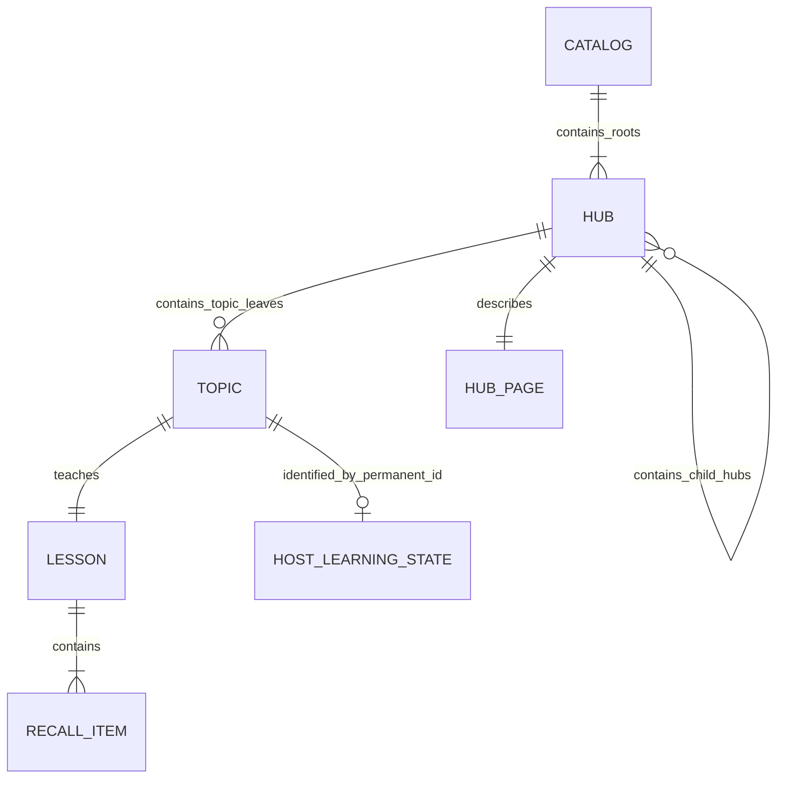

# Data Model: Backend Architecture Learning Batch

**Status**: Phase 1 design, 2026-11-17. Production content has not been generated.
**Related**: [Specification](spec.md), [manifest schema](contracts/manifest.schema.json),
[content contract](contracts/content-contract.md).

## Catalog and Node Entities

| Entity / field | Type | Rule |
| --- | --- | --- |
| Catalog.schemaVersion | integer | Exactly `1` for this contract. |
| Catalog.roots | ordered node array | Nonempty; each root is a hub. |
| Node.id | nonempty opaque string | Globally unique and permanent. Mint UUIDv4 for new nodes; preserve legacy IDs. |
| Node.kind | `hub` or `topic` | Describes the content role, not a fixed taxonomy depth. |
| Node.title | nonblank string | Human display label, preserving the requested spelling and acronyms. |
| Node.slug | kebab-case string | Unique among siblings across both node kinds; no slashes or dot segments. |
| Hub.children | ordered node array | Required and nonempty; recursively contains hubs or topic leaves. |
| Topic.children | absent | Topic nodes are leaves. |
| Optional metadata | additional fields | Preserve existing values during merges; ignore unknown optional fields when consuming. |

The parent relation is containment in `roots` / `children`. Array position supplies reading
navigation order. Do not store redundant `parentId`, `route`, or `contentPath` fields.
The manifest is the runtime source of truth; documentation and test inventories are not
additional navigation indexes.

Each published hub has at least one child across the combined hub/topic collections.
A topic may have no stored learning state until first interaction; absence means Not Started.

## Derived Routes and Files

Join each node's ancestor slugs and its own slug with `/` to obtain logical path `P`.
The logical route is `/
` with no trailing slash. A content anchor uses `#/
`.
Within-lesson navigation uses the same route with `?section=<section-key>`.

| Node kind | Derived content location |
| --- | --- |
| Hub | `topics/
/_overview.html` |
| Topic | `topics/
.html` |

These locations are relative to the application base. `/topics/` in the specification is
the logical content root, not a requirement to fetch from the origin root when the site is
hosted under a project path. The host resolves requests against its configured base.
Slugs expand `&` to `and`; acronyms remain in display labels but redundant parenthetical
acronyms are omitted from this batch's slugs.

### Hub Inventory

| Display path | Logical path `P` | Immediate batch children |
| --- | --- | --- |
| System Design | `system-design` | Backend Architecture |
| System Design → Backend Architecture | `system-design/backend-architecture` | The four sub-categories below |
| Core System Topologies | `system-design/backend-architecture/core-system-topologies` | Five topic leaves |
| Code & Domain Organization | `system-design/backend-architecture/code-and-domain-organization` | Four topic leaves |
| Communication & Routing | `system-design/backend-architecture/communication-and-routing` | Three topic leaves |
| Infrastructure & Multi-Tenancy | `system-design/backend-architecture/infrastructure-and-multi-tenancy` | Three topic leaves |

Every hub receives the reserved `_overview.html` filename in its directory. Existing hubs
may have additional children; preserve them and include their links in the actual roadmap.

### Topic Inventory

All topic paths start with `system-design/backend-architecture/`. Append the category slug,
then `/`, then the topic slug shown below. Add `topics/` and `.html` for the partial path.

| Category slug | Exact topic title | Topic slug |
| --- | --- | --- |
| core-system-topologies | Distributed System Fundamentals | distributed-system-fundamentals |
| core-system-topologies | Monolithic Architecture | monolithic-architecture |
| core-system-topologies | Modular Monolith | modular-monolith |
| core-system-topologies | Service-Oriented Architecture (SOA) | service-oriented-architecture |
| core-system-topologies | Microservices Architecture | microservices-architecture |
| code-and-domain-organization | Layered Architecture | layered-architecture |
| code-and-domain-organization | Clean Architecture | clean-architecture |
| code-and-domain-organization | Hexagonal Architecture | hexagonal-architecture |
| code-and-domain-organization | Domain-Driven Design (DDD) | domain-driven-design |
| communication-and-routing | Event-Driven Architecture | event-driven-architecture |
| communication-and-routing | API Gateway Pattern | api-gateway-pattern |
| communication-and-routing | Backend for Frontend (BFF) | backend-for-frontend |
| infrastructure-and-multi-tenancy | Service Discovery | service-discovery |
| infrastructure-and-multi-tenancy | Service Mesh | service-mesh |
| infrastructure-and-multi-tenancy | Multi-Tenant Architecture | multi-tenant-architecture |

UUIDs are intentionally not preassigned in this plan. Implementation audits first, mints
only missing identities, and commits them in the manifest. The initial catalog has 21 nodes:
six hubs and 15 topics, with topic group counts 5 / 4 / 3 / 3.

## Lessons, Hubs, and Recall Items

| Entity | Fields / relationships | Validation |
| --- | --- | --- |
| Lesson | Manifest topic ID; one title; six ordered sections; diagrams; recall items | Exactly one `.kb-topic` article whose `data-node-id` matches the manifest. |
| Lesson section | Fixed key, heading, complete explanatory content | Keys in order: `hook-eli5`, `big-picture`, `mechanics`, `trade-offs`, `pitfalls`, `mastery`. |
| Hub page | Manifest hub ID; introduction; roadmap; reading guidance; child links | Exactly one `.kb-hub` article; immediate-child links match the actual manifest children. |
| Recall item | Stable local ID, question, explanatory answer | Three to five per lesson; answers initially closed and independently revealable. |
| Editorial source | Source title and URL | Research supports factual claims; accessible source links are included in the lesson's relevant module or footer. |

A recall item's `data-recall-id` is a kebab-case key unique within its topic, assigned once
and retained when questions are reordered. It is not the current array position. Host state
uses the pair `(topic ID, recall ID)`; rewording a question must not silently replace its key.
If the concept being tested is genuinely replaced, the new question receives a new key and
any previous confidence history is retained by the host rather than reassigned.

## Host-Owned Learning State

This feature owns stable references, not a storage schema, localStorage key, scheduling
algorithm, or persistence adapter. The host supplies the following behavior by topic ID:

| State / event | Required effect |
| --- | --- |
| Absent state | Interpret the topic as Not Started. |
| Explicit topic status choice | Persist Not Started, In Progress, or Mastered as selected. |
| Open lesson / reveal answer | Do not change mastery merely because content was opened. |
| Hard / Good / Easy choice | Associate confidence with the same topic and recall IDs. |
| Review completion | Maintain host-owned review timestamps and interval state. |
| Rename / move | Change labels/locations and links; retain IDs and all associated learning state. |

Hubs aggregate distinct descendant topic IDs and are excluded from mastery denominators.
Changing a topic away from Mastered and review-difficulty scheduling remain host policy;
this batch must not redefine them. The host must satisfy the constitution's persistence,
review queue, and export/import requirements independently.

## Integrity and Update Rules

1. Audit the current catalog and conceptual alignment before creating files or identities.
2. Reject duplicate JSON object keys, global ID collisions, sibling slug collisions, and
   destinations that resolve outside the content root, including through symlinks.
3. Match existing identities first. Where no identity is known, inspect meaning, title,
   ancestry, and slug; do not equate a normalized string match with semantic equivalence.
4. Preserve unrelated nodes, optional metadata, existing IDs, and the relative order of
   unrelated siblings. Keep the requested topics in their specified relative order.
5. Validate candidate manifest, all partials, and hub links together before calling the
   bundle complete. Do not generate a separate runtime routing index.
6. Compare against a baseline to detect dropped IDs and changed node kinds. A rename or
   move preserves ID; an identity must never be reassigned to a different concept.
7. Reapplying the same request must create zero new nodes or identities. A semantic rename
   and move require explicit author review; automated checks cannot prove conceptual identity.
8. No alias route registry is added. Repair all authored links when moving a topic; preserving
   external bookmarks is outside this batch's stated acceptance requirements.
