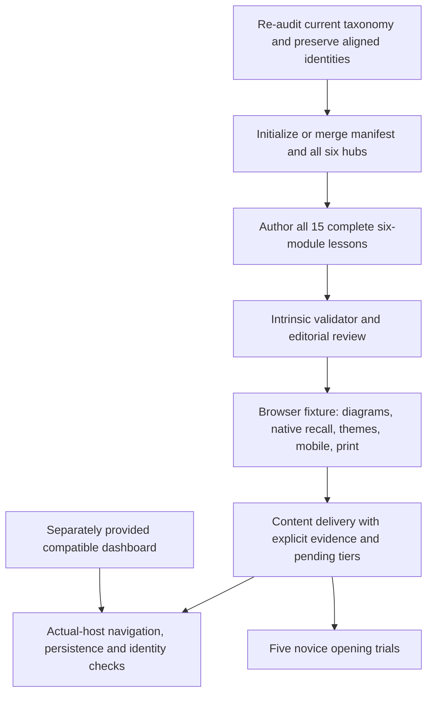

# Implementation Plan: Backend Architecture Learning Batch

**Branch**: `main` | **Date**: 2026-11-17 | **Spec**: [spec.md](spec.md)

**Input**: Feature specification from `specs/001-backend-architecture/spec.md`.

Setup returned feature identifier `001-backend-architecture`; `git branch --show-current`
confirms the actual Git branch remains `main`. No branch-creation hook is configured.

## Summary

Create the first content batch under System Design → Backend Architecture: 15 complete
ELI5-first lessons in four groups (5 / 4 / 3 / 3), six roadmap hubs, and one recursive
`manifest.json`. Preserve the six-module Story Blueprint, meaningful diagrams, contextual
trade-offs, failure stories, and 45–75 recall questions.

Use script-free HTML partials, native disclosures, permanent node IDs, and derived routes
and filesystem locations. Define the dashboard interface and a small browser-only reading
fixture; the missing dashboard and learning engine remain external integration dependencies.
This planning command creates design artifacts only, not production content or tooling.

## Technical Context

**Language/Version**: HTML5 partials and JSON schema version 1; Python 3.10-compatible
standard-library validation; ES6+ fixture/host integration with current browser support.
The workspace provides Python 3.10.12 and Node 20.19.4; Node is not needed by this plan.

**Primary Dependencies**: Native HTML details; host-owned Mermaid and Highlight.js. The
browser-fixture profile pins Mermaid 12.3.0 ESM and Highlight.js 11.11.1 browser assets.
Production partials import no libraries. The future host owns constitutional Tailwind CSS,
typography, semantic shared classes, routing, themes, and persistence.

**Storage**: `manifest.json` is the runtime identity/taxonomy authority; lessons and hubs are
static HTML files. IDs are UUIDv4 for new nodes and retained opaque IDs for reused nodes.
Host-owned localStorage learning state is referenced by node/recall IDs, never implemented
or rewritten by this content batch. No database or second identity registry.

**Testing**: A planned stdlib Python cross-file validator, focused `unittest` negative and
historical fixtures, manual/editorial source review, and a minimal browser reading fixture.
Actual dashboard acceptance and five novice opening trials are separately reported tiers.
An available development-time JSON Schema validator may check the formal schema; none is
required at runtime or by the planned intrinsic validator.

**Target Platform**: Static HTTP hosting in modern desktop/mobile browsers compatible with
the pinned browser assets; root or project-subpath deployment; 360-pixel reading width,
light/dark themes, and A4 print/PDF output. Local Python HTTP serving is validation-only.

**Project Type**: Static learning-content batch and authoring/integration contracts.

**Performance Goals**: All 15 lessons remain reachable without full-page reloads in a
compatible dashboard; openings target understanding within 30 seconds. Validate the catalog
and links by traversing the tree once and indexing IDs/routes. No new network-latency or
throughput target is introduced beyond the specification's learning outcomes.

**Constraints**: Zero production build, no backend, no per-topic scripts/styles, no manual
core-shell edits for a batch, arbitrary recursive depth, balanced four-level placement for
this request, complete self-contained explanations, and no placeholder hubs or lessons.
Do not claim dashboard/learner checks passed based solely on static or fixture evidence.

**Scale/Scope**: Initially 21 nodes and partials (six hubs plus 15 topic leaves), one manifest,
and 45–75 recall items. Preserve any unrelated content encountered on the implementation-time
re-audit. Expected-batch tests are development fixtures, not another production content index.

## Constitution Check

*GATE: Evaluated before Phase 0 research and re-evaluated after Phase 1 design.*

| Constitutional rule | Design evidence | Before research | After design |
| --- | --- | --- | --- |
| I. ELI5-first narrative has highest learning priority | Six modules, concept-first analogies, human source/comprehension review | PASS | PASS |
| II. Visual-first navigation and recursion | One recursive catalog; topic diagrams and six roadmap hubs; no depth-limited types | PASS | PASS |
| III. Standard Topic Story Blueprint | Six ordered section keys; mechanics, tables, failure stories, 3–5 hidden answers | PASS | PASS |
| IV. Persistent learning and active recall | Stable node/recall IDs; explicit host-owned status, reviews, confidence and backup behavior | PASS | PASS |
| V. Lightweight static architecture and growth | No production build/backend; derived routes/files; existing IDs/metadata preserved | PASS | PASS |
| Taxonomy step 1: audit and justified placement | Re-audit before writing; exact four-level inventory and conceptual parent reuse | PASS | PASS |
| Taxonomy step 2: automatic missing parents | Six complete `_overview.html` hubs initially; preserve/update aligned existing hubs | PASS | PASS |
| Taxonomy step 3: mirrored names and permanent identity | Kebab-case slugs; reserved hub filename; new UUIDv4 assigned once | PASS | PASS |
| Taxonomy step 4: complete bundle | Fifteen justifications, paste-ready manifest snapshot, all partials, tiered evidence | PASS | PASS |
| VI. Complete portable delivery and hygiene | Script-free partial contract, no filler or duplicate categories, mobile/print review | PASS | PASS |

All gates pass for design scope; there are no constitutional exceptions. These statuses
certify the proposed design, not implementation acceptance. The absent dashboard is an
explicit specification dependency. Full runtime persistence/navigation remains pending;
reporting it as tested without a host would fail the compliance gate.

## Project Structure

### Documentation (this feature)

```text
specs/001-backend-architecture/
├── spec.md
├── checklists/requirements.md
├── plan.md
├── research.md
├── data-model.md
├── quickstart.md
└── contracts/
    ├── manifest.schema.json
    ├── content-contract.md
    └── validation-contract.md
```

`tasks.md` is generated later by `$speckit-tasks`. `delivery.md` is the eventual implementation
bundle/evidence record. Neither is created by this planning phase.

### Source Code (repository root)

The following is the planned implementation layout, not files created during planning:

```text
manifest.json
topics/
└── system-design/
    ├── _overview.html
    └── backend-architecture/
        ├── _overview.html
        ├── core-system-topologies/
        │   ├── _overview.html
        │   ├── distributed-system-fundamentals.html
        │   ├── monolithic-architecture.html
        │   ├── modular-monolith.html
        │   ├── service-oriented-architecture.html
        │   └── microservices-architecture.html
        ├── code-and-domain-organization/
        │   ├── _overview.html
        │   ├── layered-architecture.html
        │   ├── clean-architecture.html
        │   ├── hexagonal-architecture.html
        │   └── domain-driven-design.html
        ├── communication-and-routing/
        │   ├── _overview.html
        │   ├── event-driven-architecture.html
        │   ├── api-gateway-pattern.html
        │   └── backend-for-frontend.html
        └── infrastructure-and-multi-tenancy/
            ├── _overview.html
            ├── service-discovery.html
            ├── service-mesh.html
            └── multi-tenant-architecture.html
tools/
└── validate_content.py
tests/
├── content/
│   ├── backend-architecture.json
│   └── test_validate_content.py
└── fixtures/
    ├── content-host.html
    ├── content-host.js
    └── content-host.css
```

**Structure Decision**: Place production artifacts directly at the static content paths
specified by the user. The manifest contains only core node identity/title/slug/kind and
recursive children; route and file targets are derived from ancestor slugs. Keep the
validator and reference browser canvas development-only. No `src/`, framework scaffolding,
product dashboard, package manifest, or deployment files are needed for this batch.

## Phase 0 — Research Completed

[research.md](research.md) resolves the initial questions about manifest shape, permanent
identity, partial-to-host integration, library loading, native disclosures, host readiness,
editorial sources, and validation tooling. It records decisions, rationales, alternatives,
and verified primary sources for all 15 subjects.

The research workflow used focused reviews for taxonomy contracts, content integration,
and lesson sources, then consolidated their findings. There are no unresolved design
questions. Runtime integration and learner trials remain known future acceptance work.

## Phase 1 — Design and Contracts Completed

- [data-model.md](data-model.md) defines the recursive catalog, all category/topic slugs,
  six hub locations, lesson/recall entities, learning-state references, and update invariants.
- [manifest.schema.json](contracts/manifest.schema.json) specifies the recursive version-1
  envelope and hub/topic shape. It deliberately leaves semantic and cross-file checks to
  the validator rather than relying on UUID format or array uniqueness alone.
- [content-contract.md](contracts/content-contract.md) defines the single-article envelope,
  six section keys, native recall, shared semantic classes, route/anchor grammar, renderer
  lifecycle, base-relative requests, and print preparation/restoration.
- [validation-contract.md](contracts/validation-contract.md) defines validator arguments,
  exits, reports, fixture interfaces, negative scenarios, and delivery acceptance tiers.
- [quickstart.md](quickstart.md) supplies implementation-time commands and observable
  expectations for file checks, browser reading, replay, identity, host integration, and
  learner comprehension. It does not include implementation bodies or a test suite.

The post-design Constitution Check passes. The content contract is now explicit; it is not
an assertion that an existing dashboard implements it.

Planning-time validation passed: Draft 2020-12 schema meta-validation and 12 positive/negative
schema cases, complete 15-topic inventory/source coverage, six planned hub paths, valid local
artifact links, and no unresolved template markers. Schema checking used a temporary validator
outside the project; no project dependencies were added. Production content, browser rendering,
real-host integration, and learner trials have not been executed in this planning phase.

## Implementation Handoff and Dependencies



The following dependency stages guide later task generation; they are not a generated task
checklist:

1. Re-audit the current catalog, align existing concepts, preserve/mint IDs, and confirm the
   exact inventory and source map before writing content. Resolve path conflicts explicitly.
2. Establish the manifest and hub structure, then author all lesson modules and required
   roadmap links. Do not commit incomplete placeholder lessons as delivered batch content.
3. Implement the focused intrinsic validator, expectation/negative fixtures, and minimal
   browser canvas against these contracts. Validate all 21 partials and repair failures.
4. Prepare the complete delivery bundle, source-review notes, placement justifications,
   manifest snapshot, and tiered evidence. Any incomplete tier remains visible.
5. When a real host is available, run its integration checks without introducing per-topic
   shell edits or a duplicate persistence layer. Conduct the specified learner trials and
   attach their actual results separately from author/editorial checks.

No production host or compatible content API currently exists. The host must eventually
supply the declared style vocabulary, loading/routing, rendering lifecycle, persistence,
review behavior, global UI, and print hooks. Its implementation is a separate feature and
is not silently added to this batch's tasks. Content authoring and isolated validation can
proceed while that dependency remains unavailable.

### Requirement Coverage

| Requirements | Primary design artifact | Validation evidence planned |
| --- | --- | --- |
| FR-001–FR-004 | Data model and manifest/content contracts | Audit, exact membership, six hubs, child-link coverage |
| FR-005–FR-006 | Manifest schema and derived route/ID rules | Cross-file traversal, collisions, baseline comparison |
| FR-007–FR-012 | Content contract and source map | Six-module checks, diagrams, editorial fidelity/decision/failure review |
| FR-013–FR-014 | Recall entity and host-control contract | 3–5 independent answers; actual-host confidence/review behavior |
| FR-015–FR-018 | Content and browser-fixture contracts | Script-free mount, navigation, both themes, 360px and A4 printing |
| FR-019–FR-020 | Identity/update rules and host-state references | Repeat delivery, rename/move, explicit status changes, hub aggregation |
| FR-021–FR-022 | Validation/delivery contract | Complete bundle, specific failure diagnostics, honest pending tiers |

## Complexity Tracking

No constitutional violations or additional production subsystems require justification.
The schema, validator, and browser fixture serve distinct contract, structural, and rendering
checks; none becomes a second runtime catalog or learning engine.
