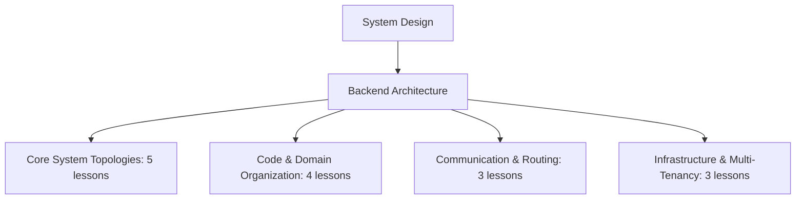

# Feature Specification: Backend Architecture Learning Batch

**Feature Branch**: `main` (current branch; no branch-creation hook is configured)

**Created**: 2026-11-17

**Status**: Draft

**Input**: User description: "Add the Backend Architecture topic batch into manifest.json
and /topics/, organizing 15 concepts into four logical sub-categories under System Design
→ Backend Architecture. Create all missing parent hub pages (_overview.html) with roadmap
diagrams, plus full ELI5-first lesson HTML partials for all 15 topics following the
constitution." The exact requested inventory is recorded under Requirements.

## User Scenarios & Testing *(mandatory)*

### User Story 1 - Find a Lesson Through a Coherent Roadmap (Priority: P1)

As a learner, I want to explore System Design → Backend Architecture through four clear
sub-categories, so I can understand the learning landscape and choose the right lesson.

**Why this priority**: The batch only becomes a useful knowledge collection when every
lesson has an understandable place and can be reached from its parent roadmap.

**Independent Test**: Inspect the batch's catalog and six hub pages independently of lesson
prose. Confirm the requested grouping and follow every parent-child link to its declared
destination; in a compatible dashboard, confirm navigation preserves the reading canvas.

**Acceptance Scenarios**:

1. **Given** no existing catalog, **When** the batch is added, **Then** there is one System
   Design root, one Backend Architecture parent, exactly the four requested sub-categories
   beneath it, and all 15 requested topic leaves in their assigned groups.
2. **Given** an existing aligned root or parent, **When** placement is audited, **Then** it
   is reused, its identity and unrelated children are preserved, and no synonymous branch
   is introduced.
3. **Given** any of the six required hubs, **When** I open it, **Then** I see a plain-language
   big picture, a rendered roadmap diagram, suggested reading guidance, and labeled links
   to every immediate child in the catalog.
4. **Given** a compatible dashboard, **When** I follow hub links to any lesson, **Then** the
   correct content opens without a full-page reload and its location remains identifiable
   as System Design → Backend Architecture → its sub-category → its topic.

---

### User Story 2 - Understand an Architecture Concept From First Principles (Priority: P1)

As a learner new to a topic, I want a complete story that starts with a familiar analogy
and builds toward mechanics, decisions, and real-world consequences, so I can explain
both how the concept works and when to use it.

**Why this priority**: Complete, intuitive teaching is the primary value of the requested
batch; an index of short definitions would not meet the learning goal.

**Independent Test**: Read any one lesson in a compatible reading canvas without opening
other lessons. Verify its six modules, visual explanations, meaningful comparisons, and
failure stories. Each lesson must deliver this value independently.

**Acceptance Scenarios**:

1. **Given** any of the 15 topics, **When** I start its lesson, **Then** the opening states
   the problem and its importance and provides an everyday analogy before technical terms
   or formal definitions.
2. **Given** a lesson's opening mental model, **When** I continue reading, **Then** the six
   Story Blueprint modules appear in order, its big-picture diagram renders, and its
   mechanics can be explored through collapsible steps or tabs without missing prose.
3. **Given** a decision about that concept, **When** I read the comparisons and pitfalls,
   **Then** I find an explicit gain/cost comparison, decision conditions, and applicable
   Symptom → Root Cause → Fix/Prevention stories tied to practical impact.
4. **Given** a narrow reading screen or either dashboard theme, **When** I inspect the
   lesson, **Then** prose, diagrams, comparisons, and controls remain readable and usable.
5. **Given** a lesson with collapsed mechanics and hidden answers, **When** I print it or
   export it to PDF through a compatible dashboard, **Then** all learning content is present,
   diagrams and tables are legible, and dashboard controls do not obscure the lesson.

---

### User Story 3 - Test Understanding Without Revealing Answers First (Priority: P2)

As a learner, I want to explain the idea in my own words and attempt topic-specific recall
questions before seeing answers, so I can distinguish recognition from understanding.

**Why this priority**: Retrieval practice makes the lessons useful for retention after the
initial reading, while the lesson itself remains independently valuable.

**Independent Test**: Open any lesson's mastery section, attempt its questions, and reveal
each answer independently. With a compatible learning engine, exercise the existing status
and confidence controls using that lesson's stable identity.

**Acceptance Scenarios**:

1. **Given** any lesson, **When** I reach its mastery check, **Then** I see "Summarize this
   in your own words" and three to five topic-specific recall or what-if questions whose
   complete answers are initially hidden.
2. **Given** a question with a hidden answer, **When** I reveal it, **Then** I see its own
   explanatory answer, and the other questions' reveal states are unaffected.
3. **Given** a new topic in a compatible learning engine, **When** I open the lesson or
   reveal an answer, **Then** it is not automatically marked Mastered; its initial status
   is Not Started until I explicitly change it.
4. **Given** the dashboard's existing learning controls, **When** I change topic status or
   rate an answer Hard, Good, or Easy and return after reloading, **Then** that state remains
   associated with the same topic and contributes to its normal progress and review behavior.

---

### User Story 4 - Add and Maintain the Batch Without Losing Prior Learning (Priority: P2)

As the knowledge-base owner, I want the batch delivered with consistent placement, complete
files, and durable identities, so I can extend or reorganize it without duplicate content,
broken links, or lost progress.

**Why this priority**: The knowledge base is intended to grow over time; correct initial
placement and stable identity prevent the first batch from creating ongoing cleanup work.

**Independent Test**: Review the delivery bundle against the inventory, apply it twice to
the same catalog, and simulate a topic rename and move with sample learning state. Verify
unchanged identities, no duplicates, retained state, and consistent links and paths.

**Acceptance Scenarios**:

1. **Given** the completed batch, **When** I review its bundle, **Then** I receive a one-line
   placement justification for each topic, the complete initial catalog or a paste-ready
   catalog update, all 15 topic partials, and every required hub creation or update.
2. **Given** the batch is already present, **When** the same batch is requested again,
   **Then** matching nodes and identities are reused and no duplicate root, category,
   topic, or conflicting file is created.
3. **Given** progress, review history, and confidence ratings for a topic, **When** it is
   renamed or moved within the hierarchy, **Then** its identity and learning state remain
   unchanged while its labels, routes, and affected hub links remain consistent.
4. **Given** one missing lesson, invalid diagram, duplicate identity, or broken hub link,
   **When** the batch is reviewed, **Then** it is reported as incomplete with the affected
   artifact identified rather than declared delivered.
5. **Given** all delivered partials and a compatible dashboard, **When** the batch is
   integrated, **Then** it renders and supports its declared interactions without manual
   changes to the dashboard's shared styles or behavior.

### Edge Cases

- The catalog and topic directory do not exist: initialize this requested branch and all
  six hubs rather than treating absence as an empty successful update.
- Only some parents or topics exist: reuse aligned nodes, preserve their identities and
  unrelated children, create only missing artifacts, and update affected hub links.
- An existing concept uses a synonymous name: reuse its aligned parent instead of creating
  a near-duplicate category; distinguish genuinely different concepts by meaning.
- A label includes spaces, punctuation, an ampersand, or an acronym: retain the requested
  display label while using a consistent kebab-case route and directory name.
- A proposed path is occupied by a different concept or an ID is already assigned elsewhere:
  resolve the conflict during placement and report the resolution; do not overwrite an
  unrelated lesson or silently reassign an existing identity.
- A topic is moved or renamed after a learner has reviewed it: preserve its learning state
  and repair affected navigation and roadmap links as part of the move.
- A hub includes other existing disciplines or lessons: preserve them; the batch's counts
  describe the requested additions, not a limit on the rest of the knowledge base.
- The dashboard is unavailable or lacks the required content integration contract: validate
  intrinsic content and catalog quality, identify the integration dependency explicitly,
  and do not claim that dashboard interactions have been demonstrated.
- A small viewport, dark theme, or print layout exposes hidden or overflowing material:
  keep explanations and answers accessible and all diagrams and comparisons readable.

## Requirements *(mandatory)*

### Functional Requirements

- **FR-001**: Before generating content, the author MUST audit the available catalog and
  document whether requested parents and topics already exist. If no catalog exists, the
  batch MUST initialize it with the requested branch rather than invent unrelated roots.
- **FR-002**: The batch MUST place its topics at System Design → Backend Architecture →
  the assigned sub-category → Topic. This four-level placement MUST remain compatible with
  the constitution's unlimited recursive navigation; it does not establish a global depth limit.
- **FR-003**: The batch MUST contain all 15 distinct topics in the inventory below, assigned
  exactly once to their requested sub-categories. Display labels and the supplied ordering
  MUST be retained. Aligned existing nodes MUST be reused without removing unrelated content.
- **FR-004**: Every missing root or parent in this branch MUST receive a lightweight hub
  with a plain-language introduction, roadmap diagram, suggested reading guidance, and
  working links to all its immediate children. From an empty catalog this means six hubs:
  System Design, Backend Architecture, and the four sub-categories. Existing hubs MUST be
  updated to include new children while preserving their other content.
- **FR-005**: The catalog MUST be delivered in `manifest.json`; topic and hub HTML partials
  MUST live under `/topics/`. Routes and directories MUST use kebab-case slugs and mirror
  the sidebar hierarchy one-to-one. Each hub MUST use the reserved filename `_overview.html`.
- **FR-006**: Every catalog node MUST have a unique, immutable `id` (an identity that never
  changes). Renaming or moving a topic MUST preserve it and its progress, review history, and
  confidence ratings; identity MUST NOT be derived anew from a mutable title or location.
- **FR-007**: Each of the 15 topic partials MUST contain all six Story Blueprint modules
  in order: Hook & ELI5; High-Level Big Picture; Step-by-Step Mechanics; Comparisons &
  Trade-Offs; Common Pitfalls, Bugs & What-If Scenarios; Active Recall & Mastery Check.
  Each lesson MUST be self-contained and complete, with no truncated explanations or filler.
- **FR-008**: Every concept MUST start with an intuitive model or everyday analogy before
  jargon, definitions, or complex mechanics. Each lesson's opening MUST state the problem,
  why it matters, and an analogy intended to be grasped within 30 seconds.
- **FR-009**: Each lesson MUST include at least one valid, rendered Mermaid big-picture
  diagram. Every hub MUST include a valid Mermaid roadmap diagram. Explanations of
  additional processes, hierarchies, timelines, or systems MUST also include appropriate
  diagrams as required by the constitution; prose MUST explain what the visuals mean.
- **FR-010**: The mechanics module MUST explain internal behavior step by step through
  collapsible cards or tabs, connecting the steps back to the opening mental model.
- **FR-011**: Each lesson MUST include a decision table covering meaningful alternatives
  or conditions, gains, costs, and when to choose the approach. A comparison MUST NOT imply
  that all architectures are mutually exclusive or invent alternatives solely to fill a table.
- **FR-012**: Each lesson MUST include topic-specific misconceptions, edge cases, and
  failure scenarios expressed as Symptom → Root Cause → Fix/Prevention, with practical
  consequences and real-world takeaways.
- **FR-013**: Each mastery module MUST contain the Feynman prompt "Summarize this in your
  own words" and three to five topic-specific recall or what-if questions with complete,
  independently revealable answers that are hidden initially in the reading view.
- **FR-014**: Lessons MUST work with a compatible dashboard's existing topic status,
  confidence-rating, and review controls through its supported content contract. This batch
  MUST NOT introduce a second learning-state system or replace the existing learning engine.
- **FR-015**: All lesson and hub partials MUST render inside the main dashboard canvas
  without manual edits to the shared dashboard styles or behavior. Diagrams, highlighted
  examples where present, collapsible mechanics, and recall answers MUST work without
  disturbing the surrounding interface or another lesson.
- **FR-016**: Every catalog target, hub child link, and related-lesson link in the batch
  MUST resolve to the intended content. In a compatible dashboard, following these links
  MUST preserve the single-page reading experience and identify the current hierarchy.
- **FR-017**: Lessons and hubs MUST follow the constitution's visual hierarchy: blue for
  structure, yellow for insights and WHY, green for impact, and pink/red for pitfalls.
  They MUST remain readable in both dashboard themes; code examples, when present, MUST
  use the supported syntax highlighting.
- **FR-018**: All learning content MUST remain usable at a 360-pixel-wide mobile viewport
  and in A4 PDF output. Wide diagrams and comparisons MUST remain accessible without
  clipping the page's reading content. Print output MUST include collapsed mechanics and
  recall answers and exclude obstructive dashboard controls.
- **FR-019**: Reapplying the batch MUST reuse matching nodes and files without multiplying
  them or changing existing identities. Path and identity conflicts MUST be resolved and
  documented without overwriting unrelated content or resetting learning state.
- **FR-020**: New topic leaves MUST begin as Not Started in a compatible learning engine.
  Opening a lesson or revealing an answer MUST NOT mark it Mastered. Hubs MUST represent
  descendant progress rather than introduce additional mastery units for this batch.
- **FR-021**: Delivery MUST include a one-line placement justification for each of the 15
  topics, a paste-ready manifest update including all missing parents (the complete manifest
  when initializing), all 15 complete topic HTML partials, all missing hub partials, and
  existing hub updates required for correct child links.
- **FR-022**: Batch acceptance MUST verify topic and hub completeness, exact requested
  membership, stable unique identities, matching catalog targets and files, valid diagrams,
  working links, and absence of placeholder content. Missing artifacts or failed checks
  MUST be reported with their affected topic or hub. Runtime integration checks MUST be
  reported separately from intrinsic content checks when the dashboard dependency is absent.

### Required Topic Inventory and Scope

All rows share **Root: System Design → Parent: Backend Architecture**. Placement follows
the user's requested conceptual grouping and stays within four levels including each leaf.

| Sub-category | Topic |
| --- | --- |
| Core System Topologies | Distributed System Fundamentals |
| Core System Topologies | Monolithic Architecture |
| Core System Topologies | Modular Monolith |
| Core System Topologies | Service-Oriented Architecture (SOA) |
| Core System Topologies | Microservices Architecture |
| Code & Domain Organization | Layered Architecture |
| Code & Domain Organization | Clean Architecture |
| Code & Domain Organization | Hexagonal Architecture |
| Code & Domain Organization | Domain-Driven Design (DDD) |
| Communication & Routing | Event-Driven Architecture |
| Communication & Routing | API Gateway Pattern |
| Communication & Routing | Backend for Frontend (BFF) |
| Infrastructure & Multi-Tenancy | Service Discovery |
| Infrastructure & Multi-Tenancy | Service Mesh |
| Infrastructure & Multi-Tenancy | Multi-Tenant Architecture |

The category counts are **5 / 4 / 3 / 3**, totaling **15 lessons**. On the current empty
content base, delivery comprises **one manifest, 15 lesson partials, and six hub partials**.

This feature covers content authoring, taxonomy registration, hub navigation content, and
compatibility with the dashboard defined by constitution v1.1.0. Building that dashboard,
its search and routing engine, its progress/review persistence, backup controls, hosting,
and unrelated topic batches are outside this feature's scope. Their relevant behavior is
an integration dependency, not functionality delivered merely by creating this batch.

### Key Entities *(include if feature involves data)*

- **Topic Batch**: The named collection of 15 requested lessons, their exact membership,
  shared placement, and delivery/validation record.
- **Taxonomy Node**: A domain, parent, sub-category, or topic with a unique permanent
  identity, display label, route, content destination, and parent-child relationships.
- **Hub Page**: A lightweight overview associated with a non-leaf node, containing its
  big picture, roadmap, reading guidance, and links matching its immediate children.
- **Topic Lesson**: A topic's complete six-module story, visual explanations, decision
  comparisons, failure scenarios, recall questions, and real-world takeaways.
- **Recall Item**: A topic-specific question and explanatory answer with an independent
  reveal state and support for the dashboard's existing confidence controls.
- **Learning State Reference**: The association between a stable topic identity and the
  dashboard's existing status, review history, and confidence ratings. The batch preserves
  this association but does not own a separate persistence system.

## Success Criteria *(mandatory)*

### Measurable Outcomes

- **SC-001**: A learner can locate all 15 requested lessons under their exact assigned
  groups, with category counts of 5 / 4 / 3 / 3 and no duplicate requested topic leaves.
- **SC-002**: All six required hubs provide an understandable big picture, a visible
  roadmap, reading guidance, and correct links to 100% of their immediate children.
- **SC-003**: All 15 lessons pass review for the six ordered story modules, complete
  explanations, an intuitive opening, meaningful trade-offs, and practical failure stories.
  No lesson requires reading another lesson to understand its opening mental model.
- **SC-004**: In at least four of five novice reading trials, a learner can state the
  topic's problem and explain its analogy in their own words after spending no more
  than 30 seconds on the opening. Sample at least one topic from each sub-category.
- **SC-005**: The batch provides 45–75 recall questions in total, with three to five per
  lesson; 100% have explanatory answers that can be revealed independently in reading view.
- **SC-006**: Every delivered navigation link reaches its intended content. In a compatible
  dashboard, a walkthrough of all 15 lessons preserves the reading interface and correct
  location context without a full-page reload.
- **SC-007**: Reapplying the batch creates zero duplicate nodes, and a rename-and-move
  check preserves 100% of a sample topic's pre-existing status, reviews, and confidence
  ratings while keeping its affected navigation links correct.
- **SC-008**: Every delivered lesson and hub passes a reading check at 360-pixel width
  and an A4 print check with no lost learning content; all diagrams, comparison entries,
  mechanics, and answers remain accessible. Both reading themes retain readable content.

## Assumptions

- The learner is an individual studying backend architecture, including beginners to any
  particular topic. Lessons are written in English and introduce their own terminology.
- Repository inspection on 2026-11-17 found no `manifest.json`, `/topics/`, or dashboard
  source. This is the first content batch, so all six parent hubs are initially missing.
  A fresh audit at implementation time takes precedence if content has since been added.
- The user's grouping and display labels are authoritative. The listed order provides
  default navigation order; hub guidance may suggest another reading sequence without
  moving or duplicating topics.
- Hubs are lightweight orientation pages, distinct from six-module lessons. They display
  descendant progress and do not count as additional learnable topics in mastery totals.
- Existing aligned nodes keep their identities. If a previously absent parent becomes
  available before implementation, it is reused and its unrelated children are preserved.
- Constitution v1.1.0 supplies the static delivery, visual, naming, persistence-identity,
  and content quality constraints. Required filenames, HTML partials, and Mermaid diagrams
  are explicit user/governance constraints rather than new implementation choices here.
- A compatible dashboard and learning engine are dependencies for proving navigation,
  theme, progress, review, confidence persistence, and integrated mobile/print behavior.
  The implementation plan must identify their content contract and readiness. If absent,
  report those integration checks as pending rather than expanding this content feature
  into a complete application or claiming those checks passed.
- The five-trial comprehension check is a lightweight acceptance sample for ELI5 clarity,
  not a claim about universal learner performance or a requirement for analytics tracking.
- Publication, deployment, and automatic commits or pushes are not part of this feature.
