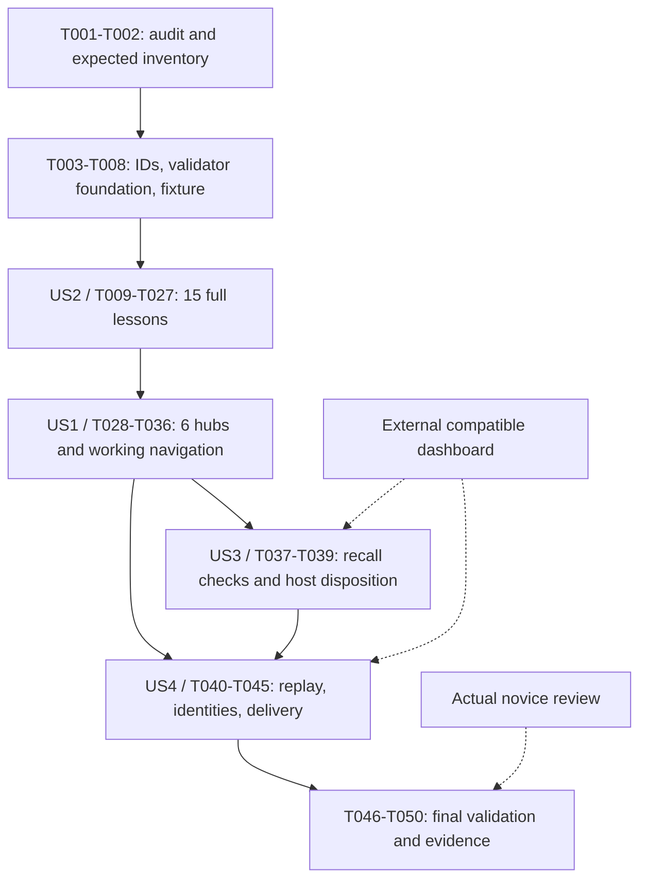

# Tasks: Backend Architecture Learning Batch

**Input**: Design documents in `specs/001-backend-architecture/`.
**Prerequisites**: [plan.md](plan.md), [spec.md](spec.md), [research.md](research.md),
[data-model.md](data-model.md), [content contract](contracts/content-contract.md),
[validation contract](contracts/validation-contract.md), and
[quickstart.md](quickstart.md). Constitution v1.1.0 governs every task.
**User instruction**: Every topic HTML file has its own separate task; lessons must never
be summarized or truncated to complete a batch faster.
**Tests**: FR-022 and the specification's acceptance scenarios require focused validation.
Include the agreed validator-negative/historical tests and browser/editorial checks; do not
add a production application, a general test framework, or a competing learning engine.
**Organization**: Tasks are grouped by user story. US2 and US1 both have priority P1; complete
lesson authoring is scheduled first so roadmap acceptance uses real lesson files. Story
labels retain their numbering from the specification.

## Format: `[ID] [P?] [Story] Description`

Every actionable item uses `- [ ] TNNN [P?] [USn?] Description with exact file paths`.
`[P]` permits work on distinct files only after the task's stated prerequisites are complete.
It does not authorize concurrent edits to the manifest, validator, fixture JavaScript, test
module, or delivery record. No task is checked off by this generation command.

## Path Conventions

Paths are repository-relative. Production content is `manifest.json` and `topics/`.
`tools/`, `tests/`, and the fixture are development-only. The delivery record is
`specs/001-backend-architecture/delivery.md`. Temporary reports/candidates live beneath
`/tmp/`; none is a second production navigation index.

### Mandatory Per-Lesson Completion Contract

This contract is part of every individual authoring task T011–T025. Read its topic's
primary-source entry in `research.md` and its exact path in `data-model.md` before writing.
The first complete version of each lesson MUST include all of the following:

1. Hook, problem, WHY, and an everyday ELI5 analogy before technical jargon for each concept.
2. Explained, valid Mermaid big-picture diagram and additional process/system diagrams
   wherever required by the constitution.
3. Complete internal mechanics in native collapsible details, connected to the analogy.
4. A meaningful decision table with alternatives/conditions, gains, costs, and choice guidance.
5. Topic-specific Symptom → Root Cause → Fix/Prevention stories and practical impact.
6. The exact Feynman prompt, three to five independently revealable questions with complete
   hidden answers, and real-world takeaways.

Each file is one script-free `.kb-topic` article with the permanent manifest ID, exact title,
and six ordered section keys `hook-eli5`, `big-picture`, `mechanics`, `trade-offs`, `pitfalls`,
`mastery`. Use stable local recall keys, source links, semantic callout classes, accessible
headings/tables, and the agreed hash-route links. Do not edit shared files from a parallel
lesson task. Do not leave recall, pitfalls, depth, or diagrams for another story; US3 verifies
already-complete learning content. No placeholders, filler, length caps, summary-only pages,
truncation, or links replacing explanations. A defective lesson reopens its own task.

---

## Phase 1: Setup (Shared Infrastructure)

**Purpose**: Establish the audit and exact expected inventory before creating production
content. Dependencies: T001 → T002.

- [X] T001 Re-audit `manifest.json`, `topics/`, and any dashboard sources before creating content; initialize `specs/001-backend-architecture/delivery.md` with existing/missing nodes, conceptual parent matches, occupied paths, and host readiness.
  Record the requested System Design → Backend Architecture → four-category placement and preserve unrelated nodes, metadata, and identities. Save any existing manifest as an implementation-time baseline outside production content; if absent, record that absence rather than inventing prior state. Do not create application runtime code.

- [X] T002 Create `tests/content/backend-architecture.json` from the exact inventory and slugs in `specs/001-backend-architecture/data-model.md`, after T001.
  Record the root/parent titles and slugs, the four category titles/slugs, ordered 15 topic titles/slugs, six hubs, and 5/4/3/3 batch counts. Keep permanent IDs out of this test expectation and preserve unrelated production catalog content; this is not a runtime routing manifest.

---

## Phase 2: Foundational (Blocking Prerequisites)

**Purpose**: Establish identities, the validator foundation, and a test-only reading canvas.
No user-story implementation starts until T003–T008 are complete. Planned manifest targets
may be temporarily absent while authoring; do not publish the catalog or claim a complete
batch until every referenced production file exists.

- [X] T003 Create or merge all 21 requested node records in `manifest.json` after T001–T002; mint IDs once and freeze them before parallel authoring.
  Apply these data-model constraints verbatim: `Catalog.schemaVersion` is an integer, “Exactly `1` for this contract.”; ordered `Catalog.roots`: “Nonempty; each root is a hub.”; nonempty opaque `Node.id`: “Globally unique and permanent. Mint UUIDv4 for new nodes; preserve legacy IDs.”; `Node.kind` is `hub` or `topic`: “Describes the content role, not a fixed taxonomy depth.”
  For nonblank `Node.title`: “Human display label, preserving the requested spelling and acronyms.” For kebab-case `Node.slug`: “Unique among siblings across both node kinds; no slashes or dot segments.” For ordered `Hub.children`: “Required and nonempty; recursively contains hubs or topic leaves.” For absent `Topic.children`: “Topic nodes are leaves.” For additional metadata: “Preserve existing values during merges; ignore unknown optional fields when consuming.”
  Match the formal schema, preserve unrelated siblings and their relative order, retain requested relative topic order, and derive routes/files from ancestry without adding `parentId`, `route`, or `contentPath` indexes. Add no placeholder HTML files.

- [X] T004 Write focused catalog/CLI negative and positive tests in `tests/content/test_validate_content.py` before T005, using temporary content fixtures.
  Cover malformed/repeated JSON keys, required fields and enums, blank labels/IDs, arbitrary recursive depth, empty hubs, topic children, duplicate IDs/sibling slugs, path or symlink escape, new UUIDv4 versus retained legacy IDs, optional metadata, and exact batch counts. Exercise valid core-parser cases through focused helpers and assert CLI exits 1/2 for invalid inputs; add full-success exit-0 assertions in T040 when all content checks exist. Observe failures for the not-yet-implemented validator rather than testing lesson prose with mocks.

- [X] T005 Implement the catalog, identity, path, and report foundation in `tools/validate_content.py` to satisfy T004 and `specs/001-backend-architecture/contracts/validation-contract.md`.
  Use Python 3.10-compatible standard-library APIs and support `--repo-root`, `--expect`, `--baseline`, and `--report`; do not interpret arbitrary JSON Schema or modify content/storage. Reject repeated keys, globally duplicated IDs, sibling slug collisions, escaped resolved paths, missing inputs, and unsupported schema versions. Derive and index canonical routes and file targets once. Emit profile/phase/result/counts/checks/integrationStatus; per-check statuses are `pass`, `fail`, `pending`, or `not-applicable`; intrinsic phase and integration-pending must remain explicit. Exit 0 only for completed required intrinsic checks, 1 for validation failures, and 2 for invalid arguments/unreadable inputs; no unwritten later check may silently pass.

- [X] T006 [P] Create the reference stylesheet in `tests/fixtures/content-host.css` after T003; it may proceed alongside T004–T005 and T007.
  Implement the shared `.kb-card`, semantic callout, diagram, and table-wrapper vocabulary; constitutional typography/fallbacks; readable light/dark palettes; 360px reading without page overflow; and A4 rules exposing complete lessons while hiding test controls. This is a small fixture stylesheet, not a production dashboard or a per-topic stylesheet.

- [X] T007 [P] Create the accessible test-only reading canvas and fixture controls in `tests/fixtures/content-host.html` after T003; it may proceed alongside T004–T006.
  Reference the adjacent fixture CSS/JavaScript, expose a reading canvas and loading/error/report area, and provide keyboard-accessible mount/theme/print test controls. Do not add a product sidebar, search, review queue, backup UI, mock mastery buttons, or persisted learning state.

- [X] T008 Implement the mount/render fixture in `tests/fixtures/content-host.js` after T005–T007.
  Expose `contentFixture.mount(route)` and `contentFixture.checkAll()`; derive routes/content files from the manifest and application base, support `?section=` navigation and back/forward, and report unknown routes/sections visibly. Pin browser Mermaid 12.3.0 and Highlight.js 11.11.1, initialize strict Mermaid with startOnLoad false, await mounting/rendering, retain source for theme rerenders, highlight code only where appropriate, and fail on missing assets/render errors. Record browser/library versions, prepare all details before real printing and restore prior states afterward, and implement no progress/storage engine. The full checkAll run must not pass before all 21 production partials exist.

**Checkpoint**: Foundation complete. IDs are stable; validator capabilities are tested on
focused temporary fixtures; browser mount/error behavior is available. Full production
validation intentionally remains incomplete until the story tasks supply all files.

---

## Phase 3: User Story 2 - Understand an Architecture Concept From First Principles (Priority: P1)

**Goal**: Deliver all 15 individually complete, self-contained lessons.
**Independent Test**: Read/mount each lesson directly without opening another lesson. Verify
its six modules, diagrams, decision/failure stories, recall, theme/mobile behavior, and print
content. Hub navigation is validated later by US1; missing hubs cannot justify shortening a
lesson. Dependencies: foundation → T009 → T010 → T011–T025 → T026–T027.

### Tests and Contract Validation for User Story 2

- [X] T009 [US2] Extend `tests/content/test_validate_content.py` with lesson-envelope, six-module, and recall-structure cases before T010.
  Cover wrong/missing article IDs or titles, forbidden wrappers/scripts/styles/handlers, missing/reordered/empty sections, absent diagrams/mechanics/tables/failure labels, placeholder explanations, duplicate DOM/recall IDs, invalid question counts, empty answers, and initially open or grouped recall disclosures. Include valid complete temporary lessons and fail the new cases until their validator support exists.

- [X] T010 [US2] Implement topic-content checks in `tools/validate_content.py` after T009, preserving the CLI/report contract and canonical route derivation.
  Enforce the data-model constraints: “Exactly one `.kb-topic` article whose `data-node-id` matches the manifest.”; “Keys in order: `hook-eli5`, `big-picture`, `mechanics`, `trade-offs`, `pitfalls`, `mastery`.”; “Three to five per lesson; answers initially closed and independently revealable.”; and “Research supports factual claims; accessible source links are included in the lesson's relevant module or footer.” Check structure and source-link presence; leave conceptual/source accuracy and actual Mermaid rendering to their stated review tiers. Topic-only fixture checks may run before hubs exist, but the full validator must still report missing referenced hubs.

### Implementation for User Story 2 — One Task Per Complete Lesson

T011–T025 can run in parallel after T010 because each owns exactly one production file and
reads the same frozen manifest. The mandatory per-lesson contract above applies in full to
each task. Category counts remain 5 / 4 / 3 / 3.

- [X] T011 [P] [US2] Author the complete **Distributed System Fundamentals** lesson in `topics/system-design/backend-architecture/core-system-topologies/distributed-system-fundamentals.html` after T010.
  Deliver all six modules now: ELI5 hook, explained Mermaid big picture, collapsible internal mechanics, trade-off decision table, Symptom → Root Cause → Fix/Prevention stories, and Feynman prompt plus 3–5 complete independent hidden Q&A items with real-world takeaways. Match the immutable manifest ID and ordered section contract, include verified primary-source links and semantic callouts, and make the lesson self-contained. Use the AWS primary source map to explain network/partial failures, latency, timeouts/retries, and consistency through a worked real-world request story. No summaries, truncation, filler, placeholders, or deferred modules. Edit only this lesson file.

- [X] T012 [P] [US2] Author the complete **Monolithic Architecture** lesson in `topics/system-design/backend-architecture/core-system-topologies/monolithic-architecture.html` after T010.
  Deliver all six modules now: ELI5 hook, explained Mermaid big picture, collapsible internal mechanics, trade-off decision table, Symptom → Root Cause → Fix/Prevention stories, and Feynman prompt plus 3–5 complete independent hidden Q&A items with real-world takeaways. Match the immutable manifest ID and ordered section contract, include verified primary-source links and semantic callouts, and make the lesson self-contained. Explain the deployment boundary, internal calls/data flow, contextual scaling/change trade-offs, and failure stories without presenting distribution as automatic improvement. No summaries, truncation, filler, placeholders, or deferred modules. Edit only this lesson file.

- [X] T013 [P] [US2] Author the complete **Modular Monolith** lesson in `topics/system-design/backend-architecture/core-system-topologies/modular-monolith.html` after T010.
  Deliver all six modules now: ELI5 hook, explained Mermaid big picture, collapsible internal mechanics, trade-off decision table, Symptom → Root Cause → Fix/Prevention stories, and Feynman prompt plus 3–5 complete independent hidden Q&A items with real-world takeaways. Match the immutable manifest ID and ordered section contract, include verified primary-source links and semantic callouts, and make the lesson self-contained. Explain explicit module APIs, hidden internals, dependency enforcement, and boundary erosion; label the Spring source as an implementation example rather than the definition. No summaries, truncation, filler, placeholders, or deferred modules. Edit only this lesson file.

- [X] T014 [P] [US2] Author the complete **Service-Oriented Architecture (SOA)** lesson in `topics/system-design/backend-architecture/core-system-topologies/service-oriented-architecture.html` after T010.
  Deliver all six modules now: ELI5 hook, explained Mermaid big picture, collapsible internal mechanics, trade-off decision table, Symptom → Root Cause → Fix/Prevention stories, and Feynman prompt plus 3–5 complete independent hidden Q&A items with real-world takeaways. Match the immutable manifest ID and ordered section contract, include verified primary-source links and semantic callouts, and make the lesson self-contained. Use the OASIS model for capabilities, contracts, interactions, ownership, and integration trade-offs; avoid defining SOA solely by SOAP or a mandatory ESB. No summaries, truncation, filler, placeholders, or deferred modules. Edit only this lesson file.

- [X] T015 [P] [US2] Author the complete **Microservices Architecture** lesson in `topics/system-design/backend-architecture/core-system-topologies/microservices-architecture.html` after T010.
  Deliver all six modules now: ELI5 hook, explained Mermaid big picture, collapsible internal mechanics, trade-off decision table, Symptom → Root Cause → Fix/Prevention stories, and Feynman prompt plus 3–5 complete independent hidden Q&A items with real-world takeaways. Match the immutable manifest ID and ordered section contract, include verified primary-source links and semantic callouts, and make the lesson self-contained. Explain capability boundaries, deployment and data ownership, communication, operations, and distributed failure costs; make the contextual comparison with monoliths and SOA explicit. No summaries, truncation, filler, placeholders, or deferred modules. Edit only this lesson file.

- [X] T016 [P] [US2] Author the complete **Layered Architecture** lesson in `topics/system-design/backend-architecture/code-and-domain-organization/layered-architecture.html` after T010.
  Deliver all six modules now: ELI5 hook, explained Mermaid big picture, collapsible internal mechanics, trade-off decision table, Symptom → Root Cause → Fix/Prevention stories, and Feynman prompt plus 3–5 complete independent hidden Q&A items with real-world takeaways. Match the immutable manifest ID and ordered section contract, include verified primary-source links and semantic callouts, and make the lesson self-contained. Trace a request through responsibility layers; distinguish logical layers from physical deployment tiers, and explain bypass/coupling pitfalls with a worked example. No summaries, truncation, filler, placeholders, or deferred modules. Edit only this lesson file.

- [X] T017 [P] [US2] Author the complete **Clean Architecture** lesson in `topics/system-design/backend-architecture/code-and-domain-organization/clean-architecture.html` after T010.
  Deliver all six modules now: ELI5 hook, explained Mermaid big picture, collapsible internal mechanics, trade-off decision table, Symptom → Root Cause → Fix/Prevention stories, and Feynman prompt plus 3–5 complete independent hidden Q&A items with real-world takeaways. Match the immutable manifest ID and ordered section contract, include verified primary-source links and semantic callouts, and make the lesson self-contained. Explain policy boundaries, inward source dependencies, dependency inversion, and runtime control flow using the original-author source; avoid prescribing four mandatory folders. No summaries, truncation, filler, placeholders, or deferred modules. Edit only this lesson file.

- [X] T018 [P] [US2] Author the complete **Hexagonal Architecture** lesson in `topics/system-design/backend-architecture/code-and-domain-organization/hexagonal-architecture.html` after T010.
  Deliver all six modules now: ELI5 hook, explained Mermaid big picture, collapsible internal mechanics, trade-off decision table, Symptom → Root Cause → Fix/Prevention stories, and Feynman prompt plus 3–5 complete independent hidden Q&A items with real-world takeaways. Match the immutable manifest ID and ordered section contract, include verified primary-source links and semantic callouts, and make the lesson self-contained. Explain inside/outside boundaries, driving/driven ports, replaceable adapters, and independent testing; do not imply a hexagon requires six ports. No summaries, truncation, filler, placeholders, or deferred modules. Edit only this lesson file.

- [X] T019 [P] [US2] Author the complete **Domain-Driven Design (DDD)** lesson in `topics/system-design/backend-architecture/code-and-domain-organization/domain-driven-design.html` after T010.
  Deliver all six modules now: ELI5 hook, explained Mermaid big picture, collapsible internal mechanics, trade-off decision table, Symptom → Root Cause → Fix/Prevention stories, and Feynman prompt plus 3–5 complete independent hidden Q&A items with real-world takeaways. Match the immutable manifest ID and ordered section contract, include verified primary-source links and semantic callouts, and make the lesson self-contained. Cover language, bounded contexts and relationships before tactical entities/value objects/aggregates, with a concrete domain story; do not imply DDD requires microservices. No summaries, truncation, filler, placeholders, or deferred modules. Edit only this lesson file.

- [X] T020 [P] [US2] Author the complete **Event-Driven Architecture** lesson in `topics/system-design/backend-architecture/communication-and-routing/event-driven-architecture.html` after T010.
  Deliver all six modules now: ELI5 hook, explained Mermaid big picture, collapsible internal mechanics, trade-off decision table, Symptom → Root Cause → Fix/Prevention stories, and Feynman prompt plus 3–5 complete independent hidden Q&A items with real-world takeaways. Match the immutable manifest ID and ordered section contract, include verified primary-source links and semantic callouts, and make the lesson self-contained. Trace producer/channel/consumer flow and worked failure/recovery stories for duplicates, ordering, and consistency; distinguish events from commands and avoid universal exactly-once claims. No summaries, truncation, filler, placeholders, or deferred modules. Edit only this lesson file.

- [X] T021 [P] [US2] Author the complete **API Gateway Pattern** lesson in `topics/system-design/backend-architecture/communication-and-routing/api-gateway-pattern.html` after T010.
  Deliver all six modules now: ELI5 hook, explained Mermaid big picture, collapsible internal mechanics, trade-off decision table, Symptom → Root Cause → Fix/Prevention stories, and Feynman prompt plus 3–5 complete independent hidden Q&A items with real-world takeaways. Match the immutable manifest ID and ordered section contract, include verified primary-source links and semantic callouts, and make the lesson self-contained. Explain ingress routing, composition, cross-cutting concerns, latency/availability trade-offs, and failure handling; distinguish gateway responsibilities from BFF and business logic. No summaries, truncation, filler, placeholders, or deferred modules. Edit only this lesson file.

- [X] T022 [P] [US2] Author the complete **Backend for Frontend (BFF)** lesson in `topics/system-design/backend-architecture/communication-and-routing/backend-for-frontend.html` after T010.
  Deliver all six modules now: ELI5 hook, explained Mermaid big picture, collapsible internal mechanics, trade-off decision table, Symptom → Root Cause → Fix/Prevention stories, and Feynman prompt plus 3–5 complete independent hidden Q&A items with real-world takeaways. Match the immutable manifest ID and ordered section contract, include verified primary-source links and semantic callouts, and make the lesson self-contained. Use the Newman source to explain client-experience-specific composition and ownership, shared versus tailored backend trade-offs, and maintenance/duplication pitfalls. No summaries, truncation, filler, placeholders, or deferred modules. Edit only this lesson file.

- [X] T023 [P] [US2] Author the complete **Service Discovery** lesson in `topics/system-design/backend-architecture/infrastructure-and-multi-tenancy/service-discovery.html` after T010.
  Deliver all six modules now: ELI5 hook, explained Mermaid big picture, collapsible internal mechanics, trade-off decision table, Symptom → Root Cause → Fix/Prevention stories, and Feynman prompt plus 3–5 complete independent hidden Q&A items with real-world takeaways. Match the immutable manifest ID and ordered section contract, include verified primary-source links and semantic callouts, and make the lesson self-contained. Explain registration, resolution, health/staleness, and client/server-side choices with a request trace; treat DNS/Kubernetes as examples rather than mandatory infrastructure. No summaries, truncation, filler, placeholders, or deferred modules. Edit only this lesson file.

- [X] T024 [P] [US2] Author the complete **Service Mesh** lesson in `topics/system-design/backend-architecture/infrastructure-and-multi-tenancy/service-mesh.html` after T010.
  Deliver all six modules now: ELI5 hook, explained Mermaid big picture, collapsible internal mechanics, trade-off decision table, Symptom → Root Cause → Fix/Prevention stories, and Feynman prompt plus 3–5 complete independent hidden Q&A items with real-world takeaways. Match the immutable manifest ID and ordered section contract, include verified primary-source links and semantic callouts, and make the lesson self-contained. Explain control/data-plane roles, communication policy and telemetry, deployment-mode alternatives, and operational failure/cost stories; avoid claiming every mesh requires sidecars. No summaries, truncation, filler, placeholders, or deferred modules. Edit only this lesson file.

- [X] T025 [P] [US2] Author the complete **Multi-Tenant Architecture** lesson in `topics/system-design/backend-architecture/infrastructure-and-multi-tenancy/multi-tenant-architecture.html` after T010.
  Deliver all six modules now: ELI5 hook, explained Mermaid big picture, collapsible internal mechanics, trade-off decision table, Symptom → Root Cause → Fix/Prevention stories, and Feynman prompt plus 3–5 complete independent hidden Q&A items with real-world takeaways. Match the immutable manifest ID and ordered section contract, include verified primary-source links and semantic callouts, and make the lesson self-contained. Explain tenants versus users, identity/context propagation, isolation choices, data scoping, noisy neighbors, and practical failure prevention through a concrete shared-service story. No summaries, truncation, filler, placeholders, or deferred modules. Edit only this lesson file.

- [X] T026 [US2] Review all 15 completed lesson files and record per-topic editorial/render evidence in `specs/001-backend-architecture/delivery.md` after T011–T025.
  Mount each lesson with the fixture, verify actual Mermaid rendering and code examples, source fidelity, analogy-before-jargon ordering for every concept, complete mechanics, meaningful comparisons, failure stories, and practical impact. Return any deficient file to its individual authoring task; never replace depth with a batch summary. Distinguish a source/teaching review from later novice comprehension trials.

- [X] T027 [US2] Validate both themes, 360px reading, keyboard access, and real A4 print/PDF for every completed lesson using `tests/fixtures/content-host.html`; record results in `specs/001-backend-architecture/delivery.md` after T026.
  Start with mixed open/closed mechanics and recall details, verify complete print output and restoration afterward, and confirm diagrams/tables remain accessible. Correct shared fixture defects in its CSS/JavaScript or reopen the specific defective lesson task; do not add per-lesson scripts/styles. Do not certify actual-dashboard layout from fixture results.

**Checkpoint**: All 15 lessons have full bodies, including active recall; each is independently
readable in the fixture. Full catalog navigation awaits the six hubs in US1. No lesson is
left to be expanded by US3.

---

## Phase 4: User Story 1 - Find a Lesson Through a Coherent Roadmap (Priority: P1)

**Goal**: Deliver the six complete hubs and exact four-category navigation to real lessons.
**Independent Test**: Inspect the catalog and each hub's big picture/roadmap/reading guidance;
follow every immediate-child link to the intended file in the fixture at root and project
URL bases. A real dashboard's breadcrumbs and global navigation remain a separate tier.
Dependencies: foundation and US2 lesson files → T028 → T029 → T030–T035 → T036.

### Tests and Contract Validation for User Story 1

- [X] T028 [US1] Add hub/link/route contract cases to `tests/content/test_validate_content.py` before T029.
  Test missing/wrong hub articles, empty introductions/reading guidance, absent roadmap source, missing/duplicate/out-of-order immediate-child links, stale routes, unknown sections, bare section fragments, and root versus subpath target derivation. Preserve unrelated child links and accept the reserved `_overview.html` filename; observe new validator failures before implementing those checks.

- [X] T029 [US1] Implement hub and cross-file link validation in `tools/validate_content.py` after T028.
  Enforce the hub rule verbatim: “Exactly one `.kb-hub` article; immediate-child links match the actual manifest children.” Derive `topics/
/_overview.html` for hubs and `topics/
.html` for leaves, recognize `#/
` with an optional known `?section=` key, and require matching article identity, title, introduction, roadmap, reading guidance, ordered child-list targets, and all referenced files. Keep topic/hub depths recursive and reject invalid links without rewriting the catalog.

- [X] T030 [P] [US1] Create or update the complete **System Design** hub in `topics/system-design/_overview.html` after T029.
  Use the matching immutable manifest ID and one script-free `.kb-hub` article with the exact title, a lightweight ELI5 big picture, valid explained Mermaid roadmap, suggested reading guidance, and a `data-child-links` list with exactly one link per actual immediate child in manifest order. Orient the domain and link every actual immediate child, including Backend Architecture; preserve any unrelated existing domain branches. Preserve existing relevant prose and unrelated child links. This is a finished overview, not a stub or a six-module topic lesson; edit only this hub file.

- [X] T031 [P] [US1] Create or update the complete **Backend Architecture** hub in `topics/system-design/backend-architecture/_overview.html` after T029.
  Use the matching immutable manifest ID and one script-free `.kb-hub` article with the exact title, a lightweight ELI5 big picture, valid explained Mermaid roadmap, suggested reading guidance, and a `data-child-links` list with exactly one link per actual immediate child in manifest order. Explain how the four learning dimensions fit together and roadmap all four category hubs in the requested order without portraying them as a maturity ladder. Preserve existing relevant prose and unrelated child links. This is a finished overview, not a stub or a six-module topic lesson; edit only this hub file.

- [X] T032 [P] [US1] Create or update the complete **Core System Topologies** hub in `topics/system-design/backend-architecture/core-system-topologies/_overview.html` after T029.
  Use the matching immutable manifest ID and one script-free `.kb-hub` article with the exact title, a lightweight ELI5 big picture, valid explained Mermaid roadmap, suggested reading guidance, and a `data-child-links` list with exactly one link per actual immediate child in manifest order. Roadmap all five topology lessons with complete introductory context and suggested reading guidance; compare learning paths without declaring one topology universally best. Preserve existing relevant prose and unrelated child links. This is a finished overview, not a stub or a six-module topic lesson; edit only this hub file.

- [X] T033 [P] [US1] Create or update the complete **Code & Domain Organization** hub in `topics/system-design/backend-architecture/code-and-domain-organization/_overview.html` after T029.
  Use the matching immutable manifest ID and one script-free `.kb-hub` article with the exact title, a lightweight ELI5 big picture, valid explained Mermaid roadmap, suggested reading guidance, and a `data-child-links` list with exactly one link per actual immediate child in manifest order. Roadmap all four organization/modeling lessons and explain their relationship to the other categories with clear reading guidance. Preserve existing relevant prose and unrelated child links. This is a finished overview, not a stub or a six-module topic lesson; edit only this hub file.

- [X] T034 [P] [US1] Create or update the complete **Communication & Routing** hub in `topics/system-design/backend-architecture/communication-and-routing/_overview.html` after T029.
  Use the matching immutable manifest ID and one script-free `.kb-hub` article with the exact title, a lightweight ELI5 big picture, valid explained Mermaid roadmap, suggested reading guidance, and a `data-child-links` list with exactly one link per actual immediate child in manifest order. Roadmap Event-Driven Architecture, API Gateway Pattern, and Backend for Frontend with clear context and reading guidance. Preserve existing relevant prose and unrelated child links. This is a finished overview, not a stub or a six-module topic lesson; edit only this hub file.

- [X] T035 [P] [US1] Create or update the complete **Infrastructure & Multi-Tenancy** hub in `topics/system-design/backend-architecture/infrastructure-and-multi-tenancy/_overview.html` after T029.
  Use the matching immutable manifest ID and one script-free `.kb-hub` article with the exact title, a lightweight ELI5 big picture, valid explained Mermaid roadmap, suggested reading guidance, and a `data-child-links` list with exactly one link per actual immediate child in manifest order. Roadmap Service Discovery, Service Mesh, and Multi-Tenant Architecture with clear context and reading guidance. Preserve existing relevant prose and unrelated child links. This is a finished overview, not a stub or a six-module topic lesson; edit only this hub file.

- [X] T036 [US1] Walk all six hubs and their child links using `tests/fixtures/content-host.html`, and record exact grouping/link/context evidence in `specs/001-backend-architecture/delivery.md` after T030–T035.
  Confirm the 5/4/3/3 requested topic split, all 15 real lesson targets, complete roadmaps, no duplicate parents, preserved unrelated children, and correct behavior under both root and project-subpath serving. Run the full static link check now that all 21 partials exist. Record fixture navigation separately from real-dashboard acceptance.

**Checkpoint**: The complete 15-lesson/six-hub content preview is reachable in the reference
canvas. US1 is independently reviewable against real target files; neither this checkpoint
nor US2 asserts real-dashboard persistence or navigation support.

---

## Phase 5: User Story 3 - Test Understanding Without Revealing Answers First (Priority: P2)

**Goal**: Verify the already-authored learning interactions and stable host integration hooks.
**Independent Test**: Attempt/reveal questions in any lesson, open two answers independently,
and inspect stable topic/recall identities. With an actual host, check explicit status and
confidence choices across reloads; otherwise report that acceptance tier as pending.
Dependencies: complete lesson files and fixture; T037 and T038 may run in parallel, then T039.

- [X] T037 [P] [US3] Add/run native recall interaction checks in `tests/fixtures/content-host.js` after the P1 content preview is ready.
  Mount each of the 15 lessons, verify its 3–5 answers start closed, open two answers independently, exercise summaries by keyboard, and verify each answer belongs to its own question. Assert stable `(topic ID, recall ID)` association and no localStorage/progress writes from the fixture or partials; preserve all existing rendering/theme/print checks. This verifies native behavior rather than introducing a card-flipping or persistence engine.

- [X] T038 [P] [US3] Review active-recall quality and stable keys across all 15 lesson files, recording per-topic results in `specs/001-backend-architecture/delivery.md`; this may run alongside T037.
  Verify the exact Feynman prompt, 45–75 total non-generic questions, complete explanatory answers, and the data-model rule: “A recall item's `data-recall-id` is a kebab-case key unique within its topic, assigned once and retained when questions are reordered.” Do not derive keys from current positions or silently reassign confidence history when rewording questions. Reopen the specific lesson task for any substantive defect.

- [X] T039 [US3] Record actual-host learning-control acceptance disposition in `specs/001-backend-architecture/delivery.md` after T037–T038, using `specs/001-backend-architecture/quickstart.md` section 6 if a compatible host exists.
  Verify the state rules verbatim where executable: “Interpret the topic as Not Started.”; “Persist Not Started, In Progress, or Mastered as selected.”; “Do not change mastery merely because content was opened.”; “Associate confidence with the same topic and recall IDs.”; and “Maintain host-owned review timestamps and interval state.” Check reload persistence, with status/confidence controls supplied by the host. If no host exists, completing this task means recording the exact pending integration checks and dependency, not claiming those checks passed or implementing a substitute engine.

**Checkpoint**: Every lesson's recall content and native interaction have evidence. Actual
learning-state acceptance remains explicitly pending if no compatible host is available.

---

## Phase 6: User Story 4 - Add and Maintain the Batch Without Losing Prior Learning (Priority: P2)

**Goal**: Prove repeat delivery, historical identity preservation, conflict reporting, and
complete delivery without altering unrelated content or inventing host behavior.
**Independent Test**: Reapply the authoring workflow to a content-only disposable copy,
exercise a rename/move with retained IDs and repaired links, and inspect diagnostics and the
full bundle. Real learning-state preservation is verified only on a compatible host.
Dependencies: P1 preview → T040 → T041 → T042/T043 → T044–T045.

### Tests and Historical Validation for User Story 4

- [X] T040 [US4] Extend `tests/content/test_validate_content.py` with baseline/history, repeat-delivery, and acceptance-report cases before T041.
  Reject replaced/dropped IDs, changed node kinds, overwritten unrelated metadata, collision resolutions that reassign another concept, and false success for missing required artifacts. Include a positive moved/renamed topic retaining its ID and repaired links; retain legacy opaque IDs. Check contract exit codes, report fields/statuses, and absent-baseline pending behavior without mocking a dashboard's persistence.

- [X] T041 [US4] Complete historical, completeness, and diagnostic checks in `tools/validate_content.py` after T040.
  Compare optional baselines to preserve previous IDs/kinds and enforce new UUIDv4 only for additions; preserve optional metadata and never mutate input/storage. Require specific artifact diagnostics, correct total-versus-batch counts, finished bundle artifacts, and no missing validator capability silently reported as a pass. With no baseline, report historical comparison pending. Keep actual-dashboard integration and human comprehension unverified by intrinsic exit 0; satisfy the focused positive/negative tests.

- [X] T042 [P] [US4] Reapply the same 15-topic authoring workflow to a content-only disposable candidate and save evidence in `/tmp/backend-architecture-repeat.json` after T041; do not edit shared production files or `delivery.md` from this parallel task.
  Snapshot the original `manifest.json`, audit and reapply the request against the candidate, and run the original checkout's validator with the candidate as `--repo-root`, the original expectation fixture as `--expect`, and that snapshot as `--baseline`. Compare IDs, node counts, unrelated metadata, files, and hub links. Require zero new nodes/identities and no unrelated changes. Re-reading the same file without reapplying the workflow is not replay evidence; use a separate temporary candidate from T043.

- [X] T043 [P] [US4] Perform a renamed/moved-topic candidate check and save evidence in `/tmp/backend-architecture-rename-move.json` after T041; do not edit shared production files or `delivery.md` from this parallel task.
  Use a separate disposable content copy and baseline, retain the topic ID and recall keys, move/rename its file and manifest location, repair affected hub/lesson links, and validate the resulting references. Use temporary expectations for that deliberate placement change rather than changing `tests/content/backend-architecture.json`. Preserve the canonical requested catalog. Treat this as content/identity evidence, not proof of localStorage history preservation.

- [X] T044 [US4] Record actual-host rename/move and progress-preservation disposition in `specs/001-backend-architecture/delivery.md` after T042–T043, referencing US3 host evidence.
  When an actual compatible host is available, enforce the data-model rule “Change labels/locations and links; retain IDs and all associated learning state.” Snapshot a sample topic's status/reviews/confidence, perform the move on a disposable host/catalog, reload and compare every saved association by the unchanged topic/recall IDs; confirm hubs aggregate distinct descendant topics without extra mastery units. Otherwise record these exact checks as pending host integration. Do not modify or rebuild the host to manufacture a passing result.

- [X] T045 [US4] Assemble the complete delivery bundle in `specs/001-backend-architecture/delivery.md` after T044.
  Include the original/final taxonomy audit, 15 one-line placement justifications, all 15 full lesson paths, all six hub creations or aligned-hub updates, verified source-review notes, conflict resolutions, repeat/rename evidence, and a dated paste-ready manifest snapshot (whole `manifest.json` for the initial catalog). Keep the manifest authoritative, include required artifacts before the final completeness run, and distinguish intrinsic, browser, host, and learner statuses. No summary text or link may replace a required lesson body.

**Checkpoint**: Repeat/rename behavior and the complete bundle have evidence. Recording a
pending host dependency completes the disposition task only; it does not complete the
corresponding real-host acceptance scenario.

---

## Phase 7: Polish & Cross-Cutting Concerns

**Purpose**: Close the content scope with appropriate final evidence and explicit dependency
statuses. These tasks carry no story labels and do not authorize application construction,
publication, deployment, or automatic commits/pushes.

- [X] T046 Run the completed intrinsic validator and focused unit suite from `specs/001-backend-architecture/quickstart.md` against `manifest.json`, saving `/tmp/backend-architecture-static.json` and recording results in `specs/001-backend-architecture/delivery.md` after T045.
  Require all 21 initial partials, exact requested membership, six ordered modules per topic, 3–5 answers per lesson, stable unique IDs, complete hubs, valid authored links, and no unfinished content. Attribute failures to their original tasks and correct them without shortening lessons. Do not treat intrinsic success as diagram/comprehension/dashboard success.

- [X] T047 Run final `contentFixture.checkAll()` in `tests/fixtures/content-host.html` and update `specs/001-backend-architecture/delivery.md` after T046.
  Confirm actual diagram rendering for all 21 partials and navigation at root/project URL bases. Complete both-theme/360px/real-A4-print checks for the six hubs, and recheck any lessons affected by changes since T027; retain earlier unaffected lesson evidence. Verify disclosure restoration and visible asset/render errors. If browser execution is unavailable, identify the pending evidence instead of marking the browser tier passed.

- [X] T048 Record the SC-004 novice-trial disposition in `specs/001-backend-architecture/delivery.md` after the final content is stable.
  When actual novice review is available, collect five opening trials spanning all four categories, at most 30 seconds per opening, with at least four successful problem-and-analogy explanations; record topic/time/outcome. Otherwise record the learner tier as pending human review and identify the unmet criterion. Author self-review, AI simulation, or a word-count estimate is not a successful learner trial.

- [X] T049 Verify and, only where needed, correct the runnable instructions in `specs/001-backend-architecture/quickstart.md` after the implemented CLI, fixture, and reports are final.
  Match actual paths/flags/asset versions, local HTTP setup, expected 15-topic/six-hub counts, repeat/rename steps, and conditional host/learner checks. Keep the agreed interfaces and content scope intact; do not add full implementation bodies or claim unexecuted scenarios passed.

- [X] T050 Perform the final constitution and task-evidence review in `specs/001-backend-architecture/delivery.md` after T046–T049, using `specs/001-backend-architecture/tasks.md` for task traceability.
  Verify every individual lesson and hub task is satisfied in full, all four taxonomy protocol steps are evidenced, no shared core-shell edits or duplicate categories were introduced, every required artifact exists, and any browser/host/learner dependency is accurately pending. Describe content-complete versus integrated acceptance precisely; leave failed substantive authoring/validation tasks open rather than declaring the entire feature complete.

---

## Dependencies & Execution Order

### Phase Dependencies

| Phase | Task range | Required predecessor | Completion boundary |
| --- | --- | --- | --- |
| Setup | T001–T002 | None | Audit and exact expected inventory |
| Foundational | T003–T008 | Setup | Stable identities, validator foundation, test canvas |
| US2 (P1) | T009–T027 | Foundation | Fifteen complete independently readable lessons |
| US1 (P1) | T028–T036 | Foundation and US2 lesson targets | Six complete hubs and actual target navigation |
| US3 (P2) | T037–T039 | P1 preview | Recall evidence plus host-control disposition |
| US4 (P2) | T040–T045 | P1 preview and US3 host disposition | Repeat/rename evidence and complete bundle |
| Polish | T046–T050 | All content and disposition tasks | Final evidence with unresolved external tiers visible |

US2 precedes US1 only because both are P1 and production roadmaps must link to finished
lessons. An implementer can prepare independent hub prose after the foundation, but must
not validate or publish hub navigation before its topic targets exist. US3 does not supply
missing mastery sections: every lesson task already includes its full recall module.

### Requirement-to-Task Coverage

| Requirements | Concrete task coverage |
| --- | --- |
| FR-001 | T001 re-audit and baseline; T042 repeat audit |
| FR-002–FR-003 | T002 exact request inventory; T003 canonical hierarchy; T036 grouping walkthrough |
| FR-004 | T030–T035 six dedicated hub files; T028–T029 coverage checks |
| FR-005–FR-006 | T003 quoted field rules/IDs; T004–T005 paths; T040–T044 historical preservation |
| FR-007–FR-012 | T009–T010 contract checks; T011–T025 fifteen complete lessons; T026 editorial/render review |
| FR-013 | T011–T025 initial complete mastery modules; T037–T038 recall checks |
| FR-014 | T008 host boundary; T039 actual-control disposition; no duplicate persistence engine |
| FR-015–FR-016 | T006–T008 canvas contract; T029 links; T036 navigation; T047 final browser review |
| FR-017–FR-018 | T006 styling; T008 render/print lifecycle; T027 all lesson layouts; T047 hubs and affected lessons |
| FR-019 | T040–T043 historical/reapply checks and specific conflict diagnostics |
| FR-020 | T039 explicit status/recall behavior; T044 descendant aggregation and preserved state |
| FR-021 | T045 full bundle with fifteen justifications and manifest snapshot |
| FR-022 | T041 complete reports; T046–T050 final validation, dependent-tier dispositions, and evidence |

Every success criterion is covered: SC-001 by T002/T003/T036/T046; SC-002 by
T030–T036; SC-003 by T011–T026; SC-004 by T048; SC-005 by T011–T025/T037–T038;
SC-006 by T029/T036/T039/T047 with actual-host checks in T044; SC-007 by
T040–T044; SC-008 by T027/T047 and the applicable real-host disposition.

### Within Each Story

Add the focused validator tests before the corresponding new validator capability, observe
expected failures, then implement that capability. Topic/recall content must be complete
when first authored. Fixtures test their stated contract only. No per-story task may reset
IDs, rewrite another lesson, or implement the absent production host.

### Parallel Opportunities

After T003, T006 and T007 can proceed on separate fixture files alongside the serial
validator test/implementation pair T004 → T005. T008 waits for T005–T007. After T010, all
15 authoring tasks T011–T025 can proceed on separate lesson files. After T029, the six hub
tasks T030–T035 are independent. T037 and T038 have distinct output files; T039 waits for
both. After T041, replay and rename checks T042/T043 use distinct temporary candidates and
reports; only T044/T045 subsequently merge their evidence into the shared delivery record.

The manifest, validator, Python test module, fixture JavaScript, and delivery record each
have one writer at a time. No parallel lesson/hub author edits shared files or silently
changes another author's permanent IDs. Parallel eligibility is not a requirement to run
multiple agents; a single implementer may process all tasks sequentially.

---

## Parallel Example: User Story 2

After T010, complete T011 (Distributed System Fundamentals) and T012 (Monolithic Architecture)
simultaneously; each owns its named HTML file and uses the frozen IDs. The same independence
applies to T013–T025. Combine only after each file satisfies the full lesson contract.

## Parallel Example: User Story 1

After T029 and the completed topic targets, T030 (System Design hub), T031 (Backend
Architecture hub), and T032–T035 (category hubs) can be authored independently. Run T036
only after all six exist. No hub task edits `manifest.json`.

## Parallel Example: User Story 3

After the P1 preview, T037 adds/tests native recall assertions in the fixture JavaScript
while T038 reviews the static questions and writes the delivery record. T038 does not
consume an in-flight T037 report. T039 collects their completed outcomes serially.

## Parallel Example: User Story 4

After T041, T042 replays the authoring request in one temporary content candidate while
T043 renames/moves a sample in another. They produce different reports and never edit
production content, canonical expectations, or the shared delivery record concurrently.

---

## Implementation Strategy

### MVP First — Complete Learning Content Before Roadmap Acceptance

The first useful development preview is T011 completed in full and mounted directly in the
fixture; it is not a substitute for the requested batch. The recommended content MVP is
Setup + Foundation + US2 + US1 (T001–T036): all 15 full lessons and six hubs, independently
reviewable in the reference canvas. This scope avoids a roadmap full of stubs and does not
claim a production dashboard exists. Do not reduce any lesson to a summary to reach this
checkpoint sooner.

### Incremental Delivery

Complete the foundation, author and validate each full lesson individually, then validate
all hubs against the finished targets. Add recall evidence and historical/replay evidence
without deferring initial lesson content. Close with the full bundle and tiered acceptance.
A substantive failed check reopens the responsible task; a dependency-disposition task may
be complete while its explicitly external host/learner acceptance tier remains pending.

### Parallel Team Strategy

If work is performed concurrently, freeze the manifest identities first and assign one
lesson or hub file to each worker at a time. Keep shared validator/fixture/report edits
serialized as described above. Never combine multiple lesson authoring tasks into one
shortened output merely to fit a context window or deadline.

## Notes

All 50 tasks start unchecked. Completion requires concrete artifacts and task-specific
evidence. The 15 lesson authoring tasks are T011–T025 and the six separate hub tasks are
T030–T035. No implementation is performed by this tasks-generation command. Ready for
`$speckit-analyze` to review consistency, then `$speckit-implement` to execute the list.
