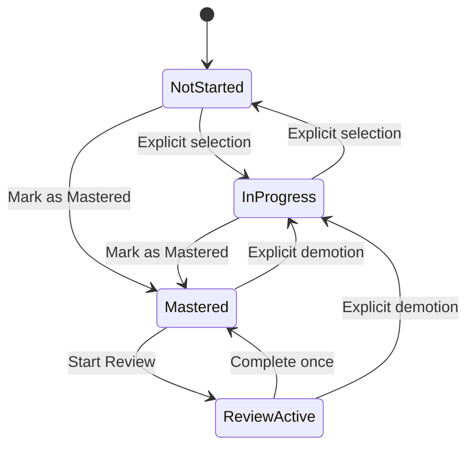
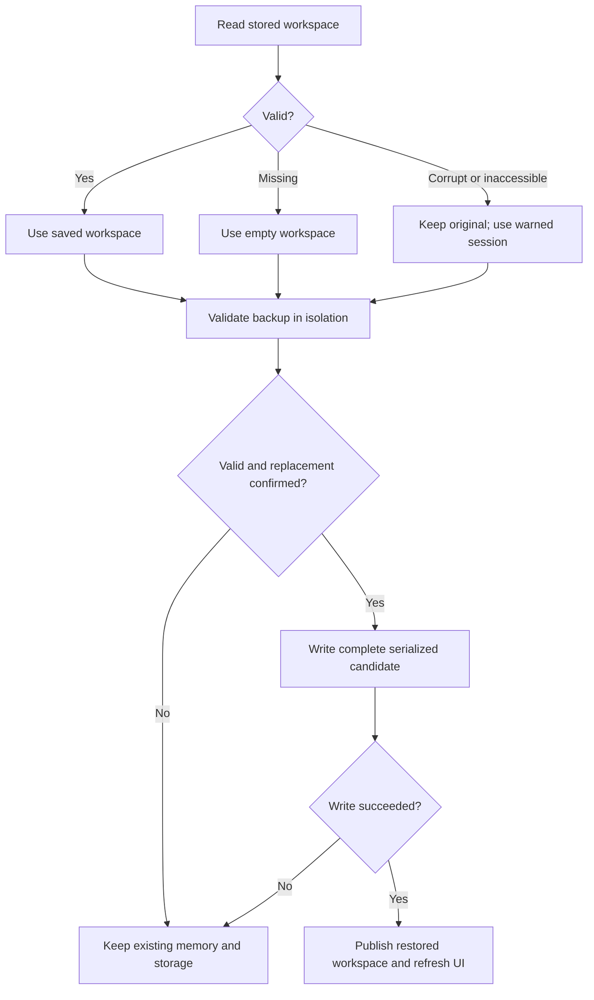

# Data Model: Static Learning Dashboard Shell

**Feature**: [spec.md](spec.md) | **Date**: 2026-11-17
**Contract**: [Progress state](contracts/progress-state.md) and [backup schema](contracts/progress-backup.schema.json).

## Catalog node (existing, read-only)

The canonical schema remains [Manifest v1](../001-backend-architecture/contracts/manifest.schema.json). The complete observed catalog is recorded in [manifest-audit.json](contracts/manifest-audit.json).

| Field | Type and rules |
| --- | --- |
| `schemaVersion` | Envelope integer, exactly 1. |
| `roots` | Ordered hub nodes; published catalogs require at least one. |
| `id` | Nonempty opaque whitespace-free string, globally unique and immutable. |
| `kind` | `hub` or `topic`; all roots are hubs. |
| `title` | Nonblank display string; duplicate titles under different parents are permitted. |
| `slug` | `^[a-z0-9]+(?:-[a-z0-9]+)*$`; sibling slugs must be unique. |
| `children` | Required nonempty ordered node array for hubs; forbidden for topics. |
| Extra metadata | Allowed; never discarded or written back by the shell. |

Runtime indexing creates `byId`, `byRoute`, preorder entries, ancestry, parent ID, display path, and descendant topic-ID sets. These are derived, never written to the manifest or progress backup. See [navigation contract](contracts/navigation-and-ui.md) for the explicit runtime-only empty-root sentinel.

## Topic learning record

A missing record is equivalent to Not Started, no visits, no confidence, and no review. Records are created lazily on a visit or explicit learning action.

| Field | Type | Meaning |
| --- | --- | --- |
| `status` | `not-started\|in-progress\|mastered` | Explicit learner selection; UI uses human-readable labels. |
| `lastVisitedAt` | UTC timestamp or null | Latest successful topic mount; hub visits do not create topic records. |
| `confidence` | Recall-key dictionary | Latest per-question rating records, including currently unmatched keys. |
| `review` | Review record or null | Latest mastery-cycle schedule and all retained review history. |

No title, route, parent, percentage, or materialized next-due date is persisted. Renaming or moving a manifest node retains its record through its permanent ID.

## Recall confidence

A topic's `confidence[recallKey]` contains `rating: hard|good|easy` and `ratedAt` (UTC). The authored `data-recall-id` is a stable kebab-case key, unique within its lesson. A rating neither changes topic status nor advances review scheduling. The latest rating replaces the prior rating; an unrequested per-card rating history is not stored.

## Review record and review events

| Field | Type | Meaning |
| --- | --- | --- |
| `cycle` | Positive integer | Latest mastery cycle, incremented on remastery after demotion. |
| `lastReviewed` | UTC timestamp | Time of the latest mastery/review event, matching the latest history entry. |
| `intervalIndex` | Integer 0–3 | Selects 3, 7, 14, or 30 elapsed days. |
| `history` | Nonempty ordered event array | All mastery and completed-review events across cycles. |
| `session` | Session or null | Latest explicitly started review, retained after completion for idempotency. |

A history event has `cycle`, `kind: mastered|review`, `sessionId`, `reviewedAt`, and `intervalIndex`. A mastery event has null `sessionId` and index 0. A review event has its unique session ID and the next index, capped at 3.

A session has `id`, `cycle`, `startedAt`, and nullable `completedAt`. Its ID is a newly generated UUIDv4 token, independent of the opaque catalog ID policy. Starting a review is explicit, not a route side effect. Completing the same session again is a no-op, even after reload.

A mastered topic requires a review record. Demotion retains that record/history and clears its session; it does not participate in the due queue. Remastery increments the cycle, appends an index-0 mastery event, resets the session, and retains earlier history.

## Workspace document

- localStorage key: `backend-lab.learning.v1`.
- Fields: `format: backend-lab.learning`, `version: 1`, `updatedAt`, `preferences`, `topics`.
- `preferences.theme` is `light`, `dark`, or null. Null follows the device setting; resolved device appearance is not persisted.
- `topics` is keyed by opaque immutable topic IDs, using safe own-key dictionary/Map handling.
- `updatedAt` is the timestamp of the most recent state mutation. Invalid or cancelled operations do not change it.
- Unknown topic IDs and unknown recall keys are retained verbatim as validated records; only current catalog topics/questions are shown.
- Sidebar expansion, search query, scroll position, loading state, and open-answer state are transient UI state and excluded from backups.

## Backup envelope

The export document contains `format: backend-lab.progress-backup`, `version: 1`, `exportedAt`, and `state` holding the complete workspace document. Export adds metadata without changing the workspace's `updatedAt`. The example [progress-backup.example.json](contracts/progress-backup.example.json) is design data, not a seeded production record.

The [JSON Schema](contracts/progress-backup.schema.json) checks structure. The semantic rules in [progress-state.md](contracts/progress-state.md) additionally validate review sequencing, identity uniqueness, timestamp validity, and current-history consistency. No runtime schema-library dependency is required.

## State transitions

| Action | Status effect | Review effect | Other effect |
| --- | --- | --- | --- |
| Open topic successfully | None | None | Update last visit. |
| Reveal/hide answer | None | None | Transient native disclosure only. |
| Rate question | None | None | Save latest rating/time. |
| Select In Progress / Not Started | Set explicitly | Retain history; clear session; exclude from due queue | Refresh rollups. |
| Mark Mastered from unfinished | Set Mastered | Begin next cycle at index 0 and current time | Refresh rollups and schedule. |
| Mark Mastered when already mastered | None | None | Idempotent no-op. |
| Start Review on mastered topic | None | Allocate explicit session; preserve unfinished session on repeated start | Show review-in-progress controls. |
| Complete active Review | None | Append exactly one event, advance index, update lastReviewed | Mark session completed. |
| Repeat completion token | None | None | Idempotent no-op. |
| Start Another Review | None | Allocate a new session only through explicit action | Allows an early review if desired. |
| Confirm valid import | Replace complete record | Restore exactly | Replace preferences and visits too. |

All status choices remain available; the diagram shows the primary transitions, not a restricted status selector.

## Derived learning views

- Mastery: `Math.round(100 * masteredLeaves / totalLeaves)`, with a 0% guard for zero leaves.
- Hub rollups: distinct current descendant topic IDs only; a hub is complete only when total > 0 and all descendants are mastered.
- Continue Learning: latest visited unfinished current topic; ties use manifest preorder. Fall back to the first unfinished topic. If all are mastered, choose earliest due, otherwise earliest scheduled review.
- Due instant: `Date.parse(lastReviewed) + [3,7,14,30][intervalIndex] * 86400000`, considered only for mastered current topics. Due means `dueInstant <= now`; ties use manifest preorder.
- Category cards: each root's immediate hub children, or that root when none are hubs. Current data therefore produces the Backend Architecture card (15 lessons); its overview supplies the four existing subcategory cards. No hidden hard-coded taxonomy is introduced.
- Navigation state is a known route plus an optional recognized section; it is never a progress identity.

## Persistence and import transaction

Ordinary edits may update the in-memory session when a save fails, while clearly reporting unsaved state and retaining export. Confirmed import has stronger all-or-nothing behavior: a storage failure leaves both the previous in-memory workspace and stored value unchanged.
