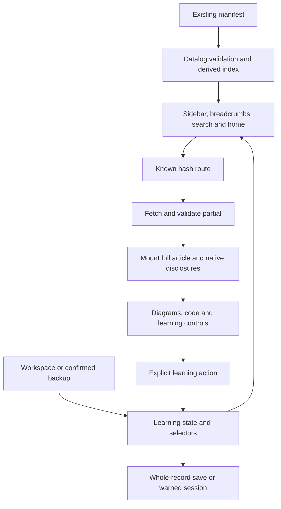

# Implementation Plan: Static Learning Dashboard Shell

**Branch**: `main` | **Date**: 2026-11-17 | **Spec**: [spec.md](spec.md)

**Input**: Feature specification from `specs/002-dashboard-shell/spec.md`

**Feature identity**: `002-dashboard-shell`. Setup reports this logical feature as BRANCH through the active feature pointer; `git branch --show-current` confirms the actual branch remains `main`. No branch hook is configured.

**Implementation status**: Completed on 2026-11-17. The planning-stage boundaries below are historical; see [acceptance summary](evidence/acceptance-summary.md) for executed results.

## Summary

Build a static documentation dashboard around the exact existing Manifest v1 and HTML partial contract. Deliver root `index.html`, committed `styles.css`, `app.js`, and `.nojekyll`, with native ES modules for catalog logic, learning state, and rendering. Hash links and application-directory-relative resources allow the same files to work at root and repository Pages paths.

Home derives progress, category cards, Continue Learning, and review queues from stable-ID local state. Recursive navigation and native-dialog search expose the catalog. The renderer preserves actual lesson classes and native recall/details elements, adds host controls in memory, and progressively renders pinned Mermaid and Highlight.js assets. Backups use a versioned, validated whole-workspace snapshot.

This plan stops after research/design. Application files, test harnesses, CSS compilation, browser acceptance, and deployment remain implementation work.

## Technical Context

**Language/Version**: HTML5, CSS, Vanilla JavaScript ES2020+ browser ES modules. Available Node 20.19.4 is for authoring/tests only; Python 3.10+ supports validation and planned browser scripts.

**Primary Dependencies**: Mermaid 12.3.0 browser ESM; Highlight.js 11.11.1 browser asset. Tailwind CSS 3.4.17 CLI is authoring-only and produces committed CSS. Native fetch, localStorage, details, dialog, and matchMedia; no application framework, fuzzy-search package, bundler, or required Node runtime.

**Storage**: One versioned `backend-lab.learning.v1` localStorage workspace keyed by immutable topic IDs and stable recall keys. Complete JSON backup envelope, schema, and semantic validation. The existing fixture has no progress to migrate.

**Testing**: Existing stdlib Python content validator and 39 tests; planned Node built-in tests for pure catalog/state/search logic; Python Playwright 1.56.0 browser acceptance aligned with available tooling; development-only jsonschema 4.25.1 for draft 2020-12 contracts; actual PDF text and visual inspection from both themes. No test dependency is deployed.

**Target Platform**: Current evergreen desktop/mobile browsers with native modal dialog and ES modules; HTTP(S) static hosting, including GitHub Pages root/repository paths. Keyboard and 360px mobile layout included; file URLs and offline cache excluded.

**Project Type**: Static single-page documentation/learning web application.

**Performance Goals**: Search results visible within 200ms in >=95% of 30 measured interactions on a documented device. Mount validated prose before optional enhancement downloads. Search/home use catalog metadata, not full-library HTML downloads.

**Constraints**: No deploy-time installation/build/server/rewrite or repository-name edits; relative local assets/hash routes; preserve permanent IDs and complete partials; no hard-coded depth limit; explicit statuses; 3/7/14/repeating-30-day reviews; 4.5:1 body-text contrast; real mobile/print behavior.

**Scale/Scope**: Current six hubs, 15 lessons, 22 diagrams, 153 details including 61 recall items, JSON/SQL code. Counts are baselines, not runtime constants. A six-level synthetic catalog verifies extensibility. Single-browser editing; no multi-tab reconciliation, accounts, remote sync, new lessons, or automatic publication.

## Constitution Check

*Gate evaluated before research and re-evaluated after Phase 1 against constitution v1.1.0.*

| Gate | Before research | After design |
| --- | --- | --- |
| I / III: Preserve ELI5-first full six-part learning stories | PASS: reuse full partials | PASS: no lesson summaries/rewrites; integration contract preserves structure and native details. |
| II: Visual-first recursive navigation and every-node progress | PASS: manifest-derived navigation | PASS: arbitrary-depth index/lists, leaf rollups, diagrams, six-level acceptance. |
| IV: Persistence, explicit status, reviews, confidence, backups | PASS: included in spec | PASS: data model, schema, and semantic/import contract cover transitions, replay, unknown IDs, and failures. |
| V: Lightweight stack, one manifest, stable IDs, mirrored paths | PASS: no backend/deploy build | PASS: authoring-only Tailwind, committed CSS, native modules, exact-schema audit, derived paths. |
| VI: Complete mobile/print delivery and reusable partials | PASS: existing hooks supported | PASS: shared CSS, native flashcards, drawer focus, print lifecycle/contrast, actual-shell PDFs. |
| Workflow: Taxonomy hygiene and identity preservation | PASS: no new content requested | PASS: existing manifest/schema/partials remain unchanged; audited IDs and future content-driven additions. |
| Governance: Planned behavior distinguished from evidence | PASS: planning scope | PASS: future commands/evidence labeled; fixture passes do not establish production-shell acceptance. |

No constitutional amendment or exception is required. The runtime-only empty-root initialization sentinel is a documented UI fallback, not a change to the published manifest schema.

## Project Structure

### Documentation (this feature)

```text
specs/002-dashboard-shell/
├── spec.md
├── plan.md
├── research.md
├── data-model.md
├── quickstart.md
├── checklists/requirements.md
├── contracts/
│   ├── manifest-audit.json
│   ├── content-integration.md
│   ├── navigation-and-ui.md
│   ├── progress-state.md
│   ├── progress-backup.schema.json
│   └── progress-backup.example.json
└── tasks.md                          # Next phase; not created by this plan
```

### Source Code (repository root)

These are planned implementation files; naming them here does not create them.

```text
index.html                           # Landmarks, header, sidebar mounts, canvas, dialogs
styles.css                           # Committed generated runtime stylesheet
app.js                               # Bootstrap, routing, UI composition and delegated actions
.nojekyll                            # Empty root file
tailwind.config.cjs                   # Optional maintainer CSS generation
assets/
├── styles/shell.css                  # Tailwind directives + semantic lesson styles
└── js/
    ├── catalog.js                    # Validation, recursive index, route parser, search
    ├── learning-state.js             # Transitions/selectors/validation + injected storage adapter
    └── content-renderer.js           # Envelope, progressive enhancements, theme, print
manifest.json                        # Existing; unchanged
topics/                              # Existing 21 partials; unchanged
tests/
├── content/                          # Existing validator tests/inventory
├── fixtures/content-host.*           # Existing test-only host
└── dashboard/
    ├── requirements.txt              # Development-only Python test pins
    ├── test_catalog.mjs
    ├── test_learning_state.mjs
    └── check_dashboard.py            # Actual-shell browser/PDF scenarios
tools/validate_content.py             # Existing validator; reused
```

**Structure Decision**: Keep the requested root entry files plus three focused native modules. Catalog/state cores have no DOM side effects and are testable independently. App UI owns one workspace; widgets do not create competing state stores. One renderer owns global library/print lifecycle. No runtime packaging is introduced.

## Phase 0 — Research Results

Completed [research.md](research.md) resolves exact manifest restrictions and the empty-root fallback; real partial selectors, question keys, nested diagrams and hub cards; deployment/hash grammar; pinned CSS/browser assets; review and backup semantics; search/dialog/focus/theme/print choices.

The [audit](contracts/manifest-audit.json) records hashes of the actual manifest, canonical schema, and complete inspected sample, plus all current IDs/targets. No research question remains unresolved.

## Phase 1 — Design

### Catalog and route boundary

Validate every canonical structural restriction plus ID/route uniqueness for normal catalogs. Build by-ID/by-route maps in preorder with ancestry and descendant leaf sets; preserve source metadata. Only the explicit empty-root initialization sentinel bypasses published root cardinality.

Validate raw hashes before URL normalization; allow only indexed routes and one recognized topic section query. Fetch only paths derived from the index, never arbitrary route text. Details are in [navigation-and-ui.md](contracts/navigation-and-ui.md).

### Composition and data flow

App owns one index, workspace snapshot, transient tree/overlay state, and navigation generation. Pure selectors derive progress/next actions; refresh affected widgets without replacing the lesson or destroying focus.



Move one sidebar DOM tree between desktop and modal drawer mounts. Use normal links/lists rather than an ARIA tree. Native dialogs provide modality; explicit handlers cover backdrop/Escape/resize and focus outcomes.

### Content and appearance boundary

[content-integration.md](contracts/content-integration.md) provides the concrete selector/CSS mapping. Restore article headings, lists, and table spacing after Tailwind Preflight. Supported semantic CSS must survive scanning, including currently unused `.kb-card`.

Mount complete prose before independent library loading. Serialize Mermaid jobs with route/theme generation checks and retryable dependency failures. Theme changes rebuild only diagram nodes, preserving disclosures/controls/focus. Print preparation/restoration are synchronous and idempotent, with SVG and foreignObject contrast overrides.

### Learning and restoration boundary

[data-model.md](data-model.md) defines records and derived views; [progress-state.md](contracts/progress-state.md) defines semantic invariants and import transactions. The [schema](contracts/progress-backup.schema.json) and [example](contracts/progress-backup.example.json) make the portable interface reviewable.

Confidence does not schedule reviews. Explicit Start Review creates a session; Complete Review consumes it once, retaining its token across reloads. Demotion retains history; remastery starts a fresh cycle. Import repaint must not generate a new visit and alter restored values.

## Implementation Sequence for Task Generation

1. Add deployable entries, CSS source/committed-output setup, and pure catalog/state boundaries.
2. Deliver known-route loading, recursive navigation, breadcrumbs, and complete partials with readable failures.
3. Add derived home/header progress, explicit status/confidence, review sessions/queue, persistence/recovery.
4. Add ranked keyboard search, responsive drawer/dialog behavior, theme rerendering, and safe backups.
5. Complete print handling and focused tests; run actual-shell acceptance at both bases and record evidence.

This is sequencing guidance. `$speckit-tasks` will generate implementation tasks; it has not run here.

## Validation and Acceptance Gates

| Coverage | Proof required during implementation |
| --- | --- |
| FR-001–005, FR-010/011 | All 21 hashes reload at both bases; 20 hub edges; breadcrumbs/history/sections; malformed routes, envelope/network failures, stale requests. |
| FR-006–009, FR-013 | 0/15, 3/15, 15/15 rollups; unknown/hub exclusion; Continue Learning cases; empty sentinel; six-level catalog. |
| FR-014/015 | Exact/path/case/one-edit matches, ranking, keyboard/focus, 30-interaction latency report. |
| FR-016–022 | Both themes, 22 diagrams, code, all 61 recall items, no duplicate controls; confidence/status persistence and relocation; corrupt/quota/dependency failures. |
| FR-023–026 | Due boundaries at -1ms/exact/+1ms; session replay; demotion/remastery; elapsed-day arithmetic; queue refresh. |
| FR-027–029 | Complete roundtrip including unknown records; invalid schema/history/version/calendar time; cancel and storage failure preserve state; no import-generated visit. |
| FR-012/030–033 | 360px/resizing, keyboard, contrast, reduced motion; 21 actual PDFs per theme with disclosure restoration. |
| FR-034 | Existing 39 tests and content validator pass; browser evidence from the actual shell rather than fixture only. |

[quickstart.md](quickstart.md) defines runnable future commands and expected outcomes. Tailwind's Node 20 CLI smoke check and the new browser harness remain implementation validation, not claimed passes.

Planning checks executed: canonical manifest/schema validation; unchanged manifest/schema/sample SHA-256 hashes; valid draft-2020-12 backup schema and populated example; six malformed-backup rejections including an invalid calendar date using an explicit UTC format checker; example review/due-date consistency; all 35 local documentation links; required plan headings and active feature pointer. The Node ESM test flag is supported. These checks validate the design artifacts, not application behavior. No before/after planning extension hooks are configured.

## Complexity Tracking

No constitutional violations require justification. Three native modules isolate catalog, learning, and rendering; authoring/test tooling never becomes a deployment dependency.
