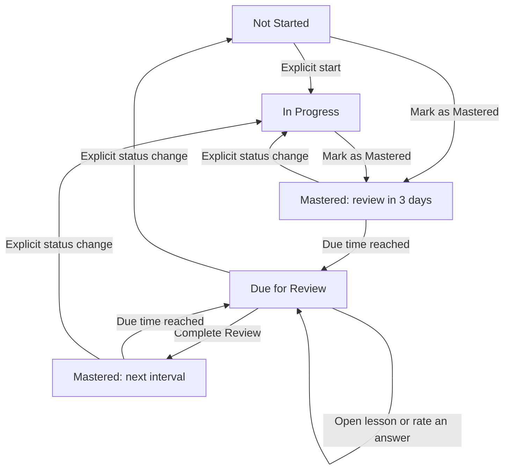

# Feature Specification: Static Learning Dashboard Shell

**Feature Branch**: `main` (no branch hook configured; feature identity is `002-dashboard-shell`)

**Created**: 2026-11-17

**Status**: Implemented — all dashboard tasks and acceptance gates passed on 2026-11-17

**Input**: User description: "Build the main static dashboard shell (index.html, styles.css, app.js) that integrates with our existing manifest.json and /topics/ HTML partials, ready for zero-config GitHub Pages deployment." Include relative resource paths, hash routing, a learning dashboard, recursive responsive navigation, search and header controls, and complete partial rendering and learning interactions.

## User Scenarios & Testing *(mandatory)*

### User Story 1 - Open and navigate the knowledge base anywhere it is hosted (Priority: P1)

As a learner, I can open a shared lesson link, browse its ancestors and sibling topics, and refresh or revisit it without losing my place or seeing a hosting error.

**Why this priority**: Every lesson and learning control depends on reliable access to the existing content, including deployment under a repository path.

**Independent Test**: Serve the site at both a domain root and a repository-style subdirectory. Open and refresh each existing hub and lesson, follow breadcrumbs and child links, and use browser back/forward. This delivers a usable reading and navigation experience without requiring progress data.

**Acceptance Scenarios**:

1. **Given** either hosting location, **When** I open or refresh a valid topic hash directly, **Then** the matching full lesson loads, its breadcrumb and sidebar selection agree, and all content requests stay inside that hosting location.
2. **Given** the existing manifest, **When** I expand its tree or select a hub, **Then** all ordered descendants are accessible, each hub opens its overview, and expanding a branch does not navigate away.
3. **Given** a loaded lesson, **When** I follow a section link or navigate back/forward, **Then** the correct lesson and requested section appear without a full-page reload.
4. **Given** an unknown route or section, **When** navigation occurs, **Then** a clear error identifies the problem and offers a working route home; unrelated lesson content is not presented as the requested page.
5. **Given** a future valid manifest with six nested levels, **When** I browse it, **Then** all levels work without a shell code change.

---

### User Story 2 - Understand progress and choose the next learning action (Priority: P1)

As a learner, I can open a home dashboard that shows what I have mastered, where I am working, and the most useful place to continue.

**Why this priority**: A home view makes the knowledge base a personal learning workspace and gives immediate direction.

**Independent Test**: Load home with empty and seeded progress records and compare global, category, and sidebar figures with the topic statuses. This delivers an accurate overview independently of search and backup controls.

**Acceptance Scenarios**:

1. **Given** no prior learning state and no selected content hash, **When** I open home, **Then** I see 0% mastered, category cards derived from the manifest, a first-lesson learning action, and a friendly empty review queue.
2. **Given** three mastered lessons out of the current fifteen, **When** I view home or any lesson, **Then** global mastery is 20%, category cards and hub badges reflect only their descendant lessons, and overview pages do not increase the denominator.
3. **Given** a previously visited unfinished lesson, **When** I use Continue Learning, **Then** I return to the most recently visited unfinished lesson; if none exists, the first unfinished lesson in manifest order is offered.
4. **Given** every lesson is mastered, **When** I open home, **Then** it celebrates completion and offers the earliest due review, or the next scheduled review when nothing is due.
5. **Given** a valid empty catalog, **When** I open home, **Then** it shows an empty-library explanation and 0% mastery without broken links or invalid percentages.

---

### User Story 3 - Read complete lessons and practice recall (Priority: P1)

As a learner, I can read a complete, visually clear lesson, inspect diagrams and code, reveal answers, rate my confidence, and explicitly record my progress.

**Why this priority**: Rendering and self-testing turn the existing content collection into a working learning product.

**Independent Test**: Open all existing partials and exercise their diagrams, code, disclosures, and host-provided controls. Change status and confidence, then reload to verify that the learning record survives.

**Acceptance Scenarios**:

1. **Given** any existing lesson or hub, **When** it loads, **Then** its complete article appears with rendered diagrams, highlighted code where present, and shared readable styling, without editing the partial.
2. **Given** a lesson with hidden recall answers, **When** I reveal and hide an answer using a pointer or keyboard, **Then** only that answer changes visibility; I can record Hard, Good, or Easy for that question and see the rating after reloading.
3. **Given** a Not Started lesson, **When** I only read it or reveal answers, **Then** it remains Not Started; when I explicitly select In Progress or Mark as Mastered, all progress displays update consistently.
4. **Given** a lesson, **When** I reach its bottom, **Then** an accessible Mark as Mastered action is present, or an explicit already-mastered state with review and status-change actions.
5. **Given** a diagram or highlighting dependency cannot load, **When** I open a lesson, **Then** the complete prose and native disclosures remain usable, an enhancement error is visible with a retry action, and unavailable rendering is not reported as successful.
6. **Given** two rapidly selected lessons, **When** the earlier request finishes last, **Then** the canvas, controls, and breadcrumbs still belong to my latest selection.

---

### User Story 4 - Return at the right time for review (Priority: P2)

As a learner, I can see which mastered topics need refreshing and explicitly complete a review without confusing reading, confidence, and mastery.

**Why this priority**: Scheduled revisits support retention after the initial learning journey.

**Independent Test**: Seed mastered topics around each review boundary, advance the reference time, and complete reviews. Confirm the queue, next due dates, and stored review history.

**Acceptance Scenarios**:

1. **Given** a topic is first marked Mastered at time T, **When** I view home before T plus 3 days, **Then** it is scheduled but not due; at or after that instant it appears in Due for Review.
2. **Given** successive explicit completed reviews, **When** each completion is recorded, **Then** the next interval after that completion is 7, then 14, then 30 days, with later completions continuing at 30 days.
3. **Given** a due topic, **When** I open it or rate an individual answer, **Then** its due status remains until I explicitly complete the topic review.
4. **Given** a mastered topic, **When** I complete its review, **Then** its review timestamp and schedule update and it leaves the due queue immediately; its mastery remains unchanged.
5. **Given** a topic is changed back to In Progress or Not Started, **When** the dashboard updates, **Then** it leaves the review queue and its mastery contribution is removed.

---

### User Story 5 - Find a lesson quickly (Priority: P2)

As a learner, I can find content by remembered words or small typing mistakes without knowing its location in the tree.

**Why this priority**: Search keeps a growing recursive library easy to use.

**Independent Test**: Open search by mouse and both keyboard shortcuts, search known titles and ancestor paths with case changes and minor errors, and navigate the results by keyboard.

**Acceptance Scenarios**:

1. **Given** any view, **When** I press Cmd+K or Ctrl+K or use the search control, **Then** search opens with focus in its input.
2. **Given** the current catalog, **When** I search a title, an ancestor-path phrase, or a one-character title typo, **Then** relevant lessons or hubs appear with their full path and content type; exact title matches rank ahead of fuzzy matches.
3. **Given** search results, **When** I use arrow keys and Enter, **Then** the selected result opens; Escape or dismissal closes search and restores focus to its opener.
4. **Given** an empty query or no matches, **When** the results update, **Then** the catalog is offered in manifest order or a clear no-results message appears, respectively.

---

### User Story 6 - Keep a comfortable and portable learning workspace (Priority: P2)

As a learner, I can use the same content on mobile, choose a theme, print complete lessons, and back up or restore my learning record.

**Why this priority**: Comfort, accessibility, and recoverable local progress make the workspace dependable over time.

**Independent Test**: Use the shell at narrow and wide viewports with keyboard input, switch themes, print a collapsed lesson, and export then restore a populated learning record.

**Acceptance Scenarios**:

1. **Given** a 360-pixel-wide viewport, **When** I open navigation, select a deeply nested lesson, and close the drawer, **Then** all navigation is reachable, focus returns sensibly, the active ancestors are expanded, and page-wide horizontal scrolling is unnecessary.
2. **Given** either theme, **When** I switch themes and reload, **Then** my choice persists and lesson text, diagrams, code, semantic cards, and controls remain readable.
3. **Given** learning progress, review history, confidence ratings, and preferences, **When** I export and restore that backup in a fresh browser profile, **Then** those values and Continue Learning behavior are reproduced.
4. **Given** an invalid, unsupported, or cancelled import, **When** restoration ends, **Then** my existing record is unchanged and the outcome is clearly stated.
5. **Given** a lesson with closed mechanics and answers, **When** I print from either theme, **Then** the output contains every explanation and answer with readable diagrams and tables, omits navigation controls, and restores disclosure states after printing.
6. **Given** local persistence is unavailable or full, **When** I change progress, **Then** the session remains usable, I see that changes are not saved, and I can still export the current session record.

### Edge Cases

- A missing, unreadable, unsupported, or structurally invalid manifest produces an actionable catalog error; a valid empty manifest produces the empty-library view.
- A topic partial is missing, has a mismatched node identity, or fails to load. The shell exposes the failure and retry/home navigation rather than retaining a stale article as if it succeeded.
- A route contains a trailing slash, malformed encoding, an extra query, or an unknown section. Unsupported forms show a route error; they do not become arbitrary resource requests.
- A saved topic is renamed or moved with its immutable ID retained. Progress, review history, and per-question confidence remain attached to it.
- A backup contains records for topics or recall questions absent from the current catalog. Preserve those records for a future matching catalog, exclude them from current rollups, and report their presence during import.
- Two nodes have the same display title under different parents. Their paths distinguish search results and their immutable IDs distinguish progress.
- A hub has no descendant lessons. It shows 0% and no completed state rather than dividing by zero or claiming mastery.
- A lesson stays open across a due-time boundary. The queue is recalculated on returning home and when the page regains focus, without requiring a reload.
- Repeated mastery clicks, repeated review submission for the same review session, or repeated route rendering must not duplicate controls or advance the review schedule twice.
- Search or the mobile drawer is dismissed while a route changes. Focus remains on a meaningful visible control or content heading.
- Reduced-motion preferences, long titles, wide tables, unavailable web fonts, and failed optional rendering assets must not block reading or navigation.

## Requirements *(mandatory)*

### Functional Requirements

#### Hosting and existing-content integration

- **FR-001**: The deliverable MUST provide root-level `index.html`, `styles.css`, `app.js`, and `.nojekyll` as a static shell that runs without an application server, package installation, build command, or deployment-specific source edits. It MUST follow the lightweight stack constraints in constitution v1.1.0.
- **FR-002**: Application-owned resource references MUST use relative paths, including `./manifest.json` and derived `./topics/...` requests. Content navigation MUST use URL hashes such as `#/system-design/backend-architecture/...`. Direct links, reloads, and back/forward MUST work at both a domain root and a repository subdirectory. Explicit HTTPS third-party library/font assets are permitted by the constitution.
- **FR-003**: The shell MUST use the current manifest as its sole catalog source, preserving its immutable IDs, ordered recursive children, titles, and slugs. A topic resolves to its mirrored `.html` partial and a hub to its `_overview.html` partial. Future valid content additions MUST require no shell edits.
- **FR-004**: The shell MUST preserve the existing [content and host contract](../001-backend-architecture/contracts/content-contract.md), including article identity, shared semantic classes, native disclosures, stable recall keys, and recognized `?section=<key>` hash links. All 15 lessons and six hubs MUST work without rewriting their content or IDs.
- **FR-005**: Navigation MUST load only the selected article into the canvas without a full-page reload. It MUST expose loading, success, missing-content, invalid-route, and retry states; only the latest navigation may update the visible article and its context. Invalid catalog structure MUST block catalog-derived navigation with an explanatory error.

#### Home and navigation

- **FR-006**: An empty hash, `#`, or `#/` MUST show the Learning Dashboard. A persistent home control and the first breadcrumb MUST return there.
- **FR-007**: Home MUST show global mastery, mastered/total lesson counts, category progress cards, Continue Learning, and Due for Review. Cards MUST derive from each root's immediate hub children, using a root card when it has no hub children; root-level lessons MUST remain reachable. Cards MUST show their path, progress, and a working link.
- **FR-008**: Continue Learning MUST choose the most recently visited unfinished lesson, falling back to the first unfinished lesson in manifest order. Visits to hubs MUST NOT displace that lesson. When all lessons are mastered, offer the earliest due review, otherwise the next scheduled review; a valid empty catalog MUST have an explanatory empty state.
- **FR-009**: Global mastery MUST equal mastered current topic leaves divided by all current topic leaves, expressed as a nearest-whole-number percentage with mastered/total counts available. Hub progress MUST use distinct descendant topic leaves only. Unknown saved IDs and hub pages MUST NOT count; zero-topic collections MUST show 0%.
- **FR-010**: The sidebar MUST render every manifest depth recursively in manifest order, with independent branch expand/collapse controls, link targets, active-node highlighting, and status/progress indicators on every node. Selecting a route MUST reveal its ancestors; topic badges MUST show the three learning statuses and hub badges MUST aggregate descendants.
- **FR-011**: Breadcrumbs MUST follow the selected node's full ancestry with working home and ancestor links. The current node MUST be distinguished from navigable ancestors. Home, errors, and loading MUST have truthful context.
- **FR-012**: On mobile, the sidebar MUST become a drawer with an accessible opener, close action, overlay dismissal, Escape dismissal, and managed focus. Selecting a destination MUST close it. Navigation and header controls MUST remain reachable at 360-pixel viewport width.

#### Header and discovery

- **FR-013**: The header MUST expose breadcrumbs, search, a labeled global mastery bar, theme switching, and JSON Progress Export/Import. The progress bar, dashboard, category cards, and sidebar MUST update from the same learning record.
- **FR-014**: Search MUST cover all current lesson and hub titles and full ancestor paths, ignore case, and tolerate single-character insertion, deletion, or substitution in title queries of at least four characters. Exact-title results MUST rank first, followed by exact word/path matches and fuzzy matches; equal-ranked results MUST follow manifest order.
- **FR-015**: Search MUST open from its visible control or Cmd/Ctrl+K, show title/path/type for each result, support arrow-key selection and Enter activation, and close with Escape or dismissal with focus restored. An empty query MUST list the catalog in manifest order; no matches MUST have a visible empty state.
- **FR-016**: Users MUST be able to select light or dark theme; an explicit choice MUST persist. Before a choice is saved, the device preference MUST apply, with light as the fallback. The theme MUST cover application chrome, diagrams, code, and all shared content classes without altering learning data.

#### Rendering and learning state

- **FR-017**: After every partial change, the shell MUST render each Mermaid diagram and highlight applicable code with Highlight.js, excluding diagrams from code highlighting. Theme changes MUST rerender diagrams from their original source. No repeated mount or theme change may duplicate diagrams, learning controls, or event effects.
- **FR-018**: A failed enhancement MUST leave complete prose, diagram source where rendering failed, plain code, and native disclosures accessible, with a visible failure and retry action. The shell MUST NOT describe an unrendered diagram as successfully rendered.
- **FR-019**: Every lesson MUST offer explicit Not Started, In Progress, and Mastered status choices and a bottom-of-lesson Mark as Mastered action. Already-mastered lessons MUST expose their status, review completion, and a way to change status. Merely viewing content or revealing answers MUST NOT change status.
- **FR-020**: Each existing recall disclosure MUST remain independently keyboard-operable and initially hide its answer on lesson mount. The shell MUST add accessible Hard, Good, and Easy confidence choices per question, retaining the latest selected confidence by immutable topic ID and stable recall key. Confidence MUST NOT imply mastery or complete a topic review.
- **FR-021**: Learning state MUST persist in localStorage and survive reloads. It MUST associate status, visit history, review history/schedule, and recall confidence with immutable topic IDs, preserving that data across title, slug, or parent changes. A successful save and an unsaved session MUST be distinguishable.
- **FR-022**: If stored data is corrupt or unavailable, the shell MUST explain the condition without silently overwriting recoverable data, allow reading and in-session learning, and offer export of the current session. An explicit valid import may restore persistence when available.

#### Review scheduling

- **FR-023**: The first explicit transition to Mastered in a mastery cycle MUST record `lastReviewed` and schedule a review after 3 days. Explicit review completions MUST schedule 7, 14, then 30 days after their completion; later reviews MUST repeat at 30 days. Marking an already-mastered topic as mastered again MUST NOT reset its schedule.
- **FR-024**: Due for Review MUST include only current mastered lessons whose next review instant is at or before the current time, ordered by earliest due instant and then manifest order. It MUST show a working topic link and due information, and a clear empty state when nothing is due. It MUST refresh on entering home, regaining page focus, and changing relevant learning state.
- **FR-025**: A due lesson MUST provide an explicit Complete Review action distinct from answer ratings and status selection. Completing a review MUST update `lastReviewed`, advance its interval once, and refresh the queue. The same review-session action MUST be idempotent; starting another review session MUST be explicit.
- **FR-026**: Changing a topic away from Mastered MUST exclude it from the queue while retaining historical review data. Marking it Mastered later MUST begin a fresh 3-day schedule. Schedule arithmetic MUST use elapsed 24-hour days and absolute timestamps, so timezone changes do not change the scheduled instant.

#### Backup and recovery

- **FR-027**: Export MUST download a versioned JSON backup containing the complete learning record: topic statuses, visit/continue state, review timestamps and interval position, question confidence, and explicit theme preference. It MUST work without a backend and include a backup creation timestamp.
- **FR-028**: Import MUST validate the whole backup before applying changes, including supported version, record shape, allowed statuses/confidence values, timestamps, and review consistency. Invalid, unsupported, or cancelled imports MUST leave current state unchanged. The user MUST see a summary of matched and unmatched records and confirm replacement before a valid import is applied.
- **FR-029**: A confirmed valid import MUST replace the saved learning record as one complete restoration and immediately refresh all views and preferences. Records absent from the current catalog MUST be retained for later matching IDs and excluded from current progress. Export followed by import MUST preserve the values in FR-027.

#### Presentation, accessibility, and print

- **FR-030**: The shell MUST implement the constitutional documentation-dashboard presentation: wide-margin reading canvas, responsive cards, warm-neutral light background, readable dark theme, semantic blue/yellow/green/pink callouts, the specified sans-serif and monospace font families with fallbacks, and smooth section navigation respecting reduced-motion preference.
- **FR-031**: All navigation, search, status, rating, theme, import/export, and drawer controls MUST be keyboard-accessible, visibly focused, and programmatically labeled. Status MUST not rely on color alone. Search and drawer focus MUST remain within the active overlay until it closes, and route changes MUST announce their outcome and give access to the main content heading.
- **FR-032**: Tables and diagrams MUST remain readable without page-wide horizontal overflow at 360 pixels; localized scrolling is acceptable. Standard body text MUST maintain at least 4.5:1 contrast in both themes.
- **FR-033**: Printing from either theme MUST include the complete selected article, open mechanics and recall answers, preserve legible diagram labels and code/tables, and hide application controls. On leaving print, the previous disclosure states MUST be restored.
- **FR-034**: Delivery verification MUST exercise the actual dashboard against all 21 existing partials, not solely the test fixture. It MUST cover deployment at both base paths, navigation and rendering, progress/review persistence, confidence, backups, search, themes, mobile, keyboard, and real print/PDF output. Existing content validation MUST continue to pass.

### Key Entities *(include if feature involves data)*

- **Catalog node**: An existing immutable ID, kind (hub or topic), title, kebab-case slug, and ordered children for hubs. Ancestry determines the route, partial location, breadcrumbs, and display path.
- **Topic learning record**: A stable topic identity with explicit status, last visit, mastery-cycle review information, and retained review history. Only current topic leaves participate in displayed progress.
- **Recall confidence record**: A stable question key within a stable topic identity, carrying the latest Hard/Good/Easy rating.
- **Review schedule**: A mastered topic's last reviewed instant and interval position, determining its next due instant using 3, 7, 14, and repeating 30-day intervals.
- **Workspace preferences**: Explicit theme selection and sufficient visit information to reproduce Continue Learning.
- **Progress backup**: A versioned, timestamped portable snapshot of the complete learning record and preferences, including temporarily unmatched identities.
- **Navigation context**: The current home or catalog route and optional recognized lesson section; it identifies displayed content without replacing permanent learning identities.

The learning workflow keeps browsing, explicit progress, and review separate:

The diagram illustrates the main learning actions; all explicit status choices remain available as required by FR-019, including transitions not drawn.

## Success Criteria *(mandatory)*

### Measurable Outcomes

- **SC-001**: A learner can directly open and refresh all 21 existing content destinations at both a site root and a repository subdirectory, with 100% showing the correct complete article and no application-content not-found errors.
- **SC-002**: Every current lesson and hub is reachable through the sidebar and breadcrumbs; a six-level sample catalog remains fully navigable. All 20 existing hub-to-child links open the intended destination.
- **SC-003**: Empty, partly completed, and fully mastered learning records produce exact counts and correctly rounded percentages everywhere. The three-of-fifteen case displays 20%; saving and reloading changes none of those values.
- **SC-004**: All 22 current diagrams render, every existing code block remains readable with applicable highlighting, and all 61 recall answers can be revealed independently by keyboard. Saved confidence choices survive navigation, reload, and topic relocation with the same identity.
- **SC-005**: At each 3-, 7-, 14-, and 30-day boundary, a topic is absent immediately before its due instant and present at that instant. Explicit review completion removes it and sets the correct next interval; opening or rating a question never postpones it.
- **SC-006**: Exact-title, ancestor-path, and one-character-typo searches find their intended current destinations; exact-title matches appear first. For the current catalog, results visibly update within 200 milliseconds of the final keystroke in at least 95% of 30 local search interactions on a documented reference device.
- **SC-007**: Exporting and restoring a populated record in a fresh browser reproduces 100% of saved statuses, visits, review values, ratings, and explicit preferences. Each invalid, unsupported, or cancelled import leaves the original record unchanged.
- **SC-008**: A learner can navigate, search, rate an answer, change status, switch theme, and export progress using only a keyboard. At 360-pixel width all these controls remain reachable without page-wide horizontal scrolling.
- **SC-009**: Every existing article prints from both themes with all prose and hidden answers present, readable diagrams and comparisons, and no obstructive application chrome; after printing, its disclosure states match their pre-print state.
- **SC-010**: Missing content, invalid catalog data, blocked persistence, failed enhancement assets, and rapid competing selections each produce the specified recoverable state with no false loading/saving claim or stale article presented as the active destination.

## Assumptions

- This is the shell for the existing catalog, not a new lesson batch. The starting inventory is 15 lessons, six hubs, 22 diagrams, and 61 recall questions. These numbers are acceptance baselines, not limits or hard-coded UI values.
- Constitution v1.1.0 and the existing manifest/content contracts are dependencies. The root files and library choices explicitly named by the user or constitution are delivery constraints; detailed implementation design belongs in the subsequent plan.
- “Personalized” means this browser's learning history and preferences. There are no accounts, login, server persistence, cross-device synchronization, or required learner name.
- “Zero-config GitHub Pages” means the same committed static files work at root or repository paths without a build, route rewrite, or base-path edits. Enabling hosting in repository settings is an external prerequisite; publishing or changing those settings is outside this specification.
- An HTTP(S) static host is available. Opening local files through a file URL and offline caching are not acceptance targets. External libraries and fonts may require connectivity; reading degrades as specified when optional enhancements fail.
- Progress begins with all current lessons Not Started. Opening a lesson records a visit but never changes status. Continue Learning breaks equal visit times using manifest order.
- Confidence is a per-question learning record. It does not automatically alter the topic review schedule; explicit topic review completion advances that schedule. Completing an early review is permitted and schedules the next interval from that completion instant.
- Review history is retained across explicit demotion, while remastery starts a new schedule. Import replaces the full record only after a preview and confirmation, making the restoration policy predictable.
- Only one browser tab is the authoritative editing session for this release; concurrent-tab conflict resolution is outside scope. The backup format must still preserve unknown IDs for future catalog growth.
- “Instant” search is measured after catalog data is available, without requiring a content-page download. A documented device/browser and local measurement isolate interaction responsiveness from external network availability.
- Branch creation was not requested and no extension hook is configured. This specification is identified by its feature directory; the working Git branch remains `main`.
