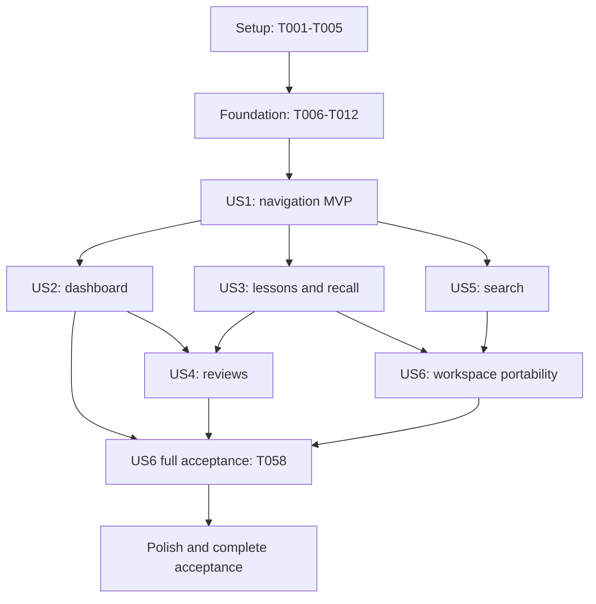

# Tasks: Static Learning Dashboard Shell

**Input**: Design documents in `specs/002-dashboard-shell/`

**Prerequisites**: [plan.md](plan.md), [spec.md](spec.md), [research.md](research.md), [data-model.md](data-model.md), [contracts](contracts/navigation-and-ui.md), and [quickstart.md](quickstart.md). Governed by constitution v1.1.0.

**Tests**: Included because FR-034 explicitly requires actual-dashboard delivery verification and SC-001–SC-010 define acceptance. The approved plan assigns focused Node tests and browser/PDF checks. Tests target behavioral boundaries, persistence/recovery, and real interactions; there are no implementation-mirroring tests for trivial markup or CSS edits.

**Organization**: Six user-story phases preserve the spec's P1/P2 ordering. Setup/foundational tasks are shared prerequisites; final tasks verify the integrated delivery. All 63 tasks are completed and checked after implementation acceptance. Existing lessons, manifest IDs, and the canonical published schema are read-only inputs; there is no lesson-writing or taxonomy-editing work in this feature.

## Format: `[ID] [P?] [Story] Description`

- `[P]` identifies a task with a different file set that can share an execution window once its listed dependencies are complete. It does not authorize starting through an incomplete dependency.
- `[US1]`–`[US6]` map directly to the six stories in the spec. Shared and polish tasks have no story label.
- Every task names exact repository-relative files and explicit dependencies. Repeated files require sequential ownership even across logically independent stories.
- Write story tests before its implementation and establish their intended missing-behavior failure; missing browser tooling is an environment gap, not a passing or meaningful behavioral test.
- Implement complete behavior; do not substitute placeholders, truncate source lessons, or treat a checkpoint as permission to leave the requested full scope unfinished.

## Path Conventions

Runtime entries are `index.html`, `styles.css`, `app.js`, `.nojekyll`; focused modules are under `assets/js/`; authored CSS is `assets/styles/shell.css`. Browser/unit checks live under `tests/dashboard/`. Evidence summaries live under `specs/002-dashboard-shell/evidence/`; generated PDFs and bulk screenshots remain outside the source tree.

Task commands use the checked-in [quickstart](quickstart.md). T004 adds an optional `--story US1..US6` selector for incremental runs, retaining the planned full-run interface when omitted. Update the guide with that verified interface in T062.

## Phase 1: Setup (Shared Infrastructure)

**Goal**: Create the static entry structure, authoring-only CSS pipeline, immutable input baseline, and development test runner. No package/build step is required by the deployed site.

- [X] T001 Verify the existing manifest, canonical schema, and inspected Clean Architecture partial against `specs/002-dashboard-shell/contracts/manifest-audit.json`; capture all 21 partial hashes and immutable node IDs in `specs/002-dashboard-shell/evidence/content-baseline.json` without modifying `manifest.json` or lesson files. (FR-003, FR-004, FR-034.)

- [X] T002 [P] Create root `index.html` and empty `.nojekyll` with `./styles.css` and module `./app.js` references, one header/nav/main, skip link, live status/persistence regions, home link, labeled header controls, desktop/sidebar drawer mounts, and native search/import/drawer dialogs; include readable noscript guidance and no origin-root asset paths. (Depends on T001; FR-001, FR-002, FR-011, FR-013, FR-031.)

- [X] T003 [P] Create `tailwind.config.cjs` and `assets/styles/shell.css` for authoring-only Tailwind 3.4.17, scanning `index.html`, `app.js`, `assets/js/**/*.js`, and `topics/**/*.html`; establish constitutional light/dark tokens, Inter/JetBrains Mono fallbacks, frame/card primitives, focus styling, and reduced-motion behavior, keeping persistent semantic CSS outside removable layers. (Depends on T001; FR-001, FR-030, FR-032.)

- [X] T004 [P] Create development pins in `tests/dashboard/requirements.txt` (Playwright 1.56.0, jsonschema 4.25.1) and the runnable `tests/dashboard/check_dashboard.py` harness shell with required `--base-url`, `--project-url`, `--report`, optional `--pdf-dir`, and optional `--story US1..US6` filtering; register scenario groups, record environment/errors, and make failures or unexecuted required gates explicit rather than passing them. (Depends on T001; FR-034.)

- [X] T005 Generate root `styles.css` from `assets/styles/shell.css` using the exact pinned Tailwind CLI command in `specs/002-dashboard-shell/quickstart.md`, smoke-check it on Node 20.19.4, and verify browsing/deployment uses committed CSS without invoking npm or a build. (Depends on T002, T003; FR-001, FR-030.)

**Checkpoint**: Entry markup and committed CSS exist; canonical input files remain unchanged. Story controls are completed in their owning phases.

---

## Phase 2: Foundational (Blocking Prerequisites)

**Goal**: Establish catalog identity/indexing, the complete shared workspace validation/storage boundary, and one application owner before story work.

### Tests first

- [X] T006 [P] Add failing canonical-catalog tests in `tests/dashboard/test_catalog.mjs` for the exact existing schema, metadata/order preservation, duplicate IDs/routes, invalid root/child shapes, opaque legacy IDs, explicit runtime-only empty roots, derived relative resources, and six-level indexing; use `specs/002-dashboard-shell/contracts/manifest-audit.json` as the identity baseline. (Depends on T005; FR-003, FR-004, FR-005, FR-010.)

- [X] T007 [P] Add failing workspace/persistence tests in `tests/dashboard/test_learning_state.mjs` against the backup schema/example and semantic contract: defaults, safe opaque-key handling, status/confidence enums, nullability, invalid calendar timestamps, review consistency, corruption, and throwing/quota storage; inject clock/storage instead of using real browser state. (Depends on T005; FR-009, FR-021, FR-022, FR-028, FR-029.)

### Implementation and acceptance

- [X] T008 [P] Implement DOM-free canonical validation and recursive indexing in `assets/js/catalog.js`: schemaVersion is “Envelope integer, exactly 1.”; roots are “Ordered hub nodes; published catalogs require at least one.”; id is “Nonempty opaque whitespace-free string, globally unique and immutable.”; kind is `hub` or `topic` with hub-only roots; title is “Nonblank display string; duplicate titles under different parents are permitted.”; slug matches `^[a-z0-9]+(?:-[a-z0-9]+)*$`; children are “Required nonempty ordered node array for hubs; forbidden for topics.” Preserve extra metadata; derive preorder/ancestry/ID-route maps/leaf sets and `./topics/...` targets; tolerate only the documented runtime empty-root sentinel as a cardinality exception. (Depends on T006, T007; FR-003, FR-004, FR-010.)

- [X] T009 [P] Implement workspace/default-record shape validation and current-leaf mastery selectors in `assets/js/learning-state.js`: format `backend-lab.learning`, version 1, immutable-ID keyed topics, status enum `not-started|in-progress|mastered`, lastVisitedAt “UTC timestamp or null”, confidence “Recall-key dictionary”, review “Review record or null”, and preferences.theme `light`, `dark`, or null. Enforce canonical UTC timestamps in “YYYY-MM-DDTHH:mm:ss.sssZ” form, safe own-key dictionaries, schema-required fields/no extra structural properties, unknown-record retention, lazy defaults, nearest-whole percentages, and zero-leaf guards; “A missing record is equivalent to Not Started, no visits, no confidence, and no review.” Do not persist routes or rollups. (Depends on T006, T007; FR-009, FR-019, FR-021, FR-028.)

- [X] T010 Complete review/history/session semantic validation in `assets/js/learning-state.js`: cycle “Positive integer”, lastReviewed “UTC timestamp” matching the latest event, intervalIndex “Integer 0–3”, history “Nonempty ordered event array”, and session “Session or null”. Enforce `kind: mastered|review`, null mastery sessionId/index 0, unique UUIDv4 review-session tokens, cycle/index progression, required startedAt and nullable completedAt, matching completion events, and “A mastered topic requires a review record.” Apply every rule in `specs/002-dashboard-shell/contracts/progress-state.md`, including valid unmatched records and real calendar timestamps. (Depends on T009; FR-021, FR-023, FR-025, FR-026, FR-028.)

- [X] T011 Implement the injected whole-document localStorage adapter and visit mutation in `assets/js/learning-state.js` using key `backend-lab.learning.v1`; updatedAt is “the timestamp of the most recent state mutation” and “Invalid or cancelled operations do not change it.” Record only successful fresh topic visits without status changes; preserve corrupt/unsupported raw storage and block automatic writes, retain ordinary failed-save edits in a clearly unsaved session, and expose truthful persistence state for later export/import UI. (Depends on T010; FR-021, FR-022.)

- [X] T012 Create root `app.js` bootstrap around the completed catalog/state APIs, computing the app base with `new URL('./', import.meta.url)` and fetching `./manifest.json`; keep one workspace snapshot, root UI ownership and navigation generation, and implement loading/catalog-error/Retry/persistence notices before adding story views. Run the foundational tests in `tests/dashboard/test_catalog.mjs` and `tests/dashboard/test_learning_state.mjs` until these shared invariants pass. (Depends on T008, T011; FR-002, FR-005, FR-021, FR-022.)

**Checkpoint**: All foundational tests pass. The catalog/state cores are DOM-free, the canonical schema is preserved, and corrupt storage cannot be silently overwritten. All story phases depend on this checkpoint.

---

## Phase 3: User Story 1 — Open and navigate the knowledge base anywhere it is hosted (Priority: P1) — MVP

**Goal**: Deliver complete existing articles through relative-path hash navigation, recursive sidebar, breadcrumbs, and truthful loading/error states.

**Independent Test**: At root and repository-prefix URLs, directly open/refresh all 21 destinations, traverse all 20 hub-child edges, use breadcrumbs/history/sections and a six-level catalog; the requested full article and active context agree. This does not require learning-control, search, or backup features.

### Tests first

- [X] T013 [P] [US1] Add failing raw-hash/section parser cases in `tests/dashboard/test_catalog.mjs`: home forms, exact indexed topic/hub paths, all six known section keys, and rejection of trailing slashes, malformed encoding, percent-encoded paths, dot segments, duplicate/extra query parameters, empty sections, hub sections, and unknown destinations. (Depends on T012; FR-002, FR-004, FR-005.)

- [X] T014 [P] [US1] Add failing US1 actual-shell scenarios in `tests/dashboard/check_dashboard.py` for direct open/refresh of all 21 routes at both bases, all 20 hub-child links, breadcrumbs/history/modified links/section focus, six-level navigation, loading/errors/identity mismatch, and slow-earlier-fetch races; assert no incorrect origin-root content request. (Depends on T012; FR-002, FR-004, FR-005, FR-010, FR-011, FR-034.)

### Implementation and acceptance

- [X] T015 [P] [US1] Implement strict raw-hash parsing in `assets/js/catalog.js` before URL normalization, supporting only the three home forms, known indexed routes, and one recognized topic-only section query; return derived catalog targets rather than arbitrary fetch paths and pass T013. (Depends on T013, T014; FR-002, FR-004, FR-005, FR-006.)

- [X] T016 [P] [US1] Implement progressive base partial loading in `assets/js/content-renderer.js`: fetch the indexed resource against the supplied app base, parse off-canvas, require one matching article/kind/node ID/h1, preserve complete content, mount native prose/disclosures before optional libraries, and expose abort/stale-generation/error/Retry outcomes without retaining an unrelated article as success. (Depends on T013, T014; FR-004, FR-005.)

- [X] T017 [US1] Wire initial routing, hashchange/back-forward, ordinary partial links, generation guards, loading/error/Home/Retry views, and same-topic section retention/scroll/focus in `app.js`; provide a basic Home landing until US2 supplies its dashboard, record only successful fresh lesson visits through T011, update the document title/live region, and preserve modified-click behavior. (Depends on T015, T016; FR-002, FR-004, FR-005, FR-006, FR-011, FR-031.)

- [X] T018 [US1] Render the complete recursive sidebar in `app.js` with normal nested lists/links, separate aria-expanded/aria-controls toggles, active aria-current state, revealed ancestors, persistent transient expansion, topic status text/icons and descendant hub counts from shared selectors; avoid an ARIA tree widget and any hard-coded depth limit. (Depends on T017; FR-003, FR-010.)

- [X] T019 [US1] Complete truthful Home/loading/error/current ancestry breadcrumbs and destination/section heading focus in `app.js`, retaining native hash anchors and an accessible route-completion announcement; never label a failed or stale request as loaded. (Depends on T018; FR-011, FR-031.)

- [X] T020 [US1] Run US1 Node cases and the `--story US1` scenarios from `tests/dashboard/check_dashboard.py` against both hosting bases; fix affected production/test files and save route/edge/race results in `specs/002-dashboard-shell/evidence/us1-navigation.json`, with all 21 routes and 20 edges accounted for. (Depends on T019; FR-002, FR-003, FR-004, FR-005, FR-010, FR-011, FR-034.)

**Checkpoint**: US1 navigation/readable-content MVP passes T020. Diagram enhancement and learning controls remain explicitly scheduled in US3; this checkpoint is not full-feature acceptance.

---

## Phase 4: User Story 2 — Understand progress and choose the next learning action (Priority: P1)

**Goal**: Deliver an accurate home dashboard and shared progress displays using existing or seeded local records.

**Independent Test**: Seed valid 0/15, 3/15, and 15/15 records and compare home/header/sidebar counts, card links, Continue Learning, due/next choices, and empty states. This does not require US3 status buttons or US4 completion actions.

### Tests first

- [X] T021 [P] [US2] Add failing home-selector cases in `tests/dashboard/test_learning_state.mjs` for 0/15, 3/15=20%, 15/15, distinct descendant/hub/unknown-ID exclusion, zero counts, visit ties, hub visits, unfinished fallback, all-mastered due/next choice, and inclusive due ordering from valid seeded review records. (Depends on T020; FR-007, FR-008, FR-009, FR-024.)

- [X] T022 [P] [US2] Add failing US2 browser scenarios in `tests/dashboard/check_dashboard.py` for all three Home hashes, seeded dashboard/header/sidebar consistency, current Backend Architecture card plus four existing overview cards, Continue Learning, all-complete/no-review states, and the runtime empty-root sentinel; seed state without requiring US3/US4 controls. (Depends on T020; FR-006, FR-007, FR-008, FR-009, FR-013.)

### Implementation and acceptance

- [X] T023 [US2] Implement Continue Learning and due/next-review selectors in `assets/js/learning-state.js`: latest unfinished successful visit with manifest-order ties/fallback, all-mastered earliest due/next, only current mastered topics in review views, and `Date.parse(lastReviewed) + [3,7,14,30][intervalIndex] * 86400000` with `dueInstant <= now`; never include unknown IDs or hubs. (Depends on T021, T022; FR-008, FR-009, FR-024.)

- [X] T024 [US2] Replace the basic Home landing with the complete dashboard in `app.js`: overall mastered/total/percentage, cards from each root's immediate hub children (root fallback when none), Continue Learning, due links/information and empty/all-complete states. Use manifest-derived links and counts, retaining access to direct topic children and the existing overview's subcategory cards. (Depends on T023; FR-006, FR-007, FR-008, FR-009, FR-024.)

- [X] T025 [US2] Wire the header's labeled global progress bar and all dashboard/sidebar count refreshes to the same workspace snapshot in `app.js`, preserving expansion/focus and mounted article state; add dashboard grid/progress presentation to `assets/styles/shell.css` without creating another state store. (Depends on T024; FR-009, FR-010, FR-013, FR-021.)

- [X] T026 [US2] Rebuild `styles.css` if source CSS changed, run the US2 selector tests and `--story US2` browser scenarios in `tests/dashboard/check_dashboard.py`, and record seeded counts/next-action/empty-state results in `specs/002-dashboard-shell/evidence/us2-dashboard.json`. (Depends on T025; FR-006, FR-007, FR-008, FR-009, FR-013, FR-024, FR-034.)

**Checkpoint**: US2 passes T026 against real navigation; future learning actions can publish through the same workspace without a second progress engine.

---

## Phase 5: User Story 3 — Read complete lessons and practice recall (Priority: P1)

**Goal**: Render all diagrams/code, preserve complete lesson styling/native disclosures, and add explicit persistent status/confidence controls.

**Independent Test**: Open every existing article, verify 22 rendered diagrams and 61 independent native recall questions, change status/rating, reload, and test each failed enhancement/retry. A moved/renamed topic retains its ID-keyed learning record. Search/backups and review-session controls are not required.

### Tests first

- [X] T027 [P] [US3] Add failing explicit-status/confidence cases in `tests/dashboard/test_learning_state.mjs`: viewing/revealing never completes a topic, successful visits preserve status, first mastery creates cycle 1/index 0, repeated mastery is a no-op, demotion/remastery retain history, and question ratings survive a manifest rename/move with the same topic/question identities. (Depends on T020; FR-019, FR-020, FR-021, FR-023, FR-026.)

- [X] T028 [P] [US3] Add failing US3 scenarios in `tests/dashboard/check_dashboard.py` for all 21 complete articles, all 22 diagrams including the nested sample, tagged code, all 61 independent native recall disclosures, saved ratings/status, bottom mastery controls, duplicate-control prevention, and independent library failure/retry with readable prose. (Depends on T020; FR-017, FR-018, FR-019, FR-020, FR-021, FR-034.)

### Implementation and acceptance

- [X] T029 [P] [US3] Implement explicit status/mastery-cycle and question-confidence mutations in `assets/js/learning-state.js`: allowed statuses `not-started|in-progress|mastered`, first/remastery index 0, retained review history, idempotent repeated mastery, `rating: hard|good|easy` and ratedAt UTC. Enforce the authored question key as a “stable kebab-case key, unique within its lesson”; replace only the latest rating, preserve unmatched records, and never infer status or review completion from views/ratings. (Depends on T027, T028; FR-019, FR-020, FR-021, FR-023, FR-026.)

- [X] T030 [P] [US3] Implement pinned, independently retryable Mermaid 12.3.0 and Highlight.js 11.11.1 browser enhancement loading in `assets/js/content-renderer.js` using exact contract URLs; retain decoded diagram sources, serialize strict/startOnLoad:false Mermaid jobs with route/theme generations, render all descendants, highlight only unprocessed non-Mermaid code, and expose readable source/plain-code fallback plus truthful enhancement errors. Provide diagram-only theme rerendering without remounting articles. (Depends on T027, T028; FR-017, FR-018.)

- [X] T031 [P] [US3] Add host-only lesson status controls and bottom Mark as Mastered/already-mastered states in `app.js`, plus one labeled Hard/Good/Easy aria-pressed group inside each native question answer and outside summary. Wire stable IDs/recall keys to T029 and refresh whichever shared progress widgets are present without requiring US2 to be mounted; preserve native independent closed-on-mount disclosures and avoid duplicate controls or rating-driven toggles. (Depends on T029, T030; FR-019, FR-020, FR-021, FR-023.)

- [X] T032 [P] [US3] Implement every real lesson selector in `assets/styles/shell.css` per `specs/002-dashboard-shell/contracts/content-integration.md`: scoped article typography/lists/details, .kb-card, all four semantic callouts, native question cards, code tokens, references, hub child-link grids, diagram/table wrappers, local narrow-screen overflow, and explicit restoration after Tailwind Preflight; support both token themes without altering partials. (Depends on T029, T030; FR-004, FR-017, FR-030, FR-032.)

- [X] T033 [US3] Rebuild `styles.css`, run US3 state cases and `--story US3` actual-shell checks in `tests/dashboard/check_dashboard.py`, and save complete-article/22-diagram/61-question, persistence/relocation and failure/retry results in `specs/002-dashboard-shell/evidence/us3-learning.json`. (Depends on T031, T032; FR-004, FR-017, FR-018, FR-019, FR-020, FR-021, FR-023, FR-032, FR-034.)

**Checkpoint**: US3 passes T033; opening/revealing never implies mastery, and plain reading remains available during enhancement failure.

---

## Phase 6: User Story 4 — Return at the right time for review (Priority: P2)

**Goal**: Deliver intentional, idempotent review sessions and correctly refreshed due queues.

**Independent Test**: With valid mastered records and a controlled clock, check every due boundary, explicitly start/complete/repeat a review, reload the completed token, and demote/remaster; due dates and queue behavior remain exact without search or backup features.

### Tests first

- [X] T034 [P] [US4] Add failing schedule/session cases in `tests/dashboard/test_learning_state.mjs` for each 3/7/14/30-day boundary at -1ms/exact/+1ms, repeating index 3, early review, explicit start/resume, duplicate/stale/completed-token replay across reload, timezone-independent arithmetic, and demotion/remastery with history retention. (Depends on T026, T033; FR-023, FR-024, FR-025, FR-026.)

- [X] T035 [P] [US4] Add failing US4 browser scenarios in `tests/dashboard/check_dashboard.py` with a controlled clock: opening/rating a due lesson leaves it due; Start/Complete Review advances once; queue updates on home/focus/visibility and an open-home due boundary; demotion/remastery and explicit Start Another Review behave correctly. (Depends on T026, T033; FR-023, FR-024, FR-025, FR-026, FR-034.)

### Implementation and acceptance

- [X] T036 [US4] Implement explicit start/resume/complete review mutations in `assets/js/learning-state.js` using persisted session IDs whose constraint is “newly generated UUIDv4 token”, “Positive integer” cycles, “Integer 0–3” intervalIndex and nullable completedAt; complete only a matching unfinished latest-cycle session, append one matching history event, cap next index at 3, retain completed tokens on reload, and clear sessions while retaining history on demotion. (Depends on T034, T035; FR-023, FR-025, FR-026.)

- [X] T037 [US4] Wire mastered-lesson Start Review, Resume/Complete Review, completed-state and explicit Start Another Review controls in `app.js`; route loads/answer ratings must not create sessions, and repeated/stale activation must not advance history or schedule. Keep explicit status controls and bottom mastery state usable. (Depends on T036; FR-019, FR-025, FR-026.)

- [X] T038 [US4] Refresh due views in `app.js` on learning changes, Home entry, focus/visibility return, and a single next-boundary timer capped to the platform range; display localized due information while comparing absolute elapsed instants, and cancel obsolete timers on route changes. (Depends on T037; FR-024.)

- [X] T039 [US4] Run US4 unit cases and `--story US4` browser scenarios in `tests/dashboard/check_dashboard.py`, recording exact-boundary/session-replay/refresh/demotion evidence in `specs/002-dashboard-shell/evidence/us4-reviews.json`; verify schedules stay unchanged on reading and ratings. (Depends on T038; FR-023, FR-024, FR-025, FR-026, FR-034.)

**Checkpoint**: US4 passes T039: 3/7/14/repeating-30-day timing and completed-session replay are proven.

---

## Phase 7: User Story 5 — Find a lesson quickly (Priority: P2)

**Goal**: Deliver instant local fuzzy discovery with keyboard-driven accessible result navigation.

**Independent Test**: Open search with mouse, Cmd+K and Ctrl+K; query exact titles, ancestor paths and one-edit typos; navigate by arrows/Enter and dismiss with focus restoration. Verify ranking and 30 latency samples without requiring progress controls.

### Tests first

- [X] T040 [P] [US5] Add failing ranked-search cases in `tests/dashboard/test_catalog.mjs` for titles/full ancestor title and slug paths, case/whitespace normalization, one-character insertion/deletion/substitution for queries >=4 characters, exact-title precedence, preorder ties, empty query, and no matches. (Depends on T020; FR-014, FR-015.)

- [X] T041 [P] [US5] Add failing US5 browser scenarios in `tests/dashboard/check_dashboard.py` for visible opener, both Cmd+K/Ctrl+K, input focus, title/path/type results, arrow/Enter selection, Escape/backdrop dismissal, focus restoration, normal result links and 30 measured search interactions with environment metadata. (Depends on T020; FR-014, FR-015, FR-031.)

### Implementation and acceptance

- [X] T042 [P] [US5] Implement dependency-free metadata search in `assets/js/catalog.js`: normalized exact-title bucket first, exact title/path phrase/all-word matches second, edit-distance-one title/token matches third for query length >=4, and manifest index as final tie-breaker; return all catalog entries in order for an empty query. (Depends on T040, T041; FR-014.)

- [X] T043 [US5] Implement the native search dialog and reusable single-modal/focus ownership in `app.js` using the existing `index.html` containers: visible and Cmd/Ctrl+K opening, focused input, accessible active result, ArrowUp/Down/Enter, no-results state, Escape/backdrop close and opener restoration unless navigating to content; close an existing modal with correct cancellation semantics. (Depends on T042; FR-013, FR-014, FR-015, FR-031.)

- [X] T044 [P] [US5] Style the existing search dialog/result hooks from `index.html` in `assets/styles/shell.css`, including readable paths/type labels, selected/hover/focus states, narrow-width scrolling, and visible keyboard guidance; work independently of the pure matcher without requiring a new partial format. (Depends on T040, T041; FR-030, FR-031, FR-032.)

- [X] T045 [US5] Rebuild `styles.css` if needed, run search unit cases and `--story US5` checks in `tests/dashboard/check_dashboard.py`, and save ranking/keyboard/latency evidence in `specs/002-dashboard-shell/evidence/us5-search.json`; require >=95% of 30 interactions to update visibly within 200ms on the documented device. (Depends on T043, T044; FR-014, FR-015, FR-031, FR-034.)

**Checkpoint**: US5 passes T045; exact titles rank first and >=95% of 30 measured updates finish within 200ms.

---

## Phase 8: User Story 6 — Keep a comfortable and portable learning workspace (Priority: P2)

**Goal**: Complete responsive/keyboard/theme comfort, recoverable JSON backup restoration, and full-content printing.

**Independent Test**: At 360px and desktop, exercise drawer/theme/focus controls; export and restore a populated workspace in a fresh context; reject invalid/cancelled/failed imports without data loss; print all 21 articles from both themes with answers and restored disclosure states. Seeded records isolate restoration tests; T058 also checks integration with the real home/review features.

### Tests first

- [X] T046 [P] [US6] Add failing backup/restore/preference cases in `tests/dashboard/test_learning_state.mjs` for the exact backup schema/example, complete workspace roundtrip including unknown IDs/keys and completed sessions, no export/import-generated visit or updatedAt mutation, invalid/unsupported/cancelled imports, corrupt storage recovery, and failed replacement preserving both current memory and stored bytes. (Depends on T033, T045; FR-016, FR-022, FR-027, FR-028, FR-029.)

- [X] T047 [P] [US6] Add failing theme/mobile/keyboard US6 scenarios in `tests/dashboard/check_dashboard.py` at 360px and desktop: one moved sidebar tree, resize and drawer close/focus rules, all controls reachable, explicit/device theme persistence, diagram-only rerender preservation, reduced motion/font fallback, >=4.5:1 body contrast and no page-wide overflow. (Depends on T033, T045; FR-012, FR-016, FR-030, FR-031, FR-032.)

- [X] T048 [US6] Add failing backup UI scenarios in `tests/dashboard/check_dashboard.py` for export download, isolated validation/preview, matched/unmatched record summary, explicit replacement, Cancel/Escape/other-modal cancellation, real fresh-context roundtrip, unknown recall retention, invalid history/calendar values, corrupt/quota behavior, and no import repaint visit stamp. (Depends on T046, T047; FR-022, FR-027, FR-028, FR-029.)

- [X] T049 [US6] Add failing actual-PDF/lifecycle scenarios to `tests/dashboard/check_dashboard.py` for all 21 articles in both themes, source prose/answer extraction comparison, hidden-controls checks, SVG/foreignObject contrast, table/diagram legibility evidence and exact disclosure restoration; missing PDF tooling must be reported as an unexecuted required gate. (Depends on T048; FR-033, FR-034.)

### Implementation and acceptance

- [X] T050 [US6] Implement backup serialization and isolated candidate parsing/validation in `assets/js/learning-state.js`: exact format `backend-lab.progress-backup`, version 1, exportedAt UTC and full state; “Export adds metadata without changing the workspace's `updatedAt`.” Validate structural and semantic rules before preview, retain unknown IDs/question keys, and reject unsupported fields/versions or invalid real dates without mutating current state. (Depends on T049; FR-027, FR-028, FR-029.)

- [X] T051 [US6] Implement confirmed replacement in `assets/js/learning-state.js` as one serialized localStorage write followed by publication to memory only after success; invalid/cancelled/failed imports preserve prior memory and stored bytes, while a valid confirmed import may replace previously blocked corrupt storage. Restore preferences/visits/reviews/ratings exactly, not by merging or stamping a visit. (Depends on T050; FR-022, FR-028, FR-029.)

- [X] T052 [US6] Wire JSON download/file input and native import preview in `app.js` and `index.html`: display backup metadata and matched/unmatched counts, retain determinable unknown questions without fetching the entire library, confirm or cancel replacement, handle write failure/retry truthfully, export unsaved session state, and refresh all controls/theme after success without recording a new visit. (Depends on T051; FR-013, FR-022, FR-027, FR-028, FR-029, FR-031.)

- [X] T053 [US6] Implement theme initialization, explicit toggle persistence and device-preference observation in `app.js`; preferences.theme is `light`, `dark`, or null, with null following the device and light fallback. Invoke T030's diagram-only source rerender, preserving disclosure/control/focus state and all learning/review values; import applies the saved preference exactly. (Depends on T052; FR-016, FR-017, FR-021.)

- [X] T054 [US6] Implement the below-64rem modal navigation drawer in `app.js` and `index.html` by moving the single sidebar DOM node, preserving tree state/IDs, handling close button/Escape/backdrop/selection/resize and accessible focus, and coordinating with T043's single-modal search/import behavior. (Depends on T053; FR-012, FR-031.)

- [X] T055 [P] [US6] Complete responsive header/drawer/dialog/control and dark-theme styling in `assets/styles/shell.css`, including 360px reachability, capped deep-tree indentation, local wide-content scrolling, semantic non-color-only status, visible focus, >=4.5:1 body contrast, fallback fonts, and reduced motion. (Depends on T054; FR-012, FR-016, FR-030, FR-031, FR-032.)

- [X] T056 [P] [US6] Implement idempotent synchronous beforeprint/afterprint disclosure snapshot/open/restore in `assets/js/content-renderer.js`; preserve every article answer/explanation, avoid asynchronous print-theme work, and let any explicit print action await active enhancements before native printing. (Depends on T054; FR-033.)

- [X] T057 [US6] Add complete print rules in `assets/styles/shell.css` for light paper/code tokens, hidden header/sidebar/overlays/host controls, wrapped code and tables, fitted diagrams, SVG text/tspan/shapes/lines/markers and foreignObject descendant contrast; preserve all prose and answers and avoid whole-article clipping. (Depends on T055; FR-030, FR-033.)

- [X] T058 [US6] Rebuild `styles.css`, run US6 Node cases and `--story US6` browser/PDF checks in `tests/dashboard/check_dashboard.py`, inspect all 42 PDF outputs and save theme/mobile/keyboard/import/print results in `specs/002-dashboard-shell/evidence/us6-workspace.json`; retain PDFs outside the repository and explicitly document any unexecuted requirement. (Depends on T026, T039, T056, T057; FR-012, FR-016, FR-022, FR-027, FR-028, FR-029, FR-030, FR-031, FR-032, FR-033, FR-034.)

**Checkpoint**: US6 passes T058, including all 42 actual PDFs, saved preferences/unknown records, and storage-failure behavior.

---

## Phase 9: Polish & Cross-Cutting Concerns

**Goal**: Validate the complete static delivery after shared appearance/print changes and record evidence for every requirement.

- [X] T059 Regenerate final root `styles.css` with pinned Tailwind from `assets/styles/shell.css`, then inspect `index.html`, `app.js`, and local imports for deployable relative assets/hash routes, complete entry files, retained semantic selectors and empty `.nojekyll`; remove implementation placeholders and ensure deployed files invoke no build/runtime package workflow. (Depends on T020, T026, T033, T039, T045, T058; FR-001, FR-002, FR-030, FR-033.)

- [X] T060 [P] Run the existing 39 tests in `tests/content/test_validate_content.py` and `tools/validate_content.py` against the existing inventory; compare every original ID and partial hash to `specs/002-dashboard-shell/evidence/content-baseline.json` and write `specs/002-dashboard-shell/evidence/content-regression.json`, preserving complete lessons and the canonical schema. (Depends on T059; FR-003, FR-004, FR-034.)

- [X] T061 [P] Run the full Node suite and `tests/dashboard/check_dashboard.py` without a story filter against both bases after the shared CSS/theme/print changes; record all SC-001–SC-010 and FR-001–FR-034 outcomes in `specs/002-dashboard-shell/evidence/final-acceptance.json`, reuse current valid PDF evidence where unchanged, and investigate every unexpected error or failed required gate. (Depends on T059; FR-001, FR-002, FR-003, FR-004, FR-005, FR-006, FR-007, FR-008, FR-009, FR-010, FR-011, FR-012, FR-013, FR-014, FR-015, FR-016, FR-017, FR-018, FR-019, FR-020, FR-021, FR-022, FR-023, FR-024, FR-025, FR-026, FR-027, FR-028, FR-029, FR-030, FR-031, FR-032, FR-033, FR-034.)

- [X] T062 Update `specs/002-dashboard-shell/quickstart.md` with the verified commands, harness story filter, actual dependency/browser versions, root/project-path instructions, optional CSS maintenance, and evidence links; distinguish executed checks from any remaining acceptance limitations and keep Pages activation outside application setup. (Depends on T060, T061; FR-001, FR-034.)

- [X] T063 Review the completed delivery against constitution v1.1.0, all six stories and the contracts, and write `specs/002-dashboard-shell/evidence/acceptance-summary.md` linking SC/FR evidence, schema/identity preservation and deployment readiness. Mark implementation tasks complete only when their behavior is delivered and verified; report remaining work explicitly without treating commit/push/publication as implied tasks. (Depends on T062; FR-034.)

**Checkpoint**: All required behavior and acceptance gates are delivered; any unexecuted or failing requirement remains explicitly open rather than being marked complete.

---

## Dependencies & Execution Order

### Phase dependencies

Setup T001–T005 precedes Foundation T006–T012. Foundation blocks every story. The default safe execution order is numerical, completing each story checkpoint before proceeding. Logical story independence supports focused development/testing, but does not make shared-file edits safe to run concurrently.

### User story dependencies

| Story | Required completed capabilities | Isolation and integration |
| --- | --- | --- |
| US1 | Foundation | Initial standalone reading/navigation MVP. |
| US2 | Foundation + US1 | Valid seeded progress proves its views before US3/US4 actions exist. |
| US3 | Foundation + US1 | Can implement core learning/enhancements without search/backups; count refresh integrates with US2 when present. |
| US4 | US2 + US3 | Uses the home queue and mastered-lesson controls; does not depend on search or backups. |
| US5 | Foundation + US1 | Metadata matcher/search does not require the learning engine's controls. |
| US6 | US3 + US5 for its ordinary UI work | Backup tests use valid seeded records; T058 additionally requires US2/US4 for the full restoration/queue integration. |
| Polish | All six stories | Final generation, regressions, evidence, and documentation. |

### Within each story

Tests precede the corresponding model/service/UI implementation. Pure catalog/state behavior precedes its consumers; native controls and rendering precede browser acceptance. Treat `app.js`, `assets/js/learning-state.js`, `assets/styles/shell.css`, and `tests/dashboard/check_dashboard.py` as single-writer files. Rebuild committed CSS at affected story checkpoints so the checked browser sees the current source.

Review-session invariants are shared schema rules in Foundation; US3 supplies initial mastery-cycle transitions, and US4 supplies explicit session operations. US2 reads valid seeded schedules without requiring those operations. This prevents a hidden dependency on a later story.

## Parallel Execution Examples

These are file-isolated opportunities, not instructions to create agents. All listed dependencies and file ownership checks apply.

| Window | Tasks that may run together | Why safe |
| --- | --- | --- |
| Setup, after T001 | T002 + T003 + T004 | HTML/marker, CSS configuration/source, and test harness use distinct files. |
| Foundation, after T005 | T006 + T007 | Catalog and learning test files differ. |
| Foundation, after T006/T007 | T008 + T009 | Catalog module and state module differ. |
| US1, after T012 | T013 + T014 | Node parser cases and browser navigation cases differ. |
| US1, after T013/T014 | T015 + T016 | Catalog parser and content renderer differ. |
| US2, after T020 | T021 + T022 | Home selector tests and browser scenarios differ. |
| US3, after T020 | T027 + T028 | State cases and browser lesson cases differ. |
| US3, after T027/T028 | T029 + T030 | State transitions and enhancement renderer differ. |
| US3, after T029/T030 | T031 + T032 | Host-control JS and semantic CSS differ. |
| US4, after T026/T033 | T034 + T035 | Schedule unit cases and browser review cases differ. |
| US5, after T020 | T040 + T041 | Matcher unit cases and search browser cases differ. |
| US5, after T040/T041 | T042 + T044 | Pure matcher and search CSS differ; T043 waits for T042. |
| US6, after T033/T045 | T046 + T047 | Restore unit cases and theme/mobile browser cases differ. |
| US6, after T054 | T055 + T056 | Responsive CSS and renderer print lifecycle differ. |
| Final, after T059 | T060 + T061 | Read-only checks produce separate reports; neither mutates application/content files. |

There are 31 `[P]` tasks across these 15 windows. Tasks in different windows are not automatically concurrent; explicit prerequisites and repeated-file constraints take precedence.

## Requirement and Acceptance Traceability

| Requirements | Main implementation tasks | Acceptance |
| --- | --- | --- |
| FR-001–005 | T001–T005, T008, T012, T015–T017 | T020, T059–T061; SC-001/002/010. |
| FR-006–009 | T009, T023–T025 | T026; SC-003. |
| FR-010/011/013 | T002, T018/T019, T025, T043, T052 | T020, T026, T045, T058; SC-002/003/008. |
| FR-012 | T054/T055 | T047, T058; SC-008. |
| FR-014/015 | T042–T044 | T040/T041, T045; SC-006. |
| FR-016 | T053/T055, T030 | T046/T047, T058; SC-004/007/008. |
| FR-017/018 | T016, T030, T032 | T028, T033, T058; SC-004/010. |
| FR-019–022 | T009–T012, T029/T031, T050–T052 | T027/T028, T033, T046/T048, T058; SC-003/004/007/010. |
| FR-023–026 | T010, T023, T029, T036–T038 | T034/T035, T039; SC-005. |
| FR-027–029 | T050–T052 | T046/T048, T058; SC-007/010. |
| FR-030–032 | T003, T032, T044, T055 | T020/T033/T045/T058; SC-004/008/010. |
| FR-033 | T056/T057 | T049, T058; SC-009. |
| FR-034 | T004, all story acceptance tasks, T059–T063 | All SC-001–SC-010 with actual-shell evidence. |

T061 aggregates prior evidence only when inputs and environment remain applicable. The final whole-shell run is required after shared theme/mobile/print changes; historical fixture passes and unexecuted checks never count as current application acceptance.

## Implementation Strategy

### MVP first

Complete T001–T020 (20 tasks): static deployment structure, foundation, and US1 navigation/full-prose reading at both hosting bases. Validate that increment independently. It is an internal navigation MVP; the complete requested learning dashboard still requires the remaining stories.

### Incremental delivery

Add US2's seeded-state overview, US3's full visual/recall controls, US4's intentional reviews, US5's search, and US6's portability/accessibility/print behavior. Each checkpoint has its own observable test criteria. Continue through every authorized task when implementing the full feature; a checkpoint is not a request for additional user permission.

### Safe scheduling

Follow numerical order for one implementer. With parallel execution, use only the listed file-isolated windows after their dependencies pass. Shared-file work remains sequential, including app/UI integrations and browser-harness additions. Do not introduce another state store, framework, runtime build, or partial-specific CSS/JS patch.

## Completion Accounting

| Scope | Tasks | Count |
| --- | --- | --- |
| Setup | T001–T005 | 5 |
| Foundation | T006–T012 | 7 |
| US1 (P1) | T013–T020 | 8 |
| US2 (P1) | T021–T026 | 6 |
| US3 (P1) | T027–T033 | 7 |
| US4 (P2) | T034–T039 | 6 |
| US5 (P2) | T040–T045 | 6 |
| US6 (P2) | T046–T058 | 13 |
| Polish | T059–T063 | 5 |
| Total | T001–T063 | 63 |

## Notes

The copied task template's sample tasks have been replaced by this feature's work. Checkbox/ID/labels/file-path formatting, dependency order, story coverage, requirement coverage, and parallel file isolation are validated at generation time. The generated task list now records completed implementation, tests, and evidence; see [acceptance summary](evidence/acceptance-summary.md). No before/after task extension hooks are configured.
