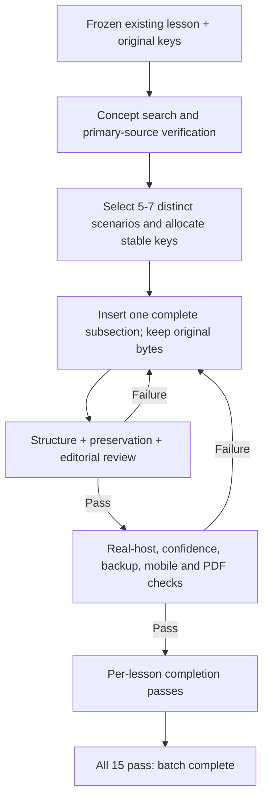

# Data Model: Interview Scenario Backfill

**Feature**: [spec.md](spec.md) | **Date**: 2026-11-17
**Interfaces**: [scenario content](contracts/scenario-content.md), [research/review](contracts/research-and-review.md), [preservation baseline](contracts/preservation-baseline.json).

## Existing lesson target

| Field | Constraint |
| --- | --- |
| Topic ID | Existing immutable opaque manifest ID; do not regenerate or change kind. |
| Title, slug, route, path | Exact existing values from the preservation baseline. |
| Article/modules | One topic article, six ordered direct sections with unchanged stable IDs. |
| Original foundational cards | Preserve exact baseline keys/order/raw markup; 3–5 permitted generally, actual migrated counts four except five for DDD. |
| Added interview set | Exactly one nested subsection with 5–7 interview cards. |
| Scope membership | Exactly the 15 existing topic leaves under the specified Backend Architecture branch; six hubs are protected non-authoring inputs. |

The manifest remains the source of navigation. Research/completion files are development evidence and never become another runtime catalog.

## Preservation baseline

The frozen [JSON audit](contracts/preservation-baseline.json) has `schemaVersion:1`, capture date, constitution version, manifest hash/node inventory, hub records, lesson records and runtime hashes.

- Hashes are lowercase 64-character SHA-256 digests of UTF-8 source without whitespace normalization.
- Manifest inventory retains every node's ID, kind, title, slug, route and ordered child IDs.
- All six hubs retain their complete-file hashes.
- Every lesson retains its complete-file hash, six section IDs/hashes, original question key/raw-HTML hashes, and decoded diagram-source hashes.
- Observed counts are 15 topics, six hubs, 61 foundational questions and 22 original diagrams; they are preservation baselines, not limits on expanded diagram totals.
- Baseline topic IDs are unique globally; original recall keys are unique within each topic.
- Runtime hashes record the expected unchanged shell/styles/state/rendering files. No host change is planned; a proven narrowly scoped compatibility fix requires documented rationale and regression evidence.
- The audit is immutable through this migration. Do not refresh it from authored output to make a comparison pass.

Original-file snapshots for rollback are taken outside the checkout at implementation start. Removing the one inserted marker span must reconstruct the original whole-file digest; protected section/card digests provide more specific failure diagnostics.

## Foundational recall card

Its existing `data-recall-id`, summary, answer, HTML bytes and position remain unchanged. A missing kind marker means foundational; future new content may explicitly use `foundational`. It remains in the same topic's confidence namespace.

The current 61 keys remain reserved. Foundational cards cannot move into the interview subsection to satisfy the new count, and an old what-if question cannot be counted in both groups.

## Interview card

| Field | Type/constraint |
| --- | --- |
| `data-recall-kind` | Constant `interview`. |
| `data-recall-id` | Stable kebab-case with `interview-` prefix; unique among all questions of its topic; allocated once and preserved on rerun/rewording. |
| `data-scenario-basis` | `adapted-production`, `reported-recurring`, or `knowledge-based`; must match its research/public disclosure. |
| Summary | Exactly one nonempty direct summary identifying the applied constraint/decision. |
| Answer parts | Exactly three direct parts in order: `scenario`, `decision`, `trade-offs`, each with its exact visible label and substantive prose. |
| Sources | Resolving references in that card's per-lesson research record, with associated visible source-note links. |
| Disclosure state | No initial `open`; no exclusive `name`; no nested recall card. |
| Count | Five through seven per lesson, independent of the foundational count. |

HTML representations are specified in the [content contract](contracts/scenario-content.md). Runtime-created confidence controls do not belong in authored files.

## Research evidence

One final Markdown record per existing leaf slug uses the same topic ID/path as the baseline. Required data:

| Field | Constraint |
| --- | --- |
| Record state | `draft` or `reviewed`; reviewed requires all required source/editorial dispositions to pass. |
| Research date | ISO `YYYY-MM-DD`, recording actual work rather than a fabricated current check. |
| Search records | Actual query, date and result/failure; distinguish availability from insufficient frequency evidence. |
| Sources | Unique local ID, descriptive title, HTTPS URL, technical-primary/interview-evidence role, actual check date or explicit limitation, and support rationale. |
| Scenario map | Five to seven rows keyed by the exact new recall IDs; selection sources, technical sources, basis, supported claim or none, assumptions and limitations. |
| Editorial dispositions | Per-card explicit pass/fail for all eight research-contract criteria, with rationale/findings. |
| Learner disclosure | Exact wording/source links included in the subsection's public note. |

All 90 current planning seeds have adapted-production basis and an explicit frequency-evidence gap. No seed has a verified company/frequency claim. Final selection and complete answers remain authoring work.

## Per-lesson completion inventory

The future `evidence/lesson-completion.json` has `schemaVersion:1`, referenced baseline digest and exactly 15 entries. Each entry has immutable topic ID/path, foundational and interview key arrays, final research-record link, and preservation/structure/editorial/browser/print checks.

Each check has `status:pending|pass|fail` plus evidence/findings. Overall lesson status uses the same values and is pass only when all five checks pass. Counts derive from arrays, not separately edited totals. Research keys and lesson keys must agree exactly.

Batch totals are 61 foundations plus 75–105 interviews = 136–166 questions. The six-candidate-per-lesson seed list suggests 90 interviews/151 total if all remain appropriate, but neither that choice nor its keys are predetermined.

## Existing learning state

Reuse `backend-lab.learning.v1` and the [existing backup contract](../002-dashboard-shell/contracts/progress-state.md). No new runtime entity, localStorage migration, backup-version bump, group-specific progress store or review policy is needed.

- Confidence remains keyed by immutable topic ID and stable question key; new keys begin absent/unrated.
- Revealing/hiding answers is transient; rating changes only the chosen question confidence and normal workspace update time.
- Topic status, mastery count and review schedule change only through existing explicit actions.
- Ordinary successful visits may update lastVisitedAt/updatedAt; exclude only those expected user-action changes when comparing preexisting records.
- Restoring an older backup retains its actual values and leaves missing new-question ratings absent. Confirmed replacement still means replacement, not a new merge policy.
- Newer/temporarily unmatched question keys retain existing export/import preservation behavior.

## Migration state transitions

Rerunning authoring replaces the same marked block, preserving keys already allocated to that lesson. It must not create duplicate subsections or erase saved learning records. A source/evidence gap changes disclosure and review decisions, not the required completeness/count.
