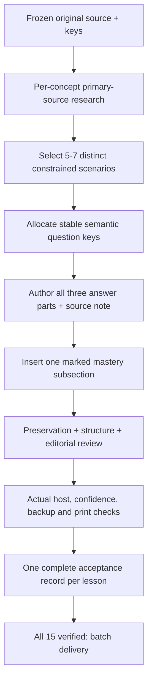

# Implementation Plan: Backfill Backend Architecture Interview Scenarios

**Branch**: `main` | **Date**: 2026-11-17 | **Spec**: [spec.md](spec.md)

**Input**: Feature specification from `specs/003-backfill-interview-scenarios/spec.md`

**Implementation status (2026-11-17)**: Completed and verified; see [delivery.md](delivery.md). The planning-time statements below describe the original design handoff. Actual PDF checks justified the anticipated narrow shared compatibility fix: root-level Mermaid SVG labels and bounded print diagram height. Exact changed runtime hashes and passing affected regressions are recorded in [renderer-compatibility.json](evidence/renderer-compatibility.json); all lesson/manifest/hub preservation requirements remain intact.

**Feature identity**: `003-backfill-interview-scenarios`. Setup returns that logical feature as BRANCH through the active feature pointer; the actual Git branch is `main`. No branch/extension hook is configured.

## Summary

Backfill the 15 existing lesson files with five to seven complete, researched interview-style production scenarios each, while retaining all 61 foundational cards and every original lesson byte. Insert one nested, marked scenario subsection inside mastery and reuse the existing native question class/confidence hooks.

Separate foundational and interview counts through a backward-compatible card-kind attribute. Preserve all topic/question identities, learning status/review/backup behavior, manifest/hubs and existing dashboard architecture. Align the current contract, validator, fixtures and browser checks; prove each lesson individually through preservation, structural/editorial, actual-host and print evidence.

Research completed 39 concept-specific searches with 90 candidate themes (six per lesson). These are production adaptations supported by primary technical references; exact interview frequency/rank/company provenance was not independently verified and must be disclosed. Full question answers, final selected keys and per-card approval remain implementation work.

This command ends after Phase 1 design. No lesson, runtime, validator, test or deployment source is modified by planning.

## Technical Context

**Language/Version**: Existing HTML5 partials, browser Vanilla JavaScript ES2020+, and Python 3.10+ stdlib content tooling. Available Node 20.19.4 supports existing pure-state/catalog tests.

**Primary Dependencies**: No new runtime dependency. Retain Mermaid 12.3.0, Highlight.js 11.11.1, committed Tailwind 3.4.17 output and native details/summary controls. Existing development tools: Playwright 1.56.0, jsonschema 4.25.1 where schema checks apply, and Poppler PDF extraction/rendering. Shared styles and host modules are expected to remain unchanged.

**Storage**: Existing `backend-lab.learning.v1` and backup schema remain unchanged. Confidence already accepts stable per-question keys. Research/completion JSON/Markdown are development evidence, never another runtime state/catalog source.

**Testing**: Focused Python structural/preservation negative tests; existing content/catalog/state regressions; updated non-persistent reading fixture; actual dashboard browser checks for all groups/keys; old/new backup and review preservation; desktop/360px/both themes; real PDFs of all 15 lessons per theme. Earlier 39-content/14-dashboard-logic passes are historical baselines, not evidence this migration has happened.

**Target Platform**: Current dashboard on evergreen browsers, root and repository-prefix static hosting, native keyboard/pointer disclosures, mobile and PDF output.

**Project Type**: Static learning-content migration with narrow contract and validation alignment.

**Performance Goals**: Keep metadata-only search and on-demand selected partial fetching. Do not preload all expanded lesson content or fetch research records at runtime. Reuse one rendering/control pipeline; verify every included diagram and no duplicated controls on navigation/theme changes.

**Constraints**: Exactly 15 authoring targets, one separate authoring task per lesson; six-module order; 3–5 foundations plus 5–7 interviews; 61 original keys/answers retained; one inserted block reconstructs original full-file hash when removed; no source truncation, invented frequency evidence, progress reset, storage migration, new taxonomy, backend or per-lesson shell patch.

**Scale/Scope**: 15 lessons and six unchanged hubs; 75–105 new scenarios, 136–166 total recall cards; 22 original diagrams retained plus any appropriate additions. Thirty updated-lesson PDFs are required (the existing all-content harness may generate 42 including hub regressions). All 90 planning seeds are candidates, not a mandated uniform six-card selection.

## Constitution Check

*Evaluated before research and re-evaluated after Phase 1 against constitution v1.2.0.*

| Gate | Before research | After design |
| --- | --- | --- |
| I / III: Full ELI5-first story, foundations and new scenario subsection | PASS: all original lesson content protected | PASS: one nested subsection, 5–7 complete scenarios, original 61 cards and six modules retained. |
| Interview standard: exact-concept search, source honesty, three answer parts | PASS: research required per lesson | PASS: 39 searches/15 concepts, primary sources and six candidate themes each; adaptation/evidence-gap disclosure and final per-card source/editorial mapping required. |
| IV: Shared confidence, explicit mastery/reviews, stable identity | PASS: retain existing model | PASS: same question class and keys namespace; new semantic keys; no implicit completion/demotion or backup/state version change. |
| V: One manifest, static modular content, no core edits per topic | PASS: existing taxonomy audited | PASS: manifest/hubs protected; current host handles marked new cards; no new runtime/build dependency. |
| VI: Complete content, keyboard/mobile/print behavior | PASS: full answers and affected checks required | PASS: exact labels and substantive parts, independent native details, both themes/360px, all diagrams and actual PDF checks. |
| Governance: Explicit migration and truthful evidence | PASS: this feature is the requested migration plan | PASS: immutable baseline, current strict production profile, explicit historical fixtures only, per-lesson completion evidence, no claim of implemented content. |

No gate fails and no constitutional exception is required. Templates/commands continue reading the constitution at runtime; this plan does not modify them.

## Project Structure

### Documentation (this feature)

```text
specs/003-backfill-interview-scenarios/
├── spec.md
├── plan.md
├── research.md
├── data-model.md
├── quickstart.md
├── checklists/requirements.md
├── contracts/
│   ├── scenario-content.md
│   ├── research-and-review.md
│   ├── preservation-and-validation.md
│   └── preservation-baseline.json
├── research/
│   ├── topic-sources.md                 # Planning searches/sources/candidate themes
│   └── <existing-topic-slug>.md         # 15 final authoring records, implementation phase
├── delivery.md                         # Future complete migration handoff
├── evidence/                           # Future per-lesson and batch acceptance
└── tasks.md                            # Next command; not generated by this plan
```

### Source Code (repository root)

```text
manifest.json                           # Existing; unchanged
topics/system-design/backend-architecture/
├── core-system-topologies/             # Five existing lesson files
├── code-and-domain-organization/       # Four existing lesson files
├── communication-and-routing/         # Three existing lesson files
└── infrastructure-and-multi-tenancy/   # Three existing lesson files
tools/validate_content.py               # Current-profile structure/preservation/evidence checks
tests/content/
├── backend-architecture.json           # Current profile/evidence references
├── test_validate_content.py            # Existing regression + current/explicit legacy fixtures
└── test_interview_scenarios.py          # New focused group/preservation/evidence negatives
tests/fixtures/content-host.js          # Shared role-aware fixture checks; still no learning writes
tests/dashboard/check_dashboard.py      # Source-derived counts, migration/confidence/PDF scenarios
specs/001-backend-architecture/contracts/content-contract.md
                                        # Update current normative text; retain old evidence
index.html, app.js, styles.css, assets/  # Existing runtime; no change expected
```

The exact 15 lesson paths are enumerated in [Migration Scope](spec.md#migration-scope) and the immutable baseline. Every `_overview.html` is protected and excluded from authoring.

**Structure Decision**: Use the existing partials and host vocabulary; add only descriptive data attributes inside one new nested block. Extend existing tooling instead of adding another application, generator framework, storage engine or validation stack. No generated lesson snapshots are copied into runtime catalogs.

## Phase 0 — Research Results

[research.md](research.md) resolves the integration unknowns:

1. Host support: current `details.kb-question[data-recall-id]` already supplies native toggles/confidence to arbitrary stable keys.
2. Group representation: missing kind is foundational; new interview marker and one nested subsection distinguish counts without altering old markup.
3. Preservation: one contiguous marked insertion can be removed to reconstruct each complete original source hash.
4. Interview sourcing: every concept searched; source-backed production adaptations, no unverified hiring-frequency claim.
5. Legacy handling: current default for production, explicit legacy keyword for old unit fixtures only, never inferred from missing content.
6. Validation/acceptance: role-aware source inventories, per-lesson evidence, unchanged-state proof and actual-host/PDF checks.

The [source research](research/topic-sources.md) records actual queries and primary links for each concept. The [baseline](contracts/preservation-baseline.json) freezes all IDs, protected content and runtime hashes. No research/design clarification remains.

## Phase 1 — Design

### Content and preserved identity

[scenario-content.md](contracts/scenario-content.md) defines the exact marker span, nested section/title, shared question class, interview kind/basis, stable semantic keys, three ordered answer-part divs and visible source note.

Insert after all original foundations and before the original takeaway. Keep original source bytes outside the new block. Existing question keys stay unchanged; new keys begin `interview-` and are allocated once in the final per-lesson record. Reruns replace the block and preserve already assigned identities.

### Research-to-delivery flow



[research-and-review.md](contracts/research-and-review.md) defines final per-lesson evidence. The planning seed list is not a substitute for complete answers or per-card approval. Use primary sources for technical claims; label fresh production assumptions and adaptation/frequency gaps honestly.

### Validator and fixture evolution

[The validation contract](contracts/preservation-and-validation.md) defines current/legacy entry points, expectation evidence references, preservation checks, structural rejection cases and report boundaries.

Default current-profile checking requires both groups and exact answer parts. Update normal unit fixtures to current content; explicit historical samples must fail the current profile. Repository/CLI acceptance cannot waive the new standard by selecting legacy mode.

Keep the existing CLI's manifest-history `--baseline` meaning. The new content-preservation audit is referenced separately by the current expectation. Update current contract text and delivery references without rewriting earlier reports.

Add the narrow optional `--lesson` scope described in the validation contract so each authoring unit can check its own current-profile content before the other lessons are migrated. Its report is explicitly partial; only the unfiltered batch run plus all required per-lesson evidence can establish full completion.

### Confidence and compatibility

[data-model.md](data-model.md) maps original/new card entities into the unchanged learning model. Old records/backup values remain associated with their topic/question IDs. Newly absent ratings remain absent. Rating/view actions cannot change mastery or review schedules.

No CSS/JS runtime edits are planned because the class, native details, strong paragraph labels, descendant diagram rendering and print hooks already fit the host. A proven compatibility defect is handled narrowly with documented regression evidence; no per-topic patch is accepted.

### Actual-host and print evidence

Update the browser fixture's flat 3–5 check and the actual harness's hard-coded 61-question/22-diagram totals. Derive current inventories from source, assert the baseline 61 separately, and test each new key rather than only a batch total.

Verify all 21 routes at both bases, both themes/360px, independent keyboard disclosure, one confidence control group per card, reload and old/new backup behavior, and unchanged status/review fields. Produce real PDFs of every migrated lesson from each theme; compare original/new prose and labels, inspect diagrams/tables, hide controls, and restore disclosure states.

## Task Generation Handoff

Keep shared baseline/tooling work separate from lesson authorship, then generate **15 separate complete authoring tasks**, exactly one for every scoped HTML file. Each task owns its lesson plus final concept research record and editorial acceptance, and includes five to seven full answers. It must not deliver only outlines or a subset of cards.

Different lessons/research files are independent authoring units after the shared contract and baseline gates are ready. Shared validator, fixture and browser-harness edits have single-file ownership and are serialized. Final integration checks all 15 per-lesson records and the complete batch.

This plan does not generate `tasks.md`, alter lessons or mark any migration task complete.

## Validation Strategy

| Requirement coverage | Planned proof |
| --- | --- |
| FR-001–005/022/023 | Every scoped file, exactly one section/5–7 complete cards, three answer parts, distinct decisions/traps and applicable diagrams; one authoring/evidence unit per lesson. |
| FR-006–009 | Actual concept queries/sources, final per-card source/basis maps, honest public notes, editorial rejection of unsupported claims. |
| FR-003/011/013/024 | Complete-source reconstruction, original raw card hashes/keys, unchanged manifest/hubs, retained status/review and existing confidence. |
| FR-010/012/014/019 | Existing shared controls on every new key, pointer/keyboard/both themes/360px, no new runtime/state dependency, backup compatibility. |
| FR-015–017/021 | Strict separate groups, default current profile, explicit historical fixtures, negative cases and source-derived live counts. |
| FR-018/020 | All 21 root/project routes, no unexpected console/diagram errors, real PDF completeness/restoration for 30 required lesson outputs. |

See [quickstart.md](quickstart.md) for available baseline checks and future runnable acceptance commands. New validator tests, browser scenarios, lesson evidence and PDF outputs are implementation work; they are not claimed as passing here.

Planning validation executed: all 15 lesson/source hashes, six hub hashes, manifest identities and seven runtime hashes match the frozen audit; the validator/current expectation remain unchanged. All 15 concept research sections contain their actual query records (39 total) and six candidate themes each (90 total). All 32 local documentation links resolve; required template headings, active feature pointer, absence of unresolved placeholders and the existing 16/16 specification checklist were checked. No before/after planning extension hooks are configured. These checks validate planning artifacts and preservation inputs, not the future migration.

## Complexity Tracking

No constitutional violations need justification. One descriptive card marker, one nested insertion boundary, a frozen audit and narrow existing-tool extensions satisfy the migration. Additional runtime services, framework changes, progress migrations and broad lesson rewrites are unnecessary.
