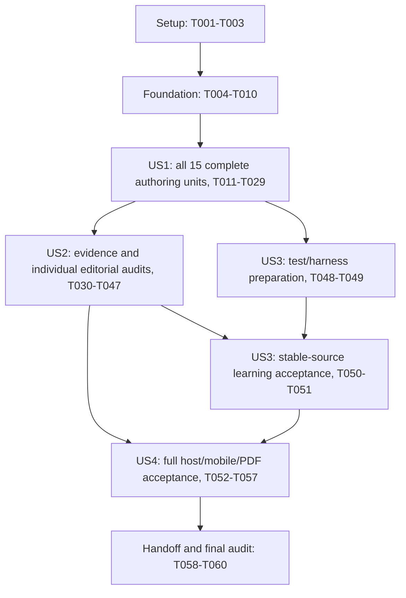

# Tasks: Backfill Backend Architecture Interview Scenarios

**Input**: Design artifacts in `specs/003-backfill-interview-scenarios/`\
**Feature**: `003-backfill-interview-scenarios` | **Actual Git branch**: `main` | **Generated**: 2026-11-17\
**Prerequisites**: [spec.md](spec.md), [plan.md](plan.md), [research.md](research.md), [data-model.md](data-model.md), [contracts/](contracts/), [quickstart.md](quickstart.md), constitution v1.2.0.

**Tests**: Included because FR-015–021 and SC-004–008 explicitly require structural/editorial rejection, preservation, actual-host and real-PDF proof. Write the targeted failing cases before their implementation; do not add cosmetic tests that merely mirror markup.

**Organization**: Four story phases follow shared setup/foundation, then final handoff. This file defines future work; every task starts unchecked. Generating it does not migrate any lesson or prove acceptance.

## Format: `[ID] [P?] [Story] Description`

- Each checklist item has a unique sequential ID, exact write/output paths and a story label in story phases.
- `[P]` identifies a demonstrated parallel window below, after its prerequisite barrier. It does not authorize concurrent writes to one file.
- Numeric order is the safe serial execution order. The dependency table also permits explicitly described cross-story work.
- One complete authoring task and one individual editorial audit are assigned to each lesson. Shared records are consolidated separately.

## Path Conventions

Paths in tasks are relative to the repository root. Existing partials live under `topics/system-design/backend-architecture/`; shared tooling lives in `tools/`, `tests/content/`, `tests/fixtures/` and `tests/dashboard/`. New evidence/research belongs under `specs/003-backfill-interview-scenarios/`. Run filesystem operations from the repository root or resolve these paths to absolute paths.

Use the exact schemas and commands in the design contracts and quickstart. Research records and evidence are development artifacts, never runtime navigation/state stores. Bulk browser/PDF artifacts and rollback snapshots stay outside the checkout.

## Complete Lesson Delivery Rules

These rules apply independently to every authoring task T012–T026 and every review T032–T046:

1. Insert exactly one complete marked subsection inside the existing sixth mastery module, after the original cards and before the original impact takeaway. The markers are `<!-- kb-interview-scenarios:start -->` and `<!-- kb-interview-scenarios:end -->`. Removing that inclusive span must reproduce the original file digest without whitespace normalization. Preserve the first five modules, Feynman prompt, all original answers, their order and every byte outside the span.
2. Use `section[data-interview-scenarios]`, exactly one h3 titled **Tricky & Most-Asked Interview Scenarios**, ID `node-<topicID>-interview-scenarios` and matching `aria-labelledby`. Keep six direct article sections. Each of 5–7 new `details.kb-question` cards has `data-recall-kind="interview"`, a permanent `interview-<meaningful-kebab-key>`, an honest basis, a direct summary and three direct ordered answer parts. Use the exact labels **The Scenario & Constraint**, **The Direct Answer & Architectural Decision**, and **Key Trade-Offs & Follow-Up Traps**, each followed by substantive explanatory paragraphs as defined in the content contract.
3. Each card must include its own concrete production constraint, decision/reasoning, actionable steps, gains/costs, viable alternative, meaningful follow-up trap and response to a changed assumption. Deliver full prose and applicable valid Mermaid diagrams. Do not use outlines, TODOs, omitted answers or superficially paraphrased cards to satisfy counts.
4. Complete the concept-specific research record from [research/topic-sources.md](research/topic-sources.md), verifying primary sources and actual claims. Planning already used web search for all 15 concepts: its 90 seeds are adapted production candidates, with no independently verified interview-frequency/company claim. Select 5–7 appropriate cards rather than forcing exactly six; disclose the actual evidence gap in a visible `[data-interview-research]` source note. Never claim search was unavailable when it was used.
5. Record all eight editorial dispositions per card: concept specificity; materially distinct decision; production prompt and explicit constraint; direct answer/reasoning/steps; trade-offs and viable alternative; follow-up trap and changed assumption; evidence honesty; full parts/prose/applicable diagrams. Structural success alone cannot approve these judgments.
6. Reuse shared styles, native disclosures and existing confidence hooks. No runtime-authored controls, individual shell patches, taxonomy edits, progress migration, review-policy changes or new build/backend. A proven host defect requires the narrow documented regression fix allowed by the plan.
7. Keep assigned keys on rerun; replace the same marked block. Update that lesson's structure/research/editorial evidence after any correction. Do not mark browser, print or overall completion from authoring alone.

## Phase 1: Setup (Shared Infrastructure)

**Purpose**: Freeze the existing inputs and initialize truthful pending evidence before any lesson edit.

**Independent test / checkpoint**: All 15 source files, six hubs, 61 foundational keys and 22 original diagrams match the immutable audit; rollback copies exist outside the checkout. Tooling and pending records are ready.

- [X] T001 Verify the frozen audit in `specs/003-backfill-interview-scenarios/contracts/preservation-baseline.json` against the current checkout, create an external rollback snapshot before edits, and record `specs/003-backfill-interview-scenarios/evidence/input-verification.json`. Enforce “Existing immutable opaque manifest ID; do not regenerate or change kind.”, “Exact existing values from the preservation baseline.”, and “Preserve exact baseline keys/order/raw markup; 3–5 permitted generally, actual migrated counts four except five for DDD.” Verify 15 lessons/six hubs/61 cards/22 original diagrams and lowercase 64-character SHA-256 digests of UTF-8 source without whitespace normalization; never regenerate the audit to accept output. Also enforce “One topic article, six ordered direct sections with unchanged stable IDs.”, “Exactly one nested subsection with 5–7 interview cards.” and “Exactly the 15 existing topic leaves under the specified Backend Architecture branch; six hubs are protected non-authoring inputs.”

- [X] T002 [P] Initialize `specs/003-backfill-interview-scenarios/evidence/lesson-completion.json` with schemaVersion 1, the baseline digest and exactly 15 immutable topic/path entries, original key arrays and initially empty new-key arrays; quote the gate rule “status:pending|pass|fail” for preservation/structure/editorial/browser/print, with overall pass only when all five pass. Create `specs/003-backfill-interview-scenarios/delivery.md` as an explicitly pending 15-lesson handoff; counts derive from arrays, and neither artifact may imply content or acceptance already exists.

- [X] T003 [P] Verify Python 3.10+, Node 20+, existing pinned requirements in `tests/dashboard/requirements.txt`, Chromium and Poppler; reuse compatible external tooling or provision outside the checkout only as needed. Record versions and the pre-change content/logic test results in `specs/003-backfill-interview-scenarios/evidence/tooling-baseline.json`; earlier 39/14-test passes are baseline evidence, not v1.2 migration acceptance.

## Phase 2: Foundational (Blocking Prerequisites)

**Purpose**: Align the shared contract, current-profile validator, negative fixtures and scoped authoring entry point before writing lessons.

**Independent test / checkpoint**: New focused tests and relevant existing regressions pass. Current-profile valid fixtures pass; old content and malformed fixtures fail for the expected reasons. Unmigrated repository lessons remain visibly incomplete.

**Blocking gate**: Complete T001–T010 before any story implementation. Default production validation must enforce constitution v1.2.0; explicit historical fixtures cannot grant real lessons a waiver.

- [X] T004 [P] Add failing current-profile contract tests in `tests/content/test_interview_scenarios.py` for separate count bounds, missing/duplicate/misplaced group/title, role mismatches, empty/out-of-order parts/labels, key collisions and malformed prefixes, open/exclusive/nested cards, protected-source edits, missing markers, current-vs-legacy selection, evidence shape and safe --lesson scoping; distinguish synthetic structural fixtures from editorial approval.

- [X] T005 [P] Update normal positive fixture factories in `tests/content/test_validate_content.py` to include complete current-profile scenario markup and add explicit legacy-1.1 historical cases that fail under current mode; retain the intent of the original catalog/hub/CLI regression tests and establish intended red cases before changing the validator.

- [X] T006 [P] Align the current normative `specs/001-backend-architecture/contracts/content-contract.md` with the new scenario supplement and constitution v1.2.0: quote “One topic article, six ordered direct sections with unchanged stable IDs.” and “Exactly one nested subsection with 5–7 interview cards.” Document preserved foundational markup, all three constitutional answer labels, existing confidence/print hooks and source disclosure; retain previous evidence as historical.

- [X] T007 Implement current-profile role inventories, structure and preservation checks in `tools/validate_content.py` per `specs/003-backfill-interview-scenarios/contracts/scenario-content.md`. Enforce data-recall-kind “Constant `interview`.”; key “Stable kebab-case with `interview-` prefix; unique among all questions of its topic; allocated once and preserved on rerun/rewording.”; basis enum `adapted-production`, `reported-recurring`, `knowledge-based`; “Exactly one nonempty direct summary identifying the applied constraint/decision.”; three ordered `scenario`, `decision`, `trade-offs` parts with exact visible labels/substantive prose; “No initial `open`; no exclusive `name`; no nested recall card.” Remove exactly one inclusive marker span to reconstruct each original file hash, compare protected sections/cards/diagrams/manifest/hubs, and default to constitution-1.2 with legacy only through an explicit unit-test keyword. Require “Exactly three direct parts in order: `scenario`, `decision`, `trade-offs`, each with its exact visible label and substantive prose.”, “Resolving references in that card's per-lesson research record, with associated visible source-note links.” and “Five through seven per lesson, independent of the foundational count.” The basis constraint is “`adapted-production`, `reported-recurring`, or `knowledge-based`; must match its research/public disclosure.”

- [X] T008 Extend `tools/validate_content.py` with strict current repository/CLI profile handling, required evidence-path/shape checks and safe optional `--lesson` targeting per `specs/003-backfill-interview-scenarios/contracts/preservation-and-validation.md`; keep catalog-history `--baseline` semantics unchanged. Emit scope batch|lesson, current recallProfile and separate source-derived group/diagram counts; reject legacy production waivers, traversal/unknown targets, malformed evidence and claims that unselected/pending editorial/browser/print gates passed.

- [X] T009 Update `tests/content/backend-architecture.json` with recallProfile constitution-1.2 and the exact preservationBaseline/scenarioResearchDirectory/completionRecord/deliveryRecord references from `specs/003-backfill-interview-scenarios/contracts/preservation-and-validation.md`; retain its original root/parent/group membership and order and never edit the runtime manifest.

- [X] T010 Run foundational tests and CLI positive/negative fixtures, including explicit legacy rejection and --lesson path guards, then record `specs/003-backfill-interview-scenarios/evidence/foundation-validation.json`. Confirm the still-unmigrated real lessons fail new scenario checks as expected rather than receiving a legacy waiver; pending authoring/source evidence must be identified honestly.

## Phase 3: User Story 1 — Practice production decisions in every existing lesson (Priority: P1) — MVP

**Purpose**: Deliver a full five-to-seven-scenario addition and final authoring/source record for each of the 15 existing lessons.

**Independent test / checkpoint**: Every scoped lesson independently passes preservation and current structure checks with 5–7 complete scenarios, exact parts and stable keys; all 61 old cards survive. The shared reading fixture works for the pilot. This checkpoint does not substitute for the independent source, host or print acceptance below.

**Tests first**: T011. **Complete lesson authoring**: T012–T026, exactly one HTML target each. **Fixture/integration**: T027–T029. Each author owns only its HTML, research record and per-lesson structure report; it must not edit the shared completion inventory.

- [X] T011 [US1] Add per-lesson preservation/rerun tests in `tests/content/test_interview_scenarios.py`: one marked insertion reconstructs the complete original source; changed Feynman/first-five/foundational/footer bytes fail; DDD retains five old cards; duplicate blocks or reallocated keys fail; scoped structure success never claims the whole batch passed. Establish the missing-behavior cases before authoring.

- [X] T012 [P] [US1] Backfill **Distributed System Fundamentals** in `topics/system-design/backend-architecture/core-system-topologies/distributed-system-fundamentals.html` with the complete 5–7-card scenario set; finish `specs/003-backfill-interview-scenarios/research/distributed-system-fundamentals.md` with concept-specific web/primary-source verification, stable keys, source mapping, honest frequency limitations and all eight editorial dispositions. Focus on uncertain commits, retry amplification, partitions, stale reads, conflicts and failure suspicion. Preserve all 4 original cards and every original byte outside the marked block. Include the exact subsection title and full “The Scenario & Constraint”, “The Direct Answer & Architectural Decision”, and “Key Trade-Offs & Follow-Up Traps” parts, applicable valid diagrams and the visible research note. Run the scoped checker and save `specs/003-backfill-interview-scenarios/evidence/lessons/distributed-system-fundamentals-structure.json`; replace only the existing block on rerun, keep allocated keys, and leave browser/print gates pending.

- [X] T013 [P] [US1] Backfill **Monolithic Architecture** in `topics/system-design/backend-architecture/core-system-topologies/monolithic-architecture.html` with the complete 5–7-card scenario set; finish `specs/003-backfill-interview-scenarios/research/monolithic-architecture.md` with concept-specific web/primary-source verification, stable keys, source mapping, honest frequency limitations and all eight editorial dispositions. Focus on launch/operations constraints, shared-resource failures, release ownership, database bottlenecks and incremental extraction. Preserve all 4 original cards and every original byte outside the marked block. Include the exact subsection title and full “The Scenario & Constraint”, “The Direct Answer & Architectural Decision”, and “Key Trade-Offs & Follow-Up Traps” parts, applicable valid diagrams and the visible research note. Run the scoped checker and save `specs/003-backfill-interview-scenarios/evidence/lessons/monolithic-architecture-structure.json`; replace only the existing block on rerun, keep allocated keys, and leave browser/print gates pending.

- [X] T014 [P] [US1] Backfill **Modular Monolith** in `topics/system-design/backend-architecture/core-system-topologies/modular-monolith.html` with the complete 5–7-card scenario set; finish `specs/003-backfill-interview-scenarios/research/modular-monolith.md` with concept-specific web/primary-source verification, stable keys, source mapping, honest frequency limitations and all eight editorial dispositions. Focus on module API enforcement, acyclic responsibilities, cross-module invariants/events, shared ownership and extraction readiness. Preserve all 4 original cards and every original byte outside the marked block. Include the exact subsection title and full “The Scenario & Constraint”, “The Direct Answer & Architectural Decision”, and “Key Trade-Offs & Follow-Up Traps” parts, applicable valid diagrams and the visible research note. Run the scoped checker and save `specs/003-backfill-interview-scenarios/evidence/lessons/modular-monolith-structure.json`; replace only the existing block on rerun, keep allocated keys, and leave browser/print gates pending.

- [X] T015 [P] [US1] Backfill **Service-Oriented Architecture (SOA)** in `topics/system-design/backend-architecture/core-system-topologies/service-oriented-architecture.html` with the complete 5–7-card scenario set; finish `specs/003-backfill-interview-scenarios/research/service-oriented-architecture.md` with concept-specific web/primary-source verification, stable keys, source mapping, honest frequency limitations and all eight editorial dispositions. Focus on enterprise contract translation, bus trade-offs, compatibility, long workflows and service/model ownership without assuming ESB or SOAP. Preserve all 4 original cards and every original byte outside the marked block. Include the exact subsection title and full “The Scenario & Constraint”, “The Direct Answer & Architectural Decision”, and “Key Trade-Offs & Follow-Up Traps” parts, applicable valid diagrams and the visible research note. Run the scoped checker and save `specs/003-backfill-interview-scenarios/evidence/lessons/service-oriented-architecture-structure.json`; replace only the existing block on rerun, keep allocated keys, and leave browser/print gates pending.

- [X] T016 [P] [US1] Backfill **Microservices Architecture** in `topics/system-design/backend-architecture/core-system-topologies/microservices-architecture.html` with the complete 5–7-card scenario set; finish `specs/003-backfill-interview-scenarios/research/microservices-architecture.md` with concept-specific web/primary-source verification, stable keys, source mapping, honest frequency limitations and all eight editorial dispositions. Focus on autonomy/release coupling, synchronous latency, partial success, data ownership, failure containment and operational granularity. Preserve all 4 original cards and every original byte outside the marked block. Include the exact subsection title and full “The Scenario & Constraint”, “The Direct Answer & Architectural Decision”, and “Key Trade-Offs & Follow-Up Traps” parts, applicable valid diagrams and the visible research note. Run the scoped checker and save `specs/003-backfill-interview-scenarios/evidence/lessons/microservices-architecture-structure.json`; replace only the existing block on rerun, keep allocated keys, and leave browser/print gates pending.

- [X] T017 [P] [US1] Backfill **Layered Architecture** in `topics/system-design/backend-architecture/code-and-domain-organization/layered-architecture.html` with the complete 5–7-card scenario set; finish `specs/003-backfill-interview-scenarios/research/layered-architecture.md` with concept-specific web/primary-source verification, stable keys, source mapping, honest frequency limitations and all eight editorial dispositions. Focus on logical layers versus physical tiers, bypassed policy, leaked persistence, transaction ownership and realistic tests. Preserve all 4 original cards and every original byte outside the marked block. Include the exact subsection title and full “The Scenario & Constraint”, “The Direct Answer & Architectural Decision”, and “Key Trade-Offs & Follow-Up Traps” parts, applicable valid diagrams and the visible research note. Run the scoped checker and save `specs/003-backfill-interview-scenarios/evidence/lessons/layered-architecture-structure.json`; replace only the existing block on rerun, keep allocated keys, and leave browser/print gates pending.

- [X] T018 [P] [US1] Backfill **Clean Architecture** in `topics/system-design/backend-architecture/code-and-domain-organization/clean-architecture.html` with the complete 5–7-card scenario set; finish `specs/003-backfill-interview-scenarios/research/clean-architecture.md` with concept-specific web/primary-source verification, stable keys, source mapping, honest frequency limitations and all eight editorial dispositions. Focus on policy/transport isolation, inward source dependencies, adapter replacement, transaction semantics and avoiding needless abstraction. Preserve all 4 original cards and every original byte outside the marked block. Include the exact subsection title and full “The Scenario & Constraint”, “The Direct Answer & Architectural Decision”, and “Key Trade-Offs & Follow-Up Traps” parts, applicable valid diagrams and the visible research note. Run the scoped checker and save `specs/003-backfill-interview-scenarios/evidence/lessons/clean-architecture-structure.json`; replace only the existing block on rerun, keep allocated keys, and leave browser/print gates pending.

- [X] T019 [P] [US1] Backfill **Hexagonal Architecture** in `topics/system-design/backend-architecture/code-and-domain-organization/hexagonal-architecture.html` with the complete 5–7-card scenario set; finish `specs/003-backfill-interview-scenarios/research/hexagonal-architecture.md` with concept-specific web/primary-source verification, stable keys, source mapping, honest frequency limitations and all eight editorial dispositions. Focus on driving/driven boundaries, shared rules, uncertain provider outcomes, adapter contracts and purposeful ports. Preserve all 4 original cards and every original byte outside the marked block. Include the exact subsection title and full “The Scenario & Constraint”, “The Direct Answer & Architectural Decision”, and “Key Trade-Offs & Follow-Up Traps” parts, applicable valid diagrams and the visible research note. Run the scoped checker and save `specs/003-backfill-interview-scenarios/evidence/lessons/hexagonal-architecture-structure.json`; replace only the existing block on rerun, keep allocated keys, and leave browser/print gates pending.

- [X] T020 [P] [US1] Backfill **Domain-Driven Design (DDD)** in `topics/system-design/backend-architecture/code-and-domain-organization/domain-driven-design.html` with the complete 5–7-card scenario set; finish `specs/003-backfill-interview-scenarios/research/domain-driven-design.md` with concept-specific web/primary-source verification, stable keys, source mapping, honest frequency limitations and all eight editorial dispositions. Focus on bounded vocabularies, aggregate invariants/concurrency, contention, cross-boundary coordination and anti-corruption translation. Preserve all 5 original cards and every original byte outside the marked block. Include the exact subsection title and full “The Scenario & Constraint”, “The Direct Answer & Architectural Decision”, and “Key Trade-Offs & Follow-Up Traps” parts, applicable valid diagrams and the visible research note. Run the scoped checker and save `specs/003-backfill-interview-scenarios/evidence/lessons/domain-driven-design-structure.json`; replace only the existing block on rerun, keep allocated keys, and leave browser/print gates pending.

- [X] T021 [P] [US1] Backfill **Event-Driven Architecture** in `topics/system-design/backend-architecture/communication-and-routing/event-driven-architecture.html` with the complete 5–7-card scenario set; finish `specs/003-backfill-interview-scenarios/research/event-driven-architecture.md` with concept-specific web/primary-source verification, stable keys, source mapping, honest frequency limitations and all eight editorial dispositions. Focus on dual writes, duplicate effects, ordering, projection lag, notification payloads and hidden command/orchestration ownership. Preserve all 4 original cards and every original byte outside the marked block. Include the exact subsection title and full “The Scenario & Constraint”, “The Direct Answer & Architectural Decision”, and “Key Trade-Offs & Follow-Up Traps” parts, applicable valid diagrams and the visible research note. Run the scoped checker and save `specs/003-backfill-interview-scenarios/evidence/lessons/event-driven-architecture-structure.json`; replace only the existing block on rerun, keep allocated keys, and leave browser/print gates pending.

- [X] T022 [P] [US1] Backfill **API Gateway Pattern** in `topics/system-design/backend-architecture/communication-and-routing/api-gateway-pattern.html` with the complete 5–7-card scenario set; finish `specs/003-backfill-interview-scenarios/research/api-gateway-pattern.md` with concept-specific web/primary-source verification, stable keys, source mapping, honest frequency limitations and all eight editorial dispositions. Focus on edge aggregation, partial failure, quota coordination, authorization boundaries and gateway blast radius. Preserve all 4 original cards and every original byte outside the marked block. Include the exact subsection title and full “The Scenario & Constraint”, “The Direct Answer & Architectural Decision”, and “Key Trade-Offs & Follow-Up Traps” parts, applicable valid diagrams and the visible research note. Run the scoped checker and save `specs/003-backfill-interview-scenarios/evidence/lessons/api-gateway-pattern-structure.json`; replace only the existing block on rerun, keep allocated keys, and leave browser/print gates pending.

- [X] T023 [P] [US1] Backfill **Backend for Frontend (BFF)** in `topics/system-design/backend-architecture/communication-and-routing/backend-for-frontend.html` with the complete 5–7-card scenario set; finish `specs/003-backfill-interview-scenarios/research/backend-for-frontend.md` with concept-specific web/primary-source verification, stable keys, source mapping, honest frequency limitations and all eight editorial dispositions. Focus on experience constraints, frontend ownership, duplication/coupling, domain authority, compatibility and boundary cost. Preserve all 4 original cards and every original byte outside the marked block. Include the exact subsection title and full “The Scenario & Constraint”, “The Direct Answer & Architectural Decision”, and “Key Trade-Offs & Follow-Up Traps” parts, applicable valid diagrams and the visible research note. Run the scoped checker and save `specs/003-backfill-interview-scenarios/evidence/lessons/backend-for-frontend-structure.json`; replace only the existing block on rerun, keep allocated keys, and leave browser/print gates pending.

- [X] T024 [P] [US1] Backfill **Service Discovery** in `topics/system-design/backend-architecture/infrastructure-and-multi-tenancy/service-discovery.html` with the complete 5–7-card scenario set; finish `specs/003-backfill-interview-scenarios/research/service-discovery.md` with concept-specific web/primary-source verification, stable keys, source mapping, honest frequency limitations and all eight editorial dispositions. Focus on termination/draining, stale or negative DNS caches, registry freshness, endpoint choice, namespace context and SDK-free integration. Preserve all 4 original cards and every original byte outside the marked block. Include the exact subsection title and full “The Scenario & Constraint”, “The Direct Answer & Architectural Decision”, and “Key Trade-Offs & Follow-Up Traps” parts, applicable valid diagrams and the visible research note. Run the scoped checker and save `specs/003-backfill-interview-scenarios/evidence/lessons/service-discovery-structure.json`; replace only the existing block on rerun, keep allocated keys, and leave browser/print gates pending.

- [X] T025 [P] [US1] Backfill **Service Mesh** in `topics/system-design/backend-architecture/infrastructure-and-multi-tenancy/service-mesh.html` with the complete 5–7-card scenario set; finish `specs/003-backfill-interview-scenarios/research/service-mesh.md` with concept-specific web/primary-source verification, stable keys, source mapping, honest frequency limitations and all eight editorial dispositions. Focus on retry multiplication, TLS migration, workload identity versus authorization, data-plane constraints, routing and business fallback. Preserve all 4 original cards and every original byte outside the marked block. Include the exact subsection title and full “The Scenario & Constraint”, “The Direct Answer & Architectural Decision”, and “Key Trade-Offs & Follow-Up Traps” parts, applicable valid diagrams and the visible research note. Run the scoped checker and save `specs/003-backfill-interview-scenarios/evidence/lessons/service-mesh-structure.json`; replace only the existing block on rerun, keep allocated keys, and leave browser/print gates pending.

- [X] T026 [P] [US1] Backfill **Multi-Tenant Architecture** in `topics/system-design/backend-architecture/infrastructure-and-multi-tenancy/multi-tenant-architecture.html` with the complete 5–7-card scenario set; finish `specs/003-backfill-interview-scenarios/research/multi-tenant-architecture.md` with concept-specific web/primary-source verification, stable keys, source mapping, honest frequency limitations and all eight editorial dispositions. Focus on noisy neighbors, isolation models, tenant context, independent restore/placement, migration and customization cost. Preserve all 4 original cards and every original byte outside the marked block. Include the exact subsection title and full “The Scenario & Constraint”, “The Direct Answer & Architectural Decision”, and “Key Trade-Offs & Follow-Up Traps” parts, applicable valid diagrams and the visible research note. Run the scoped checker and save `specs/003-backfill-interview-scenarios/evidence/lessons/multi-tenant-architecture-structure.json`; replace only the existing block on rerun, keep allocated keys, and leave browser/print gates pending.

- [X] T027 [P] [US1] Update `tests/fixtures/content-host.js` to check foundational/interview groups, new card roles/parts, combined stable-key uniqueness and independent native toggles without a 3–5 total cap; keep it test-only and non-persistent. Smoke-check the completed Distributed System Fundamentals pilot and record `specs/003-backfill-interview-scenarios/evidence/fixture-pilot.json` without claiming fixture results prove learning-state integration.

- [X] T028 [US1] Merge all 15 scoped structure results and authored key inventories into `specs/003-backfill-interview-scenarios/evidence/lesson-completion.json`, preserving immutable IDs, exact original key arrays and per-lesson research links. Require 5–7 new keys per lesson and matching research/HTML inventories; record verified preservation/structure, retain pending remaining gates, and do not mark any whole lesson passed yet.

- [X] T029 [US1] Run the current-profile unit/content checks for all 15 authored lessons, verify full-source reconstruction and unchanged six hubs/manifest, and save `specs/003-backfill-interview-scenarios/evidence/authoring-structure.json`. Require exactly 61 retained foundations plus 75–105 interviews (136–166 total), count all source diagrams dynamically, and report remaining independent review/browser/print work explicitly.

## Phase 4: User Story 2 — Understand the evidence behind interview practice (Priority: P1)

**Purpose**: Independently review every scenario's actual primary-source support, selection basis, full answer and learner-facing claims.

**Independent test / checkpoint**: Each lesson's exact scenario keys resolve to a reviewed concept-specific record and public note. All eight editorial criteria pass for every card. Deliberately definition-only, duplicate, unsupported-claim and misleading-disclosure examples fail editorial review even if structurally valid.

**Tests first**: T030 establishes editorial rejection cases. T031 aligns source/evidence validation. T032–T046 are separate individual reviews; T047 alone consolidates their shared inventory. These audits may be a later independent pass by the same implementer and do not require external approval or delegation.

- [X] T030 [P] [US2] Create and evaluate editorial negative cases in `specs/003-backfill-interview-scenarios/evidence/editorial-negative-cases.md`: definition-only content, superficial duplicate theme, unsupported ranking/company claim, false research-unavailable claim, omitted decision/alternative/trap and incorrect vendor-generalization. Record why structurally valid examples fail the eight-criterion rubric; these semantic judgments must not be represented as automatic HTML proof.

- [X] T031 [US2] Complete research/completion reference validation in `tools/validate_content.py`: enforce record state “`draft` or `reviewed`; reviewed requires all required source/editorial dispositions to pass.”, “ISO `YYYY-MM-DD`, recording actual work rather than a fabricated current check.”, actual query/date/result records, and sources with “Unique local ID, descriptive title, HTTPS URL, technical-primary/interview-evidence role, actual check date or explicit limitation, and support rationale.” Require 5–7 exact-key scenario mappings, resolving selection/technical sources, basis/claim/assumption limitations, exact public disclosure and explicit per-card pass/fail findings. Reject structurally unsupported reported-recurring/knowledge-based classifications and incomplete completion gates without claiming to automate source credibility. Enforce “Actual query, date and result/failure; distinguish availability from insufficient frequency evidence.”, “Five to seven rows keyed by the exact new recall IDs; selection sources, technical sources, basis, supported claim or none, assumptions and limitations.”, “Per-card explicit pass/fail for all eight research-contract criteria, with rationale/findings.” and “Exact wording/source links included in the subsection's public note.”

- [X] T032 [P] [US2] Independently audit every **Distributed System Fundamentals** scenario in `topics/system-design/backend-architecture/core-system-topologies/distributed-system-fundamentals.html` against `specs/003-backfill-interview-scenarios/research/distributed-system-fundamentals.md` and the primary sources, recording `specs/003-backfill-interview-scenarios/evidence/lessons/distributed-system-fundamentals-editorial.json`. Recheck all eight editorial criteria and all 5–7 claim/source rows, distinguish documented production adaptations from actual interview evidence, label author-created assumptions and reject unsupported frequency/company claims. Correct only this lesson's inserted block/research record as needed, preserve keys/protected bytes, re-run its scoped checker to refresh `specs/003-backfill-interview-scenarios/evidence/lessons/distributed-system-fundamentals-structure.json`, and mark the research record reviewed only after its sources and full answers pass.

- [X] T033 [P] [US2] Independently audit every **Monolithic Architecture** scenario in `topics/system-design/backend-architecture/core-system-topologies/monolithic-architecture.html` against `specs/003-backfill-interview-scenarios/research/monolithic-architecture.md` and the primary sources, recording `specs/003-backfill-interview-scenarios/evidence/lessons/monolithic-architecture-editorial.json`. Recheck all eight editorial criteria and all 5–7 claim/source rows, distinguish documented production adaptations from actual interview evidence, label author-created assumptions and reject unsupported frequency/company claims. Correct only this lesson's inserted block/research record as needed, preserve keys/protected bytes, re-run its scoped checker to refresh `specs/003-backfill-interview-scenarios/evidence/lessons/monolithic-architecture-structure.json`, and mark the research record reviewed only after its sources and full answers pass.

- [X] T034 [P] [US2] Independently audit every **Modular Monolith** scenario in `topics/system-design/backend-architecture/core-system-topologies/modular-monolith.html` against `specs/003-backfill-interview-scenarios/research/modular-monolith.md` and the primary sources, recording `specs/003-backfill-interview-scenarios/evidence/lessons/modular-monolith-editorial.json`. Recheck all eight editorial criteria and all 5–7 claim/source rows, distinguish documented production adaptations from actual interview evidence, label author-created assumptions and reject unsupported frequency/company claims. Correct only this lesson's inserted block/research record as needed, preserve keys/protected bytes, re-run its scoped checker to refresh `specs/003-backfill-interview-scenarios/evidence/lessons/modular-monolith-structure.json`, and mark the research record reviewed only after its sources and full answers pass.

- [X] T035 [P] [US2] Independently audit every **Service-Oriented Architecture (SOA)** scenario in `topics/system-design/backend-architecture/core-system-topologies/service-oriented-architecture.html` against `specs/003-backfill-interview-scenarios/research/service-oriented-architecture.md` and the primary sources, recording `specs/003-backfill-interview-scenarios/evidence/lessons/service-oriented-architecture-editorial.json`. Recheck all eight editorial criteria and all 5–7 claim/source rows, distinguish documented production adaptations from actual interview evidence, label author-created assumptions and reject unsupported frequency/company claims. Correct only this lesson's inserted block/research record as needed, preserve keys/protected bytes, re-run its scoped checker to refresh `specs/003-backfill-interview-scenarios/evidence/lessons/service-oriented-architecture-structure.json`, and mark the research record reviewed only after its sources and full answers pass.

- [X] T036 [P] [US2] Independently audit every **Microservices Architecture** scenario in `topics/system-design/backend-architecture/core-system-topologies/microservices-architecture.html` against `specs/003-backfill-interview-scenarios/research/microservices-architecture.md` and the primary sources, recording `specs/003-backfill-interview-scenarios/evidence/lessons/microservices-architecture-editorial.json`. Recheck all eight editorial criteria and all 5–7 claim/source rows, distinguish documented production adaptations from actual interview evidence, label author-created assumptions and reject unsupported frequency/company claims. Correct only this lesson's inserted block/research record as needed, preserve keys/protected bytes, re-run its scoped checker to refresh `specs/003-backfill-interview-scenarios/evidence/lessons/microservices-architecture-structure.json`, and mark the research record reviewed only after its sources and full answers pass.

- [X] T037 [P] [US2] Independently audit every **Layered Architecture** scenario in `topics/system-design/backend-architecture/code-and-domain-organization/layered-architecture.html` against `specs/003-backfill-interview-scenarios/research/layered-architecture.md` and the primary sources, recording `specs/003-backfill-interview-scenarios/evidence/lessons/layered-architecture-editorial.json`. Recheck all eight editorial criteria and all 5–7 claim/source rows, distinguish documented production adaptations from actual interview evidence, label author-created assumptions and reject unsupported frequency/company claims. Correct only this lesson's inserted block/research record as needed, preserve keys/protected bytes, re-run its scoped checker to refresh `specs/003-backfill-interview-scenarios/evidence/lessons/layered-architecture-structure.json`, and mark the research record reviewed only after its sources and full answers pass.

- [X] T038 [P] [US2] Independently audit every **Clean Architecture** scenario in `topics/system-design/backend-architecture/code-and-domain-organization/clean-architecture.html` against `specs/003-backfill-interview-scenarios/research/clean-architecture.md` and the primary sources, recording `specs/003-backfill-interview-scenarios/evidence/lessons/clean-architecture-editorial.json`. Recheck all eight editorial criteria and all 5–7 claim/source rows, distinguish documented production adaptations from actual interview evidence, label author-created assumptions and reject unsupported frequency/company claims. Correct only this lesson's inserted block/research record as needed, preserve keys/protected bytes, re-run its scoped checker to refresh `specs/003-backfill-interview-scenarios/evidence/lessons/clean-architecture-structure.json`, and mark the research record reviewed only after its sources and full answers pass.

- [X] T039 [P] [US2] Independently audit every **Hexagonal Architecture** scenario in `topics/system-design/backend-architecture/code-and-domain-organization/hexagonal-architecture.html` against `specs/003-backfill-interview-scenarios/research/hexagonal-architecture.md` and the primary sources, recording `specs/003-backfill-interview-scenarios/evidence/lessons/hexagonal-architecture-editorial.json`. Recheck all eight editorial criteria and all 5–7 claim/source rows, distinguish documented production adaptations from actual interview evidence, label author-created assumptions and reject unsupported frequency/company claims. Correct only this lesson's inserted block/research record as needed, preserve keys/protected bytes, re-run its scoped checker to refresh `specs/003-backfill-interview-scenarios/evidence/lessons/hexagonal-architecture-structure.json`, and mark the research record reviewed only after its sources and full answers pass.

- [X] T040 [P] [US2] Independently audit every **Domain-Driven Design (DDD)** scenario in `topics/system-design/backend-architecture/code-and-domain-organization/domain-driven-design.html` against `specs/003-backfill-interview-scenarios/research/domain-driven-design.md` and the primary sources, recording `specs/003-backfill-interview-scenarios/evidence/lessons/domain-driven-design-editorial.json`. Recheck all eight editorial criteria and all 5–7 claim/source rows, distinguish documented production adaptations from actual interview evidence, label author-created assumptions and reject unsupported frequency/company claims. Correct only this lesson's inserted block/research record as needed, preserve keys/protected bytes, re-run its scoped checker to refresh `specs/003-backfill-interview-scenarios/evidence/lessons/domain-driven-design-structure.json`, and mark the research record reviewed only after its sources and full answers pass.

- [X] T041 [P] [US2] Independently audit every **Event-Driven Architecture** scenario in `topics/system-design/backend-architecture/communication-and-routing/event-driven-architecture.html` against `specs/003-backfill-interview-scenarios/research/event-driven-architecture.md` and the primary sources, recording `specs/003-backfill-interview-scenarios/evidence/lessons/event-driven-architecture-editorial.json`. Recheck all eight editorial criteria and all 5–7 claim/source rows, distinguish documented production adaptations from actual interview evidence, label author-created assumptions and reject unsupported frequency/company claims. Correct only this lesson's inserted block/research record as needed, preserve keys/protected bytes, re-run its scoped checker to refresh `specs/003-backfill-interview-scenarios/evidence/lessons/event-driven-architecture-structure.json`, and mark the research record reviewed only after its sources and full answers pass.

- [X] T042 [P] [US2] Independently audit every **API Gateway Pattern** scenario in `topics/system-design/backend-architecture/communication-and-routing/api-gateway-pattern.html` against `specs/003-backfill-interview-scenarios/research/api-gateway-pattern.md` and the primary sources, recording `specs/003-backfill-interview-scenarios/evidence/lessons/api-gateway-pattern-editorial.json`. Recheck all eight editorial criteria and all 5–7 claim/source rows, distinguish documented production adaptations from actual interview evidence, label author-created assumptions and reject unsupported frequency/company claims. Correct only this lesson's inserted block/research record as needed, preserve keys/protected bytes, re-run its scoped checker to refresh `specs/003-backfill-interview-scenarios/evidence/lessons/api-gateway-pattern-structure.json`, and mark the research record reviewed only after its sources and full answers pass.

- [X] T043 [P] [US2] Independently audit every **Backend for Frontend (BFF)** scenario in `topics/system-design/backend-architecture/communication-and-routing/backend-for-frontend.html` against `specs/003-backfill-interview-scenarios/research/backend-for-frontend.md` and the primary sources, recording `specs/003-backfill-interview-scenarios/evidence/lessons/backend-for-frontend-editorial.json`. Recheck all eight editorial criteria and all 5–7 claim/source rows, distinguish documented production adaptations from actual interview evidence, label author-created assumptions and reject unsupported frequency/company claims. Correct only this lesson's inserted block/research record as needed, preserve keys/protected bytes, re-run its scoped checker to refresh `specs/003-backfill-interview-scenarios/evidence/lessons/backend-for-frontend-structure.json`, and mark the research record reviewed only after its sources and full answers pass.

- [X] T044 [P] [US2] Independently audit every **Service Discovery** scenario in `topics/system-design/backend-architecture/infrastructure-and-multi-tenancy/service-discovery.html` against `specs/003-backfill-interview-scenarios/research/service-discovery.md` and the primary sources, recording `specs/003-backfill-interview-scenarios/evidence/lessons/service-discovery-editorial.json`. Recheck all eight editorial criteria and all 5–7 claim/source rows, distinguish documented production adaptations from actual interview evidence, label author-created assumptions and reject unsupported frequency/company claims. Correct only this lesson's inserted block/research record as needed, preserve keys/protected bytes, re-run its scoped checker to refresh `specs/003-backfill-interview-scenarios/evidence/lessons/service-discovery-structure.json`, and mark the research record reviewed only after its sources and full answers pass.

- [X] T045 [P] [US2] Independently audit every **Service Mesh** scenario in `topics/system-design/backend-architecture/infrastructure-and-multi-tenancy/service-mesh.html` against `specs/003-backfill-interview-scenarios/research/service-mesh.md` and the primary sources, recording `specs/003-backfill-interview-scenarios/evidence/lessons/service-mesh-editorial.json`. Recheck all eight editorial criteria and all 5–7 claim/source rows, distinguish documented production adaptations from actual interview evidence, label author-created assumptions and reject unsupported frequency/company claims. Correct only this lesson's inserted block/research record as needed, preserve keys/protected bytes, re-run its scoped checker to refresh `specs/003-backfill-interview-scenarios/evidence/lessons/service-mesh-structure.json`, and mark the research record reviewed only after its sources and full answers pass.

- [X] T046 [P] [US2] Independently audit every **Multi-Tenant Architecture** scenario in `topics/system-design/backend-architecture/infrastructure-and-multi-tenancy/multi-tenant-architecture.html` against `specs/003-backfill-interview-scenarios/research/multi-tenant-architecture.md` and the primary sources, recording `specs/003-backfill-interview-scenarios/evidence/lessons/multi-tenant-architecture-editorial.json`. Recheck all eight editorial criteria and all 5–7 claim/source rows, distinguish documented production adaptations from actual interview evidence, label author-created assumptions and reject unsupported frequency/company claims. Correct only this lesson's inserted block/research record as needed, preserve keys/protected bytes, re-run its scoped checker to refresh `specs/003-backfill-interview-scenarios/evidence/lessons/multi-tenant-architecture-structure.json`, and mark the research record reviewed only after its sources and full answers pass.

- [X] T047 [US2] Aggregate the 15 independent reviews into `specs/003-backfill-interview-scenarios/evidence/research-review.json` and update editorial dispositions in `specs/003-backfill-interview-scenarios/evidence/lesson-completion.json`; require every scenario to map to real sources or an honestly recorded gap and every research record to reach reviewed without unresolved findings. Record dates/queries actually used, keep existing planning searches accurate, and leave browser/print/overall states pending until their own gates pass.

## Phase 5: User Story 3 — Keep my existing learning record while adding new practice (Priority: P1)

**Purpose**: Prove the new cards participate in existing confidence and backup behavior without changing old learning records or the 15-topic mastery denominator.

**Independent test / checkpoint**: Seed pre-migration states/backups, load all expanded lessons, rate/revisit/reload/export/import every new key and compare preserved status/review/original confidence fields at both hosting bases. New keys start absent. Only expected user-driven visit/update fields may differ.

**Tests first**: T048 may be authored alongside T030 after US1. T048–T049 share one browser-harness file and run serially. T050 waits for both T047 and T049 so its source/evidence is stable after the editorial corrections.

- [X] T048 [P] [US3] Add actual-host learning-preservation scenarios in `tests/dashboard/check_dashboard.py` using valid pre-migration states and old backups: all old identities/ratings and status/review fields survive, every new key starts unrated, two answers remain independently keyboard-operable, and all new ratings survive navigation/reload/export/import without implicit mastery/review changes. Permit only normal lastVisitedAt/updatedAt visit changes and preserve existing unknown-key replacement behavior.

- [X] T049 [US3] Implement shared role-aware source inventory assertions in `tests/dashboard/check_dashboard.py` and wire them into the learning scenarios: derive all keys and diagram counts, retain the original 61 as a preservation assertion, require 5–7 scenario keys per lesson and 136–166 total, and check one existing confidence group per new key. Remove fixed current totals of 61/22, keep app/state/backup code unchanged, and distinguish current source counts from historical evidence.

- [X] T050 [US3] Run the focused migration learning checks from `tests/dashboard/check_dashboard.py` against stable authored content at both hosting bases and save per-lesson state/rating/backup results in `specs/003-backfill-interview-scenarios/evidence/learning-preservation.json`. Use real existing controls and old/new backups, retain Mastered status/the 15-topic denominator and unchanged due history, and report failures without resetting learning data.

- [X] T051 [US3] Attach each lesson's learning-preservation results to the browser evidence references in `specs/003-backfill-interview-scenarios/evidence/lesson-completion.json`; preserve missing-new-key defaults and record only expected visit-time differences. Keep full browser/overall completion pending until the remaining route/theme/mobile and print checks pass; do not add a localStorage/backup version or runtime group store.

## Phase 6: User Story 4 — Read and verify the expanded lessons everywhere the dashboard works (Priority: P2)

**Purpose**: Finish actual-host, accessibility/mobile/theme, diagram, structural-negative and real print/PDF acceptance for each lesson.

**Independent test / checkpoint**: All 21 destinations and 20 hub-child links work at root and repository-prefix bases without unexpected healthy-dependency console/Mermaid errors. Both themes work at 360px; every new card is independently usable. All 15 lessons have complete readable PDFs from both themes, with disclosure states restored. Every lesson has all five acceptance gates passing.

**Tests first**: T052. T054 can run alongside T052 because it writes only its regression report. Keep edits to the shared browser harness serial (T052 → T053 → T055); run the full PDF batch once after these changes, unless a failure or later source change requires rerunning affected acceptance.

- [X] T052 [P] [US4] Add failing expanded-host/PDF acceptance cases in `tests/dashboard/check_dashboard.py` for all 21 routes/20 hub-child edges at both bases, every source diagram including closed-card diagrams, light/dark 360px interaction/focus, no unexpected console/rendering errors or duplicate controls, and real printed scenario summaries/labels/answers/source notes with restored disclosure states. Keep unavailable tooling explicitly unexecuted rather than passing.

- [X] T053 [US4] Complete the new role-aware browser assertions and reporting in `tests/dashboard/check_dashboard.py`, including the non-persistent reading fixture check, all new keys by pointer/keyboard, healthy-dependency console/Mermaid checks, native theme rerendering, 360px local overflow, and per-lesson evidence at both root/repository-prefix URLs. Reuse shared host behavior; document and regression-test only a proven narrow compatibility defect if one is discovered.

- [X] T054 [P] [US4] Run current-profile structural/preservation/evidence negatives and original catalog/hub/state regressions from `tests/content/test_interview_scenarios.py`, `tests/content/test_validate_content.py` and `tests/dashboard/test_learning_state.mjs`; save `specs/003-backfill-interview-scenarios/evidence/validator-regressions.json`. Confirm current production validation rejects legacy waivers and every malformed group/part/key/marker/evidence case, while historical fixtures are explicitly labeled.

- [X] T055 [US4] Extend real-PDF source extraction/comparison in `tests/dashboard/check_dashboard.py` to include scenario summaries/title, all three labeled answer parts, original prose and source notes, with diagram/table visual-review artifacts and hidden-controls/restoration assertions. Require all 15 lessons from both themes (30 outputs; existing six-hub extras may yield 42), keep bulk artifacts outside the checkout, and prepare one final integrated run rather than repeating the whole PDF batch unnecessarily.

- [X] T056 [US4] Run the updated actual-dashboard suite without a story filter at root and repository-prefix URLs, with its real-PDF output enabled. Save `specs/003-backfill-interview-scenarios/evidence/host-acceptance.json` and `specs/003-backfill-interview-scenarios/evidence/print-results.json`, inspect required PDF diagrams/tables, and account for each of the 15 lessons' source-derived keys/counts, current diagrams, both themes/mobile, backup/state behavior and print completeness. Missing or failing required gates stay open.

- [X] T057 [US4] Reconcile `specs/003-backfill-interview-scenarios/evidence/lesson-completion.json` against the latest actual-source hashes and preservation/structure/editorial/browser/print reports; quote the final rule “Overall lesson status uses the same values and is pass only when all five checks pass.” Require exactly 15 passing per-lesson entries and write `specs/003-backfill-interview-scenarios/evidence/final-acceptance.json` mapping FR-001–FR-024 and SC-001–SC-008. Fix any remaining scoped failure before claiming the batch complete.

## Phase 7: Polish & Cross-Cutting Concerns

**Purpose**: Publish the complete local handoff/evidence, verify references and close only work actually proven complete.

**Independent test / checkpoint**: The final unfiltered current-profile CLI and final audit pass against actual source; delivery and acceptance records resolve for all 15 lessons. Historical evidence and protected inputs remain unchanged.

- [X] T058 [P] Finalize `specs/003-backfill-interview-scenarios/delivery.md` with every exact lesson path, preserved/new key counts, final source record and per-lesson evidence links; report actual 75–105 scenarios and total cards/diagrams without forcing six per topic or asserting unverified frequency. Preserve old 001/002 delivery/evidence files as historical.

- [X] T059 [P] Update `specs/003-backfill-interview-scenarios/quickstart.md` with the verified current/scoped CLI commands, tooling versions, real host/PDF procedures and evidence links; update only the status/history notes in `specs/003-backfill-interview-scenarios/spec.md` and `specs/003-backfill-interview-scenarios/plan.md` to distinguish completed implementation from their earlier planning state. Do not change requirements or old evidence to match a deficient result.

- [X] T060 Run the final current-profile CLI after the handoff references are complete, verify original manifest/hubs and reconstructed lesson hashes, confirm expected runtime files stayed unchanged (or a proven narrow fix has explicit evidence), and review all constitutional/FR/SC gates. Write `specs/003-backfill-interview-scenarios/evidence/acceptance-summary.md` and check off tasks only when their promised content and evidence exist; no commit/push/publication, progress reset or template edits are implied.

## Dependencies & Execution Order

### Story dependencies

US1 provides migrated content for the other stories. US2 tests source honesty independently from runtime learning behavior; US3 test preparation is independent of US2, but its acceptance run waits for source corrections to finish. US4 combines those gates into complete delivery. These are independently assessable story checks with explicit shared-input dependencies.

### Exact task prerequisites

A range here includes every task in it. The following table is authoritative when using a parallel window; otherwise execute in numeric order.

| Task | Must complete first |
| --- | --- |
| T001 | None |
| T002 | T001 |
| T003 | T001 |
| T004 | T002, T003 |
| T005 | T002, T003 |
| T006 | T002, T003 |
| T007 | T004, T005, T006 |
| T008 | T007 |
| T009 | T008 |
| T010 | T009 |
| T011 | T010 |
| T012 | T011 |
| T013 | T011 |
| T014 | T011 |
| T015 | T011 |
| T016 | T011 |
| T017 | T011 |
| T018 | T011 |
| T019 | T011 |
| T020 | T011 |
| T021 | T011 |
| T022 | T011 |
| T023 | T011 |
| T024 | T011 |
| T025 | T011 |
| T026 | T011 |
| T027 | T012 |
| T028 | T012, T013, T014, T015, T016, T017, T018, T019, T020, T021, T022, T023, T024, T025, T026, T027 |
| T029 | T028 |
| T030 | T029 |
| T031 | T030 |
| T032 | T031 |
| T033 | T031 |
| T034 | T031 |
| T035 | T031 |
| T036 | T031 |
| T037 | T031 |
| T038 | T031 |
| T039 | T031 |
| T040 | T031 |
| T041 | T031 |
| T042 | T031 |
| T043 | T031 |
| T044 | T031 |
| T045 | T031 |
| T046 | T031 |
| T047 | T032, T033, T034, T035, T036, T037, T038, T039, T040, T041, T042, T043, T044, T045, T046 |
| T048 | T029 |
| T049 | T048 |
| T050 | T047, T049 |
| T051 | T050 |
| T052 | T047, T051 |
| T053 | T052 |
| T054 | T047, T051 |
| T055 | T053 |
| T056 | T054, T055 |
| T057 | T056 |
| T058 | T057 |
| T059 | T057 |
| T060 | T058, T059 |

### Shared-file and acceptance barriers

- `tools/validate_content.py`: T007 → T008 → T031. Do not edit it concurrently.
- `tests/content/test_interview_scenarios.py`: T004 → T011; T054 only reads/runs it.
- `tests/dashboard/check_dashboard.py`: T048 → T049 → T050, then T052 → T053 → T055. T050 is a focused run/report task and may add the narrow required invocation support before later edits. T056 runs the finished suite.
- `evidence/lesson-completion.json`: T002 → T028 → T047 → T051 → T057. Lesson authors/auditors write only their own reports; shared reconciliation is serialized.
- T032–T046 may correct only their corresponding lesson block/research record and refresh its structure report. No acceptance run may read those files while a correction is in progress.
- After any accepted content correction, rerun affected structure/editorial/host/print checks and refresh their source references before overall pass. A final batch report never replaces missing per-lesson proof.
- Keep the baseline, `manifest.json`, all six `_overview.html` files and historical feature 001/002 evidence unchanged. Runtime files are expected unchanged; only a demonstrated scoped compatibility defect may justify a documented fix.

## Parallel Execution Examples

These are file-isolated work windows, not a requirement to create agents. Complete the listed barriers and all transitive prerequisites first.

| Window | Barrier | Tasks that may run together |
| --- | --- | --- |
| Shared setup | T001 | T002, T003 |
| Shared foundation | T002, T003 | T004, T005, T006 |
| US1 — complete lesson authorship | T011 | T012, T013, T014, T015, T016, T017, T018, T019, T020, T021, T022, T023, T024, T025, T026 |
| US1 — pilot fixture alongside remaining lessons | T011, T012 | T013, T014, T015, T016, T017, T018, T019, T020, T021, T022, T023, T024, T025, T026, T027 |
| US2 / US3 — independent test preparation | T029 | T030, T048 |
| US2 — individual editorial audits | T031 | T032, T033, T034, T035, T036, T037, T038, T039, T040, T041, T042, T043, T044, T045, T046 |
| US4 — browser test work and validator regression execution | T047, T051 | T052, T054 |
| Final documentation | T057 | T058, T059 |

**US1 example**: after T011, author Distributed System Fundamentals (T012), Layered Architecture (T017) and Service Discovery (T024) independently, each with its full HTML/research/scoped report. Once the T012 pilot is complete, T027 can update the reading fixture while the remaining lesson authors finish.

**US2 example**: after T031, audit Distributed System Fundamentals (T032), Clean Architecture (T038) and Multi-Tenant Architecture (T046) independently. Each audit owns only that lesson's block, record and individual reports. T047 consolidates only after all 15 finish.

**US3 example**: T048 can prepare learning-preservation tests while T030 prepares editorial negatives, because they own different files. Its own harness tasks remain serial; actual T050 acceptance waits for all reviewed source to be stable.

**US4 example**: after T047 and T051, T052 can add browser/PDF tests while T054 runs the completed Python/Node regressions and writes its separate report. The browser implementation and final integrated execution then proceed in dependency order.

There are **42 unique [P] tasks across eight windows**; overlapping US1 windows are alternative schedules, not duplicate tasks. Do not run an authoring task concurrently with its later audit.

## Requirement & Outcome Traceability

| Requirements | Specific work / proof |
| --- | --- |
| FR-001–004 | T001, T004, T007, T011–T026, T028–T029: exactly 15 complete targets, required nested structure/answers and retained originals. |
| FR-005 | T012–T026, T030, T032–T046: complete distinct production decisions, alternatives and traps; explicit editorial rejection. |
| FR-006–009 | T012–T026, T030–T047: exact-concept search, source/claim mapping, public limitations and independent review. |
| FR-010 | T004, T007, T027, T048–T050, T052–T056: hidden independent native answers, meaningful controls and real-host behavior. |
| FR-011 | T001, T004, T007, T011–T026, T028–T029, T048–T051: immutable old identities/bytes, new stable keys and rerun safety. |
| FR-012–014 | T006, T048–T053, T056: shared partial controls, original state/reviews, all new ratings and backups without new runtime architecture. |
| FR-015–017 | T004–T010, T027–T031, T048–T049, T054: strict role-aware inventories, explicit historical fixtures and current evidence. |
| FR-018–020 | T048–T050, T052–T056: actual dashboard at both bases, all routes, mobile/themes, complete actual PDFs and restoration. |
| FR-021 | T004–T010, T027, T031, T049, T052–T055: current contract, validator, fixtures and regression alignment. |
| FR-022 | T002, T012–T026, T028–T029, T032–T047, T051, T057–T060: exact per-lesson keys, sources and all five evidence gates. |
| FR-023 | T012–T026, T032–T046, T049, T052–T056: applicable new diagrams, all original diagrams and host/PDF rendering. |
| FR-024 | T001, T006–T010, T054, T058–T060: protected manifest/hubs, bounded content migration and historical preservation. |

| Outcome | Independent acceptance |
| --- | --- |
| SC-001 | T028–T029 plus T057: 15 lessons, 75–105 scenarios, 61 foundations, 136–166 total. |
| SC-002 | T030 and T032–T047: all eight criteria per scenario, rejecting shallow or duplicated decisions. |
| SC-003 | T031–T047: every card mapped to exact-concept research and truthful supported/public claims. |
| SC-004 | T001, T007, T011, T029, T048–T051: whole-source reconstruction, identity hashes and seeded learning preservation. |
| SC-005 | T048–T050 and T056: every new key independently toggles/rates/persists/restores without changing mastery/review. |
| SC-006 | T052–T056: all 21 routes at both bases, every diagram, healthy console, both themes and 360px. |
| SC-007 | T055–T056: 30 required readable lesson PDF outputs and prior disclosure-state restoration. |
| SC-008 | T004–T010, T030–T031, T054, T057: structural/editorial negatives and 15 separate evidence-backed completion entries. |

## Implementation Strategy

### MVP First — User Story 1

Complete setup/foundation and US1 (T001–T029, **29 tasks**). This delivers all 15 complete additions with their authored source records and intrinsic preservation/structure proof. Use T012 plus T027 as the early integration pilot before distributing the remaining authoring work.

This MVP is an intermediate checkpoint. It is not the requested completed backfill: independent source/editorial review, learning-state acceptance and host/PDF checks still remain. Do not stop after one lesson, truncate any lesson or declare all gates passed from the pilot.

### Incremental Delivery

1. Freeze inputs and establish strict current-profile/scoped validation (T001–T010).
2. Author every complete lesson separately; test the pilot fixture, then consolidate source-derived inventories (T011–T029).
3. Perform all 15 individual source/editorial audits and repair only their scoped additions (T030–T047).
4. Verify existing state and all new confidence/backup behavior against stable reviewed content (T048–T051). Test preparation may overlap step 3 as documented.
5. Complete both-base actual-host, theme/mobile and real-PDF acceptance with per-lesson findings (T052–T057).
6. Finalize current handoff references and rerun the final bounded audit (T058–T060).

### Task Accounting

| Phase | Tasks |
| --- | ---: |
| Setup | 3 |
| Foundation | 7 |
| US1 — production practice | 19 |
| US2 — evidence and editorial review | 18 |
| US3 — learning-record preservation | 4 |
| US4 — complete dashboard/print verification | 6 |
| Polish | 3 |
| **Total** | **60** |

Exactly **15 authoring tasks** (T012–T026) and **15 individual editorial reviews** (T032–T046) cover the exact 15 scoped HTML paths. The remaining 30 tasks cover shared preparation, validation, integration and handoff.

## Notes

All tasks start unchecked. Mark a task complete only when its full promised content and evidence exist. If a required browser/PDF dependency is unavailable, record an unexecuted/pending gate and resolve it; do not count it as a pass. Preserve actual research/check dates and historical results.

No question requires unsupported “most asked” claims despite the mandated subsection title. Documented production adaptations with honest frequency limitations satisfy the evidence contract when their full answers are supported.

This task file authorizes the planned migration work only when the implementation workflow is invoked. Task generation itself changes no lesson, runtime source, validator, test or learning data, and does not commit, push or deploy.
