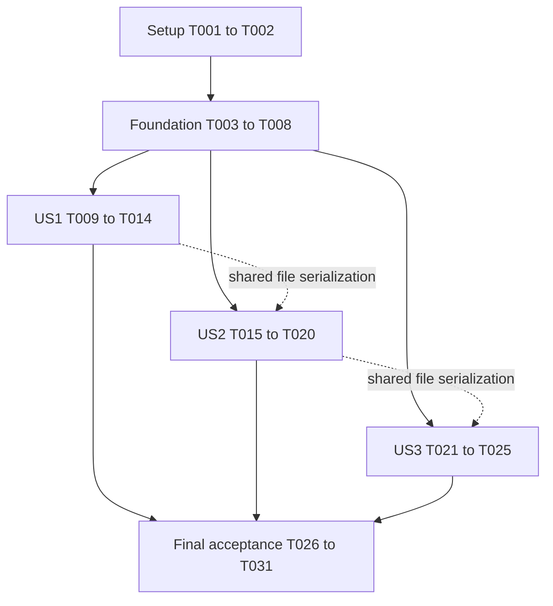

# Tasks: Simplify Lesson UI

**Input:** [spec.md](spec.md), [plan.md](plan.md), [research.md](research.md),
[data-model.md](data-model.md), [presentation contract](contracts/lesson-presentation.md),
[progress contract](contracts/progress-controls.md), [quickstart.md](quickstart.md).
**Created:** 2026-11-25. **Status:** Implementation and required validation complete; see [delivery.md](delivery.md).
**Branch:** `main`; `004-simplify-lesson-ui` is the feature-directory key, not a newly created branch.

**Scope:** Shared UI and deterministic presentation migration. Preserve all existing
teaching content and learner data. This is not lesson authorship: do not create 135
reauthoring tasks, repeat question research or regenerate topics/recall identities.
The task-generation stage changed this checklist only; the subsequently authorized implementation is complete.

## Format and execution rules

- Each executable item has an unchecked box, sequential ID, concrete paths and a story
  label only in its story phase. `[P]` identifies file-independent work after its stated
  prerequisites; it does not authorize sub-agent spawning.
- Tests are included because FR-020 and the approved plan explicitly require meaningful
  contract/application regression. Define new contract cases before implementing them;
  confirm their failures expose the intended missing behavior rather than an unrelated setup error.
- Existing state APIs, manifest/backup schema versions and library versions are reused.
  No new framework, production backend, dependency reinstall or progress migration.
- Keep the first snapshot under `.cache/lesson-ui/baseline/`; never overwrite it on resume.
  A missing snapshot, failed/unexecuted gate or stale report cannot count as acceptance.
- Source changes are serialized when tasks touch the same files. Keep evidence runs after
  their tested input edits settle; reuse only matching fingerprints and intact PDF hashes.
- Do not modify the original `specs/001-*`–`specs/003-*` records/evidence to conceal intended
  changes. Preserve unrelated `docs/project/` files. Commit/push/deployment are outside this checklist.

## Phase 1: Setup — inspect and protect the current checkout

**Purpose:** Establish the actual pre-edit baseline and reuse the available tooling.

- [X] T001 Re-audit `manifest.json`, `topics/`, `research/topics/`, historical mapped research and the working tree against `research.md`; capture original manifest bytes at `.cache/lesson-ui/baseline/manifest.json`, lesson originals under `.cache/lesson-ui/baseline/files/`, and machine-readable inventories/protected hashes under `.cache/lesson-ui/baseline/`. Record paragraph variants, exact ordered source/related links, all question/diagram bytes, IDs and research mappings. Protect hubs, learning-state code, research, historical evidence and unrelated files. Adopt an existing original snapshot on resume instead of replacing it. Expected baseline is 181 nodes/135 lessons/46 hubs, seven research-paragraph variants and 120 related preambles; reconcile genuine intervening changes before editing.
- [X] T002 Verify the reusable Python/Node, Playwright 1.56.0, jsonschema 4.25.1, Chromium and Poppler environment described in `specs/004-simplify-lesson-ui/quickstart.md` against `tests/dashboard/requirements.txt`; record actual versions/paths and execution-access needs in `.cache/lesson-ui/environment.json`. Reuse the existing `/tmp/backend-*` installations where available; install only a genuinely missing prerequisite. Verify `.cache/` outputs remain ignored in `.gitignore`.

**Checkpoint:** Original content is recoverable and protected before any policy, content or runtime edit.

## Phase 2: Foundational — align policy, validation and migration safety

**Purpose:** Resolve the authorized presentation-policy change and build a safe common
migration foundation before the user-story edits. A transitional checkout may not yet
satisfy the new current presentation policy; that is not a completed publication.

- [X] T003 Amend `.specify/memory/constitution.md` to the planned 2.0.0 presentation rule: replace the mandatory public adaptation/frequency boilerplate with named reader source links and maintainer evidence, and permit the compact progress UI while preserving ELI5 depth, six modules, card counts, research honesty, identities, explicit reviews and mobile/print requirements. Preserve ratification date; use the actual amendment date and record rationale, migration/sync impacts and the user's explicit authorization from FR-016. Do not change historic evidence or claim migration completion here.
- [X] T004 [P] Align `docs/topic-publishing.md` and `.agents/skills/topic-publish/SKILL.md` with T003: show the concise visible Sources group, maintainer-only research limitations, preserved contextual assumptions, compact related links and inherited host progress controls. Preserve actual research/complete-lesson requirements. Remove instructions requiring publicDisclosure to match a rendered paragraph in current mode; leave generic Spec Kit templates unchanged unless an actual conflicting rule is found. Dependencies: T003.
- [X] T005 [P] Add meaningful current/legacy presentation tests in `tests/content/test_lesson_presentation.py`, and adapt fixture-mode selection in `tests/content/test_validate_content.py`, `tests/content/test_interview_scenarios.py` and `tests/content/test_topic_publishing.py`. Cover clean current Sources with both new records omitting publicDisclosure and unchanged archived records; retain strict legacy disclosure mismatch/removal failures. Reject missing/hidden/nested sources, reordered/bad URLs, reintroduced or renamed generic intro prose, invalid claims/editorial findings and missing/unknown current presentation config. Dependencies: T003; preserve historical snapshot files.
- [X] T006 Implement explicit presentation dispatch in `tools/validate_content.py` and add `researchPresentation: sources-only-v1` to `tests/content/publishing.json`, preserving `recallProfile: constitution-1.2` and all research mappings. Enforce “Unknown values fail” and “A missing setting in current topic-publishing configuration fails.” Thread policy through validate, registered topic checkers, check_article, check_interviews and check_research; explicit legacy fixtures/named historical expectations use strict disclosure-v1. Retain source/date/basis/claim/eight-criterion checks, accept existing 1.2.0/1.3.0 provenance plus new 2.0.0 records, and treat existing publicDisclosure as archival only in current mode. Expose applied policy in reports; no skip-validation flag. Dependencies: T005.
- [X] T007 Add migration safety tests in `tests/content/test_lesson_copy_migration.py` for all captured note shapes, scope composition, dry-run nonmutation, idempotence, snapshot nonreplacement, unexpected/multiple/nested notes, exact card/diagram/link preservation, dated technical prose, legacy external-reference footers and the meaningful Container Orchestration footer. Use small isolated fixtures and the T001 snapshot contract; never edit production lesson prose just to satisfy a test. Dependencies: T001 and T006.
- [X] T008 Implement `tools/migrate_lesson_presentation.py` with the planned `--snapshot`, default dry-run, `--apply` and `--verify` commands, adopting the T001 snapshot format without overwriting originals. Add `--scope sources|related|all` with default all so the story slices below can apply separately; document this additive option in `specs/004-simplify-lesson-ui/quickstart.md`. Resolve targets from the manifest, parse exact element spans, preserve unrelated bytes, reject unexpected shapes and allow only audited source-paragraph/label/related-group changes. Scopes must compose without undoing earlier approved edits; scoped verification checks its completed region and permits only original or approved edits in the other region, while final all-scope verification requires both complete. Pass T007 before applying to real topics. Dependencies: T007.

**Checkpoint:** The amended policy and strict current/legacy tests agree; the migration
tool is safe on isolated fixtures. Current production records have not been rewritten.

## Phase 3: User Story 1 — read without repeated administrative copy (P1, MVP)

**Goal:** Remove every generic research paragraph while retaining compact Sources,
complete learning material and working current publishing acceptance.

**Independent test:** Read a lesson from every wording variant/branch at both base paths,
inspect its canonical partial and a print preview, and confirm the paragraph is absent,
source links are visible/mapped, and contextual assumptions and answers remain intact.

### Contract checks before the story implementation

- [X] T009 [US1] Define source-presentation and fresh-content browser checks in `tests/dashboard/check_lesson_ui.py`, with reusable isolated-context/server helpers for later story checks. Cover all captured note variants, visible Sources outside closed cards, identical ordered labels/URLs, absence of replacement or hidden administrative prose, contextual numeric assumptions, and direct canonical partial content at `/` and `/backend-lab/`. Keep these checks callable independently before the final combined runner is completed in T026. Dependencies: Phase 2.

### Implementation and independent acceptance

- [X] T010 [US1] Dry-run and apply the Sources-only transformation using `tools/migrate_lesson_presentation.py --snapshot .cache/lesson-ui/baseline --apply --scope sources` to the manifest-derived lesson files under `topics/`. Replace only each audited first generic paragraph in `aside[data-interview-research]` with an h4 Sources label; preserve the exact source references, full lesson/answer bytes and all research files. Run scoped verification and a repeat apply to prove idempotence. Dependencies: T009.
- [X] T011 [P] [US1] Style the existing Sources hook in `styles.css` as a concise, readable wrapping reference group in both themes and print, preserving named links and avoiding a replacement explanatory panel or extra disclosure. Keep unrelated lesson callouts and source-reference footers intact. Dependencies: T009; may proceed alongside T010 on separate files.
- [X] T012 [P] [US1] Update only lesson fetch freshness in `assets/js/content-renderer.js` to conditional `cache: no-cache` revalidation, retaining relative URL construction, AbortSignal, identity guards and beforeprint/afterprint behavior. Add a warm-cache old-partial/new-canonical-response test to `tests/dashboard/check_lesson_ui.py`, preserving latest-route wins and no unhandled aborts. Do not add renderer text stripping, a service worker or a research-record network fetch. Dependencies: T009; serialize later edits to the same browser-check file.
- [X] T013 [P] [US1] Align current Sources assertions in `tests/dashboard/check_dashboard.py`, including direct EXPANDED use, and extend its PDF text checks to reject the generic research paragraph while still requiring source labels/links, every answer and diagram label. Keep historical disclosure fixtures separate and retain print disclosure-state restoration. Dependencies: T009; this task owns the dashboard harness until its changes finish.
- [X] T014 [US1] Run the new presentation fixture checks, current whole-catalog intrinsic validation and the T009/T012 browser scenarios against the migrated catalog; record `.cache/lesson-ui/us1.json` and representative print-preview evidence. Verify all seven original variants are gone without deleting meaningful assumptions, source references or teaching content. This is story-only acceptance; catalog-wide final PDFs and shared application acceptance remain T028–T030. Dependencies: T010–T013.

**Checkpoint/MVP:** US1 is independently demonstrable after the common foundation.
During an authorized full implementation continue through US2, US3 and final gates;
this checkpoint is not an instruction to stop or deploy.

## Phase 4: User Story 2 — track learning with one compact control (P1)

**Goal:** Replace duplicate/large progress UI with one near-title Progress selector and
conditional review date/action using the existing learning state.

**Independent test:** Use every status/review variant in both themes at 1024/1440px and
360px; change status, start/complete review, reload and restore backup. Verify compactness,
focus and state without the old banner.

### Contract checks before the story implementation

- [X] T015 [US2] Add compact-control browser contract cases to `tests/dashboard/check_lesson_ui.py` for exactly one labeled `#topic-status` row after a lesson title, none on hubs, all status/review variants, at most two pointer interactions, keyboard selection and stable selector/review/card focus. Assert the progress-contract bounds verbatim: “One row, bounding height ≤56px” at desktop ≥1024px; “At most two rows, bounding height ≤112px” at 360px; “Target width and height ≥44px” for each status/action control. Exclude only the specified open-menu/temporary-error cases and check enlarged-text operability separately. Dependencies: Phase 2 and completion of earlier edits to this file.

### Implementation and independent acceptance

- [X] T016 [US2] Refactor learningControls/refreshLearningControls and delegated actions in `app.js` to retain one stable native `#topic-status` select labeled Progress with values `not-started`, `in-progress`, `mastered`. Remove `#mastery-actions`, `.mastery-footer` construction, MAKE IT YOURS, both promotional headings/helper paragraphs, duplicate status help and the obsolete `master-topic` button action. Show the current Start review / Complete review / Start another review action plus a short next date only when mastered. Reuse existing state APIs; transfer focus only when its focused review control is replaced, otherwise preserve the selector/card/other focus. Keep `data-host-controls`, confidence controls, persistence notices and in-lesson Feynman/mastery content. Dependencies: T015.
- [X] T017 [P] [US2] Replace the obsolete banner and toolbar layout rules in `styles.css` with the progress-contract layout: one desktop row, a status row plus conditional review row at 360px, ≤8px row gap, readable short date/full accessible meaning, ≥44px controls, visible keyboard focus and existing theme tokens. Remove unused footer-only selectors without changing green educational callouts. Preserve print suppression through `data-host-controls`; do not meet size targets by clipping, shrinking targets or hiding actions. Dependencies: T015 and earlier US1 stylesheet edits; can proceed with T016.
- [X] T018 [P] [US2] Replace obsolete Mark as Mastered interactions with explicit status selection in `tools/check_topics.py` and `tests/dashboard/check_dashboard.py`; retain all mastery/reload/confidence/storage-failure assertions. Extend current print checks to exclude the removed host copy and new interactive control labels. Include `tests/content/publishing.json` and resolved research presentation in catalog evidence fingerprints so stale policy results cannot be reused. Keep the runner's truthful broader-application pending behavior. Dependencies: T015 and T013; files are independent of T016/T017.
- [X] T019 [US2] Add real state/backup integration cases to `tests/dashboard/check_lesson_ui.py`, seeding all nine current branches plus an unknown imported record and reusing `assets/js/learning-state.js` unchanged. Preserve the data-model constraints: status “not-started, in-progress or mastered”; visits “Ordinary visits may update it; a copy/UI migration does not rewrite it”; confidence “Hard/Good/Easy affect confidence only”; cycle “Preserve monotonic remastery behavior”; lastReviewed “Never infer a new review from reading or rating”; intervalIndex “Preserve current bounds and advancement”; history “Do not drop, duplicate or fabricate events”; session “Preserve identity, cycle and completion/replay protection”; unknown records “Preserve in backups/storage; exclude from known-topic progress denominator.” Keep `backend-lab.learning.v1` and backup/state version 1. Test active/completed restoration, remastery, same-status no-op, stale/replayed completion, due boundaries, Continue Learning with a strictly latest visit, rollups and corrupt/quota/import failures at both bases. Dependencies: T015; serialize with other edits to this file.
- [X] T020 [US2] Execute the T015/T019 browser cases on the real app and existing `tests/dashboard/test_learning_state.mjs` suite, recording `.cache/lesson-ui/us2.json` plus mobile/light/dark/control-state screenshots. Measure geometry rather than trusting CSS; verify no focus theft on rating/theme changes, no implicit mastery/review, accurate save errors and agreement of sidebar/home/global progress after reload/import. Fix defects in the owning source files before marking complete. Dependencies: T016–T019.

**Checkpoint:** Compact progress and reviews work independently of related-link cleanup;
the original learning-state model and all saved-record semantics are retained.

## Phase 5: User Story 3 — follow related lessons without filler (P2)

**Goal:** Remove the repeated related-decision intro while preserving compact, correctly
classified links and the new presentation rules for future topic publication.

**Independent test:** Inspect/follow each real related-topic group, an original external
reference footer and a footer with meaningful prose. Verify no filler or empty group,
unchanged targets/order and a fresh publishing fixture accepted without removed copy.

- [X] T021 [US3] Add related-footer browser cases to `tests/dashboard/check_lesson_ui.py` and targeted preservation assertions to `tests/content/test_lesson_copy_migration.py`. Cover the 120 actual intro occurrences, no-related footer/empty-group behavior, original 15 external Sources and further reading footers, long related labels and the meaningful Container Orchestration paragraph. Verify classification by link purpose/href, not footer class alone. Dependencies: Phase 2; serialize with prior edits to both test files.
- [X] T022 [US3] Apply `tools/migrate_lesson_presentation.py --snapshot .cache/lesson-ui/baseline --apply --scope related` to the manifest-derived affected files under `topics/`. Replace only the exact related intro with the concise Related topics label; preserve link labels, targets/order, existing Sources-only changes and meaningful footer prose. Leave external-reference footers and hubs unchanged; final all-scope verification must match the combined approved transformation and repeat apply must be a no-op. Dependencies: T021; T010 precedes this task in the default execution order.
- [X] T023 [US3] Finish compact wrapping related-link group styles in `styles.css`, using semantic groups that remain readable in both themes, keyboard navigation and print; do not create an empty heading/group when no related targets exist or restyle original external references as related topics. Preserve the T017 progress geometry and existing educational layout. Dependencies: T021 and prior stylesheet work; verify against T022 markup.
- [X] T024 [US3] Add a fresh temporary full-lesson/research publishing fixture and forbidden-related-preamble regression in `tests/content/test_topic_publishing.py`, implementing any required current-mode acceptance guard in `tools/validate_content.py`. Prove the fixture passes sources-only-v1 without publicDisclosure and with correct source/related groups, while missing research, incomplete questions, unsupported claims or regenerated filler fail. Keep strict disclosure-v1 behavior and the existing manifest/research mapping; do not add a real topic or repeat a new Spec Kit cycle. Recheck `docs/topic-publishing.md` examples against this accepted fixture. Dependencies: T021 and T006.
- [X] T025 [US3] Run the related-link/publishing checks against both local bases, recording `.cache/lesson-ui/us3.json`; compare ordered destinations and preserved external references/prose with T001. Run default all-scope `--verify` and a repeat default apply through `tools/migrate_lesson_presentation.py`; require all sources/related edits complete, no other content change and no remaining repeated intro. Dependencies: T022–T024.

**Checkpoint:** All three story slices are functional. Final shared-runtime and visual
acceptance is still required; story-only reports are not full delivery evidence.

## Phase 6: Polish and cross-cutting acceptance

**Purpose:** Prove the complete shared change once against final inputs, with truthful
report composition, verified reuse and no unnecessary repeated PDF generation.

- [X] T026 Finish the owned-server/isolated-context CLI in `tests/dashboard/check_lesson_ui.py` using `--catalog-report`, `--baseline`, `--report` and `--screenshots` as specified in `specs/004-simplify-lesson-ui/quickstart.md`. Orchestrate the completed feature cases and existing current US1–US6 functions; exclude historical MIGRATION and avoid rerunning the US6 print_articles function after validating the catalog's full PDF evidence. Validate every selected node/case, source/runtime/policy/browser fingerprint and PDF hash; accept catalog pending only for its documented broader-application-regression reason with all components complete. Missing/failed/stale inputs must block the combined pass. Keep reusable story-case functions independently callable. Dependencies: all story phases.
- [X] T027 Run current whole-catalog intrinsic validation and the existing/new Python content and Node catalog/state suites from `specs/004-simplify-lesson-ui/quickstart.md`, writing `.cache/lesson-ui/intrinsic.json` and concise suite results under `.cache/lesson-ui/`. Require the actual manifest-derived counts, sources-only-v1 policy, complete research/answers, strict legacy fixture negatives and fresh future-publishing acceptance. Fix actual failures without weakening contracts or replacing historical baseline expectations. Dependencies: T026.
- [X] T028 Execute `tools/check_topics.py` with `.cache/lesson-ui/baseline/manifest.json`, explicit `app.js styles.css assets/js/content-renderer.js` paths, report `.cache/lesson-ui/catalog.json` and PDF directory `.cache/lesson-ui/pdfs`. Require every current node (today 181), all 543 expected browser cases and 362 real light/dark PDFs, with complete answers/source text/diagram labels, relative reloads, working enhancements, no console/layout errors, keyboard cards, confidence, hubs/mobile/themes and restored print disclosure state. A completed all-node pass with top-level pending/exit 1 solely for broader application regression is the expected component handoff to T029; any other failure/pending reason remains a failed/incomplete gate. Never mask the exit or rewrite the report as a full pass. Dependencies: T027.
- [X] T029 Run `tests/dashboard/check_lesson_ui.py` against the final catalog report and original baseline, producing `.cache/lesson-ui/application.json`, combined acceptance references and `.cache/lesson-ui/visual/`. Require all current application journey functions except the explicitly verified reused print step, all feature state/size/focus/cache/source/link cases at their required root/project/theme/viewport coverage, and exact preservation of unaffected seeded/unknown records. The combined result may pass only when catalog components and application checks match final inputs; no static-only or story-only substitution. Dependencies: T028 for final composition and the T026 runner. Independent application cases may execute concurrently with T028, but the runner must retain pending status until the complete catalog report/fingerprints/PDF hashes verify.
- [X] T030 Complete substantive visual/preservation review using `.cache/lesson-ui/visual/`, `.cache/lesson-ui/pdfs/` and `tools/migrate_lesson_presentation.py --snapshot .cache/lesson-ui/baseline --verify`. Review all diagram/theme contact sheets and zoom anomalies; inspect all seven source-note variants, legacy/meaningful footers, actual compact control states, Feynman boxes, long tables/code and complete scenario pages. Confirm unchanged manifest/hubs, diagram/card/answer bytes, source/link order, research/mappings, `assets/js/learning-state.js`, historical evidence and unrelated files. Record findings in `.cache/lesson-ui/review.json`; after fixes refresh affected evidence and only reuse verified matching results. Dependencies: T028–T029.
- [X] T031 Recheck pre/post implementation hooks if `.specify/extensions.yml` exists, run `git diff --check`, and reconcile all final reports/fingerprints before completing `specs/004-simplify-lesson-ui/delivery.md`. Record the applied presentation amendment, exact scope, final counts, checks, UI screenshots, preservation result and honest limitations; update the feature stage statements and this `specs/004-simplify-lesson-ui/tasks.md` only when every required gate is actually complete. Do not claim a standalone pass for a still-pending catalog report; explain its verified combined application acceptance. Do not commit, push or deploy under this task list. Dependencies: T027–T030.

## Dependencies and execution order

- Default order is phases 1–6, then final delivery. Phase 2 blocks production story edits.
  Snapshot T001 precedes all content/policy/runtime mutation.
- Stories are independently testable after the foundation using their scoped migration
  and callable browser cases. They share files, so their phase bodies are serialized by
  default; do not merge edits from concurrent writers to the same file without coordination.
- T004 and T005 can proceed separately after T003. T006 depends on T005, T008 on T007;
  T007 follows the common policy/test setup.
- US1: T009 → T010/T011/T012/T013 → T014. T012 owns later edits to its cache cases;
  do not edit the same browser-check file concurrently with T009.
- US2: T015 → T016/T017/T018; T019 extends the completed test file; T020 waits for all.
- US3: T021 → T022/T023/T024 → T025, with prior stylesheet/validator edits complete.
  Scoped transforms compose; final verification always uses both scopes.
- T026 → T027 → T028 → T029 → T030 → T031. A local fix reopens only dependent checks,
  while shared input changes invalidate all affected catalog fingerprints.

## Parallel examples

These are optional file-independence examples, not instructions to create agents.

| Story | Safe independent work after prerequisites | Required synchronization |
| --- | --- | --- |
| US1 | T010 canonical Sources edits; T011 Sources CSS; T012 renderer/cache cases; T013 existing dashboard source assertions | T009 complete first; T014 after all four; no overlapping test-file edits |
| US2 | T016 app controls; T017 control CSS; T018 old harness/runner adaptations | T015 complete first; serialize shared stylesheet work from US1 and browser-file edits in T019 |
| US3 | T022 related partial edits; T023 related CSS; T024 isolated future-publishing/validator checks | T021 complete first; prior owners release CSS/validator files; T025 checks the integrated result |

Tests/evidence must not run while their tested content or runtime is being mutated.

## Requirement coverage and independent slices

| Scope | Tasks | Requirements/outcomes |
| --- | --- | --- |
| Shared baseline, policy and safety | T001–T008 | FR-014–017, FR-020; explicit authorized amendment, evidence and identity preservation |
| US1: reading cleanup | T009–T014 (6) | FR-001–003, FR-015–018; SC-001/004/006 research/source portion |
| US2: compact progress | T015–T020 (6) | FR-005–013, FR-018–019; SC-001/002/003/005 progress portion |
| US3: related navigation | T021–T025 (5) | FR-004, FR-014, FR-016–019; SC-001/004/005/006 related/future portion |
| Final acceptance and delivery | T026–T031 | FR-014–020 and all SC-001–006 against final integrated inputs |

**Suggested MVP:** Foundation plus US1. It removes the unwanted research paragraph
catalog-wide while preserving sources and teaching. US2 is the next P1 increment, followed
by US3. This sequencing does not authorize ending a full implementation early.

## Implementation strategy and handoff

1. Establish the original snapshot and amend only the requested presentation rules.
2. Prove strict current/legacy policy and migration fixtures before bulk edits.
3. Complete each independently testable story; mark only actually completed tasks.
4. Run the cheap suites, then the catalog browser/PDF pass and current application pass.
   Reuse the catalog's validated print substep instead of printing twice.
5. Inspect actual output and preservation, fix issues and refresh affected results.
6. Deliver only when all 31 tasks and required final gates are complete.

**Historical task-generation review:** Originally 31 sequential unchecked tasks; 6 US1, 6 US2, 5 US3 and 14
shared setup/foundation/final tasks. Every executable item has an ID and concrete paths;
story labels appear only in story phases. All 20 functional requirements and six success
criteria map to work above. No unresolved design clarification or new dependency is
introduced; the optional migration scopes make the approved story slices executable.
No `.specify/extensions.yml` was present before or after generation, so no task-stage
extension hooks were configured. Final implementation acceptance is now recorded in [delivery.md](delivery.md); completed tasks above reflect actual execution.
